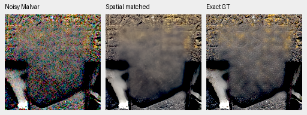
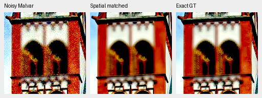
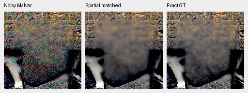

# Full-epoch training with matched whole-image context

This continuation tests whether aligned scene features can improve a native
RAW query's weak-detail recovery and keep smooth regions quiet. The
[earlier matched run](expanded-scene-spatial12k.md) used 24,000 photos per arm.
Its context benefit was small at ISO400, response fell at ISO6400, and the
fine GFX crossings remained incomplete. The
[localized-contrast comparison](scene-local-contrast-2400.md#completed-64-photo-comparison)
found almost identical ISO6400 fine-increment error with or without aligned
scene features, with higher variation in the spatial model's exact flat cores.

## Training design

Both arms start from Corpus 100k EMA
`87b96f3c487b9edaf1c477742b6c38f2a82cc6b20a94716d51cc8cf46a17a760`.
The local-only arm retains the native V120-style trunk. The spatial arm adds
the existing zero-output adapter, with spatial features registered to the
native query and injected at eighth resolution. Its additional preview is
built from the same noisy full Bayer observation as the four native queries.
The preview uses an aspect-preserving 1,024-pixel long side. Both arms freeze
the same DINO backbone and train the same sensor-valid reconstruction loss.

| Quantity | Declared per arm |
| --- | ---: |
| Updates | 50,000 |
| Scene observations | 100,000 |
| Distinct eligible training photos | 90,692 |
| Updates through the first complete shuffled pass | 45,346 |
| Further visits from the second shuffled pass | 9,308 |
| Native 256×256 bin4 query slots | 400,000 |

The complete pass visits 66,692 more source IDs than the earlier matched
12k continuation. Each visit draws native crop positions, global D4
augmentation, a camera recipe and corruption from the global index. The
current 100k full-model parent had previously visited these photos under
its bin4 → geometry → area2 ordinary-photo recipe. The new study tests
wider coverage at native bin4 with whole-image context. These two changes
describe the new study as a whole. The two new arms use identical data.
Canonical validation/test IDs, the 64 reserved scene development fields and
both protected GFX families remain outside this continuation.

Each scene has a 50% chance of a localized modification before camera and
Bayer simulation. One quarter of those modifications supplies an exact
constant-color center, with a smooth transition into the photograph. The
other three quarters retain a weak version of the original local texture.
Ordinary scenes make up the other half. A pad-free native center is tested
inside the 256×256 query. Other crops can overlap and share the same Bayer
observation. This exposes the model to plausible weak structure and exact
smooth targets within real surroundings.

Each arm uses BF16 training, 100 warmup updates, peak trunk/adapter
rates 3e-6/1e-4, and 0.999 EMA on one 50,000-update cosine schedule.
The workers alternate matched milestones. Each phase restores the raw
weights, EMA, Adam state, RNG state and global scene index from its previous
checkpoint. Every completed phase retains source IDs, crop boxes, camera and
noise seeds, and crop fingerprints. The controller compares the full input
trace between arms. Phase receipts record training, data read/CPU auditing
and checkpoint write times. Data time includes memory mapping, cache
verification, augmentation, sensor simulation and CPU fingerprinting.

## Quality comparisons

The scheduled monitor replays the fixed held-out scene panel at matched
2k, 5k, 12k and 25k states on eight photos, and at 50k on all 64. It compares
V120, Corpus 100k and both new EMAs. The aligned arm also receives a masked
guide, a blurred distant view and a mirrored distant view with the query
and its preview halo preserved exactly. The primary texture measures are
phase-aligned weak response and increment error. The exact flat regions
measure false structure and color bias under coupled and independent draws.
[Panel construction and measurements](scene-local-contrast-2400.md#held-out-test-for-true-detail-and-flat-regions).

The completed endpoints require the fixed 427-photo and known/unseen
camera panels, 100% exact-target triplets, and both standing GFX100S
comparisons. Collection jobs wait for the matched 50k endpoints. The
fixed-panel worker first qualifies both endpoints on three archived cases.
The main scene covers fence, foliage, sky and building.
The fine green cab review covers left and right crops under both noise
profiles. Its ISO100 and camera JPEGs are independent qualitative references.
Training, numerical collection and native viewing are recorded separately.
Full-frame GFX preview resolution relative to a native query remains a
known distribution difference.
[Endpoint collection queue](results/scene-full-epoch-v1/endpoint-review-queue.json).
The corrected endpoint renderer writes output inside the frozen worker’s
directory. The 2,000-update review verified that path. The
corrected endpoint worker is waiting for the 50k checkpoints.
[Native collector recovery receipt](results/scene-full-epoch-v1/endpoint-native-recovery.json).

The previous waiters were bound to the first training controller and exited
after its RAM-floor stop. Seven receipt-driven workers now wait for verified
matched checkpoints across controller restarts. These include a new matched
5k monitor and both standing GFX families at 5k, the three already planned
12k, 25k and 50k monitors, and the original two endpoint collectors.
[Replacement queue and older failure logs](results/scene-full-epoch-v1/resilient-review-queue.json).

## Execution status

Both CUDA qualifications passed. Each initial zero-output model reproduced the
parent prediction exactly and both arms saw identical Bayer inputs and clean
targets. Both production arms completed eight updates using the same 16 photos
and 64 crops, including two exact-flat and five weak-texture scenes. The local
arm then restored its update-eight checkpoint and continued from scene index 16.
The first recovery started after both arms
completed 2,500 updates, with verified matching inputs for 5,000
distinct scenes and 20,000 native queries each. The local worker reached
update 4,500 on its way to the 5,000 milestone before the runtime RAM
reserve stopped it. Its phase had no saved checkpoint. The controller
restarted from the verified 2,500 checkpoint and the first 942 replayed
scene records match the interrupted attempt byte for byte. At that point
numerical and native reviews were complete through 2,000.
[Restart receipt](results/scene-full-epoch-v1/retry-005000.json) ·
[Original failure and retry logs](results/scene-full-epoch-v1/retry-005000-evidence.tar.xz).

A second memory-floor stop came after local update 4,491. The recovery
controller now asks the frozen worker to save state every 500 updates
or sooner at an original milestone. It keeps the original memory
limits and preserves individual segment receipts. Reaching a matched
milestone requires identical concatenated observation traces in both
arms. The frozen 50,000-update learning-rate horizon, source order,
checkpoints, EMA and validation schedule remain in use. A repeated
RAM-floor stop now replays at most one 500-update segment.
The first local segment now has a verified checkpoint at update 3,000.
Its 1,000 scene records match each interrupted attempt byte for byte.
The update-3,500 segment has resumed from that stored optimizer and EMA
state. The most recent matched pair at this recovery was update 2,500.
[Recovery controller](../scripts/resume_scene_full_epoch.py) ·
[First durable segment and original worker identity](results/scene-full-epoch-v1/segmented-recovery.json) ·
[Second failure and durable restart evidence](results/scene-full-epoch-v1/segmented-recovery.tar.xz).

The local arm subsequently verified update 4,500, covering 9,000 distinct
photos and 36,000 native queries across its durable prefix. A third RAM-floor
stop came after update 4,939. The controller kept update 4,500 and queued the
last 500-update segment for automatic retry under the original limits.
Those stops left the matched and reviewed milestones at 2,500 and 2,000.
[Automatic retry and local prefix audit](results/scene-full-epoch-v1/automatic-memory-recovery-005000.json).

Both arms have now reached **5,000 verified matched updates**. Each has
seen the same 10,000 distinct photos, 10,000 distinct noise seeds and
40,000 native queries. The observation traces match byte for byte.
They contain 4,958 ordinary, 3,785 weak and 1,257 exact-flat scenes.
The retained worker loops total 2,349.22 s local and 3,117.55 s spatial,
including 640.54 s and 667.47 s of reader/CPU fingerprinting time.
Checkpoint writes took 4.90 and 5.01 s. These figures cover retained
training segments. The frozen schedule has advanced into the next phase.
[Matched 5,000 update, source, time and checkpoint audit](results/scene-full-epoch-v1/matched-005000-training.json) ·
[Earlier paired segment prefix](results/scene-full-epoch-v1/paired-prefix-004000.json) ·
[Earlier local 5,000 prefix](results/scene-full-epoch-v1/local-005000-prefix.json).
Both arms have now reached **7,500 matched updates** on 15,000 distinct
photos and 60,000 native queries each. Five more saved 500-update segments
extend the verified 5k trace. Numerical and native reviews are complete at
7,500. The next training phase is running on the original schedule.
[Matched 7,500 audit](results/scene-full-epoch-v1/matched-007500-training.json) ·
[Local-only prefix](results/scene-full-epoch-v1/local-007500-prefix.json) ·
[Earlier paired 7,000 prefix](results/scene-full-epoch-v1/paired-prefix-007000.json) ·
[Earlier 6,500 receipt](results/scene-full-epoch-v1/paired-prefix-006500.json).

Both arms subsequently verify **8,000 matched updates**, with byte-identical
input traces on 16,000 distinct photos and 64,000 native queries each. The local
arm has reached **10,000 updates**, covering 20,000 photos, 20,000 noise seeds
and 80,000 native queries. Its retained training loops total 4,702.64 s,
including 1,280.80 s of reader and CPU fingerprinting. Checkpoint writes take
11.42 s. The spatial arm tripped the RAM reserve during the next segment
and automatically restarted from its saved 8k checkpoint. Quality scoring
and native viewing remain complete through 7,500.
[Matched 8k source and checkpoint audit](results/scene-full-epoch-v1/paired-prefix-008000.json) ·
[Local 10k source, timing and checkpoint audit](results/scene-full-epoch-v1/local-010000-prefix.json) ·
[Spatial retry receipt](results/scene-full-epoch-v1/spatial-retry-008500.json).

The spatial retry verifies through **8,500** and reproduces all 44 retried
scene records byte for byte. Two subsequent RAM-reserve stops trigger retries
from 8,500. The third attempt completes the next segment and reproduces the
116 and 162 scene records from the two interrupted attempts. Training is
now matched through **9,000 updates**, covering 18,000 distinct photos and
72,000 native queries per arm. Local-only remains ahead at 10,000.
[8,500 retry verification](results/scene-full-epoch-v1/paired-prefix-008500.json) ·
[9,000 source and checkpoint verification](results/scene-full-epoch-v1/paired-prefix-009000.json).

The next two spatial segments complete and both arms verify the
**10,000-update milestone**. Each arm has 20,000 distinct source photos,
20,000 distinct noise seeds and 80,000 native queries. The input traces
match byte for byte. The independent 9,500 prefix audit records the
preceding matched checkpoint. The fixed numerical monitor and both
standing GFX reviews are complete at 10,000. Training is advancing on
the original schedule toward 12,000.
[9,500 source and checkpoint verification](results/scene-full-epoch-v1/paired-prefix-009500.json) ·
[Matched 10k training and review bindings](results/scene-full-epoch-v1/matched-010000-training.json) ·
[10k quality review](#matched-quality-comparison-at-10000-updates).

The retained loops through 10k process 17.01 native queries per second
locally and 13.19 with spatial context. The totals are 4,702.64 s and
6,064.53 s. Reading and CPU fingerprinting account for 27.2% and 20.9%
of those loops. The last five successful segments per arm take median
34.74 s and 36.44 s to initialize, measured from process launch to the
creation of the training log. Retry, queue and quality-review time are
outside these measurements.
[Throughput and segment timings](results/scene-full-epoch-v1/matched-010000-throughput.json).

Both arms complete **12,000 updates** with byte-identical training input
traces. Each saw 24,000 distinct photos, 24,000 sensor seeds and 96,000
native queries. Those visits include 3,009 flat, 9,008 attenuated and
11,983 ordinary scenes per arm. The local checkpoint SHA256 is
`f3a94ec7a3d0f59a1a5245ecc54542ee1593fdd7fa33a759b7c4182a91e72515`
and the spatial checkpoint is
`d8279f5dd615b0fe16c8424e4c7b681ea1606ae0ecb376122fa7e5da50ffd1b6`.
Both checkpoints carry raw and EMA weights, Adam state and RNG state.
The evaluation uses EMA weights. The first spatial 12k attempt hit the
runtime memory reserve. The saved 11,500 state resumed on the same schedule.

| Retained loops through update 12,000 | Training seconds | Reader and fingerprint seconds | Native queries per training second |
| --- | ---: | ---: | ---: |
| Local-only | 5,619.00 | 1,529.85 | 17.09 |
| Spatial | 7,184.45 | 1,496.00 | 13.36 |

These measured loops exclude queue time, discarded attempts and quality
review. The 50,000-update continuation remains in training. The exact-target
12k numerical and native review and both standing GFX reviews are complete.
[Matched 12k training audit](results/scene-full-epoch-v1/matched-012000-training.json) ·
[Phase and checkpoint archive](results/scene-full-epoch-v1/matched-012000-training.tar.xz) ·
[Spatial restart receipt](results/scene-full-epoch-v1/matched-012000-retry.json) ·
[Prior 11,500 verification](results/scene-full-epoch-v1/paired-prefix-011500.json).

The next paired checkpoint at **12,500 updates** verifies 25,000 distinct
photos, 25,000 seeds and 100,000 native queries per arm on identical input
traces. This passes the 24,000-photo coverage of the earlier matched scene
study. Retained training loops total 5,842.76 s local and 7,468.07 s spatial.
The 12,000-update checkpoints remain the last numerically and visually
reviewed pair. [Paired 12,500 source and checkpoint audit](results/scene-full-epoch-v1/paired-prefix-012500.json).

The next segments verify identical inputs through **13,000 updates** on
26,000 distinct photos, 26,000 sensor seeds and 104,000 native queries per
arm. Both training workers retain the original 50,000-update schedule.
[Paired 13k source and checkpoint audit](results/scene-full-epoch-v1/paired-prefix-013000.json).

The first spatial attempt toward 13,500 spent 8 minutes 49 seconds
before opening its training trace. Two process samples showed advancing
CPU time with identical I/O counts and no training output. The controller
restarted from the verified 13k checkpoint. The second attempt completes
and both arms now verify identical traces through **13,500 updates** on
27,000 photos and 108,000 native queries per arm. The frozen data and
schedule are the same. The last completed quality review is at 12k.
[Paired 13,500 and recovery audit](results/scene-full-epoch-v1/paired-prefix-013500.json) ·
[Original attempt and restart receipts](results/scene-full-epoch-v1/paired-prefix-013500.tar.xz).

The pair subsequently reaches **14,500 updates** on identical traces.
Each arm covers 29,000 distinct photos and noise seeds, with 116,000
native queries. The retained training loops total 6,682.10 s local and
9,138.21 s spatial. The local and spatial checkpoints contain raw and EMA
weights. The queued intermediate quality comparison uses EMA.
[Paired 14k source and checkpoint audit](results/scene-full-epoch-v1/paired-prefix-014000.json) ·
[Paired 14,500 audit](results/scene-full-epoch-v1/paired-prefix-014500.json) ·
[Segment receipts](results/scene-full-epoch-v1/paired-prefix-014500.tar.xz).

Both arms now verify **15,000 updates** with identical observations.
Each covers 30,000 distinct photos, 30,000 noise seeds and 120,000 native
queries. Retained loops total 6,911.95 s local and 9,646.03 s spatial.
The local checkpoint SHA256 is
`7d2e041b563651d7dd9af24a18cb32f8cd94b8a094a05005eb55a43bb0fd30cb`.
The spatial checkpoint SHA256 is
`53a3232a26c9997024dbd4349c09e7040c6a9d53ffef8d03dd7f95b5ba8d8114`.
Both store raw and EMA weights. The 15k EMA exact-target monitor, native
triplets and both standing GFX reviews are complete. The continuation
advances on the original 50k schedule.
[Paired 15k source and checkpoint audit](results/scene-full-epoch-v1/paired-prefix-015000.json) ·
[Segment receipts](results/scene-full-epoch-v1/paired-prefix-015000.tar.xz) ·
[15k review queue](results/scene-full-epoch-v1/queue-review-015000.json).

The arms verify matching observations through **20,000 updates**, with
40,000 distinct photos, 40,000 noise seeds and 160,000 native queries per arm.
Retained training loops total 9,987.81 s local and 13,139.33 s spatial.
The local checkpoint is
`b892a08c8ebbccb05c000e4f42d1f86c3a7d1d5870721ccd6e1c8fe9e82c3889`.
The spatial checkpoint is
`e56429f491c6712ab931ad4364d5d27ca6a45df5b3d23a7616a915c3aae8dd1f`.
Both resume the original 50k schedule. The latest complete interim quality
review uses the matched 20k EMA checkpoints and covers all 64 exact-target
photo sources and both standing GFX scenes.
[20k numerical and native review](scene-full-epoch-20k.md) ·
[Completed review bindings](results/scene-full-epoch-v1/matched-020000-quality-status.json).
[15,500 audit](results/scene-full-epoch-v1/paired-prefix-015500.json) ·
[16,000 audit](results/scene-full-epoch-v1/paired-prefix-016000.json) ·
[16,500 audit](results/scene-full-epoch-v1/paired-prefix-016500.json) ·
[17,000 audit](results/scene-full-epoch-v1/paired-prefix-017000.json) ·
[17,500 audit](results/scene-full-epoch-v1/paired-prefix-017500.json) ·
[18,000 audit](results/scene-full-epoch-v1/paired-prefix-018000.json) ·
[18,500 audit](results/scene-full-epoch-v1/paired-prefix-018500.json) ·
[19,000 audit](results/scene-full-epoch-v1/paired-prefix-019000.json) ·
[19,500 audit](results/scene-full-epoch-v1/paired-prefix-019500.json) ·
[20,000 paired source audit](results/scene-full-epoch-v1/paired-prefix-020000.json) ·
[20,000 segment receipts](results/scene-full-epoch-v1/paired-prefix-020000.tar.xz).

The matched continuation verifies identical inputs through **25,000 updates**,
with 50,000 distinct photos, 50,000 seeds and 200,000 native queries per arm.
Retained training loops total 12,399.77 s local and 16,025.42 s spatial.
This checkpoint pair has its own numerical and native review.
[20,500 audit](results/scene-full-epoch-v1/paired-prefix-020500.json) ·
[21,000 audit](results/scene-full-epoch-v1/paired-prefix-021000.json) ·
[21,500 audit](results/scene-full-epoch-v1/paired-prefix-021500.json) ·
[22,000 audit](results/scene-full-epoch-v1/paired-prefix-022000.json) ·
[22,500 paired audit](results/scene-full-epoch-v1/paired-prefix-022500.json) ·
[22,500 segment receipts](results/scene-full-epoch-v1/paired-prefix-022500.tar.xz) ·
[23,000 paired audit](results/scene-full-epoch-v1/paired-prefix-023000.json) ·
[23,500 paired audit](results/scene-full-epoch-v1/paired-prefix-023500.json) ·
[23,500 segment receipts](results/scene-full-epoch-v1/paired-prefix-023500.tar.xz) ·
[24,000 paired audit](results/scene-full-epoch-v1/paired-prefix-024000.json) ·
[24,500 paired audit](results/scene-full-epoch-v1/paired-prefix-024500.json) ·
[24,500 segment receipts](results/scene-full-epoch-v1/paired-prefix-024500.tar.xz) ·
[25,000 paired audit](results/scene-full-epoch-v1/paired-prefix-025000.json) ·
[25,000 segment receipts](results/scene-full-epoch-v1/paired-prefix-025000.tar.xz).
[Earlier local audit](results/scene-full-epoch-v1/local-022500-prefix.json).

The 64-source numerical and exact native photo review is complete at
25k EMA. Both standing GFX scenes were viewed at the same checkpoint
pair. Both arms completed their first shuffled pass at 45,346 updates.
Each arm used all 90,692 eligible photos once, with 90,692 distinct noise
seeds and 362,768 native queries. The recorded photo IDs match the frozen
order at every index, and both arms have the same observation trace hashes.
The retained training loops took 21,865.67 s local-only and 28,652.54 s with
spatial context. The 50,000-update schedule continues. The latest completed
paired quality review is [40k](scene-full-epoch-40k.md).
[First-epoch audit](results/scene-full-epoch-v1/paired-prefix-045346.json) ·
[First-epoch segment receipts and source order](results/scene-full-epoch-v1/paired-prefix-045346.tar.xz).

Both arms match through update 47,500. Five additional matched segments
contain 4,308 distinct second-pass visits and 17,232 native queries per
arm, with fresh noise seeds and source IDs in the frozen second-epoch order.
The cumulative count is 95,000 observations and 380,000 native queries
per arm. The additional retained loops take 1,304.67 s local-only and
1,242.47 s with spatial context. The original 50,000-update program continues.
[Matched 47,500 audit](results/scene-full-epoch-v1/paired-prefix-047500.json) ·
[Continuation receipts](results/scene-full-epoch-v1/paired-prefix-047500.tar.xz) ·
[Local second-epoch source-order proof](results/scene-full-epoch-v1/local-047500-second-epoch.json).

A scoped 47.5k review uses 24 new natural photos, 24 planted-wire
backgrounds and both standing GFX scenes. The local-only arm improves
natural fine-flat and increment error against Corpus 100k, with
mixed intact-wire changes. The paired fixed photo and camera panels
remain queued at 50k. [Matched 47.5k scope and native review](green-covariance-refit.md).

Local-only training completed 50,000 updates, 100,000 observations
and 400,000 native queries. The second pass contains 9,308 distinct
photos. A scoped numerical and native review is complete at the 50k
EMA. The spatial arm continues and the paired fixed photo and camera
reviews remain queued. [Local 50k recipe and scope](local-50000-scoped.md) ·
[Verified completion](results/scene-full-epoch-v1/local-050000-training.json).
[Matched 25k checkpoint receipt](results/scene-full-epoch-v1/matched-025000-training.json) ·
[25k exact-photo and GFX review](scene-full-epoch-25k.md) ·
[25,500 paired audit](results/scene-full-epoch-v1/paired-prefix-025500.json) ·
[26,000 paired audit](results/scene-full-epoch-v1/paired-prefix-026000.json) ·
[26,500 paired audit](results/scene-full-epoch-v1/paired-prefix-026500.json) ·
[27,000 paired audit](results/scene-full-epoch-v1/paired-prefix-027000.json) ·
[27,500 paired audit](results/scene-full-epoch-v1/paired-prefix-027500.json) ·
[28,000 paired audit](results/scene-full-epoch-v1/paired-prefix-028000.json) ·
[28,500 paired audit](results/scene-full-epoch-v1/paired-prefix-028500.json) ·
[29,000 paired audit](results/scene-full-epoch-v1/paired-prefix-029000.json) ·
[29,500 paired audit](results/scene-full-epoch-v1/paired-prefix-029500.json) ·
[30,000 paired audit](results/scene-full-epoch-v1/paired-prefix-030000.json) ·
[30,500 paired audit](results/scene-full-epoch-v1/paired-prefix-030500.json) ·
[31,000 paired audit](results/scene-full-epoch-v1/paired-prefix-031000.json) ·
[31,500 paired audit](results/scene-full-epoch-v1/paired-prefix-031500.json) ·
[32,000 paired audit](results/scene-full-epoch-v1/paired-prefix-032000.json) ·
[32,500 paired audit](results/scene-full-epoch-v1/paired-prefix-032500.json) ·
[33,000 paired audit](results/scene-full-epoch-v1/paired-prefix-033000.json) ·
[33,500 paired audit](results/scene-full-epoch-v1/paired-prefix-033500.json) ·
[34,000 paired audit](results/scene-full-epoch-v1/paired-prefix-034000.json) ·
[34,500 paired audit](results/scene-full-epoch-v1/paired-prefix-034500.json) ·
[35,000 paired audit](results/scene-full-epoch-v1/paired-prefix-035000.json) ·
[35,500 paired audit](results/scene-full-epoch-v1/paired-prefix-035500.json) ·
[36,000 paired audit](results/scene-full-epoch-v1/paired-prefix-036000.json) ·
[36,500 paired audit](results/scene-full-epoch-v1/paired-prefix-036500.json) ·
[37,000 paired audit](results/scene-full-epoch-v1/paired-prefix-037000.json) ·
[37,500 paired audit](results/scene-full-epoch-v1/paired-prefix-037500.json) ·
[38,000 paired audit](results/scene-full-epoch-v1/paired-prefix-038000.json) ·
[38,500 paired audit](results/scene-full-epoch-v1/paired-prefix-038500.json) ·
[39,000 paired audit](results/scene-full-epoch-v1/paired-prefix-039000.json) ·
[39,500 paired audit](results/scene-full-epoch-v1/paired-prefix-039500.json) ·
[40,000 paired audit](results/scene-full-epoch-v1/paired-prefix-040000.json) ·
[40,000 segment receipts](results/scene-full-epoch-v1/paired-prefix-040000.tar.xz) ·
[40,500 paired audit](results/scene-full-epoch-v1/paired-prefix-040500.json) ·
[41,000 paired audit](results/scene-full-epoch-v1/paired-prefix-041000.json) ·
[41,500 paired audit](results/scene-full-epoch-v1/paired-prefix-041500.json) ·
[42,000 paired audit](results/scene-full-epoch-v1/paired-prefix-042000.json) ·
[42,500 paired audit](results/scene-full-epoch-v1/paired-prefix-042500.json) ·
[42,500 segment receipts](results/scene-full-epoch-v1/paired-prefix-042500.tar.xz) ·
[43,000 paired audit](results/scene-full-epoch-v1/paired-prefix-043000.json) ·
[43,500 paired audit](results/scene-full-epoch-v1/paired-prefix-043500.json) ·
[43,500 segment receipts](results/scene-full-epoch-v1/paired-prefix-043500.tar.xz) ·
[44,000 paired audit](results/scene-full-epoch-v1/paired-prefix-044000.json) ·
[44,500 paired audit](results/scene-full-epoch-v1/paired-prefix-044500.json) ·
[44,500 segment receipts](results/scene-full-epoch-v1/paired-prefix-044500.tar.xz) ·
[45,000 paired audit](results/scene-full-epoch-v1/paired-prefix-045000.json) ·
[45,000 segment receipts](results/scene-full-epoch-v1/paired-prefix-045000.tar.xz) ·
[Review launch](results/scene-full-epoch-v1/queue-full-025000-launch.json).

[23,500 local audit](results/scene-full-epoch-v1/local-023500-prefix.json) ·
[24,000 local audit](results/scene-full-epoch-v1/local-024000-prefix.json) ·
[24,500 local audit](results/scene-full-epoch-v1/local-024500-prefix.json) ·
[25,000 local audit](results/scene-full-epoch-v1/local-025000-prefix.json).

Local-only verifies 45,000 updates, 90,000 distinct photos and
360,000 native queries on the 50k schedule. The retained loop took
21,730.41 s. The first 44k attempt exhausted local storage. The worker
resumed from the verified 43.5k checkpoint after checksum-verified cache
relocation to the SSD. The first 100 reprocessed observation rows match
the interrupted attempt byte for byte. Both arms retain the same input
plan and source order. Output directories through 50k now write to the
SSD. [Recovery and 44k local audit](results/scene-full-epoch-v1/storage-recovery-044000.json) ·
[Recovery receipts](results/scene-full-epoch-v1/storage-recovery-044000.tar.xz) ·
[44.5k local prefix](results/scene-full-epoch-v1/local-044500-prefix.json) ·
[45k local prefix](results/scene-full-epoch-v1/local-045000-prefix.json).
[25,500 local audit](results/scene-full-epoch-v1/local-025500-prefix.json) ·
[26,000 local audit](results/scene-full-epoch-v1/local-026000-prefix.json) ·
[26,500 local audit](results/scene-full-epoch-v1/local-026500-prefix.json) ·
[27,500 local audit](results/scene-full-epoch-v1/local-027500-prefix.json) ·
[28,000 local audit](results/scene-full-epoch-v1/local-028000-prefix.json) ·
[28,500 local audit](results/scene-full-epoch-v1/local-028500-prefix.json) ·
[29,000 local audit](results/scene-full-epoch-v1/local-029000-prefix.json) ·
[29,500 local audit](results/scene-full-epoch-v1/local-029500-prefix.json) ·
[30,000 local audit](results/scene-full-epoch-v1/local-030000-prefix.json) ·
[30,500 local audit](results/scene-full-epoch-v1/local-030500-prefix.json) ·
[31,000 local audit](results/scene-full-epoch-v1/local-031000-prefix.json) ·
[31,500 local audit](results/scene-full-epoch-v1/local-031500-prefix.json) ·
[32,000 local audit](results/scene-full-epoch-v1/local-032000-prefix.json) ·
[32,500 local audit](results/scene-full-epoch-v1/local-032500-prefix.json) ·
[33,000 local audit](results/scene-full-epoch-v1/local-033000-prefix.json) ·
[33,500 local audit](results/scene-full-epoch-v1/local-033500-prefix.json) ·
[35,000 local audit](results/scene-full-epoch-v1/local-035000-prefix.json) ·
[36,000 local audit](results/scene-full-epoch-v1/local-036000-prefix.json) ·
[37,000 local audit](results/scene-full-epoch-v1/local-037000-prefix.json) ·
[37,500 local audit](results/scene-full-epoch-v1/local-037500-prefix.json) ·
[38,000 local audit](results/scene-full-epoch-v1/local-038000-prefix.json) ·
[38,500 local audit](results/scene-full-epoch-v1/local-038500-prefix.json) ·
[39,000 local audit](results/scene-full-epoch-v1/local-039000-prefix.json) ·
[39,500 local audit](results/scene-full-epoch-v1/local-039500-prefix.json) ·
[40,000 local audit](results/scene-full-epoch-v1/local-040000-prefix.json) ·
[40,500 local audit](results/scene-full-epoch-v1/local-040500-prefix.json) ·
[41,000 local audit](results/scene-full-epoch-v1/local-041000-prefix.json) ·
[41,500 local audit](results/scene-full-epoch-v1/local-041500-prefix.json) ·
[42,000 local audit](results/scene-full-epoch-v1/local-042000-prefix.json) ·
[42,500 local audit](results/scene-full-epoch-v1/local-042500-prefix.json).

The verified matched 30k pair completes the 64-photo numerical evaluation,
native exact-crop viewing and both standing GFX reviews. Its scoring driver
verifies the prior FP32 controls against source and checkpoint bindings
before reuse.
[30k exact-photo and standing GFX review](scene-full-epoch-30k.md) ·
[30k review launch](results/scene-full-epoch-v1/queue-full-030000-launch.json) ·
[Frozen review drivers](results/scene-full-epoch-v1/queue-full-030000.tar.xz).

The matched 40k photo scoring, exact crops and both standing GFX
reviews are complete. Spatial 40k lowers independent ISO6400 fine-flat
RMS by 0.022 DN16 and loses 0.119 points of fine response versus
spatial 35k. Correct and wrong distant context remain close. Fine
cab crossings are incomplete. The fixed photo and camera evaluation
and native reviews for the 50k endpoints are queued.
[40k exact-photo and standing GFX review](scene-full-epoch-40k.md) ·
[40k launch receipt](results/scene-full-epoch-v1/queue-full-040000-launch.json) ·
[40k frozen review drivers](results/scene-full-epoch-v1/queue-full-040000.tar.xz).
[35k exact-photo and standing GFX review](scene-full-epoch-35k.md) ·
[35k launch receipt](results/scene-full-epoch-v1/queue-full-035000-launch.json) ·
[35k review drivers](results/scene-full-epoch-v1/queue-full-035000.tar.xz).

[Earlier local-only 20,000 audit](results/scene-full-epoch-v1/local-020000-prefix.json) ·
[Matched 20,000 controller receipt](results/scene-full-epoch-v1/matched-020000-training.json) ·
[Review queue](results/scene-full-epoch-v1/queue-review-020000-launch.json) ·
[Review drivers](results/scene-full-epoch-v1/queue-review-020000.tar.xz).

[Launch and state bindings](results/scene-full-epoch-v1/launch-publication.json) ·
[Frozen order, first traces and monitor source](results/scene-full-epoch-v1/launch-evidence.tar.xz).

Both arms' first 2,000 updates cover the same 4,000 distinct sources,
4,000 distinct noise seeds and 16,000 native crops. Their observation
logs match byte for byte. The scenes include 1,981 ordinary, 1,467 weak
and 552 exact-flat examples. Summing the two measured phase loops gives
882.57 s for local-only and 1,152.02 s for spatial. The local reader
and CPU fingerprinting account for 257.88 s. Both runs continue on
their original learning-rate schedules.
[Local prefix audit](results/scene-full-epoch-v1/local-2000-source-audit.json).

An end-to-end monitor qualification used the matched update-eight
checkpoints. It ran all seven policies on 32 test groups, checking
the fixed local input and the preserved near-preview support in 96
native queries. The monitor generated four native boards and the
expected summary. The matched update-2,000 quality collection is
complete on that same eight-photo panel.
[Monitor qualification](results/scene-full-epoch-v1/monitor-preflight.json).

## First matched quality comparison at 2,000 updates

The eight-photo monitor contains 32 paired groups across ISO400 and
ISO6400 and both draw laws. The seven policies process 96 native queries
each. Local EMA SHA256 is
`7f59fe60437e278e550a6abeaf65156c7fb0094d80d2711f9fcbbbd918f71383`.
Spatial EMA SHA256 is
`25867a55eec2423f79d5c05a302184b8871c504de427d9bfee3e1184584d7f64`.
The two distant-view interventions retain the exact query and nearby
preview pixels. Collection used CUDA IEEE FP32 and took 177.9 s
after loading the checkpoints.
[Checkpoint bindings and per-source results](results/scene-full-epoch-v1/matched-002000-pilot.json).

| ISO6400 model or preview | Coupled increment RMS, DN16 | Coupled flat RMS, DN16 | Independent increment RMS, DN16 | Independent flat RMS, DN16 |
| --- | ---: | ---: | ---: | ---: |
| V120 | 84.243 | 4.832 | 103.838 | 4.707 |
| Corpus 100k | 84.218 | 4.208 | 103.983 | 4.127 |
| Local 2k | 83.856 | 4.559 | 104.316 | 4.235 |
| Spatial 2k, matching | 84.097 | 4.438 | 104.431 | 4.260 |
| Spatial 2k, masked | 83.822 | 4.800 | 104.422 | 4.343 |
| Spatial 2k, mirrored distant view | 84.191 | 4.457 | 104.310 | 4.254 |

The correct preview lowers coupled flat RMS by 0.362 DN16
[−0.894, −0.005] relative to its masked control, while raising
increment error by 0.276 DN16 [+0.082, +0.502]. Its independent
increment RMS is 0.115 DN16 higher than local-only with a paired
interval spanning zero [−0.363, +0.485]. The mirrored distant view
is also close. The two EMA continuations show no clear weak-detail
gain on this intermediate panel. The full benchmark and standing
reviews remain scheduled for the final endpoints. Both standing GFX
families have also been reviewed at this intermediate checkpoint.

The triplets show noisy Malvar, spatial 2k with the matching preview,
and exact GT. The two ISO6400 independent draws use shot/read
`0.00128/6.5536e-6`, ADC16 black 0.03, capture exposure 0.33,
display exposure ×3.0303 and contrast ×2. The native 160×160 windows
start at `[48,48]` inside the 256-pixel query.

The stone's fine grain remains soft. Query `[218,192]`, RGGB.
Palauenc05, CC BY-SA 4.0.
[All methods](images/scene-full-epoch-v1/pilot-002000/000-iso6400-independent-role0-comparison.png) ·
[Exact-flat counterpart](images/scene-full-epoch-v1/pilot-002000/000-iso6400-independent-role2-comparison.png).

The arches and columns are retained. The fine architectural features
stay blurred in both the local and spatial outputs. Query `[22,250]`,
BGGR. Full source and license details are in the viewing record.
[All methods](images/scene-full-epoch-v1/pilot-002000/001-iso6400-independent-role0-comparison.png) ·
[Exact-flat counterpart](images/scene-full-epoch-v1/pilot-002000/001-iso6400-independent-role2-comparison.png).

### Standing GFX100S at update 2,000

All eight standing boards were viewed. Both arms keep the DSCF3879
sky smooth and both coarse fence directions visible. Thin building
cables and fine leaf boundaries remain soft. In the separate DSCF3842
fine cab, faint diagonal modulation appears under the transferred
DSCF3879 prior and the fine crossings remain incomplete in both ROIs.

The spatial and local outputs differ by 0.92 DN16 camera-RGB RMS in
the sky, 9.76 DN16 in the coarse fence, and 2.03–4.13 DN16 in the
four cab views. These measure model differences. The ISO100 AHD
and camera JPEGs are independent qualitative references. The
CPU IEEE FP32 review checks identical saved Bayer inputs and noise
conditioning. Local and spatial collection took 252.24 and 295.52 s
respectively for the ten archived observations.

The main native 160×160 crops remain at `[176,176]` in their
512-pixel queries. Shot/read is `0.00128/6.5536e-6` with display
exposure ×4. The cab crops in the 768-pixel query remain at
`[206,229]` and `[426,189]` with display exposure ×16. The
transferred profile uses `0.0014635775921166604/1.0715704128646712e-6`.
[Complete standing receipt](results/scene-full-epoch-v1/matched-002000-standing.json) ·
[Sky](images/scene-full-epoch-v1/standing-002000/main-overcast-sky-main-overcast-sky.png) ·
[Building](images/scene-full-epoch-v1/standing-002000/main-building-detail-main-building-detail.png) ·
[Foliage](images/scene-full-epoch-v1/standing-002000/main-foliage-main-foliage.png) ·
[Coarse fence](images/scene-full-epoch-v1/standing-002000/main-chain-link-fence-main-chain-link-fence.png).

| Cab profile | Native views |
| --- | --- |
| Nominal | [Left](images/scene-full-epoch-v1/standing-002000/mesh-nominal-fine-green-mesh-left.png) · [Right](images/scene-full-epoch-v1/standing-002000/mesh-nominal-fine-green-mesh-right.png) |
| Transferred | [Left](images/scene-full-epoch-v1/standing-002000/mesh-profile3879-fine-green-mesh-left.png) · [Right](images/scene-full-epoch-v1/standing-002000/mesh-profile3879-fine-green-mesh-right.png) |

## Matched quality comparison at 5,000 updates

The same eight-photo monitor ran 32 paired groups with seven inference
policies in 109.97 s of CUDA IEEE FP32 inference. The local checkpoint
SHA256 is `e860f7f7ea2fcdfd18dc3597ec382ea83bc2d00f083c2809735f18765e4ca546`.
The spatial checkpoint SHA256 is
`14cff19b95fc19cb051113efb36a22567b6b2ef85bce218bc6571d85c6d88a23`.
Both use EMA weights. The control metrics for V120 and Corpus 100k
are identical to the 2,000-update review.
[Per-photo metrics, checkpoint bindings and reviewed crops](results/scene-full-epoch-v1/matched-005000-pilot.json) ·
[Paired photo-level intervals](results/scene-full-epoch-v1/matched-005000-pilot-paired.json).

| ISO6400, coupled draws | Fine-increment RMS, DN16 | Fine flat RMS, DN16 | Fine weak response |
| --- | ---: | ---: | ---: |
| V120 | 84.243 | 4.832 | 68.275% |
| Corpus 100k | 84.218 | 4.208 | 68.175% |
| Local 5k | 84.703 | 4.357 | 67.225% |
| Spatial 5k, matching | 84.876 | 4.226 | 67.056% |
| Spatial 5k, masked | 84.564 | 4.643 | 67.385% |
| Spatial 5k, blurred distant view | 84.883 | 4.163 | 67.105% |
| Spatial 5k, mirrored distant view | 84.963 | 4.211 | 66.994% |

On coupled ISO6400 draws the aligned preview reduces flat variation
by **0.417 DN16** versus masking (paired 95% interval −0.958 to −0.037).
It raises increment error by 0.313 DN16 (+0.142 to +0.488) and reduces
signed weak response by 0.330 points (−0.478 to −0.081). Against the
mirrored distant view the matching preview gains 0.061 weak-response
points (+0.001 to +0.142) with flat RMS essentially tied. This comparison
preserves the query and nearby preview halo. Against local-only,
the weak response difference is −0.169 points (−0.374 to +0.119).
Against Corpus 100k the aligned weak response falls by 1.119 points
(−1.704 to −0.249), with similar flat variation. On independent draws,
it gains 0.074 points over mirroring (+0.013 to +0.145) and loses
0.998 points to Corpus 100k (−1.690 to −0.152).
Compared with the matching 2k checkpoint, the coupled increment error
is 0.779 DN16 higher and the independent increment error is 0.358
DN16 lower. Both draw laws have lower weak response at 5k.

The two triplets show noisy Malvar, spatial 5k with matching preview
and exact GT at native 160×160. The first independent ISO6400 weak
roles use shot/read `0.00128/6.5536e-6`, ADC16 black level 0.03,
capture exposure 0.33, display exposure ×3.0303 and contrast ×2.
The ROI is `[48,48,160,160]` in both 256-pixel queries.

Hauroth, query `[218,192]`, RGGB, Palauenc05, CC BY-SA 4.0. The matching
and mirrored previews show similar stone grain, with the exact patch
visibly crisper. [Full comparison](images/scene-full-epoch-v1/pilot-005000/000-iso6400-independent-role0-comparison.png) ·
[Exact-flat comparison](images/scene-full-epoch-v1/pilot-005000/000-iso6400-independent-role2-comparison.png).

Limburg Cathedral, query `[22,250]`, BGGR. Both arms restore the arch
contours and lose fine surface and window-edge detail.
[Full comparison](images/scene-full-epoch-v1/pilot-005000/001-iso6400-independent-role0-comparison.png) ·
[Exact-flat comparison](images/scene-full-epoch-v1/pilot-005000/001-iso6400-independent-role2-comparison.png).
The comparable full427 photo and measured camera panels are scheduled
for the full endpoints.

### Standing GFX100S at update 5,000

Both intermediate EMAs keep the sky smooth and retain both directions
of the coarse fence. Neither has a visible gain in coarse crossings.
Thin building lines and small leaf edges remain soft. The nominal
profile leaves most of the fine cab mesh faint. The transferred
DSCF3879 profile leaves both diagonal families faintly visible in
the right crop, with incomplete crossings and mottled underlying
paint. Both left and right crops and both camera JPEGs were reviewed.
The ISO100 AHD renders and JPEGs are independent qualitative references.

The spatial and local outputs differ by 2.08 DN16 camera-RGB RMS in
the sky, 8.45 in the coarse fence and 2.52–4.14 in the four cab views.
The comparison uses identical saved RAW, noise and rendering. CPU IEEE
FP32 inference on the ten archived observations took 265.47 s local
and 277.44 s spatial. Main views use DSCF3879/3880, native ROI `[176,176,160,160]` in
512-pixel queries, nominal shot/read `0.00128/6.5536e-6`, and
display exposure ×4. Cab views use DSCF3842/3835, native ROIs
`[206,229,160,160]` and `[426,189,160,160]` in a 768-pixel query,
with display exposure ×16. The transferred shot/read profile is
`0.0014635775921166604/1.0715704128646712e-6`.

The first renderer stopped at its output-path check. The corrected
renderer uses the same completed predictions and writes inside the
frozen worker directory. Both logs and the corrected render receipt
are included in the archive.
[Native review and provenance](results/scene-full-epoch-v1/matched-005000-standing.json) ·
[Collection and renderer evidence](results/scene-full-epoch-v1/matched-005000-standing.tar.xz) ·
[Sky](images/scene-full-epoch-v1/standing-005000/main-overcast-sky-main-overcast-sky.png) ·
[Building](images/scene-full-epoch-v1/standing-005000/main-building-detail-main-building-detail.png) ·
[Foliage](images/scene-full-epoch-v1/standing-005000/main-foliage-main-foliage.png) ·
[Coarse fence](images/scene-full-epoch-v1/standing-005000/main-chain-link-fence-main-chain-link-fence.png).

| Cab profile | Native views |
| --- | --- |
| Nominal | [Left](images/scene-full-epoch-v1/standing-005000/mesh-nominal-fine-green-mesh-left.png) · [Right](images/scene-full-epoch-v1/standing-005000/mesh-nominal-fine-green-mesh-right.png) |
| Transferred | [Left](images/scene-full-epoch-v1/standing-005000/mesh-profile3879-fine-green-mesh-left.png) · [Right](images/scene-full-epoch-v1/standing-005000/mesh-profile3879-fine-green-mesh-right.png) |

## Matched quality comparison at 7,500 updates

The added matched EMA review uses the same eight held-out fields and
seven inference policies as at 5,000. The 32 groups took 103.5 s of
CUDA IEEE FP32 inference. Training consumed the same 15,000 distinct
photos, 15,000 distinct noise seeds and 60,000 queries per arm. The
retained training loops total 3,557.75 s local and 4,596.08 s spatial.

The local checkpoint SHA256 is
`ba8d85e57866e0aea24dc12a345036fefbee81ee8d7a6e7bc5dc9930dbf511c6`.
The spatial checkpoint SHA256 is
`09992e1d7af2fb7a27d90b32d01066ae9613c515418c17fb9b7a3d13eec7400f`.
The original 50,000-update schedule continues.
[Training checkpoint and input-trace audit](results/scene-full-epoch-v1/matched-007500-training.json) ·
[Per-photo metrics and checked crops](results/scene-full-epoch-v1/matched-007500-pilot.json) ·
[Paired intervals](results/scene-full-epoch-v1/matched-007500-pilot-paired.json).

| ISO6400, coupled draws | Fine-increment RMS, DN16 | Fine flat RMS, DN16 | Fine weak response |
| --- | ---: | ---: | ---: |
| V120 | 84.243 | 4.832 | 68.275% |
| Corpus 100k | 84.218 | 4.208 | 68.175% |
| Local 7.5k | 84.568 | 4.394 | 67.402% |
| Spatial 7.5k, matching | 84.788 | 4.334 | 67.161% |
| Spatial 7.5k, masked | 84.603 | 4.656 | 67.330% |
| Spatial 7.5k, blurred distant view | 84.831 | 4.275 | 67.113% |
| Spatial 7.5k, mirrored distant view | 84.857 | 4.403 | 67.038% |

On independent ISO6400 draws the matching preview recovers **0.372
points** over the matching 5k checkpoint (+0.181 to +0.670), while
increment error falls 0.366 DN16 (−0.760 to −0.026) and flat RMS rises
0.063 DN16 (+0.019 to +0.102). The correct preview gains 0.158
points over mirroring (+0.016 to +0.282), with similar increment and
flat errors. The matching-versus-local weak response difference
is −0.068 points (−0.383 to +0.457). On coupled draws the matching
preview still reduces flat RMS versus masking by 0.322 DN16
(−0.746 to −0.027) and raises increment error by 0.186 DN16
(+0.041 to +0.343). Its weak response is 1.014 points below
Corpus 100k (−1.739 to −0.029). These are eight-photo results.

Both triplets show noisy Malvar, spatial 7.5k with the matching preview
and exact GT, at native 160×160. Both use the first independent ISO6400
weak role, shot/read `0.00128/6.5536e-6`, ADC16 black 0.03,
capture exposure 0.33, display exposure ×3.0303 and contrast ×2.
The ROI is `[48,48,160,160]` in each 256-pixel query.

Hauroth, query `[218,192]`, RGGB, Palauenc05, CC BY-SA 4.0. Stone
grain remains softer than the exact target.
[Matched comparison](images/scene-full-epoch-v1/pilot-007500/000-iso6400-independent-role0-comparison.png) ·
[Exact-flat counterpart](images/scene-full-epoch-v1/pilot-007500/000-iso6400-independent-role2-comparison.png).

Limburg Cathedral, query `[22,250]`, BGGR. The arches and frame remain
legible, with soft brickwork and ornamental details.
[Matched comparison](images/scene-full-epoch-v1/pilot-007500/001-iso6400-independent-role0-comparison.png) ·
[Exact-flat counterpart](images/scene-full-epoch-v1/pilot-007500/001-iso6400-independent-role2-comparison.png).

Comparable full427 and measured-camera panels are scheduled for the
full endpoints.

### Standing GFX100S at update 7,500

Both arms retain a smooth sky and both coarse fence directions.
Fine building rails and leaf edges remain soft. The transferred
noise profile retains faint diagonals in the right cab crop, with
incomplete and uneven crossings. The nominal profile leaves much
of this lattice unresolved. The left crops retain some background
mottle. Both ROIs, both profiles and the independent ISO100 AHD
and JPEG references were reviewed.

The spatial and local outputs differ by 1.06 DN16 camera-RGB RMS in
the sky, 9.27 in the coarse fence, and 2.40–4.18 in the four cab
views. CPU IEEE FP32 collection on ten archived observations took
248.14 s local and 264.40 s spatial. The main views use shot/read
`0.00128/6.5536e-6` and display exposure ×4. The transferred cab
profile uses `0.0014635775921166604/1.0715704128646712e-6` and
the two cab profiles use display exposure ×16. Native locations
and measured input fingerprints match across arms.
[Native review and provenance](results/scene-full-epoch-v1/matched-007500-standing.json) ·
[Collection evidence](results/scene-full-epoch-v1/matched-007500-standing.tar.xz) ·
[Sky](images/scene-full-epoch-v1/standing-007500/main-overcast-sky-main-overcast-sky.png) ·
[Building](images/scene-full-epoch-v1/standing-007500/main-building-detail-main-building-detail.png) ·
[Foliage](images/scene-full-epoch-v1/standing-007500/main-foliage-main-foliage.png) ·
[Coarse fence](images/scene-full-epoch-v1/standing-007500/main-chain-link-fence-main-chain-link-fence.png).

| Cab profile | Native views |
| --- | --- |
| Nominal | [Left](images/scene-full-epoch-v1/standing-007500/mesh-nominal-fine-green-mesh-left.png) · [Right](images/scene-full-epoch-v1/standing-007500/mesh-nominal-fine-green-mesh-right.png) |
| Transferred | [Left](images/scene-full-epoch-v1/standing-007500/mesh-profile3879-fine-green-mesh-left.png) · [Right](images/scene-full-epoch-v1/standing-007500/mesh-profile3879-fine-green-mesh-right.png) |

## Matched quality comparison at 10,000 updates

Both EMAs are from the verified sequence of 20,000 distinct photos and
80,000 native queries per arm. The checkpoint SHA256 values are
`4e7d58622ca609ece938112cd66b5e705c9979c73254a5ced423490f30678933`
for local and
`ad1020252d6d66722e701450e0ecd390f6ca64e63e566f4818a89516033fbb1a`
for spatial. The numerical monitor covers the same eight development
photo backgrounds as the previous checkpoints, excluded from this
continuation. Its 32 groups took 83.39 s for CUDA IEEE FP32 collection.
All eight exact-target boards were viewed at native scale.
[Training and checkpoint audit](results/scene-full-epoch-v1/matched-010000-training.json) ·
[Per-photo metrics and exact native crops](results/scene-full-epoch-v1/matched-010000-pilot.json) ·
[Fine-band paired intervals](results/scene-full-epoch-v1/matched-010000-pilot-paired.json) ·
[Bandwise and flat-color comparison](results/scene-full-epoch-v1/matched-010000-band-context.json).

| ISO6400, independent draws | Fine-increment RMS, DN16 | Fine flat RMS, DN16 | Fine weak response | Lower-band flat RMS, DN16 |
| --- | ---: | ---: | ---: | ---: |
| Corpus 100k | 103.983 | 4.127 | 67.145% | 13.868 |
| Local 10k | 103.856 | 4.111 | 66.232% | 12.221 |
| Spatial 10k, matching | 103.572 | 4.120 | 66.233% | 12.071 |
| Spatial 10k, masked | 103.823 | 4.236 | 66.287% | 12.461 |
| Spatial 10k, mirrored distant view | 103.660 | 4.151 | 66.000% | 12.191 |

On independent ISO6400 draws, the matching preview raises fine response
by 0.233 percentage points over the mirrored view [0.089, 0.329].
Matched local and spatial weak response differ by +0.002 points
[−0.319, +0.227]. Against masking, the matching preview lowers fine
increment RMS by 0.251 DN16 [0.007, 0.496] and fine flat RMS by
0.116 DN16 [0.012, 0.232]. The mirrored view gives lower increment
RMS in the lower frequency band by 0.327 DN16 [0.003, 0.714].
The lower band covers 1/32 to 1/8 cycles per native pixel.

Compared with the matching 7,500-update state, fine flat RMS falls
by 0.188 DN16 on coupled ISO6400 draws [0.017, 0.481]. On independent
draws the matching fine response falls 0.286 percentage points
[−0.947, +0.160], and the increment-RMS difference is uncertain.
The coupled matching result still has 0.792 DN16 more fine-increment
error than Corpus 100k [0.175, 1.581]. The independent lower-band flat
RMS is 1.797 DN16 below Corpus 100k [0.740, 2.920], with much smaller
differences versus matched local and mirrored context. The source count
is eight, so these are development comparisons.

The two triplets display native noisy Malvar, spatial 10k EMA with
the matching preview and exact GT. Both use 160×160 pixels at
ROI `[48,48,160,160]` in their 256-pixel queries, independent ISO6400
noise with shot/read `0.00128/6.5536e-6`, ADC16 black fraction 0.03,
capture exposure 0.33 and display exposure ×3.0303 with contrast ×2.

Hauroth, Palauenc05, CC BY-SA 4.0. Query `[218,192]`, RGGB.
The stone grain remains softer than the exact target and the flat
control is visibly smooth.
[All methods](images/scene-full-epoch-v1/pilot-010000/000-iso6400-independent-role0-comparison.png) ·
[Exact flat](images/scene-full-epoch-v1/pilot-010000/000-iso6400-independent-role2-comparison.png).

Limburg Cathedral, query `[22,250]`, BGGR. The frame and arch
openings are clear, while fine brickwork and trim remain soft.
[All methods](images/scene-full-epoch-v1/pilot-010000/001-iso6400-independent-role0-comparison.png) ·
[Exact flat](images/scene-full-epoch-v1/pilot-010000/001-iso6400-independent-role2-comparison.png).

Comparable full427 and measured-camera panels are scheduled for the
full endpoints.

### Standing GFX100S at update 10,000

Both EMAs keep the sky smooth and both coarse-fence directions visible.
Fine building hardware and leaf margins remain soft. Both left-cab
crops show faint traces at the green post and incomplete crossings.
The transferred noise profile preserves more of the diagonals on the
right. Both 10k outputs still show mottled paint and uneven crossings
there. Neither profile shows a convincing new lattice improvement.
All eight native boards were viewed with the independent ISO100 AHD
and both cab camera JPEGs.

The spatial and local outputs differ by 1.35 DN16 camera RGB RMS in
the sky, 7.85 on the coarse fence, and 2.30–3.60 in the four cab
views. CPU IEEE FP32 collection of ten archived observations took
266.57 s local and 273.78 s spatial. Main DSCF3879 uses the nominal
shot/read `0.00128/6.5536e-6` and display exposure ×4. The DSCF3842
cab uses display exposure ×16 and the same nominal or transferred
`0.0014635775921166604/1.0715704128646712e-6` noise profile.
The receipt records matching native coordinates and Bayer samples
across arms. Independent ISO100 views are qualitative comparisons.
[Complete native review and provenance](results/scene-full-epoch-v1/matched-010000-standing.json) ·
[Collection archive](results/scene-full-epoch-v1/matched-010000-standing.tar.xz) ·
[Sky](images/scene-full-epoch-v1/standing-010000/main-overcast-sky-main-overcast-sky.png) ·
[Building](images/scene-full-epoch-v1/standing-010000/main-building-detail-main-building-detail.png) ·
[Foliage](images/scene-full-epoch-v1/standing-010000/main-foliage-main-foliage.png) ·
[Coarse fence](images/scene-full-epoch-v1/standing-010000/main-chain-link-fence-main-chain-link-fence.png).

| Cab profile | Native views |
| --- | --- |
| Nominal | [Left](images/scene-full-epoch-v1/standing-010000/mesh-nominal-fine-green-mesh-left.png) · [Right](images/scene-full-epoch-v1/standing-010000/mesh-nominal-fine-green-mesh-right.png) |
| Transferred | [Left](images/scene-full-epoch-v1/standing-010000/mesh-profile3879-fine-green-mesh-left.png) · [Right](images/scene-full-epoch-v1/standing-010000/mesh-profile3879-fine-green-mesh-right.png) |

## Matched quality comparison at 12,000 updates

The exact-target monitor reuses the eight photo backgrounds, sensor draws
and context interventions from 10,000 updates. These photos were reserved
from this continuation. The Corpus 100k parent had seen them during its
own training, so this monitor measures development trends on fixed inputs.
Collection of 32 groups in CUDA IEEE FP32 took 57.21 s. Eight native boards
were viewed. Same-query
mirroring preserves the query and its preview halo while changing distant
context. Masking removes the spatial guide. The spatial 12k state and all
controls use EMA weights, bound in the training and monitor receipts.
[Training and EMA checkpoints](results/scene-full-epoch-v1/matched-012000-training.json) ·
[Per-photo scores and native crops](results/scene-full-epoch-v1/matched-012000-pilot.json) ·
[Paired response intervals](results/scene-full-epoch-v1/matched-012000-pilot-paired.json) ·
[Bandwise and flat comparison](results/scene-full-epoch-v1/matched-012000-band-context.json).

| ISO6400, independent draws | Fine-increment RMS, DN16 | Fine flat RMS, DN16 | Fine weak response | Lower-band flat RMS, DN16 |
| --- | ---: | ---: | ---: | ---: |
| Corpus 100k | 103.983 | 4.127 | 67.145% | 13.868 |
| Local 12k | 103.652 | 4.085 | 66.129% | 11.826 |
| Spatial 12k, matching | 103.528 | 4.089 | 66.066% | 11.524 |
| Spatial 12k, masked | 103.502 | 4.187 | 66.126% | 12.178 |
| Spatial 12k, mirrored distant view | 103.599 | 4.098 | 65.957% | 11.636 |

Matching context adds **0.109 fine-response percentage points [0.020, 0.173]**
over the mirrored distant view. It trails the masked preview by 0.060 points
[0.008, 0.165]. The fine-response difference from matched local-only is
−0.063 points [−0.179, +0.131]. On the same inputs, matching context lowers
fine flat RMS by 0.098 DN16 [0.001, 0.207] and lower-band flat RMS by
**0.654 DN16 [0.123, 1.238]** versus masking. The lower band spans 1/32 to 1/8
cycles per native pixel. Against the masked preview at ISO400, matching
context also lowers fine flat RMS by 0.810 DN16 [0.231, 1.740] on independent
draws. These intervals resample whole photos.

At ISO6400, lower-band flat RMS falls **0.548 DN16 [0.111, 1.038]** versus 10k
on independent draws. Fine response has no resolved increase. Relative to
Corpus 100k, matching 12k gives 3.58 DN16 lower centered flat RGB variation
[1.65, 5.66] while retaining 1.08 fewer fine-response points [0.40, 1.58]
on independent draws. It has 0.655 DN16 higher fine-increment error
[0.054, 1.389] on coupled draws. Relative to V120, matching 12k lowers
independent fine flat RMS by 0.618 DN16 [0.311, 0.891], with a 1.43-point
lower fine response whose interval spans zero [−2.68, +0.13]. The small
held-out development panel supports a quiet-region benefit under some
interventions. Fine response remains close to the matched local model.

Both triplets show noisy Malvar, matching spatial 12k EMA and exact GT.
The 160×160 native cells use ROI `[48,48,160,160]` within their 256-pixel
queries, independent ISO6400 shot/read `0.00128/6.5536e-6`, ADC16 black
fraction 0.03, capture exposure 0.33, display exposure ×3.0303 and contrast ×2.

**Hauroth**, Palauenc05, CC BY-SA 4.0. Query `[218,192]`, RGGB. Both models
retain the broad boundaries and dark openings. Fine stone grain stays
softer than the exact target. The exact-flat control looks smooth.
[All methods](images/scene-full-epoch-v1/pilot-012000/000-iso6400-independent-role0-comparison.png) ·
[Exact flat](images/scene-full-epoch-v1/pilot-012000/000-iso6400-independent-role2-comparison.png) ·
[Source photo](https://commons.wikimedia.org/wiki/File:Hauroth_Wegekreuz_St-Bartholom%C3%A4us.jpg).

**Limburg Cathedral**, Berthold Werner, public domain. Query `[22,250]`,
BGGR. The arches and frame remain clear. Faint brick texture and trim stay
softer than the exact target. The exact-flat control has faint variation
near the transition.
[All methods](images/scene-full-epoch-v1/pilot-012000/001-iso6400-independent-role0-comparison.png) ·
[Exact flat](images/scene-full-epoch-v1/pilot-012000/001-iso6400-independent-role2-comparison.png) ·
[Source photo](https://commons.wikimedia.org/wiki/File:Limburger_Dom_BW_1.jpg).

The 12k exact-target review is complete. Comparable full427 and
measured-camera panels remain queued for the full endpoints.

### Standing GFX100S at update 12,000

Both EMA arms keep the overcast sky smooth and the two coarse-fence
families visible. Fine brackets, cables and leaf tips remain soft. The
left cab shows the green post and faint traces of the mesh. The right cab
shows more diagonal modulation under the transferred noise prior, with
uneven crossings and dark mottling. Both 12k arms leave much of the fine
lattice missing under both profiles. All eight native boards were viewed
with the independent ISO100 AHD and both cab camera JPEGs.

The spatial and local arms differ by 2.05 DN16 camera RGB RMS in the sky,
9.07 on the coarse fence, and 2.66–4.94 in the four cab crops. These are
model-to-model differences. CPU IEEE FP32 collection of ten archived
observations took 236.62 s local and 279.54 s spatial. The main DSCF3879
scene uses the nominal shot/read `0.00128/6.5536e-6` and display ×4.
The DSCF3842 cab uses display ×16 and the same nominal prior or the
transferred `0.0014635775921166604/1.0715704128646712e-6` prior. The receipt
binds identical Bayer inputs, native coordinates and display across arms.
The independently exposed ISO100 images and camera JPEGs are qualitative
references.
[Native boards and provenance](results/scene-full-epoch-v1/matched-012000-standing.json) ·
[Collection archive](results/scene-full-epoch-v1/matched-012000-standing.tar.xz) ·
[Overcast sky](images/scene-full-epoch-v1/standing-012000/main-overcast-sky-main-overcast-sky.png) ·
[Building](images/scene-full-epoch-v1/standing-012000/main-building-detail-main-building-detail.png) ·
[Foliage](images/scene-full-epoch-v1/standing-012000/main-foliage-main-foliage.png) ·
[Coarse fence](images/scene-full-epoch-v1/standing-012000/main-chain-link-fence-main-chain-link-fence.png).

| Cab profile | Native comparisons |
| --- | --- |
| Nominal | [Left](images/scene-full-epoch-v1/standing-012000/mesh-nominal-fine-green-mesh-left.png) · [Right](images/scene-full-epoch-v1/standing-012000/mesh-nominal-fine-green-mesh-right.png) |
| Transferred | [Left](images/scene-full-epoch-v1/standing-012000/mesh-profile3879-fine-green-mesh-left.png) · [Right](images/scene-full-epoch-v1/standing-012000/mesh-profile3879-fine-green-mesh-right.png) |

## Matched exact-target monitor at 15,000 updates

The local and spatial EMA checkpoints complete the same 32-group monitor
over eight development photos. The matched local and spatial training
traces cover 30,000 photos each. These eight monitor photos are separate
from this continuation and previously appeared in Corpus 100k training.
[Paired training audit](results/scene-full-epoch-v1/paired-prefix-015000.json) ·
[Exact-target results](results/scene-full-epoch-v1/matched-015000-pilot.json) ·
[Bandwise intervals](results/scene-full-epoch-v1/matched-015000-band-context.json).

| ISO6400, independent draws | Fine increment RMS, DN16 | Fine response | Lower-band flat RMS, DN16 |
| --- | ---: | ---: | ---: |
| Corpus 100k | 103.983 | 67.145% | 13.868 |
| Local 15k | 103.696 | 66.526% | 11.881 |
| Spatial 15k, matching | 103.645 | 66.320% | 11.670 |
| Spatial 15k, masked | 103.514 | 66.497% | 12.036 |
| Spatial 15k, mirrored distant view | 103.663 | 66.247% | 11.632 |

The matching spatial arm gains 0.254 fine-response points
[0.122, 0.306] over its 12k predecessor. It trails the matched local arm
by 0.206 points [0.070, 0.316]. The fine-response difference from the
mirrored view is +0.073 points [−0.046, +0.149]. Lower-band flat RMS falls
2.198 DN16 [1.098, 3.425] versus Corpus 100k. Differences versus matching
local, masked and mirrored inputs remain smaller on these eight photos.

Both native triplets use independent ISO6400, shot/read
`0.00128/6.5536e-6`, capture exposure 0.33, 16-bit ADC with black 0.03,
display exposure ×3.0303 and contrast ×2. Each 160×160 cell uses unchanged
pixels at query ROI `[48,48,160,160]`. Corpus 100k and V120 are shown in
the linked comparisons along with the matched local and context controls.

**Hauroth**, Palauenc05, CC BY-SA 4.0, query `[218,192]`, RGGB. Fine stone
grain stays softer than GT, while the exact-flat center looks smooth.
[Comparison](images/scene-full-epoch-v1/pilot-015000/000-iso6400-independent-role0-comparison.png) ·
[Source](https://commons.wikimedia.org/wiki/File:Hauroth_Wegekreuz_St-Bartholom%C3%A4us.jpg).

**Limburg Cathedral**, Berthold Werner, public domain, query `[22,250]`,
BGGR. Arch shapes and trim stay clear. The lower arch bricks are still
softer than GT. [Comparison](images/scene-full-epoch-v1/pilot-015000/001-iso6400-independent-role0-comparison.png) ·
[Source](https://commons.wikimedia.org/wiki/File:Limburger_Dom_BW_1.jpg).

The exact-target numerical and native review is complete. The broad
panels are queued for the full 50k checkpoints.

### Standing GFX100S at update 15,000

Both EMA arms preserve a smooth overcast sky and both coarse fence
directions. Thin brackets, cables and leaf tips remain soft. The fine
cab's right diagonal pattern is more visible under transferred noise
conditioning. Under the nominal profile the spatial arm is slightly
softer around the narrow right diagonals. Both arms leave most fine
crossings incomplete, with background mottling and weak wire colour.
The ISO100 AHD views and both cab camera JPEGs were viewed at native
scale. Their independently exposed images supply qualitative references.

Camera-linear RGB differences between the spatial and local arms measure
1.54 DN16 RMS in the sky, 13.01 on the coarse fence and 2.20–4.95 across
the four cab crops. Both paths use the same native coordinates and display.
Main DSCF3879 uses shot/read `0.00128/6.5536e-6` and display ×4.
DSCF3842 uses display ×16 and either the same prior or the transferred
`0.0014635775921166604/1.0715704128646712e-6` prior.
[Native provenance and model differences](results/scene-full-epoch-v1/matched-015000-standing.json) ·
[Collection archive](results/scene-full-epoch-v1/matched-015000-standing.tar.xz) ·
[Overcast sky](images/scene-full-epoch-v1/standing-015000/main-overcast-sky-main-overcast-sky.png) ·
[Building](images/scene-full-epoch-v1/standing-015000/main-building-detail-main-building-detail.png) ·
[Foliage](images/scene-full-epoch-v1/standing-015000/main-foliage-main-foliage.png) ·
[Coarse fence](images/scene-full-epoch-v1/standing-015000/main-chain-link-fence-main-chain-link-fence.png).

| Cab profile | Native comparisons |
| --- | --- |
| Nominal | [Left](images/scene-full-epoch-v1/standing-015000/mesh-nominal-fine-green-mesh-left.png) · [Right](images/scene-full-epoch-v1/standing-015000/mesh-nominal-fine-green-mesh-right.png) |
| Transferred | [Left](images/scene-full-epoch-v1/standing-015000/mesh-profile3879-fine-green-mesh-left.png) · [Right](images/scene-full-epoch-v1/standing-015000/mesh-profile3879-fine-green-mesh-right.png) |

The fixed-target and both standing intermediate reviews are complete at
15k. Broad panels remain queued for the full 50k endpoints.
