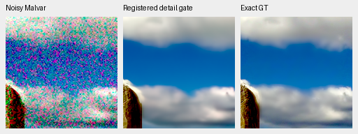
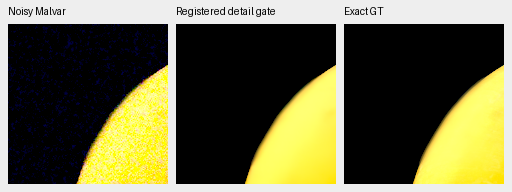

# Mixing Corpus 100k and the quieter spatial model by region

A fitted blend of Corpus 100k and spatial 40k lowers fine-flat RMS
from **5.371 to 5.162 DN16** on 48 independent ISO6400 photographs.
Fine response changes by **−0.012 percentage points** and fine-increment
RMS by **−0.013 DN16**. Coarse flat error and quiet chroma fall, while
the highest measured band has a small regression. The gate gains little
from registered exterior samples. The same fit with the local-only 40k
checkpoint leaves more fine-flat variation. Both standing GFX scenes
remain close to Corpus 100k, with incomplete fine cab crossings.

[Machine results](results/scene-gated-mixture-v1/publication.json) ·
[Fitted coefficients](results/scene-gated-mixture-v1/mixture-coefficients.json) ·
[Frozen drivers and receipts](results/scene-gated-mixture-v1/evidence.tar.xz) ·
[Native crop provenance](images/scene-gated-mixture-v1/manifest.json).
The follow-up filters the signed boost after gating and removes the
upper-band regression on two exact-photo cohorts.
[Band-limited refit](scene-mixture-upper-band.md).

## Composition and fitting

The matched 40k continuation reduces quiet-region error and attenuates
some fine signal. This test combines both approaches in the same output.
The model difference is split using a 0.92-pixel Gaussian low-pass
and its complementary residual. A separate scalar field weights each
band. A 12-pixel edge taper limits the delivered correction. The coarse
field stays within [0, 1]. The fine field can also apply up to half of the
opposite model difference as a neutral luminance correction. It adds no
direct chroma boost. Both restoration models still run for each query.
[Matched 40k review](scene-full-epoch-40k.md) ·
[Prior work on combining denoisers](https://arxiv.org/abs/1711.06712).

The fields use 32-pixel measurement windows at stride 16 and bilinear
interpolation between centers. Local features measure smoothed green
edge strength, texture relative to shot/read variance and disagreement
between the models. The exterior feature uses the median texture in
the eight donor windows nearest in distance and tone, with a 24-pixel
guard outside the entire restoration query. The shuffled control reverses
the placement of those donor descriptors. Each fit can also use constant
weights, so the region-specific models retain that option.

| Frozen model or fit | SHA256 |
| --- | --- |
| Corpus 100k EMA | `87b96f3c487b9edaf1c477742b6c38f2a82cc6b20a94716d51cc8cf46a17a760` |
| Spatial 40k EMA | `d8ba41fa48bab80d515d8248ce6bd787b5347bcd00bcc1816ebbe39ddf52b8ef` |
| Local-only 40k EMA | `ff4f1310a09227adad6b31bb903b5622706aaf888fa0b2a1ae194ec5d1dbe9f8` |
| V120 EMA | `a9d9b6b4f974e24a6b11e5e740aab32314233a7f53c056cf37c7d2aac1c589fb` |
| Fitted scalar-field coefficients | `ee1a89c0b59f291d8c47495781ded474f54e898c4f15e0a787cdac85e04c167e` |

The coefficient fit uses 16 calibration backgrounds, each at ISO400
and ISO6400 with coupled and independent draws. This gives 64 groups and
192 role queries per fit. The other 48 backgrounds supply 192 evaluation
groups and 576 role queries. Within each group, present, attenuated and
exact-flat roles keep the same previously frozen inputs and targets.
A constrained quadratic solver fits the actual delivered bands against
absolute and increment error, including an exact-flat penalty. In the
response-calibrated fit, the signed projection on each calibration
noise/draw group must reach or exceed the parent response. The observed held-out
response can vary. The coefficient solutions use direct CPU optimization
without EMA. Eight bounded solves total 0.057 s, eight signed spatial
solves 0.060 s and eight signed local-only solves 0.048 s. Replay and
model inference are timed separately in the receipts.

## Held-out evidence

The central `[80,80,96,96]` crop is scored in 16-pixel DCT blocks.
The lower, fine and upper bands span 1/32–1/8, 1/8–1/3 and at least
1/3 cycles per native pixel.

| Independent ISO6400, fine band | Response | Increment RMS | Flat RMS |
| --- | ---: | ---: | ---: |
| V120 | 65.255% | 155.898 DN16 | 5.785 DN16 |
| Corpus 100k | 65.729% | 155.719 DN16 | 5.371 DN16 |
| Local-only 40k | 64.912% | 154.748 DN16 | 4.450 DN16 |
| Spatial 40k | 64.799% | 154.714 DN16 | 4.400 DN16 |
| Constant risk fit, spatial checkpoint | 64.998% | 154.796 DN16 | 4.386 DN16 |
| Response fit, local features plus spatial checkpoint | 65.736% | 155.726 DN16 | 5.161 DN16 |
| Response fit, registered context plus spatial checkpoint | 65.717% | 155.707 DN16 | 5.162 DN16 |
| Response fit, registered context plus local-only checkpoint | 65.716% | 155.712 DN16 | 5.269 DN16 |

The registered spatial mixture reduces fine-flat RMS by **0.209 DN16**
[0.054, 0.424] versus Corpus 100k. Fine-response change is −0.012
points [−0.027, +0.005] and fine-increment RMS changes by
−0.013 DN16 [−0.033, +0.012]. Coarse flat RMS falls **1.064 DN16**.
The upper band increases **0.103 DN16** in flat RMS and **0.123 DN16**
in increment RMS. The ISO6400 coupled test lowers fine-flat RMS by
0.070 DN16 and raises fine-increment RMS by 0.070 DN16. At ISO400,
the two draws lower fine-flat RMS by 0.117 and 0.122 DN16.
Intervals resample complete source photos.

Purely convex fits and the signed constant fit all collapse to
Corpus 100k under the response constraint. Letting the field apply the
bounded luminance boost makes the spatially varying fit possible.
The exact-target oracle that chooses one convex scalar per photo
still loses 0.849 points of fine response on ISO6400 independent draws.

Registered exterior descriptors change fine-flat RMS by only
+0.001 DN16 [−0.021, +0.028] versus local feature weights using the
same spatial checkpoint. The registered fit changes error by −0.019
DN16 and response by −0.018 points versus that local feature fit.
The shuffled exterior fit practically equals the local feature fit.
Changing the quieter checkpoint from spatial to local-only raises
fine-flat RMS by **0.107 DN16** [0.025, 0.221] at similar response.
This comparison uses two independently fitted mixtures and matched
checkpoint training. It does not isolate distant context inside
the spatial checkpoint.

Directly reconstructed FP32 output agrees with the predicted
increment RMS within 0.00002 DN16 across all 192 held-out groups.
At ISO6400 on independent draws the registered spatial blend lowers
quiet chroma RMS from 26.838 to 25.943 DN16 and raises present-core
sRGB PSNR by 0.020 dB [0.007, 0.037]. Mean worst-channel flat bias
changes from 27.51 to 27.01 DN16, with uncertainty spanning zero.
Fine-increment RMS changes by −0.010 DN16 in x-dominant modes,
−0.005 in y-dominant modes and −0.013 in diagonal modes, each
measured as contribution over the same core. This component fit
has a fixed photo subset and both standing GFX reviews. The fixed
427-photo and measured-camera continuation panels remain queued at
50k. The performance history links the completed V120 and Corpus
100k scores. [Performance history](performance-history.md).

## Native exact-target triplets

Each cell uses 160 × 160 native pixels at `[48,48,160,160]` within
the named query. Noisy Malvar, the response-calibrated registered
spatial mixture and exact GT share ISO6400 shot/read
`0.00128/6.5536e-6`, capture ×0.33, black level 0.03, a 16-bit ADC,
display ×3.0303 and contrast ×2.

**House of the Lake, Delos**, Bernard Gagnon, CC BY-SA 3.0. GRBG query
`[138,248,256,256]`. This source gives the largest fine-increment
improvement for the registered fit, at 0.209 DN16. The fine edge of
the dark foreground stays softer than GT. [Source](https://commons.wikimedia.org/wiki/File:House_of_the_Lake,_Delos_02.jpg) ·
[All paths](images/scene-gated-mixture-v1/exact/038-iso6400-independent-scene-mixture-comparison.png).

**Calocochlia festiva**, H. Zell, CC BY-SA 3.0. GRBG query
`[756,396,256,256]`. This crop gives the greatest fine-increment
cost at 0.336 DN16. The dark field looks smooth. The fine
variation along the bright shell edge stays soft. [Source](https://commons.wikimedia.org/wiki/File:Calocochlia_festiva_02.JPG) ·
[All paths](images/scene-gated-mixture-v1/exact/042-iso6400-independent-scene-mixture-comparison.png).

## Standing GFX100S comparisons

The main DSCF3879/3880 scenes use the original 512-pixel contexts
at display ×4. The registered spatial blend changes the sky by
0.78 DN16 camera-RGB RMS and the coarse fence by 3.46 DN16 from
Corpus 100k. The sky remains smooth and coarse crossings coherent.
Small cables and leaves stay soft. The ISO100 AHD capture supplies
an independent qualitative reference.

The DSCF3842/3835 crops use the original 768-pixel contexts and both
priors at display ×16. The registered spatial blend changes the four
crops by 1.98–2.46 DN16 RMS. The transferred right diagonals remain
clearer than nominal, with incomplete fine intersections and left
mottling. Both JPEGs and the independently demosaiced ISO100 AHD
reference were viewed at native scale. Aperture, exposure time and
subject motion differ.

[Sky](images/scene-gated-mixture-v1/standing/main-overcast-sky-main-overcast-sky.png) ·
[Building](images/scene-gated-mixture-v1/standing/main-building-detail-main-building-detail.png) ·
[Foliage](images/scene-gated-mixture-v1/standing/main-foliage-main-foliage.png) ·
[Coarse fence](images/scene-gated-mixture-v1/standing/main-chain-link-fence-main-chain-link-fence.png).

| Cab prior, shot/read | Left | Right |
| --- | --- | --- |
| Nominal `0.00128/6.5536e-6` | [Native board](images/scene-gated-mixture-v1/standing/mesh-nominal-fine-green-mesh-left.png) | [Native board](images/scene-gated-mixture-v1/standing/mesh-nominal-fine-green-mesh-right.png) |
| Transferred `0.0014635775921166604/1.0715704128646712e-6` | [Native board](images/scene-gated-mixture-v1/standing/mesh-profile3879-fine-green-mesh-left.png) | [Native board](images/scene-gated-mixture-v1/standing/mesh-profile3879-fine-green-mesh-right.png) |
