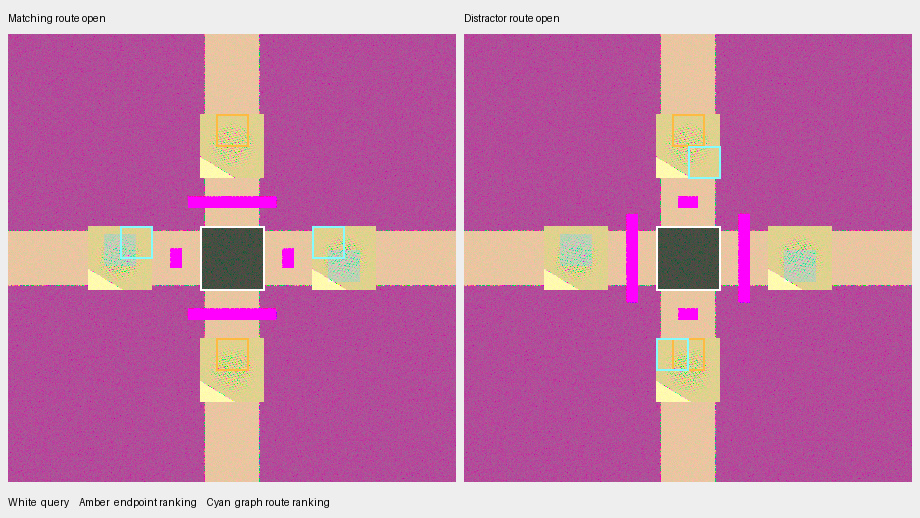
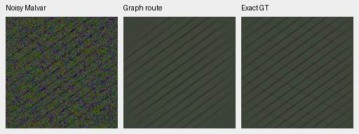
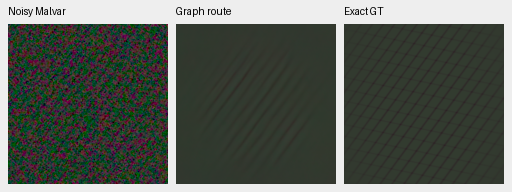

# Whole-frame paths for RAW donor ranking

Whole-frame paths changed which RAW windows the search selected in controlled occlusion layouts. They recovered less faint structure than whole-frame endpoint appearance on the retained exact-target panel. The graph kept the GFX100S sky smooth and preserved the building and foliage, with the same coarse fence output as endpoint ranking. Fine cab crossings remained incomplete.

## What changed

The replay starts with the [localized RAW window catalog and two-boundary donor check](scene-window-donors.md). Candidate positions, spectra, query-phase verification and delivery settings are shared across rankings. Each candidate pair brackets the query. A direction must predict both reserved RAW folds in both donors before the query can use it. The query uses separate RAW evidence to decide where to deliver a correction.

The whole-frame preview uses the A screening fold, one same-parity site per 4×4 RAW cell. Changing all 37,440 withheld pixels on a fixture reproduced the preview bit for bit. The graph uses the same frozen DINOv3 ConvNeXt-Small revision `421020015aa4266363db803b6049a529999afb1e`, preview longest side 1536 and exposure ×4 as endpoint ranking. Each graph cell spans about four preview pixels. The four-neighbor edge cost uses native step length, a weighted mean of three cosine distances from the query's central descriptor, and a capped difference between neighboring preview RGB values.

One shortest-path field per query scores each donor at 5×5 points. The route score decays exponentially with cost above the geometric minimum. Its lower quartile combines with endpoint affinity via geometric mean. The cost-matched straight route uses 24 samples along the direct line. The restricted graph keeps the whole-image descriptors and candidate catalog, with a large cost outside the retained neighborhood. The earlier straight-path arm uses its original four-box descriptor score.

## What the scene contributes

A fixture with identical endpoints gives path affinities of **0.581** when the graph can detour around a barrier, **0.247** on the straight route and **0.304** when the detour is closed. To test whether this affects RAW donor choice, eight paired layouts use sources 88–91 at ISO400 and ISO6400. Each pair has identical Bayer samples in the query and all four donor frames, with the same background noise draw. Changing the obstructions in the surrounding scene opens the route to either the matching or the rotated-wire donor pair.

| Ranking | Both intended donors, matching route open | Both intended donors, distractor route open |
| --- | ---: | ---: |
| Full-frame endpoint appearance | 4/8 | 4/8 |
| Cost-matched straight route | 2/8 | 4/8 |
| Full-frame graph route | **6/8** | 2/8 |

Mean local RGB error against the exact two-family query was **12.461 DN16** for the graph with the matching route open and **12.617 DN16** after swapping the corridors. Endpoint appearance gave **12.462 DN16** in both layouts. The largest unscaled query change on the paired background-only queries was 0.050 DN16 RMS with the graph in the matching layout and 0.369 after the swap, versus 0.733 for endpoint appearance. Donors containing actual wire pass their own checks in all eight background-only observations. Local validation limits how much of that signal reaches a query with no wire. The constructed layouts demonstrate that intervening scene pixels affect selection, with little improvement in absolute image error.

## Exact-target replay

The retained panel has 16 composites from procedural sources 88–95, eight per noise profile. It pairs background-only, strong-only and two-family queries. The delivery scale remains 0.82212 at ISO400 and 0.56106 at ISO6400, with thresholds 2 and 1 respectively. Weak response is the signed projection onto the exact added faint wire, and increment RMS measures the error in the two-family minus strong-only prediction. All fixed-scale rows meet the declared quiet-RMS allowance of 0.02 DN16 above V143. The CPU reference's 264 prediction arrays reproduced bit for bit with CUDA IEEE FP32 screening.

| Ranking | ISO400 both intended frames | ISO400 weak response | ISO400 increment RMS (DN16) | ISO6400 weak response | ISO6400 increment RMS (DN16) |
| --- | ---: | ---: | ---: | ---: | ---: |
| V143 EMA | — | 0.89% | 11.2020 | 0.67% | 25.4279 |
| Fixed bracket, two-boundary check | — | 9.02% | 11.1532 | 0.92% | 25.4302 |
| Near appearance | 6/8 | 4.69% | 11.1844 | 0.67% | 25.4373 |
| Full-frame endpoint appearance | 6/8 | 4.80% | 11.1801 | 0.66% | 25.4380 |
| Earlier straight-path appearance | 5/8 | 4.65% | 11.2062 | 0.67% | 25.4370 |
| Cost-matched straight route | 3/8 | 1.25% | 11.2057 | 0.67% | 25.4355 |
| Restricted graph route | 4/8 | 0.89% | 11.2081 | 0.66% | 25.4450 |
| Full-frame graph route | 4/8 | 0.89% | 11.2081 | 0.66% | 25.4450 |

The two graphs produce bit-identical outputs on all 16 composites. Against the exact two-family query at ISO400, aggregate query RMS is 8.424 DN16 with either graph, 8.035 with endpoint appearance and 8.945 for V143. The graphs improve the larger signal while leaving the added faint signal near the parent. At the stricter common quiet RMS of 2.43489 DN16, graphs and V143 recover 0.89% and endpoint appearance 0.94%. All graph, endpoint and cost-matched straight rankings reject all 36 separate flat, one-step and rail-only donor controls, twelve of each.

The crops below use one output pixel per source pixel. Both show noisy Malvar, graph-guided V143 EMA and exact GT at `[176,176,160,160]` in the 512×512 source, or `[48,48,160,160]` in the query. Both use ISO400 shot/read `8e-5 / 2.56e-8`, exposure ×2 and contrast ×5 around the exact crop's mean linear RGB before sRGB encoding. The V143 EMA SHA256 is `96d146d017c54196288c585f8b7eddcf030e8a235061049c31e985b9380b7ce4`. The dark diagonal family is visible on source 88. The fainter crossing family visible in the exact target is largely absent in both reconstructions.

[Source 88 all arms](images/scene-geodesic-donors-v1/iso400-source88-RGGB-comparison.png) · [Source 89 all arms](images/scene-geodesic-donors-v1/iso400-source89-BGGR-comparison.png).

## Native GFX100S review

Full and restricted graphs exactly reproduce V120 on the overcast sky, building and foliage. The cost-matched straight route visibly adds purple and green bands near the building's vertical structure, changing 40.01 DN16 RGB RMS from V120. Both graphs reproduce the endpoint ranking on the coarse mesh, 8.93 DN16 from V120, with visible crossings intact.

On the nominal left cab crop the full graph chooses a different pair from the restricted graph. One selected window abuts the restricted frame, so 10 of its 25 route samples interpolate costs from cells outside that frame. Adding a one-cell interpolation margin to the restricted graph reproduces the full graph's affinities exactly for every candidate, selects the same pair and confirms the same one direction. The apparent selection advantage comes from grid support at the edge. The local validation delivers exact V120 pixels in all three runs.

The nominal right graph and restricted graph change 0.89 DN16 from V120 and 1.08 from endpoint ranking, with no convincing additional connected crossings. Both transferred-prior crops fall back to V120, where the faint diagonals are fragmented. Fine crossings remain incomplete near the post and across the wire field, with the same broad green-gray mottle visible on each graph output.

All eight boards use V120 Small EMA SHA256 `a9d9b6b4f974e24a6b11e5e740aab32314233a7f53c056cf37c7d2aac1c589fb`, the current general recommendation. Nominal shot/read is `0.00128 / 6.5536e-6`, with exposure ×4 for DSCF3879 and ×16 for DSCF3842. The transferred cab prior `0.0014635775921166604 / 1.0715704128646712e-6` also displays at ×16. Coordinates are fixed native active-sensor `[x,y,w,h]`. The DSCF3880 and DSCF3835 ISO100 AHD renders use separate exposures. Both DSCF3842/3835 straight-out-of-camera JPEGs are included on the four cab boards. These are qualitative references with differences in aperture, exposure and moving subjects.

| RAW and prior | Native crop | Coordinates |
| --- | --- | --- |
| DSCF3879 nominal | [Sky](images/scene-geodesic-donors-v1/main-overcast-sky.png) | `[5800,1400,160,160]` |
| DSCF3879 nominal | [Building](images/scene-geodesic-donors-v1/main-building-detail.png) | `[5790,2690,160,160]` |
| DSCF3879 nominal | [Foliage](images/scene-geodesic-donors-v1/main-foliage.png) | `[8890,5570,160,160]` |
| DSCF3879 nominal | [Coarse fence](images/scene-geodesic-donors-v1/main-chain-link-fence.png) | `[2240,6000,160,160]` |
| DSCF3842 nominal | [Left](images/scene-geodesic-donors-v1/mesh-nominal-left.png) | `[806,6489,160,160]` |
| DSCF3842 nominal | [Right](images/scene-geodesic-donors-v1/mesh-nominal-right.png) | `[1026,6449,160,160]` |
| DSCF3842 transferred | [Left](images/scene-geodesic-donors-v1/mesh-profile3879-left.png) | `[806,6489,160,160]` |
| DSCF3842 transferred | [Right](images/scene-geodesic-donors-v1/mesh-profile3879-right.png) | `[1026,6449,160,160]` |

## Coverage and evidence

Numerical evaluation and native inspection are complete for this scoped inference replay. It reused two EMA checkpoints. The 203.58-second collection time covers the entire 24-input replay and several arms. Full427 and the known/unseen camera panels are outside this component study. Whole-frame endpoint appearance remains the stronger donor-ranking reference in this comparison.

[Native crop manifest](images/scene-geodesic-donors-v1/manifest.json) · [Metrics and selection counts](results/scene-geodesic-donors-v1/summary.json) · [Publication hashes](results/scene-geodesic-donors-v1/publication.json) · [Frozen source and receipts](results/scene-geodesic-donors-v1/evidence.tar.xz).
