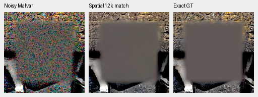

# Matched whole-scene training with localized weak detail

Four matched 2,400-update continuations test whether training on locally
weakened texture helps a whole-image restoration model recover faint detail
while keeping flat areas smooth. Training is in progress as of November 18,
2026. An eight-photo pilot with existing checkpoints shows slightly cleaner
flat cores when the spatial model sees the matching scene, with no increase
in true fine-detail response. [Run, pilot and review bindings](results/scene-local-contrast-2400-v1/publication.json).

## Training and corpus coverage

The larger-corpus recipe has already taken the full restoration model through
1.6 million target slots. The Corpus 100k schedule visited all 90,778 ordinary
training photos five or six times. In a 64-photo repeated-noise test, that
checkpoint reduced the faint ISO6400 fine-band error from 12.51 to 11.75 DN16,
mostly through lower variance. Signed fine-detail response stayed near 12%.
[Corpus 100k](full-corpus-long100k.md) · [64-photo noise analysis](full-corpus-faint-noise.md).

The new experiment uses Corpus 100k EMA as its common parent and the complete
90,692-photo whole-scene training pool as the source schedule. Each arm draws
the same shuffled prefix of **4,800 distinct photos** with four native
256×256 queries per photo, for **19,200 crops per arm**. The sampler uses
the 4×-binned cache. The 427 canonical validation photos and both standing GFX
families are excluded from this training data. Source order, crop boxes,
camera recipe and seeds are fixed across arms.
[Earlier 24,000-photo scene run](expanded-scene-spatial12k.md) · [Training plan](results/scene-local-contrast-2400-v1/training-plan.json).

| Native query model | Ordinary scene data | Localized contrast data |
| --- | --- | --- |
| Local-only | Plain local | Localized local |
| Spatial scene features | Plain spatial | Localized spatial |

The localized arms use a selection probability of 0.5, yielding 2,386
scheduled altered scenes. Each selected scene attenuates texture in one
native query with a taper. Clean pixels outside that support retain their
original values. The camera simulator observes the changed complete scene
before extracting the native queries. The spatial arms receive aligned features
from a 1,024-pixel-long-side preview of the noisy Bayer image. All four arms
freeze the same DINOv3 backbone and use BF16 training with 100 warmup updates,
peak learning rates of 3e-6 for the trunk and 1e-4 for the spatial adapter,
and 0.999 EMA. Checkpoints are scheduled at 800, 1,600 and 2,400 updates.
[Localized contrast reader](scene-local-contrast-training.md) · [CUDA qualification](results/scene-local-contrast-2400-v1/physical-prefix.json).

The two discarded-update preflights used matching source inputs within each
data recipe. The controller checks the full observed source trace across
local-only and spatial models before recording the matched training closure.
The quality comparison measures the spatial gain within each data recipe and
then compares those gains.

## Held-out test for true detail and flat regions

The frozen evaluation contains 64 validation photos, 16 per Bayer order.
Two noise profiles and two draw policies give **256 groups and 768 native
queries**. The present condition keeps 22% of the local fine residual over a
9×9 running average in the center. The matched masked-fine condition removes
that residual while preserving the same low-frequency structure and taper.
A third condition sets the 96×96 center to an exact constant with a smooth
skirt into the photographed surroundings. The coupled draws share the
physical Poisson and read-noise components they can share between the two fine
detail conditions. Independent draws provide a second estimate. Each group's
exterior Bayer samples are identical across its three conditions. The 64
sources include one whose scored center has zero paired increment. It
contributes to the error and flat-core measurements.
[Frozen evaluation](results/scene-local-contrast-2400-v1/evaluation-plan.json) · [Input audit](results/scene-local-contrast-2400-v1/observation-verification.json).

For an intervention on the context, each model receives identical local
Bayer values, variance and camera metadata. The distant preview can be
blurred or replaced with the mirrored preview while keeping the query and
a 16-pixel preview halo exact. The neutral policy masks the entire spatial
feature field. The near-preserving interventions test the contribution of the
distant image directly. Signed response measures the component of the
output difference that aligns with the exact paired fine residual.
Flat-core fine-band RMS measures false variation where every true
fine-band coefficient is zero.

## Existing-checkpoint pilot

The first eight declared photos qualify the panel using V120 EMA,
Corpus 100k EMA and the earlier spatial 12k EMA. The table uses the coupled
draws. RMS values are mean per-photo errors in linear RGB luma before display
gain. Pooled response weights by clean fine-band energy. Three photos account
for 88.0% of the pilot's clean fine-band energy, so the pooled response mainly
describes those crops. The independent-draw results show the same direction
for pooled response and flat-core error.
[Checkpoint SHA256s and inference policy](results/scene-local-contrast-2400-v1/pilot-plan.json) · [All per-photo and pooled results](results/scene-local-contrast-2400-v1/pilot-results.json).

| EMA and preview policy | ISO400 fine response | ISO400 flat RMS, DN16 | ISO6400 fine response | ISO6400 flat RMS, DN16 |
| --- | ---: | ---: | ---: | ---: |
| V120 | 94.37% | 3.73 | 68.27% | 4.83 |
| Corpus 100k | 94.47% | 3.14 | 68.18% | 4.21 |
| Spatial 12k, matching | 94.14% | 5.05 | 67.56% | 5.22 |
| Spatial 12k, blurred distant field | 94.16% | 5.24 | 67.69% | 5.51 |
| Spatial 12k, neutral | 94.23% | 5.33 | 67.63% | 5.40 |
| Spatial 12k, mirrored distant field | 94.16% | 5.18 | 67.60% | 5.32 |

Matching context lowers mean fine-band flat-core RMS compared with all
three altered context policies at both noise levels. It also lowers signed
response in these same comparisons. Corpus 100k has the lowest flat-core
error in all four conditions. The paired increment RMS from matching and
neutral spatial context is 35.37 versus 35.24 DN16 at ISO400 and 84.08 versus
83.96 at ISO6400 for the coupled draws. The pilot gives no visible evidence
of better weak reconstruction from the matching preview.

### Native 100% pilot crops

Each triplet shows noisy Malvar, aligned spatial 12k EMA and exact synthesized
GT. The denoised checkpoint SHA256 is
`b5c8e776da2cf61b66fcf4a76ffc73df000145cdeb15bd14bd4a740949639183`.
ISO6400 uses shot/read `0.00128 / 6.5536e-6`, and ISO400 uses
`8e-5 / 2.56e-8`. The synthetic ADC is 16-bit with black fraction 0.03 and
sensor exposure 0.33. All columns use the same camera transform, exposure
×3.0303 and reference-centered viewing contrast ×2. The crop is
`[48,48,160,160]` within each 256×256 query. Each PNG retains the original
crop pixels at native size. [All ten viewed boards and triplets](results/scene-local-contrast-2400-v1/viewing.json).

The stone's grain softens visibly at ISO6400. Its query starts at `[218,192]`
in the 4×-binned Hauroth wayside cross image, with RGGB. Photograph by
Palauenc05, CC BY-SA 4.0. [Photograph](https://commons.wikimedia.org/wiki/File:Hauroth_Wegekreuz_St-Bartholom%C3%A4us.jpg) · [License](https://creativecommons.org/licenses/by-sa/4.0/).

The exact flat center stays visibly smooth with the same surrounding stone.
[All context policies](images/scene-local-contrast-2400-v1/000-iso6400-coupled-role2-comparison.png).

The cathedral's arches remain legible while fine masonry and narrow trim
soften. Its query starts at `[22,250]` in the 4×-binned image, with BGGR.
Photograph by Berthold Werner, public domain. [Photograph](https://commons.wikimedia.org/wiki/File:Limburger_Dom_BW_1.jpg).

## New endpoint review status

| Deliverable | Status |
| --- | --- |
| Training | Both data preflights passed. Localized spatial is the first live arm. The other three are scheduled behind it. |
| Held-out weak detail and flat cores | All 256 observation groups verified. The full comparison is queued for the four matched endpoints. |
| Fixed 427-photo and known/unseen camera panels | All three are queued for the verified endpoints. No new checkpoint has broad scores. [PSNR history](performance-history.md). |
| Standing DSCF3879/3880 and DSCF3842/3835 | Native collection is queued as each EMA endpoint completes. It uses the cached main sky, building, foliage and fence queries, plus both fine-mesh ROIs at both priors and the established AHD/JPEG references. Viewing is pending. [Main scene](gfx-qualitative.md) · [Fine cab mesh](gfx-green-mesh.md). |

The last evaluated spatial checkpoint in this report is the earlier
12k EMA. Its real-photo review still finds missing fine cab crossings.
[Earlier standing results](expanded-scene-spatial12k.md#matched-development-and-standing-gfx-review).
