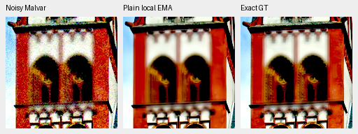
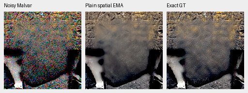

# Matched whole-scene training with localized weak detail

Four matched 2,400-update continuations test whether training on locally
weakened texture helps a whole-image restoration model recover faint detail
while keeping flat areas smooth. The localized spatial, plain local and
plain spatial arms have finished their eight-photo and standing-camera
reviews. The localized local arm is training. An
eight-photo pilot with existing checkpoints shows slightly cleaner
flat cores when the spatial model sees the matching scene, with no increase
in true fine-detail response. [Run, pilot and review bindings](results/scene-local-contrast-2400-v1/publication.json).

## Training and corpus coverage

The larger-corpus recipe has already taken the full restoration model through
1.6 million target slots. The Corpus 100k schedule visited all 90,778 ordinary
training photos five or six times. In a 64-photo repeated-noise test, that
checkpoint reduced the faint ISO6400 fine-band error from 12.51 to 11.75 DN16,
mostly through lower variance. Signed fine-detail response stayed near 12%.
[Corpus 100k](full-corpus-long100k.md) · [64-photo noise analysis](full-corpus-faint-noise.md).

The new experiment uses Corpus 100k EMA as its common parent and the complete
90,692-photo whole-scene training pool as the source schedule. Each arm draws
the same shuffled prefix of **4,800 distinct photos** with four native
256×256 queries per photo, for **19,200 crops per arm**. The sampler uses
the 4×-binned cache. The 427 canonical validation photos and both standing GFX
families are excluded from this training data. Source order, crop boxes,
camera recipe and seeds are fixed across arms.
[Earlier 24,000-photo scene run](expanded-scene-spatial12k.md) · [Training plan](results/scene-local-contrast-2400-v1/training-plan.json).

| Native query model | Ordinary scene data | Localized contrast data |
| --- | --- | --- |
| Local-only | Plain local | Localized local |
| Spatial scene features | Plain spatial | Localized spatial |

The localized arms use a selection probability of 0.5, yielding 2,386
scheduled altered scenes. Each selected scene attenuates texture in one
native query with a taper. Clean pixels outside that support retain their
original values. The camera simulator observes the changed complete scene
before extracting the native queries. The spatial arms receive aligned features
from a 1,024-pixel-long-side preview of the noisy Bayer image. All four arms
freeze the same DINOv3 backbone and use BF16 training with 100 warmup updates,
peak learning rates of 3e-6 for the trunk and 1e-4 for the spatial adapter,
and 0.999 EMA. Checkpoints are scheduled at 800, 1,600 and 2,400 updates.
[Localized contrast reader](scene-local-contrast-training.md) · [CUDA qualification](results/scene-local-contrast-2400-v1/physical-prefix.json).

The two discarded-update preflights used matching source inputs within each
data recipe. The controller checks the full observed source trace across
local-only and spatial models before recording the matched training closure.
The quality comparison measures the spatial gain within each data recipe and
then compares those gains.

## Held-out test for true detail and flat regions

The frozen evaluation contains 64 validation photos, 16 per Bayer order.
Two noise profiles and two draw policies give **256 groups and 768 native
queries**. The present condition keeps 22% of the local fine residual over a
9×9 running average in the center. The matched masked-fine condition removes
that residual while preserving the same low-frequency structure and taper.
A third condition sets the 96×96 center to an exact constant with a smooth
skirt into the photographed surroundings. The coupled draws share the
physical Poisson and read-noise components they can share between the two fine
detail conditions. Independent draws provide a second estimate. Each group's
exterior Bayer samples are identical across its three conditions. The 64
sources include one whose scored center has zero paired increment. It
contributes to the error and flat-core measurements.
[Frozen evaluation](results/scene-local-contrast-2400-v1/evaluation-plan.json) · [Input audit](results/scene-local-contrast-2400-v1/observation-verification.json).

For an intervention on the context, each model receives identical local
Bayer values, variance and camera metadata. The distant preview can be
blurred or replaced with the mirrored preview while keeping the query and
a 16-pixel preview halo exact. The neutral policy masks the entire spatial
feature field. The near-preserving interventions test the contribution of the
distant image directly. Signed response measures the component of the
output difference that aligns with the exact paired fine residual.
Flat-core fine-band RMS measures false variation where every true
fine-band coefficient is zero.

The matched analysis reports each noise draw separately, with ISO6400 as
the primary condition. It repeats the comparison on the 32 photos with
the lowest clean increment RMS, ranked before any new endpoint inference.
Uncertainty intervals resample complete photos jointly across the arms.
The primary spatial-by-augmentation contrast reports fine response,
increment error and flat-core error together.
[Frozen paired analysis](results/scene-local-contrast-2400-v1/matched-analysis-plan.json).

## Existing-checkpoint pilot

The first eight declared photos qualify the panel using V120 EMA,
Corpus 100k EMA and the earlier spatial 12k EMA. The table uses the coupled
draws. RMS values are mean per-photo errors in linear RGB luma before display
gain. Pooled response weights by clean fine-band energy. Three photos account
for 88.0% of the pilot's clean fine-band energy, so the pooled response mainly
describes those crops. The independent-draw results show the same direction
for pooled response and flat-core error.
[Checkpoint SHA256s and inference policy](results/scene-local-contrast-2400-v1/pilot-plan.json) · [All per-photo and pooled results](results/scene-local-contrast-2400-v1/pilot-results.json).

| EMA and preview policy | ISO400 fine response | ISO400 flat RMS, DN16 | ISO6400 fine response | ISO6400 flat RMS, DN16 |
| --- | ---: | ---: | ---: | ---: |
| V120 | 94.37% | 3.73 | 68.27% | 4.83 |
| Corpus 100k | 94.47% | 3.14 | 68.18% | 4.21 |
| Spatial 12k, matching | 94.14% | 5.05 | 67.56% | 5.22 |
| Spatial 12k, blurred distant field | 94.16% | 5.24 | 67.69% | 5.51 |
| Spatial 12k, neutral | 94.23% | 5.33 | 67.63% | 5.40 |
| Spatial 12k, mirrored distant field | 94.16% | 5.18 | 67.60% | 5.32 |

Matching context lowers mean fine-band flat-core RMS compared with all
three altered context policies at both noise levels. It also lowers signed
response in these same comparisons. Corpus 100k has the lowest flat-core
error in all four conditions. The paired increment RMS from matching and
neutral spatial context is 35.37 versus 35.24 DN16 at ISO400 and 84.08 versus
83.96 at ISO6400 for the coupled draws. The pilot gives no visible evidence
of better weak reconstruction from the matching preview. At ISO6400 the
matching view raises response on three of eight photos and reduces the
flat-core RMS on four of eight compared with neutral.
[Source-paired pilot differences](results/scene-local-contrast-2400-v1/pilot-paired-differences.json).

### Native 100% pilot crops

Each triplet shows noisy Malvar, aligned spatial 12k EMA and exact synthesized
GT. The denoised checkpoint SHA256 is
`b5c8e776da2cf61b66fcf4a76ffc73df000145cdeb15bd14bd4a740949639183`.
ISO6400 uses shot/read `0.00128 / 6.5536e-6`, and ISO400 uses
`8e-5 / 2.56e-8`. The synthetic ADC is 16-bit with black fraction 0.03 and
sensor exposure 0.33. All columns use the same camera transform, exposure
×3.0303 and reference-centered viewing contrast ×2. The crop is
`[48,48,160,160]` within each 256×256 query. Each PNG retains the original
crop pixels at native size. [All ten viewed boards and triplets](results/scene-local-contrast-2400-v1/viewing.json).

The stone's grain softens visibly at ISO6400. Its query starts at `[218,192]`
in the 4×-binned Hauroth wayside cross image, with RGGB. Photograph by
Palauenc05, CC BY-SA 4.0. [Photograph](https://commons.wikimedia.org/wiki/File:Hauroth_Wegekreuz_St-Bartholom%C3%A4us.jpg) · [License](https://creativecommons.org/licenses/by-sa/4.0/).

The exact flat center stays visibly smooth with the same surrounding stone.
[All context policies](images/scene-local-contrast-2400-v1/000-iso6400-coupled-role2-comparison.png).

The cathedral's arches remain legible while fine masonry and narrow trim
soften. Its query starts at `[22,250]` in the 4×-binned image, with BGGR.
Photograph by Berthold Werner, public domain. [Photograph](https://commons.wikimedia.org/wiki/File:Limburger_Dom_BW_1.jpg).

## New endpoint review status

The first arm finished in 1,725.31 seconds of measured training. Its
2,400-update checkpoint contains raw and EMA weights, optimizer state, and
the fixed Corpus 100k parent and DINO bindings. The controller verified the
actual order of all 4,800 distinct sources, including 2,386 localized scenes
and 19,200 native crops. The evaluated weight policy is EMA. Its checkpoint
SHA256 is `9f3a5cc187d0b9c9cd8de5bb22bf93bf29d0e8d0f67a474fbc834c71727eb789`.
[Training audit and immutable traces](results/scene-local-contrast-2400-v1/localized-spatial-training-publication.json).

### First trained endpoint on the eight-photo pilot

The new EMA replays all 32 groups from the pilot in CUDA IEEE FP32,
including exact native inputs and preview interventions. Compared with
the earlier spatial 12k at ISO6400, aligned localized spatial reduces
flat-core fine variation on every coupled observation and seven of the
eight independent ones. The Corpus 100k parent retains lower mean
flat-core error and higher fine response. The new aligned result gives
67.34% pooled response at ISO6400, versus 67.47% with its own neutral
context. The matching and mirrored views are close, with slightly
less flat-core error in the mirrored view. Its coupled median
source response is 53.80%, up from 53.39% in the earlier spatial arm.
[Exact checkpoint and held-out metrics](results/scene-local-contrast-2400-v1/first-endpoint-heldout.json).

| EMA, ISO6400 coupled | Fine response | Paired increment RMS, DN16 | Flat-core RMS, DN16 |
| --- | ---: | ---: | ---: |
| V120 | 68.27% | 84.24 | 4.83 |
| Corpus 100k | 68.18% | 84.22 | 4.21 |
| Earlier spatial 12k, matching | 67.56% | 84.08 | 5.22 |
| Localized spatial 2,400, matching | 67.34% | 84.40 | 4.85 |

In the independent repeats, the localized spatial increment RMS is
103.93 DN16 versus 104.27 for earlier spatial 12k and 103.98 for
Corpus 100k. The comparisons vary training length and data recipe.
The comparison with the parent also adds spatial context. The remaining
three arms supply the matched controls for the augmentation effect.

Both new native triplets keep the pilot's original coordinates and
camera transforms. The Hauroth stone query starts at `[218,192]`
with RGGB, and the cathedral at `[22,250]` with BGGR. Each uses
ROI `[48,48,160,160]` within its 256-pixel query, shot/read
`0.00128 / 6.5536e-6`, ADC16 black fraction 0.03, exposure ×3.0303
and contrast ×2. The middle column is the bound localized spatial
EMA above. Stone grain, fine masonry and narrow trim remain soft.
[All three new native comparisons](results/scene-local-contrast-2400-v1/first-endpoint-viewing.json).

| Deliverable | Status |
| --- | --- |
| Training | Localized spatial and plain local completed 2,400 updates each. Plain spatial is running and localized local is queued. [Milestone and analysis bindings](results/scene-local-contrast-2400-v1/milestone-and-analysis.json). |
| Held-out weak detail and flat cores | Both completed endpoints have eight-photo replays. All 256 observation groups are ready for the full four-arm comparison. |
| Fixed 427-photo and known/unseen camera panels | All three are queued for the verified endpoints. No new checkpoint has broad scores. [PSNR history](performance-history.md). |
| Standing DSCF3879/3880 and DSCF3842/3835 | The first two endpoints have completed collection and actual viewing of both standing scenes. The other EMA endpoints are queued as each completes training. [Main scene](gfx-qualitative.md) · [Fine cab mesh](gfx-green-mesh.md). |

### First endpoint standing GFX review

The aligned EMA used cached DSCF3879 and DSCF3842 whole-frame
Bayer previews, native 512- and 768-pixel queries, and CPU IEEE
FP32. The predictions use the same Bayer query, conditioning and
display as V120, Corpus 100k and the earlier spatial 12k. All eight
standing boards were inspected at native crop scale.
[Checkpoint identities, native coordinates and viewing notes](results/scene-local-contrast-2400-v1/first-endpoint-standing-viewing.json).

The overcast sky stays visibly smooth. Its prediction differs from
Corpus 100k by 1.62 camera-linear DN16 RMS. The coarse chain-link
fence shows both directions and its larger crossings. Its changes
are stronger than the sky changes at 15.73 DN16 versus Corpus 100k.
Fine leaf tips, building brackets and thin cables remain soft.
These measurements compare the two models on the same input.
[Per-region output differences](results/scene-local-contrast-2400-v1/first-endpoint-standing-deltas.json).

DSCF3879 uses shot/read `0.00128 / 6.5536e-6`, display exposure
×4 and the independent DSCF3880 ISO100 AHD reference. Native
160×160 boxes start at sky `[5800,1400]`, building `[5790,2690]`,
foliage `[8890,5570]` and fence `[2240,6000]`.
[Sky](images/scene-local-contrast-2400-first/main-overcast-sky-main-overcast-sky.png) · [Building](images/scene-local-contrast-2400-first/main-building-detail-main-building-detail.png) · [Foliage](images/scene-local-contrast-2400-first/main-foliage-main-foliage.png) · [Coarse fence](images/scene-local-contrast-2400-first/main-chain-link-fence-main-chain-link-fence.png).

The fine cab mesh remains incomplete in both ROIs. Transferred
conditioning retains more diagonal repeat structure, especially
at right. The new model resembles the earlier spatial EMA, with
3.73–5.14 DN16 RMS differences across the four boards. Nominal
conditioning leaves broad green-gray variation at right and little
visible mesh beside the left post. The separately demosaiced
DSCF3835 ISO100 capture and both camera JPEGs are qualitative
references. The apertures, shutter speeds and scene contents differ.

DSCF3842 uses exposure ×16 and native 160×160 boxes starting at
`[806,6489]` left and `[1026,6449]` right.

| Conditioning, shot/read | Boards |
| --- | --- |
| Nominal `0.00128 / 6.5536e-6` | [Left](images/scene-local-contrast-2400-first/mesh-nominal-fine-green-mesh-left.png) · [Right](images/scene-local-contrast-2400-first/mesh-nominal-fine-green-mesh-right.png) |
| Transferred `0.0014635775921166604 / 1.0715704128646712e-6` | [Left](images/scene-local-contrast-2400-first/mesh-profile3879-fine-green-mesh-left.png) · [Right](images/scene-local-contrast-2400-first/mesh-profile3879-fine-green-mesh-right.png) |

The first endpoint's eight-photo replay and standing review are
complete. The fixed photo and known/unseen camera panels await the
full matched checkpoint set. [Combined publication record](results/scene-local-contrast-2400-v1/first-endpoint-publication.json).

### Plain local control

Plain local completed 2,400 updates in 1,715.39 seconds of measured
training. Its raw and EMA checkpoint SHA256 is
`d8dfa59759b12422526cd361e1023b1f4e83ec3467cae79c7288ed9544608098`.
It uses the same Corpus 100k parent, frozen DINO, and 4,800
source visits with 19,200 native crops. The two finished traces
agree on every source, crop coordinate, camera recipe and draw
seed. All 2,414 draws without augmentation reproduce their full
observation record.
[Training and evaluation receipts](results/scene-local-contrast-2400-v1/second-endpoint-publication.json) · [Input trace comparison](results/scene-local-contrast-2400-v1/two-arm-inputs.json).

On the eight-photo EMA replay, coupled ISO6400 increment RMS is
84.16 DN16 for plain local, 84.40 for localized spatial and
84.22 for Corpus 100k. Independent ISO6400 reverses the two new
arms, with 104.22 for plain local and 103.93 for localized spatial.
Coupled flat-core RMS is 4.69 DN16 for plain local, 4.85 for
localized spatial and 4.21 for Corpus 100k. These comparisons
change both the context path and the augmentation. The ordinary-data
pair below isolates the effect of the context path under that recipe.
[Matched eight-photo metrics](results/scene-local-contrast-2400-v1/second-endpoint-heldout.json).

The plain local EMA retains the visibly smooth exact flat core.
Both ISO6400 triplets use the same sources, 160-pixel ROI,
noise conditioning and exposure as the localized spatial triplets
above. Stone grain and fine masonry stay soft.
[Noise, source coordinates and all native boards](results/scene-local-contrast-2400-v1/second-endpoint-heldout-viewing.json).

The plain local GFX review uses the same eight crops, camera
priors and display settings as the localized spatial review.
It uses CPU IEEE FP32 native inference and no whole-image
guide. The sky remains smooth and the coarse fence keeps both
visible directions. Fine leaves, bracket cables and fine cab
crossings remain unresolved. Cab predictions differ from localized
spatial by 2.10–4.41 camera-linear DN16 RMS. The transferred prior
still retains more visible diagonals in the right crop.
[Standing RAW provenance and actual viewing](results/scene-local-contrast-2400-v1/second-endpoint-standing-viewing.json) · [Model-to-model deltas](results/scene-local-contrast-2400-v1/second-endpoint-standing-deltas.json).

[Sky](images/scene-local-contrast-2400-second/main-overcast-sky-main-overcast-sky.png) · [Building](images/scene-local-contrast-2400-second/main-building-detail-main-building-detail.png) · [Foliage](images/scene-local-contrast-2400-second/main-foliage-main-foliage.png) · [Coarse fence](images/scene-local-contrast-2400-second/main-chain-link-fence-main-chain-link-fence.png).

| Cab profile | Plain local and localized spatial boards |
| --- | --- |
| Nominal | [Left](images/scene-local-contrast-2400-second/mesh-nominal-fine-green-mesh-left.png) · [Right](images/scene-local-contrast-2400-second/mesh-nominal-fine-green-mesh-right.png) |
| Transferred | [Left](images/scene-local-contrast-2400-second/mesh-profile3879-fine-green-mesh-left.png) · [Right](images/scene-local-contrast-2400-second/mesh-profile3879-fine-green-mesh-right.png) |

### Plain spatial control

Plain spatial completed 2,400 updates in 1,542.04 seconds of measured
training. Its raw and EMA checkpoint SHA256 is
`0ff44f0d0aa52e9c60f2170072e312a3b3c35287035f24f57da274e17c66fd62`.
It uses Corpus 100k as its parent. Its entire observed data trace
is byte-identical to plain local across 4,800 distinct photos and
19,200 native crops, including source coordinates, physical whole-scene
and query fingerprints, camera metadata and noise. The difference is
the learned native path with or without the spatial scene adapter.
[Endpoint and frozen sources](results/scene-local-contrast-2400-v1/third-endpoint-publication.json) · [Matched data trace](results/scene-local-contrast-2400-v1/plain-matched-inputs.json).

The CUDA IEEE FP32 EMA evaluation replays identical native observations
and verifies all intervention preview fingerprints against the earlier
pilot. At ISO6400, the matching scene raises flat-core fine variation
versus the plain local arm, with almost identical increment error in
the coupled draws. The matching scene lowers flat-core variation
slightly compared with blanking its own adapter input, with a small
loss of fine response. Corpus 100k keeps the cleanest flat cores.

| EMA and preview policy | Coupled fine RMS, DN16 | Coupled flat RMS, DN16 | Coupled fine response | Independent fine RMS, DN16 |
| --- | ---: | ---: | ---: | ---: |
| V120 | 84.24 | 4.83 | 68.27% | 103.84 |
| Corpus 100k | 84.22 | 4.21 | 68.18% | 103.98 |
| Localized spatial, matching | 84.40 | 4.85 | 67.34% | 103.93 |
| Plain local | 84.16 | 4.69 | 67.61% | 104.21 |
| Plain spatial, matching | 84.16 | 4.86 | 67.51% | 104.07 |
| Plain spatial, neutral | 84.13 | 4.92 | 67.63% | 104.26 |

The coupled matching-minus-local flat RMS difference is +0.17 DN16.
Its exploratory source-bootstrap interval spans −0.07 to +0.59 DN16.
Matching-minus-neutral gives −0.06 DN16, with an interval of −0.13 to
+0.001 DN16. At ISO400 the matching preview also reduces flat-core
variation versus neutral, from 4.91 to 4.69 DN16 with coupled draws
and from 4.37 to 4.18 with independent draws. The eight-photo
comparison gives little evidence of better fine reconstruction.
[All noise/draw/context results](results/scene-local-contrast-2400-v1/third-endpoint-heldout.json) · [Paired differences](results/scene-local-contrast-2400-v1/third-endpoint-paired.json).

These two native triplets use the original stone and cathedral queries,
with ROI `[48,48,160,160]`. They show noisy Malvar, the plain spatial
EMA with the matching scene, and exact synthetic GT. Shot/read
are `0.00128 / 6.5536e-6`, ADC16 black fraction is 0.03, with the
same display exposure ×3.0303 and contrast ×2 as above. Stone grain
and fine masonry remain softer than the target. The separate flat
view remains visibly smooth.
[Bound sources and all viewed comparisons](results/scene-local-contrast-2400-v1/third-endpoint-heldout-viewing.json).

#### Plain spatial standing GFX review

The matching scene CPU IEEE FP32 review uses DSCF3879/3880 and
DSCF3842/3835 at the same native 160×160 coordinates, noise priors,
and display exposures as the prior two endpoints. The overcast sky
appears smooth and the coarse grid keeps both visible directions.
Compared with plain local, camera-linear changes are 1.71 DN16 RMS
in sky and 8.21 DN16 in the coarse fence. Fine bracket cables and leaf
edges remain soft. The fine cab retains more obvious diagonal structure
under the transferred prior and incomplete crossings under both.
Cab differences versus plain local range from 2.38 to 4.26 DN16 RMS.
The differently exposed ISO100 AHD and both camera JPEGs were viewed
as qualitative references.
[Actual native review with coordinates and inputs](results/scene-local-contrast-2400-v1/third-endpoint-standing-viewing.json) · [Model-to-model deltas](results/scene-local-contrast-2400-v1/third-endpoint-standing-deltas.json).

[Sky](images/scene-local-contrast-2400-third/main-overcast-sky-main-overcast-sky.png) · [Building](images/scene-local-contrast-2400-third/main-building-detail-main-building-detail.png) · [Foliage](images/scene-local-contrast-2400-third/main-foliage-main-foliage.png) · [Coarse fence](images/scene-local-contrast-2400-third/main-chain-link-fence-main-chain-link-fence.png).

| Cab profile | Plain spatial and matched comparators |
| --- | --- |
| Nominal | [Left](images/scene-local-contrast-2400-third/mesh-nominal-fine-green-mesh-left.png) · [Right](images/scene-local-contrast-2400-third/mesh-nominal-fine-green-mesh-right.png) |
| Transferred | [Left](images/scene-local-contrast-2400-third/mesh-profile3879-fine-green-mesh-left.png) · [Right](images/scene-local-contrast-2400-third/mesh-profile3879-fine-green-mesh-right.png) |

#### Preview scale in training and GFX

The median training query covers **10.02%** of its scene. The GFX
queries cover **0.26%** for the main crop and **0.58%** for the
cab. Grid spacing at the coarsest encoder level is 64 native pixels
for the median training scene and about 364 for both GFX previews.
The training query spans four coarsest-grid intervals per dimension,
while the main and cab queries span 1.40 and 2.11 respectively.
Both use the same 1,024-pixel preview cap. These are sampling
intervals. The observed geometry leaves open whether preview scale
contributes to the weaker real fine-detail result.
[Measured geometry from all 19,200 training crops and both standing captures](results/scene-local-contrast-2400-v1/preview-scale.json).

The full matched 64-photo weak-detail and fixed 427-photo and
known/unseen camera evaluations are queued behind the localized local
endpoint. Plain spatial is the latest endpoint evaluated on the
eight-photo and standing GFX scope.
