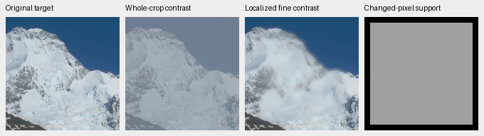
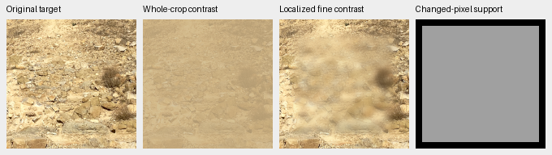

# Localized contrast for whole-scene training

The whole-scene reader can now reduce texture inside one native crop
while retaining the rest of the clean scene. On 45 qualifying crops
from the expanded training pool, the intervention retains **79.8%**
of the lower-band luma RMS and **38.6%** of the fine-band RMS on
average. A uniformly attenuated crop with the same fine-band RMS
would retain 38.6% of the lower band. This preflight measures
training inputs. It does not establish a restoration gain.

The [matched scene continuation](expanded-scene-spatial12k.md)
used natural scene observations. Its aligned scene features changed
weak recovery only slightly. Localized attenuation lets a subsequent
matched study vary local visibility while keeping edges, illumination and
scene context more representative of the source photograph.
[Reader implementation](../src/demosaic/scene_training_data.py).

## Native data path

The whole-scene training plan accepts `local_contrast_fraction`
from 0 to 1, default 0. A scene-specific draw chooses whether to
apply the transform, which of the existing crop boxes to use and
a scale sampled log-uniformly between 0.125 and 0.5. These choices
use their own seed. Source order, D4 transforms, crop coordinates,
exposure, camera calibration, CFA and noise parameters stay fixed
under the same plan.

Inside the selected crop, a 9×9 mean estimates the local background.
A smooth taper reduces the difference between each pixel and that
background. The affected native 256-pixel crop has a 144×144
support with a 20-pixel transition on each side. Centering the
filter before averaging keeps constant RGB fields bit-identical.
The clean target pixels outside the support match exactly.
Camera conversion and Bayer degradation run once on the resulting
scene, and all crops and the context preview use that RAW.
[Plan integration](../scripts/train_scene_context.py).

## Source-bound preflight

The preflight sampled 48 fixed train-only fields from the expanded
90,692-source pool. Three crops lacked the defined minimum local
fine-band contrast or brightness. The remaining 45 are measured
in the same 128-pixel center of the selected 256-pixel crops.
Lower-band RMS uses 1/32–1/8 cycles per pixel and fine-band RMS
uses 1/8–1/3, both on native 16-pixel DCT blocks. Ratios use each
crop's original band RMS as its denominator.

| Target transformation | Lower-band RMS retained | Fine-band RMS retained |
| --- | ---: | ---: |
| Existing whole-crop attenuation, same scale draw | 26.2% | 26.2% |
| Localized attenuation | 79.8% | 38.6% |
| Whole-crop attenuation, matched to localized fine RMS | 38.6% | 38.6% |

All 45 retained more lower-band than fine-band RMS. The changed
support covers 2.5–6.2% of a complete scene in these examples.
The strategy still softens some real edges inside the support,
especially the small rocks in the amphitheatre crop. The
transition is visible in the preflight images. The results
support a controlled training-data comparison and leave its
learned detail and quiet-region effects open.
[Source inputs and numeric coverage](results/scene-local-contrast-preflight-v1/publication.json).

The 160×160 target comparisons use ROI `[48,48,160,160]`
in each 256-pixel crop, native binned pixels, exposure ×1 and an
identical clipped-sRGB display. These are clean training target
variants before camera conversion and restoration. The full crop
origins in the binned scenes are `[134,62]` and `[478,152]`.

Source credits are Avenue for Mount Sefton and Bernard Gagnon for
the amphitheatre. Crops are modified by binning, contrast transforms
and native display conversion. [Mount Sefton source](https://commons.wikimedia.org/wiki/File:Mount_Sefton_and_the_Footstool_1.jpg) ·
[CC BY-SA 3.0](https://creativecommons.org/licenses/by-sa/3.0) ·
[Amphitheatre source](https://commons.wikimedia.org/wiki/File:Amphitheatre_(Lambaesis)_09.jpg) ·
[CC BY 4.0](https://creativecommons.org/licenses/by/4.0).

A separate sensor intervention changes the corresponding local
Bayer samples and retains the base observation outside the mask
by construction. All 421,632 exterior samples in the ISO400
example and 446,868 in the ISO6400 example match bit for bit,
including their variances. This construction is for controlled
evaluation. The training reader applies the physical noise
operator once to each complete scene.

The final operator was checked against higher-precision outputs
on all 45 qualifying crops. The actual reader also reproduced
eight training draws with the same source, crop boxes, D4 and
camera parameters, exact clean pixels outside the support, and
native crops copied from their complete RAW.
[Stable filter and reader qualification](results/scene-local-contrast-preflight-v1/stable-fixtures.json).

With the option enabled on every scene for smoke testing, the
actual CUDA trainer completes two discarded native updates
in each of the local-only and spatial modes. Both read identical
augmented observations. The spatial adapter receives gradients,
the DINO tensors keep their original hash, and the checkpoints
round-trip with matching optimizer steps and weights. These
checkpoints are retained as execution evidence.
[Actual CUDA trainer preflight](results/scene-local-contrast-preflight-v1/cuda-preflight.json).
