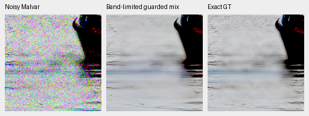
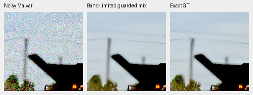

# Restricting the regional detail boost to measured frequencies

Filtering the signed luminance boost after the spatial gate removes
the prior blend's upper-band regression. On the fixed ISO6400 test,
fine-flat RMS falls by **0.421 DN16**, fine-increment error falls by
**0.043 DN16**, and fine response stays within **0.001 percentage
points** of Corpus 100k. A separate 32-photo cohort confirms smaller
flat and increment gains. The fine cab crossings remain incomplete.

[Held-out wire and Bayer-gated damping follow-up](scene-mixture-wire-gaps.md).

[Machine results](results/scene-mixture-upper-band-v1/publication.json) ·
[Fitted coefficients](results/scene-mixture-upper-band-v1/coefficients.json) ·
[Frozen drivers and receipts](results/scene-mixture-upper-band-v1/evidence.tar.xz) ·
[Native crop provenance](images/scene-mixture-upper-band-v1/manifest.json).

## Frequency restriction and fitting

The two restoration paths use the same frozen EMAs as the previous
regional mixture. Corpus 100k is
`87b96f3c487b9edaf1c477742b6c38f2a82cc6b20a94716d51cc8cf46a17a760`
and spatial 40k is
`d8ba41fa48bab80d515d8248ce6bd787b5347bcd00bcc1816ebbe39ddf52b8ef`.
The fitted coefficients have SHA256
`bb70c73e03859c2e03f4e7f8535e24ecf0650e4d86c3765fb133556fadae96cb`. The
coarse and positive detail bases are the same as before. The signed
basis multiplies the endpoint difference by its local or regional
weight first, then low-passes the resulting luminance field. A radial
raised-cosine rolls off from 0.24 to 0.32 cycles per native pixel. The
fit uses 24 pixels of reflection padding and the same 12-pixel taper
at the edge of the 160-pixel delivery region. The negative coefficient
cap stays at 0.5. Chroma comes from the positive model mixture.
[Previous regional mixture and gate features](scene-gated-mixture.md).

Five CPU solves use 16 calibration photographs at ISO400 and ISO6400,
each with coupled and independent draws. This gives 64 groups and 192
role queries per fit. The previous fit is replayed, and two controls
test the high-band guard alone and the low-pass without refitting.
The selected fit restricts the signed boost and requires calibration
fine response at least equal to the parent, with upper-band flat
and increment MSE at most the parent, averaged within each of the
four conditions. The test measurements use the central 96-pixel
region, with fine frequencies from 1/8 to 1/3 cycles/pixel and the
upper band from 1/3 upward. The coefficients use direct optimization
without EMA. Total fit time is 0.044 s, separate from replay and
network inference.

The linear filter can be applied once after summing the weighted
fields. On 192 fixed test groups, synthesized FP32 output matches
the fitted fine-increment RMS within 0.00002 DN16. The single-filter
and per-basis implementations produced identical FP32 camera pixels
in the checked replay. A central sinusoid at 3/16 cycles/pixel keeps
its amplitude within 1%, while one at 7/16 cycles/pixel retains under
1%. The two neural forwards are still required.

## Fixed 48-photo test

| Independent ISO6400 | Fine response | Fine-increment RMS | Fine-flat RMS | Upper increment RMS | Upper flat RMS |
| --- | ---: | ---: | ---: | ---: | ---: |
| Corpus 100k EMA | 65.729% | 155.719 | 5.371 | 120.038 | 2.131 |
| Spatial 40k EMA | 64.799% | 154.714 | 4.400 | 119.568 | 2.481 |
| Previous signed mixture | 65.717% | 155.707 | 5.162 | 120.161 | 2.234 |
| Wide boost with upper guard | 65.705% | 155.695 | 5.231 | 120.045 | 2.106 |
| Low-pass only, previous weights | 65.715% | 155.681 | 5.127 | 119.977 | 2.104 |
| Band-limited refit, registered gate | 65.726% | 155.675 | 4.939 | 119.977 | 2.086 |
| Band-limited refit with upper guard | 65.728% | 155.677 | 4.949 | 119.981 | 2.093 |

RMS values are in DN16. Relative to Corpus 100k, the guarded refit
reduces fine-flat RMS **0.421 DN16** [0.127, 0.826], fine-increment
RMS **0.043 DN16** [0.015, 0.070], and upper-flat RMS **0.038 DN16**
[0.021, 0.063]. Upper response rises 0.099 percentage points. Coarse
flat RMS falls 1.968 DN16, and quiet chroma RMS falls 1.428 DN16.
Present-core rendered PSNR rises 0.041 dB. Intervals resample sources.

The low-pass alone removes most of the prior upper-band cost. Refitting
the weights gives most of the additional fine-flat gain. The registered
gate and local-only gate give close results with the same spatial
checkpoint. The upper guard adds little at this cutoff. The guarded
fit lowers fine-flat and upper-flat RMS across all four noise/draw
conditions. Fine-increment error still rises 0.048 DN16 on independent
ISO400 and 0.055 DN16 on coupled ISO6400. On the same fixed ISO6400
independent subset, V120 gives 65.255% fine response, 155.898 DN16
fine-increment RMS and 5.785 DN16 fine-flat RMS.
[Matched V120 subset](scene-gated-mixture.md#held-out-evidence).

## Separate 32-photo confirmation

A separate cohort from the prior repeat-noise study uses newly
simulated RAW noise, the same 256-pixel query geometry and identical
whole-scene exterior for each role in a group. The 32 photos are
disjoint from the 64 fixed fitting and test photos and from the
scene-continuation training manifest. Source IDs and decoded cache
hashes have zero matches in 559,808 recorded photographic visits
for Corpus 100k. Both frozen restorers rerun under CUDA IEEE FP32
for 128 groups, with 91.86 s of network and preview time.
The coefficients come directly from the 16-photo fit. [Cohort provenance](paired-repeat-stability.md#final-1200-update-evaluation).

| Independent ISO6400 | Fine response | Fine-increment RMS | Fine-flat RMS | Upper increment RMS | Upper flat RMS |
| --- | ---: | ---: | ---: | ---: | ---: |
| Corpus 100k EMA | 69.113% | 122.273 | 4.381 | 80.565 | 1.923 |
| Spatial 40k EMA | 68.210% | 121.417 | 4.125 | 80.230 | 2.391 |
| Previous signed mixture | 69.081% | 122.281 | 4.292 | 80.682 | 2.014 |
| Band-limited refit with upper guard | 69.095% | 122.219 | 4.195 | 80.523 | 1.898 |

Fine-flat RMS falls **0.186 DN16** [0.129, 0.244], fine-increment RMS
falls **0.054 DN16** [0.011, 0.098] and fine response changes −0.017
percentage points [−0.057, +0.010]. Upper-flat RMS falls **0.025 DN16**
[0.016, 0.035], and upper-increment RMS falls 0.042 DN16. Coarse
flat RMS falls 1.895 DN16. The other noise/draw conditions preserve
the flat gains. Coupled ISO6400 and independent ISO400 have small
fine-increment regressions. The composition has two exact-target
photo cohorts and both standing GFX reviews. The broad 427-photo
and measured-camera continuation panels are still queued at 50k.

## Native exact-target triplets

Each displayed crop is 160 × 160 native pixels at `[48,48,160,160]`
in a 256-pixel query. Noisy Malvar, the band-limited guarded mixture
and exact GT use the same ISO6400 shot/read `0.00128/6.5536e-6`,
capture ×0.33, black level 0.03, 16-bit ADC, display ×3.0303 and
contrast ×2.

**Svitzer Cecilia on the River Thames**, mattbuck, CC BY-SA 4.0.
GRBG query `[168,470,256,256]`. Fine-increment RMS falls 0.373 DN16,
the largest improvement on the separate cohort. The hull edge
holds while fine water texture stays soft.
[Source](https://commons.wikimedia.org/wiki/File:London_MMB_%C2%BB146_River_Thames_and_%22Svitzer_Cecilia%22.jpg) ·
[Comparison](images/scene-mixture-upper-band-v1/confirmation/090-iso6400-confirmation-upper-comparison.png).

**Harvest at Kościelniki**, Jacek Halicki, CC BY-SA 4.0.
BGGR query `[124,28,256,256]`. Fine-increment RMS rises 0.159 DN16,
the largest confirmation regression. Fine overhead wires remain weak
against the grey sky.
[Source](https://commons.wikimedia.org/wiki/File:2014_K%C5%82odzko,_%C5%BCniwa_w_Ko%C5%9Bcielnikach_02.JPG) ·
[Comparison](images/scene-mixture-upper-band-v1/confirmation/069-iso6400-confirmation-upper-comparison.png).

The fixed test witnesses also use the common transform. Fine-increment
RMS falls 0.462 DN16 in Delos and rises 0.324 DN16 on the bright
shell crop. [Delos triplet](images/scene-mixture-upper-band-v1/exact/038-iso6400-independent-upper-band-triplet.png) ·
[Shell triplet](images/scene-mixture-upper-band-v1/exact/042-iso6400-independent-upper-band-triplet.png).

## Standing GFX100S comparisons

The main DSCF3879/3880 crops use the original 512-pixel contexts at
display ×4. The refit changes the sky by 1.41 DN16 RGB RMS, and the
coarse fence by 6.57 DN16 versus Corpus 100k. At native scale the sky
stays smooth and coarse crossings stay coherent. Thin cables and
small leaves remain soft.

The DSCF3842/3835 crop set uses the original 768-pixel contexts at
display ×16. The refit changes the four native crops by 3.26–4.37 DN16
versus Corpus 100k. The transferred prior retains clearer right
diagonals. Fine intersections remain incomplete, and the left crop
retains faint mottling. Both JPEGs and the independent ISO100 AHD
references were viewed at native scale. Conditions differ in aperture,
exposure time and subject motion.

[Sky](images/scene-mixture-upper-band-v1/standing/main-overcast-sky-main-overcast-sky.png) ·
[Building](images/scene-mixture-upper-band-v1/standing/main-building-detail-main-building-detail.png) ·
[Foliage](images/scene-mixture-upper-band-v1/standing/main-foliage-main-foliage.png) ·
[Coarse fence](images/scene-mixture-upper-band-v1/standing/main-chain-link-fence-main-chain-link-fence.png).

| Cab prior, shot/read | Left | Right |
| --- | --- | --- |
| Nominal `0.00128/6.5536e-6` | [Native board](images/scene-mixture-upper-band-v1/standing/mesh-nominal-fine-green-mesh-left.png) | [Native board](images/scene-mixture-upper-band-v1/standing/mesh-nominal-fine-green-mesh-right.png) |
| Transferred `0.0014635775921166604/1.0715704128646712e-6` | [Native board](images/scene-mixture-upper-band-v1/standing/mesh-profile3879-fine-green-mesh-left.png) | [Native board](images/scene-mixture-upper-band-v1/standing/mesh-profile3879-fine-green-mesh-right.png) |
