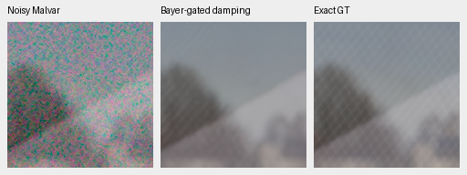
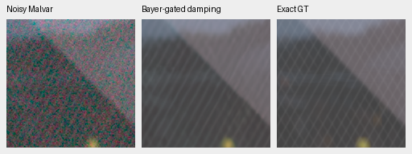

# Damping a regional detail correction with Bayer evidence

Bayer-gated damping cuts weak-increment error by **0.370 DN16** on
18 held-out ISO6400 wire scenes, while weak response falls **0.109
percentage points**. On two unplanted photo cohorts, it lowers
fine-increment and exact-flat error. Error on the continuing strong
wire inside a true gap increases slightly. The fine cab crossings
remain incomplete.

[Phase-aligned green recovery and the matched 47.5k follow-up](green-covariance-refit.md).

[Machine results](results/scene-mixture-wire-gaps-v1/publication.json) ·
[Frozen drivers and receipts](results/scene-mixture-wire-gaps-v1/evidence.tar.xz) ·
[Native crop provenance](images/scene-mixture-wire-gaps-v1/manifest.json).

## Model and fitting

The restored baseline is the guarded [band-limited mixture](scene-mixture-upper-band.md)
of Corpus 100k EMA `87b96f3c487b9edaf1c477742b6c38f2a82cc6b20a94716d51cc8cf46a17a760`
and spatial 40k EMA `d8ba41fa48bab80d515d8248ce6bd787b5347bcd00bcc1816ebbe39ddf52b8ef`.
Its coefficient SHA256 is
`bb70c73e03859c2e03f4e7f8535e24ecf0650e4d86c3765fb133556fadae96cb`.
The current general-choice V120 EMA
`a9d9b6b4f974e24a6b11e5e740aab32314233a7f53c056cf37c7d2aac1c589fb`
is scored on the same wire captures. All neural paths use IEEE FP32.

The new gate tests the sign of the neutral high-frequency endpoint
difference in each green phase at its native CFA coordinates. It
correlates that difference with a locally high-passed RAW signal,
using a Gaussian with a standard deviation of four packed pixels and
the shot/read variance. The weaker green score determines a bounded
smooth weight. The correction is low-passed after weighting and
tapered at the 160-pixel delivery boundary. Both neural estimates
have seen all CFA samples, so the gate measures empirical agreement
on the same observation. In the algebra check a constant input gives
zero, a known shared sinusoid saturates the gate and opposite phase
signs give zero at the center.

Calibration uses 24 separate wire backgrounds at ISO400 and ISO6400
and 16 unplanted independent ISO6400 photo triplets. The objective
maximizes mean ISO6400 weak response under six Corpus 100k mean error
ceilings. They cover wire and natural flat error, wire and natural
increment error, absolute gap error and weak-band gap error. The
initial nonnegative sweep has no eligible gain. On one development
ellipse, the agreement score is stronger on the exact flat than on its
present role. The signed sweep was frozen before scoring confirmation.
It selects −0.5 for the registered Bayer gate and −1.75 for the reversed
gate. Thirteen registered and three reversed settings satisfy the
ceilings. Uniform scaling has no eligible gain, so its constrained
control is the unchanged band-limited mixture. The code applies one
fixed scalar per arm with both frozen network forwards.

## Held-out wire gaps

The confirmation uses 18 of the earlier 24 gap-shoulder backgrounds at
ISO6400. Six overlap the earlier natural calibration and are excluded.
The wire and natural confirmation panels share ten sources and are
analyzed separately. Neither confirmation panel shares sources with the
new fit. The four roles use independent simulated noise for the present,
exterior-only, strong-only and exact-flat scenes. All methods receive the
same 256-pixel query. The spatial encoder sees a 512-pixel measured scene
with the same exterior for all four roles. The reversed-scene control
flips each packed CFA plane around the query and reinserts the identical
query pixels. [Wire fixture and noise provenance](query-gap-shoulders.md).

The intact score subtracts the strong-only restoration from the present
one. It fits and removes smooth tone, the planted edge and the continuing
strong carrier. The true-gap score uses the eight exact ellipse or strip
gaps and removes the same nuisance terms before assigning error to weak
frequencies. It includes up to four harmonics plus sum and difference
bands below Nyquist. The exterior-only contrast measures weak-band error
under exterior-only versus strong-only conditions inside those gaps.

| ISO6400 mean | Weak response | Intact increment RMS | Exact flat RMS | Absolute gap RMS | Weak-band gap RMS |
| --- | ---: | ---: | ---: | ---: | ---: |
| V120 | 33.810% | 193.086 | 24.520 | 155.881 | 9.072 |
| Corpus 100k | 33.893% | 193.492 | 24.083 | 154.292 | 9.335 |
| Spatial 40k | 32.815% | 192.962 | 22.359 | 154.065 | 9.208 |
| Previous signed mixture | 33.765% | 193.485 | 23.320 | 154.079 | 9.316 |
| Band-limited mixture | 33.606% | 193.444 | 22.761 | 153.885 | 9.295 |
| With Bayer-gated damping | 33.497% | 193.074 | 22.746 | 153.912 | 9.293 |

Error units are DN16. Source bootstrap intervals compare all arms on the
same observations. Relative to the band-limited mixture, damping cuts
intact error 0.370 DN16 [0.131, 0.687] and changes weak response −0.109
points [−0.235, −0.029]. Absolute gap RMS moves +0.027 DN16
[−0.023, +0.096]. Its strong-wire component rises 0.171 DN16
[0.039, 0.350]. Weak-band gap RMS moves −0.003 DN16 and exterior-only
weak error moves −0.010 DN16, with both intervals spanning zero.

The raw exterior intervention has little effect on this layout. Against
the reversed-scene control, the registered scene has 0.117 DN16 higher
intact error and a −0.023-point weak-response difference. This measures
the contribution of aligned exterior data on the constructed 512-pixel
fields.

Matching damping energy on development gives a better controlled test of
the local gate. The registered and reversed controls deliver 1.754 and
1.751 DN16 RMS on confirmation. The registered gate improves intact
error 0.058 DN16 [0.006, 0.116], with a −0.003-point response change
and 0.124 DN16 higher continuing strong-wire error. The uniform control
uses only 1.213 DN16 RMS on confirmation despite the same development
energy. The independently optimized reversed gate damps more strongly
and gets lower intact error with lower weak response.

## Unplanted detail

The fixed panel uses 48 held-out photographs. A separate 24-photo cohort
uses new independent ISO6400 noise. Its source IDs are disjoint from all
of the calibration and confirmation photos above. Both use the published
256-pixel query and a 96-pixel score core. The luma RMS covers the
1/8–1/3 band, with the DCT energy normalized over all native pixels.
Response changes average separate photo percentages.

| Independent ISO6400 versus band-limited mixture | Fine-flat RMS change | Fine-increment RMS change | Fine-response change |
| --- | ---: | ---: | ---: |
| 48 fixed photos | −0.150 DN16 | −0.188 DN16 | −0.167 points |
| 24 additional photos, new noise | −0.130 DN16 | −0.155 DN16 | −0.210 points |

On the additional photos, the fine-increment change has interval
[−0.230, −0.090] DN16. Compared with Corpus 100k, fine-flat and
fine-increment error fall 0.494 and 0.214 DN16 respectively.
On the fixed panel, damping changes upper-band flat RMS from 2.093
to 2.092 DN16 and upper-band increment RMS from 119.981 to 119.980
DN16. The corresponding Corpus 100k results are 2.131 and 120.038.
Lower-band flat and increment RMS also fall. The largest rendered
channel deviation from a neutral luma correction after FP32 rounding
is 0.0048 DN16.
This is a quieter operating point with lower response. The scoped
composition has no full427 or measured-camera PSNR measurement.
[Comparable model history](performance-history.md).

## Native exact-target comparisons

The triplets use the same 160 × 160 native pixels at `[48,48,160,160]`
within the query `[128,128,256,256]` of each listed source box. The
RGGB capture uses shot/read `0.00128/6.5536e-6`, exposure ×0.33,
16-bit ADC and black level 0.03. All columns use display ×2 and
the same camera rendering. The exact target is the constructed scene
with a planted gap.

**Vvedensky Ostrovsky Monastery in winter**, Kotjara kamenskaja,
CC BY-SA 4.0. Source box `[52,104,512,512]`. Weak-band gap error
changes 4.619→4.501 DN16 versus Corpus 100k, the largest reduction in
the eight test gaps. The faint weave remains soft over the light area.
[Source](https://commons.wikimedia.org/wiki/File:%D0%92%D0%B2%D0%B5%D0%B4%D0%B5%D0%BD%D1%81%D0%BA%D0%B8%D0%B9_%D0%9E%D1%81%D1%82%D1%80%D0%BE%D0%B2%D1%81%D0%BA%D0%B8%D0%B9_%D0%BC%D0%BE%D0%BD%D0%B0%D1%81%D1%82%D1%8B%D1%80%D1%8C_%D0%B7%D0%B8%D0%BC%D0%B0.jpg) ·
[All methods](images/scene-mixture-wire-gaps-v1/exact/008-iso6400-comparison.png).

**Ottignies station on a frosty day**, Trougnouf, CC BY 4.0. Source
box `[606,6,512,512]`. Weak-band gap error rises 11.050→11.123
DN16 versus Corpus 100k, the largest increase. The bright diagonal
remains coherent and the second wire direction blends into the dark field.
[Source](https://commons.wikimedia.org/wiki/File:Ottignies_train_station_on_a_frosty_day,_looking_down_at_the_platforms_from_the_South_side.jpg) ·
[All methods](images/scene-mixture-wire-gaps-v1/exact/000-iso6400-comparison.png).

## Standing GFX100S comparisons

All eight boards were viewed at native scale. The DSCF3879 sky
reproduces the band-limited mixture. Building detail changes by
0.686 DN16 camera-RGB RMS, foliage by 2.300 and coarse fence by 2.789.
The coarse crossings stay coherent and fine building and foliage edges
stay soft. Damping changes the separate DSCF3842 cab crops by up to
0.811 DN16 RMS. The transferred right diagonals remain the clearest,
with mottling and incomplete crossings. The independent ISO100 AHD and
cab JPEG views are qualitative references with different exposures,
aperture and subject motion.

DSCF3879 uses shot/read `0.00128/6.5536e-6` and display ×4. The
DSCF3842 crops use display ×16 and either that nominal prior or
transferred `0.0014635775921166604/1.0715704128646712e-6`.

[Sky](images/scene-mixture-wire-gaps-v1/standing/main-overcast-sky-main-overcast-sky.png) ·
[Building](images/scene-mixture-wire-gaps-v1/standing/main-building-detail-main-building-detail.png) ·
[Foliage](images/scene-mixture-wire-gaps-v1/standing/main-foliage-main-foliage.png) ·
[Coarse fence](images/scene-mixture-wire-gaps-v1/standing/main-chain-link-fence-main-chain-link-fence.png).

| Cab conditioning | Left ROI | Right ROI |
| --- | --- | --- |
| Nominal | [Native board](images/scene-mixture-wire-gaps-v1/standing/mesh-nominal-fine-green-mesh-left.png) | [Native board](images/scene-mixture-wire-gaps-v1/standing/mesh-nominal-fine-green-mesh-right.png) |
| Transferred | [Native board](images/scene-mixture-wire-gaps-v1/standing/mesh-profile3879-fine-green-mesh-left.png) | [Native board](images/scene-mixture-wire-gaps-v1/standing/mesh-profile3879-fine-green-mesh-right.png) |
