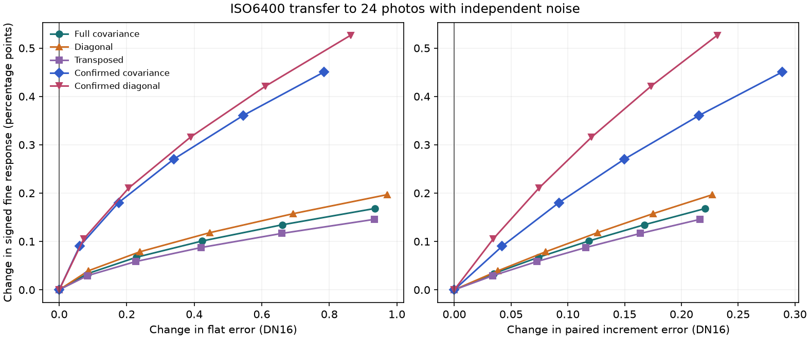
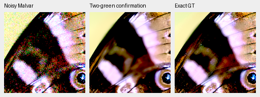
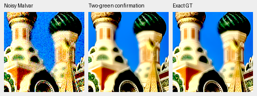

# Using similar patches elsewhere in the photo to filter native detail

Whole-photo patch covariance gave no reliable improvement over a simpler
frequency-by-frequency filter. On 24 independent ISO6400 photos, confirming
the correction on both physical green grids adds **0.180 percentage points**
of fine response over Corpus 100k, with **0.092 DN16** more fine-increment
error and **0.176 DN16** more flat-core error. Fitting the correction strength
on independent noise draws selects zero at both ISO levels. The native
GFX100S review shows no new fine crossings.

[Machine results](results/scene-patch-covariance-v1/publication.json) ·
[Frozen receipts and source](results/scene-patch-covariance-v1/evidence.tar.xz) ·
[Native crop provenance](images/scene-patch-covariance-v1/manifest.json).

## How the photo conditions aggregation

The [earlier spectral test](scene-spectrum-detail.md) estimated how
much power to expect in each frequency. This replay also estimates
which frequencies occur together. It builds an atlas of 16-pixel
windows outside the native query and its 16-pixel halo. Up to
32 exterior patches contribute to each local window according to
low-resolution brightness, color, structure and a soft distance
weight. The GFX100S atlas reads about 4,770 windows across the field.

Each fit uses 40 native cosine modes from 0.08 to 0.224 cycles per
pixel plus low-frequency nuisance terms. The two green grids are
fit at their actual CFA offsets. The symmetric cross moment of
the two fits estimates the donor covariance with less bias from
independent sensor noise. It carries no mean donor signal. The
method subtracts an empirical finite-sample allowance from the
covariance eigenvalues, then applies bounded Wiener gains to the
**query's** measured-minus-parent coefficients. A tapered overlap-add
delivers the correction along a camera-neutral direction. Tests
recover the same known cosine coefficients on both greens for each
of the four Bayer layouts, verify donor isolation, and check zero
output with exactly zero innovation.

The diagonal control removes cross-frequency correlations. The
transposed control swaps the axes of the full covariance. The nearby
control prefers exterior patches close to the query. The confirmed
policies taper the gain unless the original RAW projections on
both greens support the proposed sign. The taper rises from 0.5
to 2.5 estimated standard deviations based on the less supportive
green. Descriptor selection and the frozen parent both use the
noisy observation, so the confirmation is an empirical check.

## Exact-target results

The replay uses 32 earlier source fields for calibration and 32
different fields for the independent test, at ISO400 and ISO6400.
Those fields appeared in the original Corpus 100k training.
The second transfer uses 24 separate validation photos outside the
training receipts and fixed 427-photo cohort, with six of each
Bayer layout. It reuses their frozen natural texture-present,
attenuated and exact-flat roles. The same clean targets are used for
coupled and independent calibrations. Only the RAW observation and
its resulting parent prediction change. [Transfer cohort audit](green-covariance-refit.md#frozen-inputs-and-models).

The diagnostic strength sets a pooled **1 DN16 added correction**
on the exact-flat calibration fields in the 1/8–1/3 cycles/pixel
band. The table reports the actual remaining error on the 24
transfer photos. Response projects the restored present-minus-absent
increment onto the exact signed increment. Errors are mean per-photo
RMS in DN16.

| Independent ISO6400 transfer | Fine response | Fine increment RMS | Fine flat RMS |
| --- | ---: | ---: | ---: |
| V120 EMA | 73.832% | 139.539 | 5.338 |
| Corpus 100k EMA | 73.897% | 138.927 | 4.826 |
| Matched patch covariance | 73.964% | 139.001 | 5.054 |
| Diagonal control | 73.975% | 139.008 | 5.065 |
| Transposed covariance | 73.955% | 139.000 | 5.052 |
| Nearby covariance | 73.951% | 139.002 | 5.055 |
| Two-green confirmation | 74.077% | 139.019 | 5.002 |
| Confirmed diagonal | 74.107% | 139.002 | 5.032 |

Relative to Corpus 100k on these photos, two-green confirmation
changes response by +0.180 points [0.143, 0.214], increment RMS by
+0.092 DN16 [0.046, 0.139], and flat RMS by +0.176 DN16 [0.124, 0.231].
Intervals resample entire photos. Below 1/8 cycles/pixel, increment
and flat RMS also rise, by 0.176 and 0.059 DN16. On the earlier
32 independent ISO6400 photos, the same full confirmed operator
gains 0.143 response points with 0.086 DN16 more increment error.
The confirmed diagonal has higher response on both panels.

Strength fitting minimizes fine-increment RMS while allowing
up to 0.05 DN16 extra flat RMS and 0.02 DN16 extra present-image
RMS in each band. It also requires at least the parent response.
Fitting coupled draws selects positive gains for every policy.
Fitting the same 32 fields with independent noise selects zero
for all six policies at both ISOs. The denser gain-grid replay
confirms the zero selection.

A separate repeat-pattern simulation gives the atlas the right
correlations between two exact modes. Donor and query signs and
sensor noise are redrawn independently over 2,048 cases. At 50%
response, full covariance lowers intact error from 56.52 to
53.95 DN16 and adds 26.36 DN16 on the flat control. The diagonal
operator gives 51.03 and 19.60 DN16 at the same response. A transposed
prior only reaches 46.03% at its allowed maximum. Even with the
correct mode family, the finite-sample full covariance estimates
pass more unwanted signal than the diagonal.

The base is Corpus 100k EMA
`87b96f3c487b9edaf1c477742b6c38f2a82cc6b20a94716d51cc8cf46a17a760`.
The general-use comparison is V120 EMA
`a9d9b6b4f974e24a6b11e5e740aab32314233a7f53c056cf37c7d2aac1c589fb`.
The 152-case CPU replay with saved parent outputs took 84.69 s,
and the 64-case independent calibration replay took 44.74 s,
including data reads. This study trained no weights. Numerical
evaluation and native review are complete within this component
scope. [Fixed-panel PSNR history](performance-history.md).

## Native exact-target crops

Each cell shows 160×160 native pixels at `[48,48,160,160]` in the
256-pixel query. The simulated ISO6400 prior uses shot/read
`0.00128/6.5536e-6`, capture exposure ×0.33 and ADC16 black fraction
0.03. Display uses ×3.03 exposure and ×2 common reference-centered
contrast. Each triplet shows noisy Malvar, the two-green confirmed
covariance above Corpus 100k and exact synthetic GT.

**Lilacfork butterfly**, Atanu Bose Photography, CC BY-SA 4.0,
`[290,120,256,256]`, GRBG. The diagonal wing edge persists and
the smallest markings remain soft. The paired error is 0.080 DN16
lower than confirmed diagonal on this example.
[Source](https://commons.wikimedia.org/wiki/File:Close_wing_basking_position_of_Lethe_sura_%28Doubleday,_1849%29_-_Lilacfork.jpg) ·
[Full board](images/scene-patch-covariance-v1/exact/transfer-37-present-comparison.png) ·
[Flat control](images/scene-patch-covariance-v1/exact/transfer-37-flat-comparison.png).

**Saint Nicholas Cathedral, Nice**, Florent Abel, CC BY-SA 4.0,
`[138,178,256,256]`, GBRG. Small tower accents remain soft. The
paired error rises 0.150 DN16 versus confirmed diagonal on this example.
[Source](https://commons.wikimedia.org/wiki/File:Cath%C3%A9drale_orthodoxe_russe_Saint-Nicolas_de_Nice.jpg) ·
[Full board](images/scene-patch-covariance-v1/exact/transfer-35-present-comparison.png) ·
[Flat control](images/scene-patch-covariance-v1/exact/transfer-35-flat-comparison.png).

## Standing GFX100S comparisons

All 12 boards were reviewed at native size. The DSCF3879/3880 sky stays
smooth and the coarse fence keeps its crossings. At the fixed diagnostic
strength, confirmation changes camera-RGB RMS by 0.190 DN16 in the
sky, 0.584 on the building, 1.002 in the foliage and 0.806 on the fence.
The diagonal policies leave the sky identical. The fine building
wires and small leaf subdivisions stay soft.

The two DSCF3842/3835 left regions remain mostly unresolved. The
transferred right still shows the clearest diagonals, with incomplete
crossings. Confirmation changes the four fine-cab crops by
0.129–0.230 DN16, with little visible effect. The ISO100 AHD and
camera JPEG images are independent qualitative references with
different exposure, aperture and moving subjects.

[Sky ×4](images/scene-patch-covariance-v1/standing/main-overcast-sky-main-overcast-sky-x4.png) ·
[Building ×4](images/scene-patch-covariance-v1/standing/main-building-detail-main-building-detail-x4.png) ·
[Foliage ×4](images/scene-patch-covariance-v1/standing/main-foliage-main-foliage-x4.png) ·
[Coarse fence ×4](images/scene-patch-covariance-v1/standing/main-chain-link-fence-main-chain-link-fence-x4.png).

| Cab profile, shot/read | Left ROI | Right ROI |
| --- | --- | --- |
| Nominal `0.00128/6.5536e-6` | [×4](images/scene-patch-covariance-v1/standing/mesh-nominal-fine-green-mesh-left-x4.png) · [×16](images/scene-patch-covariance-v1/standing/mesh-nominal-fine-green-mesh-left-x16.png) | [×4](images/scene-patch-covariance-v1/standing/mesh-nominal-fine-green-mesh-right-x4.png) · [×16](images/scene-patch-covariance-v1/standing/mesh-nominal-fine-green-mesh-right-x16.png) |
| Transferred `0.0014635775921166604/1.0715704128646712e-6` | [×4](images/scene-patch-covariance-v1/standing/mesh-profile3879-fine-green-mesh-left-x4.png) · [×16](images/scene-patch-covariance-v1/standing/mesh-profile3879-fine-green-mesh-left-x16.png) | [×4](images/scene-patch-covariance-v1/standing/mesh-profile3879-fine-green-mesh-right-x4.png) · [×16](images/scene-patch-covariance-v1/standing/mesh-profile3879-fine-green-mesh-right-x16.png) |
