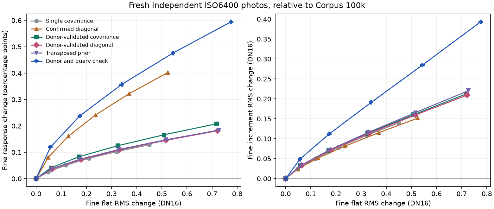
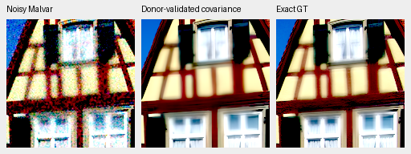
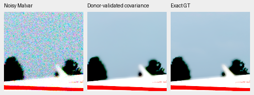

# Checking patch covariance on separate Bayer donors

Validating the modes on disjoint exterior patches helps when the
scene contains coherent repeats. On 24 planted-wire backgrounds,
combining the donor and query checks recovers **0.109 percentage
points** over the earlier confirmed diagonal filter at matched
flat error. It also lowers error on the continuing direction in
true gaps by **0.162 DN16**. Fine-detail error rises on 32 new
ISO6400 natural photos. Both standing cab ROIs
retain incomplete fine crossings.

[Machine results](results/scene-patch-crossfit-v1/publication.json) ·
[Frozen drivers and receipts](results/scene-patch-crossfit-v1/evidence.tar.xz) ·
[Crop provenance](images/scene-patch-crossfit-v1/manifest.json).

[Wider Bayer windows](scene-patch-width.md) lower short-wire error
in known gaps by 3.85 DN16 versus the narrower same-band window.
A separate low band raises long-wave response at similar quiet
error on a second set of planted wires. The real cab still has
incomplete crossings.

## Separate discovery from measurement

The [previous patch-covariance experiment](scene-patch-covariance.md)
estimated directions and their power in one donor group. Positive
eigenvalues admitted noise even when the atlas contained the correct
repeat. This replay keeps the same 16-pixel windows, spatial-frequency
band, query RAW, taper and parent. It ranks up to 32 exterior patches
with the same matching rule and assigns alternating ranks to two
nonoverlapping sets. It fits eigenvectors on one set and measures
their signed green cross power on the other. The reciprocal pass
swaps the sets and the two delivered corrections average equally.

The held-out power subtracts two estimated standard errors. The
estimate uses the larger of empirical variation and the propagated
independent sensor-noise floor. Each half needs an effective sample
count of at least four. The resulting bounded filter still applies
to the query's measured-minus-parent coefficients. The additional
query check uses both physical greens to confirm the proposed sign.
The validated diagonal uses the same donor power rule on fixed
cosine axes. The transpose control swaps the verified prior's axes
before filtering the original query. Candidate matching still uses
noisy descriptors. The disjoint RAW samples give an empirical
check under that selection.

## Coherent repeats and held-out wire geometries

In the fixed repeat simulation, a 40% response parent sees a weak
combination of two known cosine modes. Independent donor groups and
query noise are drawn across all four Bayer layouts. After fitting
one strength on coherent repeats, the new 1,536 coherent cases
give the following results.

| Filter | Response | Intact RMS, DN16 | Flat RMS, DN16 |
| --- | ---: | ---: | ---: |
| Previous single covariance | 49.663% | 54.589 | 27.009 |
| Previous single diagonal | 49.810% | 51.430 | 20.281 |
| Donor-validated covariance | 49.638% | 50.002 | 15.440 |
| Donor-validated diagonal | 49.783% | 51.405 | 20.130 |

When the relative mode signs vary across donors, the gain over the
diagonal disappears. When alternate donor patches have perpendicular
patterns, the split filter brings response close to the parent
(40.400%) and flat error to 6.565 DN16. This is deliberately adverse
to the discovery and verification halves.

The wire replay uses 24 previously captured photo backgrounds with
four planted wire geometries and separate noisy observations for each
role. Twelve contain exact true gaps. The original natural-photo
gain match transfers unevenly. Donor and query checking gains 1.563
wire response points over Corpus 100k while raising wire-flat RMS
by 0.439 DN16. After observing this mismatch, a second analysis
holds out one complete geometry family at a time and calibrates
each filter on the other three to +0.10 DN16 actual wire-flat RMS.

| Wire-flat match | Weak response | Intact increment RMS | Continuing strong error in gaps | False weak error in gaps | Flat RMS |
| --- | ---: | ---: | ---: | ---: | ---: |
| Corpus 100k EMA | 31.804% | 183.117 | 73.781 | 8.539 | 20.245 |
| Earlier single covariance | 32.117% | 183.180 | 73.623 | 8.605 | 20.345 |
| Earlier query-confirmed diagonal | 32.369% | 183.313 | 73.350 | 8.643 | 20.345 |
| Donor-validated covariance | 32.166% | 183.124 | 73.617 | 8.626 | 20.345 |
| Donor and query checks | 32.478% | 183.313 | 73.188 | 8.652 | 20.345 |
| Donor and query checks, diagonal | 32.390% | 183.268 | 73.350 | 8.660 | 20.345 |

All errors use DN16. Compared with the earlier confirmed diagonal,
the combined full filter changes weak response by +0.109 points
[0.044, 0.181], continuing strong error in gaps by −0.162 DN16
[−0.286, −0.014] and false weak error in gaps by +0.009 DN16
[−0.034, +0.050]. Intervals resample photos within each family,
with fold strengths fixed. Relative to the parent, false weak error
is still 0.113 DN16 higher. These are retrospective comparisons
within the retained planted-wire pool.

## Transfer to independent natural detail

The calibration uses 32 earlier photo fields with independent
noise at ISO400 and ISO6400. Under the same absolute and quiet
error limits as the previous study, every operator selects zero
strength at both ISOs. A separate nonzero comparison sets the same
+0.15 DN16 exact-flat fine RMS on the calibration fields.

The fresh ISO6400 test uses 32 photos, eight per CFA. Source IDs and
cache hashes are distinct from the earlier natural and wire panels,
the fixed 427-photo cohort and all 559,808 recorded Corpus 100k
photographic visits. Every photo has independent noise for the
exterior, present, attenuated and flat observations. The table
gives mean per-photo fine RMS on the actual transfer, using
1/8–1/3 cycles per native pixel.

| Fresh ISO6400 transfer | Fine response | Fine increment RMS, DN16 | Fine flat RMS, DN16 |
| --- | ---: | ---: | ---: |
| V120 EMA | 63.262% | 131.358 | 4.612 |
| Corpus 100k EMA | 63.455% | 130.676 | 3.935 |
| Previous confirmed diagonal | 63.656% | 130.742 | 4.114 |
| Donor-validated covariance | 63.559% | 130.767 | 4.178 |
| Donor-validated transposed | 63.547% | 130.769 | 4.182 |
| Donor and query checks | 63.752% | 130.825 | 4.186 |
| Donor and query checks, diagonal | 63.751% | 130.801 | 4.182 |

The donor-validated covariance changes the parent fine response
by +0.104 points [0.073, 0.142], increment error by +0.091 DN16
[0.051, 0.135] and flat error by +0.243 DN16 [0.128, 0.377].
The added query check recovers more response with higher error.
The transposed covariance gives nearly the same result as the
matching covariance. The other 32 independent fields at both
ISOs and the earlier 24 ISO6400 transfer photos also show weak
or adverse fine-error changes. At a second calibration matching
the fine response, the earlier confirmed diagonal still gives
lower increment error on the 32 fresh photos.

The parent is Corpus 100k EMA
`87b96f3c487b9edaf1c477742b6c38f2a82cc6b20a94716d51cc8cf46a17a760`.
The recommended comparison uses V120 EMA
`a9d9b6b4f974e24a6b11e5e740aab32314233a7f53c056cf37c7d2aac1c589fb`.
The fresh parent forward loop uses CUDA IEEE FP32 and takes 77.09 s
including capture writes. CPU calibration takes 59.32 s, new
photo replay 63.27 s, and the wire-flat analysis 49.23 s. No weights
were trained. Numerical and native qualitative review are complete
for this component. [Fixed-panel history](performance-history.md).

## Native exact-target crops

Each cell is 160×160 at `[48,48,160,160]` in a 256-pixel query,
ISO6400 shot/read `0.00128/6.5536e-6`, exposure ×0.33 at capture,
ADC16 black fraction 0.03. The photo triplets use common display
×3.03 and contrast ×2. Each shows noisy Malvar, donor-validated
covariance and exact GT.

**Marktbreit**, Berthold Werner, public domain. Query
`[486,104,256,256]`, GBRG. The beam edges survive with soft
paint and window details. Increment error is 0.119 DN16 lower
than the earlier confirmed diagonal on this example.
[Source](https://commons.wikimedia.org/wiki/File:Marktbreit_BW_9.jpg) ·
[Comparison](images/scene-patch-crossfit-v1/exact/fresh-19-present-comparison.png) ·
[Flat control](images/scene-patch-crossfit-v1/exact/fresh-19-flat-comparison.png).

**Patrouille Suisse**, Julian Herzog, CC BY 4.0. Query
`[336,80,256,256]`, GBRG. The sky is smooth and dark edges are
rounded. Increment error is 0.237 DN16 higher than the earlier
confirmed diagonal.
[Source](https://commons.wikimedia.org/wiki/File:Patrouille_Suisse_Northrop_F-5E_Tiger_II_ILA_Berlin_2016_15.jpg) ·
[Comparison](images/scene-patch-crossfit-v1/exact/fresh-15-present-comparison.png) ·
[Flat control](images/scene-patch-crossfit-v1/exact/fresh-15-flat-comparison.png).

The wire triplets use the held-out geometry strengths for the
combined donor and query check, display ×2 and contrast ×1. Both
use a central `[128,128,256,256]` native query in their 512-pixel
planted field, with the same sensor and crop settings. The strip
example gains 0.531 response points, although the weak crossings
are still faint. The ellipse example adds 0.180 DN16 false
projection compared with the earlier confirmed diagonal.

- **Hippolais polyglotta**, Roger Culos, CC BY-SA 4.0,
  field `[88,60,512,512]`, GRBG. [Source](https://commons.wikimedia.org/wiki/File:Hippolais_polyglotta_MHNT.ZOO.2010.11.201.1.jpg) · [Triplet](images/scene-patch-crossfit-v1/wire/wire-35f2f4c550-triplet.png) · [Comparison](images/scene-patch-crossfit-v1/wire/wire-35f2f4c550-comparison.png).
- **Carillón Estación Limache**, Carlos Figueroa Rojas, CC BY-SA 4.0,
  field `[116,650,512,512]`, GRBG. [Source](https://commons.wikimedia.org/wiki/File:Carill%C3%B3n_Estaci%C3%B3n_Limache_20191223_01.jpg) · [Triplet](images/scene-patch-crossfit-v1/wire/wire-807607835c-triplet.png) · [Comparison](images/scene-patch-crossfit-v1/wire/wire-807607835c-comparison.png).

## Standing GFX100S comparisons

All 12 native boards were viewed. DSCF3879/3880 uses display ×4
and the nominal noise profile. At the natural matched-flat
strength, donor validation changes sky by 0.027 DN16 camera-RGB
RMS versus Corpus 100k. The sky stays smooth and the coarse
fence retains coherent crossings. Thin building bracing and small
leaf subdivisions remain soft.

Both DSCF3842/3835 left crops stay mostly unresolved. The
transferred right still shows clearer diagonal traces with
incomplete crossings. The donor-validated change is 0.024–0.067
DN16 over the four fine-cab crops. The measured real peaks span
0.114–0.139 cycles/pixel, inside the fitted band. The approximately
0.036 cycles/pixel peak reported in V196 belongs to a planted mesh.
The ISO100 AHD and camera JPEGs are independent
qualitative references with different aperture, exposure and
motion. [Measured cab peaks](green-phase-spectrum.md#measured-result) ·
[Planted mesh frequency audit](innovation-frequency-selection.md).

[Sky](images/scene-patch-crossfit-v1/standing/main-overcast-sky-main-overcast-sky-x4.png) ·
[Building](images/scene-patch-crossfit-v1/standing/main-building-detail-main-building-detail-x4.png) ·
[Foliage](images/scene-patch-crossfit-v1/standing/main-foliage-main-foliage-x4.png) ·
[Coarse fence](images/scene-patch-crossfit-v1/standing/main-chain-link-fence-main-chain-link-fence-x4.png).

| Cab shot/read | Left ROI | Right ROI |
| --- | --- | --- |
| Nominal `0.00128/6.5536e-6` | [×4](images/scene-patch-crossfit-v1/standing/mesh-nominal-fine-green-mesh-left-x4.png) · [×16](images/scene-patch-crossfit-v1/standing/mesh-nominal-fine-green-mesh-left-x16.png) | [×4](images/scene-patch-crossfit-v1/standing/mesh-nominal-fine-green-mesh-right-x4.png) · [×16](images/scene-patch-crossfit-v1/standing/mesh-nominal-fine-green-mesh-right-x16.png) |
| Transferred `0.0014635775921166604/1.0715704128646712e-6` | [×4](images/scene-patch-crossfit-v1/standing/mesh-profile3879-fine-green-mesh-left-x4.png) · [×16](images/scene-patch-crossfit-v1/standing/mesh-profile3879-fine-green-mesh-left-x16.png) | [×4](images/scene-patch-crossfit-v1/standing/mesh-profile3879-fine-green-mesh-right-x4.png) · [×16](images/scene-patch-crossfit-v1/standing/mesh-profile3879-fine-green-mesh-right-x16.png) |
