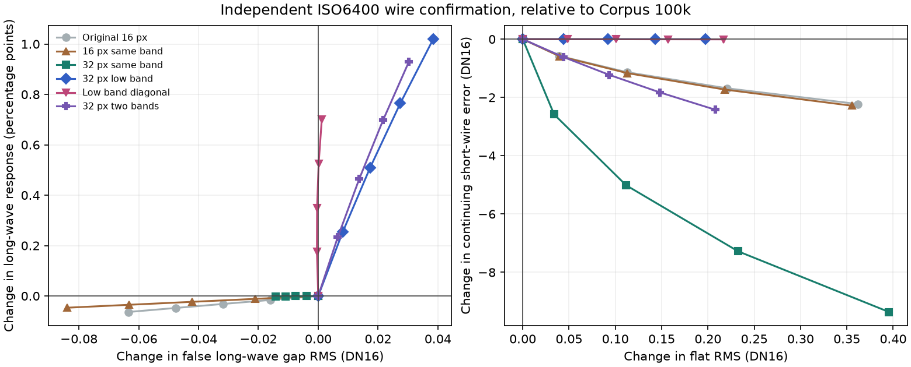
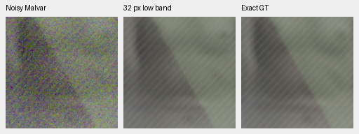
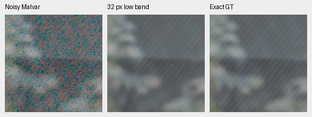

# Wider Bayer measurement windows for weak wires

On 32 new ISO6400 planted-wire scenes, a 32-pixel window lowers
error on the short wire that continues through true gaps in a
longer wire by **3.85 DN16** versus a 16-pixel window in the same
frequency band. Measured flat error is nearly identical. A
separate lower band recovers **0.51 percentage points** of the
long fundamental over Corpus 100k, with a small and uncertain
change in false gap projection. Natural-photo errors rise, and
the fine GFX100S cab crossings remain incomplete.

[Machine results](results/scene-patch-width-v1/publication.json) ·
[Frozen drivers and receipts](results/scene-patch-width-v1/evidence.tar.xz) ·
[Native crop provenance](images/scene-patch-width-v1/manifest.json).

## Separating window width from frequency coverage

The [previous separate-donor filter](scene-patch-crossfit.md)
fits native detail in 16-pixel windows and uses the query's
two physical green grids to confirm the sign of its correction.
This follow-up holds the evidence rule fixed and changes the
window and delivered frequency band. The same-band comparison
uses 0.08–0.16 cycles per native pixel, with 20 cosine modes at
16 pixels and 66 at 32 pixels. A second 32-pixel fit uses
0.022–0.08 cycles per pixel and 25 modes. All fits retain the
remaining modes through 0.224 cycles per pixel as nuisance terms.
The wider window supplies more Bayer sites and finer frequency
spacing. Its donor selection also uses wider field samples.

The measured DSCF3842 peaks have periods about **7.2 to 8.8
pixels**. They already fall inside the previous filter's band.
The **27.69-pixel** fundamental reported in V196 belongs to a
planted mesh. The previous report and research summary now
identify the two measurements correctly.
[Measured real cab peaks](green-phase-spectrum.md#measured-result) ·
[Planted mesh frequency audit](innovation-frequency-selection.md).

An exact noiseless projection across all CFA layouts and phases
recovers 87.2% and 85.5% along the two real peak directions with
16 pixels in the same band. The 32-pixel window reaches 92.7%
and 92.2%. The separate low band represents 92.2% of the
27.69-pixel test wave, compared with 0.7% in the original
16-pixel band. These are measurements of basis coverage before
donor screening and delivery.

## Fresh long and short crossing wires

The test freezes 48 new photo backgrounds and places a weak
24–35-pixel-period wire across a stronger 7–11-pixel-period
wire. The longer carrier has a strip gap, ellipse gap,
continuous dip or contrast step. Independent noise is drawn for
four roles. The exact targets enter scoring. The filter uses the
fixed whole-scene exterior and native query measurements.

The first 16 sources set one correction strength per policy
to +0.10 DN16 measured flat RMS. The following 32 cover both
wire directions, all four CFA layouts and 16 cases with exact
gaps. Source IDs and cache hashes exclude the previous photo
and wire panels, the fixed 427-photo cohort and all 559,808
recorded Corpus 100k photographic visits.

| Policy | Long fundamental response | Long intact error | False long projection in gaps | Continuing short error in gaps | Flat RMS |
| --- | ---: | ---: | ---: | ---: | ---: |
| V120 EMA | 76.177% | 21.008 | 9.464 | 82.680 | 21.237 |
| Corpus 100k EMA | 75.317% | 21.136 | 9.744 | 78.167 | 21.217 |
| Original 16 pixels | 75.286% | 21.141 | 9.712 | 77.030 | 21.330 |
| 16 pixels, same band | 75.294% | 21.137 | 9.701 | 77.002 | 21.330 |
| 32 pixels, same band | 75.317% | 21.134 | 9.736 | 73.153 | 21.329 |
| 32 pixels, low band | 75.827% | 20.892 | 9.761 | 78.166 | 21.309 |
| 32 pixels, diagonal low band | 75.668% | 21.022 | 9.743 | 78.163 | 21.318 |
| 32 pixels, both bands | 75.782% | 20.913 | 9.757 | 76.941 | 21.311 |

All errors use DN16. Within the same band, widening lowers
short-wire error inside gaps by 3.849 DN16 [2.364, 5.407]
and total gap error by 2.184 DN16 [1.351, 3.025].
False projection of the missing long wire rises by 0.035 DN16
[0.011, 0.062] versus the narrower window. The change in flat
RMS is −0.001 DN16 [−0.025, +0.024].

The low-band covariance raises fundamental response by
0.510 points [0.377, 0.648] over Corpus 100k and lowers
intact fundamental error by 0.244 DN16 [0.126, 0.380].
False projection in true gaps changes by +0.017 DN16
[−0.068, +0.111]. At a similar measured flat error, the
low-band covariance gains 0.159 response points [0.080,
0.245] and lowers intact fundamental error by 0.130 DN16
[0.071, 0.204] versus its diagonal control. The combined
two-band setting shares one strength and gives up most of
the short-wire improvement. Intervals resample photo
backgrounds.

On 32 earlier natural-photo scenes with independent noise, the
wire-calibrated low band raises the lower-frequency paired
increment error by 0.220 DN16 [0.157, 0.284] and flat error by
0.182 DN16 [0.121, 0.249]. The same-band 32-pixel width raises
fine increment and flat error by 0.136 and 0.278 DN16. The
natural-photo replay shows the cost of using the wire-calibrated
strength on ordinary fine detail.

The frozen parent is Corpus 100k EMA
`87b96f3c487b9edaf1c477742b6c38f2a82cc6b20a94716d51cc8cf46a17a760`
and V120 EMA uses
`a9d9b6b4f974e24a6b11e5e740aab32314233a7f53c056cf37c7d2aac1c589fb`.
The 48-scene CUDA IEEE FP32 capture and parent loop takes
256.83 s including writes. Calibration CPU replay takes
24.95 s, confirmation 49.09 s and natural replay 39.97 s.
No weights were trained and both numerical and native reviews
are complete for the component. [Fixed-panel history](performance-history.md).

## Native exact-target crops

Each cell is 160×160 at `[48,48,160,160]` in the central
`[128,128,256,256]` query of the 512-pixel planted field.
All triplets use ISO6400 shot/read `0.00128/6.5536e-6`,
capture exposure ×0.33, ADC16 black 0.03 and common display ×2.
The columns show noisy Malvar, the specified restored output
and exact synthetic GT at native size.

**Tchaikovsky Street**, Екатерина Борисова, CC BY-SA 4.0,
field `[26,138,512,512]`, GBRG. The low band gains
1.578 long-wave response points over the original 16-pixel
filter. Long crossings stay soft.
[Source](https://commons.wikimedia.org/wiki/File:%D0%A7%D0%B0%D0%B9%D0%BA%D0%BE%D0%B2%D1%81%D0%BA%D0%BE%D0%B3%D0%BE_17_02.jpg) ·
[Comparison](images/scene-patch-width-v1/exact/long-35-present-comparison.png) ·
[Flat control](images/scene-patch-width-v1/exact/long-35-flat-comparison.png).

**Artemisia genipi**, Robert Flogaus-Faust, CC BY 4.0,
field `[10,0,512,512]`, GBRG. The low band adds 0.502 DN16
false long projection versus the original 16-pixel filter.
The two outputs look close at native size.
[Source](https://commons.wikimedia.org/wiki/File:Artemisia_genipi_2_RF.jpg) ·
[Comparison](images/scene-patch-width-v1/exact/long-39-present-comparison.png) ·
[Flat control](images/scene-patch-width-v1/exact/long-39-flat-comparison.png).

The same-band width triplets use those same settings. The wider
output makes the short family modestly clearer in the first.
The second has the largest increase in false long projection
when the window is widened.

- **Japanese cedar cones**, MrPanyGoff, CC BY-SA 3.0,
  field `[56,34,512,512]`, GRBG. [Source](https://commons.wikimedia.org/wiki/File:Japanese_cedar_cones_-_Cryptomeria_japonica.jpg) · [Triplet](images/scene-patch-width-v1/mid/long-18-triplet.png) · [Comparison](images/scene-patch-width-v1/mid/long-18-comparison.png).
- **Aveiro**, Alvesgaspar, CC BY-SA 3.0, field
  `[30,120,512,512]`, RGGB. [Source](https://commons.wikimedia.org/wiki/File:Aveiro_March_2012-23.jpg) · [Triplet](images/scene-patch-width-v1/mid/long-20-triplet.png) · [Comparison](images/scene-patch-width-v1/mid/long-20-comparison.png).

The natural crops show a smooth island sky gradient and a soft
woodland transition. Identical capture conditioning and native
coordinates use display exposure ×3.03, contrast ×2. The
provenance manifest gives the fixed boxes and source licenses.
[Gorée](images/scene-patch-width-v1/natural/fresh-03-comparison.png) ·
[Deidesheim](images/scene-patch-width-v1/natural/fresh-06-comparison.png).

## Standing GFX100S comparisons

The 12 boards use the stored DSCF3879/3880 and DSCF3842/3835
coordinates. The same-band 32-pixel policy changes the main
sky by 0.009 DN16, the building by 1.334, foliage by 1.744
and coarse fence by 1.477 in camera-RGB RMS. The sky remains
visually smooth, and the coarse crossing pattern stays
coherent. Fine wires and small leaves remain soft.

Across both fine-cab profiles, the 32-pixel same-band
correction changes the four views by 0.039–0.116 DN16.
The two measured peak projections in the restored green
change by at most 0.069 percentage points of the noisy
RAW projection. That projection uses the same noisy capture
and provides a descriptive check. Both left meshes remain
mostly unresolved, and the transferred right retains the
clearest incomplete diagonals. The ISO100 AHD and JPEG
images are independently captured qualitative references
with different aperture, exposure and motion.

[Sky ×4](images/scene-patch-width-v1/standing/main-overcast-sky-main-overcast-sky-x4.png) ·
[Building ×4](images/scene-patch-width-v1/standing/main-building-detail-main-building-detail-x4.png) ·
[Foliage ×4](images/scene-patch-width-v1/standing/main-foliage-main-foliage-x4.png) ·
[Coarse fence ×4](images/scene-patch-width-v1/standing/main-chain-link-fence-main-chain-link-fence-x4.png).

| Cab conditioning, shot/read | Left ROI | Right ROI |
| --- | --- | --- |
| Nominal `0.00128/6.5536e-6` | [×4](images/scene-patch-width-v1/standing/mesh-nominal-fine-green-mesh-left-x4.png) · [×16](images/scene-patch-width-v1/standing/mesh-nominal-fine-green-mesh-left-x16.png) | [×4](images/scene-patch-width-v1/standing/mesh-nominal-fine-green-mesh-right-x4.png) · [×16](images/scene-patch-width-v1/standing/mesh-nominal-fine-green-mesh-right-x16.png) |
| Transferred `0.0014635775921166604/1.0715704128646712e-6` | [×4](images/scene-patch-width-v1/standing/mesh-profile3879-fine-green-mesh-left-x4.png) · [×16](images/scene-patch-width-v1/standing/mesh-profile3879-fine-green-mesh-left-x16.png) | [×4](images/scene-patch-width-v1/standing/mesh-profile3879-fine-green-mesh-right-x4.png) · [×16](images/scene-patch-width-v1/standing/mesh-profile3879-fine-green-mesh-right-x16.png) |
