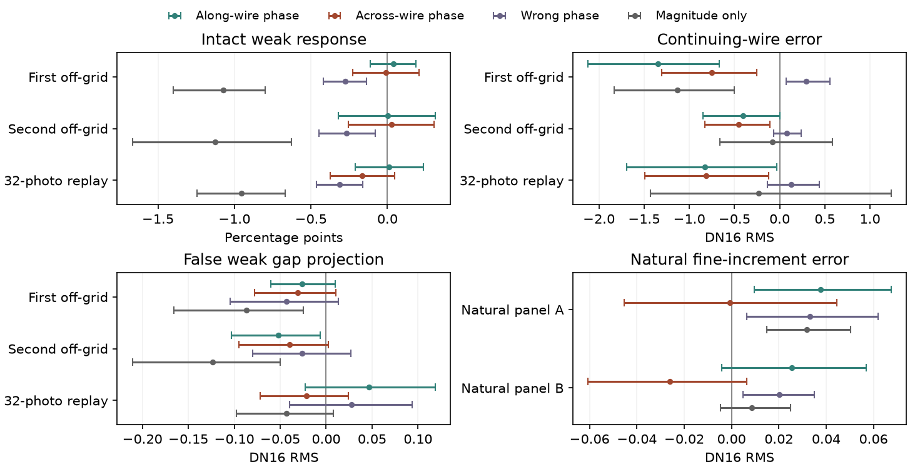
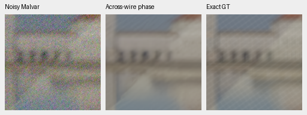
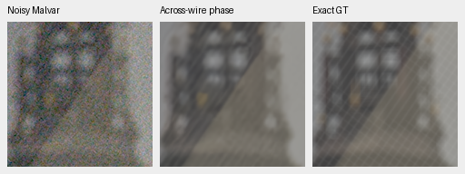

# Checking Bayer phase on neighboring RAW windows

Nearby RAW phase improves recovery of the direction that continues
through a true gap. After matching natural fine-increment error on a
separate calibration set, across-wire checks lower continuing-wire
error by **0.45–0.81 DN16** across three off-grid replays versus the
[joint gate](scene-coherent-fourier.md). Weak-direction response and
false gap projection change little. At the earlier wire-flat
calibration, the same checks deliver more wire detail and raise
natural flat error. Fine cab crossings remain incomplete.

[Follow-up on pooling center and neighboring phase](scene-pooled-phase.md)
tests admitting more marginal center coefficients at the same
natural-photo error limits.

[Machine results](results/scene-phase-neighbors-v1/publication.json) ·
[Frozen drivers and receipts](results/scene-phase-neighbors-v1/evidence.tar.xz) ·
[Native crop provenance](images/scene-phase-neighbors-v1/manifest.json).

## Phase evidence from the same image

The earlier joint gate pools cross-power from exterior RAW and confirms
the correction on both green lattices of the center. This replay keeps
that complete path. It uses two additional 32-pixel RAW windows for
each Fourier pair, selected solely by the pair's orientation and the
window coordinates. Their centers are offset by one window width on
each side, along the nearest cardinal or diagonal axis. The two extra
windows do not overlap each other or the center. For diagonal offsets
the center displacement has length 32√2 native pixels.

The expected phase advance comes from the Fourier frequency and the
native displacement. Each neighboring green measurement is projected
onto the corresponding phase of the center RAW average and divided
by its propagated noise scale. The included sides are summed with
variance normalization. At a query boundary, an unavailable side
contributes no score. The score scales the joint-gate correction
through a clipped linear ramp. Phase and sign of the delivered
correction still come from the center greens.

- **Along-wire phase** chooses the axis closest to the carrier tangent.
- **Across-wire phase** chooses the axis closest to the carrier normal.
- **Wrong phase** uses the along-wire windows with a quarter-cycle
  rotation in the test.
- **Magnitude only** uses both along-wire quadratures and ignores
  their angle relative to the center.

The audit checks disjoint sensor coordinates and the sign of the
phase transport on all four Bayer layouts. The ungated joint result
reproduces its earlier score coefficients within 10⁻¹⁰ and
its earlier standing display pixels exactly. Local tests reuse
neighboring observations across overlapping delivery windows. The
frozen parent also sees the entire query, so the uncertainty is
measured over independent photos.

The parent is Corpus 100k EMA
`87b96f3c487b9edaf1c477742b6c38f2a82cc6b20a94716d51cc8cf46a17a760`.
The general comparison is V120 EMA
`a9d9b6b4f974e24a6b11e5e740aab32314233a7f53c056cf37c7d2aac1c589fb`.
All methods use the same frozen weights, CFA positions, exteriors
and color transforms. This is an inference-only comparison.

## Wire and natural calibration

The first calibration uses the previous 16 wire backgrounds and
matches +0.10 DN16 exact-flat RMS over Corpus 100k. On the 32-photo
replay, across-wire phase at that setting recovers **0.555 response
points** [0.286, 0.848] and lowers continuing-wire error **2.086 DN16**
[1.018, 3.308] versus the joint gate. False projection changes by
+0.015 DN16 [−0.051, +0.077]. Using only neighboring magnitude gains
1.738 response points, with +0.107 DN16 of false projection and
+0.719 DN16 natural fine-flat RMS on panel A.

A separate 32-photo independent-draw ISO6400 calibration matches the
earlier joint gate's **natural fine-increment RMS** or its **natural
fine-flat RMS**. The two natural test panels have 32 backgrounds each.
All three sets are disjoint by image ID and cache SHA256. The wire
tests reuse the 24, 24 and 32 source backgrounds from the joint gate
study, with the previously frozen parent outputs. They use
shot/read `0.00128/6.5536e-6` and four independent sensor draws per
background. The tests use whole-photo paired bootstrap intervals
with gains fixed.

At the natural-increment operating point, the gains are 0.27141 for
joint, 0.67626 along, 0.64371 across, 0.71488 wrong phase and 0.36158
magnitude. The 32-photo wire replay gives the following results.
Gap measurements use its 16 cases with exact weak-wire gaps.

| Method | Intact weak response | Continuing-wire error, DN16 | False gap projection, DN16 | Exact-flat RMS, DN16 |
| --- | ---: | ---: | ---: | ---: |
| V120 EMA | 20.459% | 83.471 | 4.664 | 24.154 |
| Corpus 100k EMA | 21.706% | 78.197 | 4.751 | 22.965 |
| Dense cosine | 29.519% | 72.277 | 5.445 | 23.139 |
| Four-grid mean | 24.395% | 75.270 | 4.934 | 23.124 |
| Joint gate | 25.399% | 72.291 | 4.945 | 23.112 |
| Along-wire phase | 25.409% | 71.461 | 4.991 | 23.094 |
| Across-wire phase | 25.232% | 71.477 | 4.924 | 23.078 |
| Wrong phase | 25.086% | 72.417 | 4.972 | 23.087 |
| Magnitude only | 24.444% | 72.060 | 4.901 | 23.008 |

Across-wire phase lowers continuing-wire error **0.753**, **0.454** and
**0.814 DN16** across the three replays. Their reduction intervals are
[0.254, 1.305], [0.109, 0.829] and [0.120, 1.496]. On the 32-photo
replay the response difference is −0.166 points [−0.372, +0.045] and
the false projection difference is −0.021 DN16 [−0.072, +0.024].
The wrong-phase arm shows no comparable drop in continuation error.
Compared with across-wire phase, the along-wire arm gains slightly
more intact response on this replay, with more projected error in
the weak gaps.

On natural panels A and B, the across-wire arm changes fine-increment
RMS by −0.001 [−0.045, +0.045] and −0.026 [−0.061, +0.006] DN16
versus the joint gate. Flat RMS rises by 0.053 and 0.014 DN16.
Using the natural-flat calibration gives −0.015 and −0.036 DN16
natural increment changes, with less intact response on the wire
tests. In both cases the unmodified Corpus 100k has lower mean
natural increment and flat error than the across-wire variant.
The natural matching exposes the tradeoff that the wire-flat
setting hides.

The numerical and native reviews are complete for the scoped
component. The existing fixed 427-photo and measured-camera panels
cover the full models. [Broad PSNR history](performance-history.md).

### Native exact targets

The triplets show noisy Malvar, the Corpus 100k EMA with across-wire
phase at the natural-increment calibration, and exact simulated GT.
Each 160 × 160 cell is `[48,48,160,160]` in the
`[128,128,256,256]` query. Both use the ISO6400 profile above,
capture exposure ×0.33, 16-bit ADC with black level 0.03 and
display exposure ×2. The source photographs were binned fourfold
and cropped before adding simulated wires.

**Nymphenburg Palace**, Diego Delso, source box `[352,2,512,512]`,
GRBG. Continuing-wire error falls by 3.947 DN16. The recovered
diagonal is faint over the pale wall and the weak direction stays
soft compared with the exact target.
[Photograph](https://commons.wikimedia.org/wiki/File:Exterior_del_Palacio_de_Nymphenburg,_M%C3%BAnich,_Alemania61.JPG) ·
[delso.photo](https://delso.photo/) ·
[CC BY-SA 3.0](https://creativecommons.org/licenses/by-sa/3.0/) ·
[All methods](images/scene-phase-neighbors-v1/exact/transfer-10-present-comparison.png) ·
[Exact-flat control](images/scene-phase-neighbors-v1/exact/transfer-10-flat-triplet.png).

**Jasna Góra flèche**, Yarl, source box `[0,260,512,512]`, GBRG.
False weak projection rises 0.145 DN16, the greatest increase
among the remaining cases. The restored diagonals lose fine
contrast near the bright edges. Both exact flat controls stay
visually smooth at the common display.
[Photograph](https://commons.wikimedia.org/wiki/File:Cz%C4%99stochowa_-_Jasna_G%C3%B3ra_Fleche.jpg) ·
[CC BY-SA 3.0](https://creativecommons.org/licenses/by-sa/3.0/) ·
[All methods](images/scene-phase-neighbors-v1/exact/transfer-15-present-comparison.png) ·
[Exact-flat control](images/scene-phase-neighbors-v1/exact/transfer-15-flat-triplet.png).

## Standing GFX100S comparisons

**DSCF3879 ISO6400 / DSCF3880 ISO100.** At ×4 and nominal shot/read
`0.00128/6.5536e-6`, across-wire phase at the natural-increment
calibration changes the sky by 0.010 DN16 camera-RGB RMS, the
coarse fence by 2.312, the building by 1.836 and the foliage by
3.539 against Corpus 100k. The sky stays smooth and the coarse
crossings stay connected. Fine cables and leaf subdivisions remain
soft. The independently demosaiced ISO100 AHD reference differs
in aperture and moving subjects.
[Sky](images/scene-phase-neighbors-v1/standing/main-overcast-sky-main-overcast-sky-x4.png) ·
[Building](images/scene-phase-neighbors-v1/standing/main-building-detail-main-building-detail-x4.png) ·
[Foliage](images/scene-phase-neighbors-v1/standing/main-foliage-main-foliage-x4.png) ·
[Coarse fence](images/scene-phase-neighbors-v1/standing/main-chain-link-fence-main-chain-link-fence-x4.png).

**DSCF3842 ISO6400 / DSCF3835 ISO100.** Both ROIs and priors were
viewed at ×4 and ×16 with the independently demosaiced AHD and both
camera JPEGs. The nominal shot/read is `0.00128/6.5536e-6`.
The transferred DSCF3879 values are `0.00146358/1.07157e-6`. The
references differ in aperture, exposure, motion or rendering.

Across-wire phase changes the four cab crops by 0.739–1.331 DN16
camera-RGB RMS versus Corpus 100k. At the joint gate's added RMS,
the transferred right peak projections move from +0.632/+0.139
to +0.642/+0.086 percentage points of the noisy measurements.
The nominal right loses on both peaks. The transferred right
still has the clearest diagonals, and both left and right have
missing crossings. There is no obvious added false color or
splotching. V120 remains the general recommendation.

| Cab ROI | Nominal | Transferred DSCF3879 profile |
| --- | --- | --- |
| Left | [×4](images/scene-phase-neighbors-v1/standing/mesh-nominal-fine-green-mesh-left-x4.png) · [×16](images/scene-phase-neighbors-v1/standing/mesh-nominal-fine-green-mesh-left-x16.png) | [×4](images/scene-phase-neighbors-v1/standing/mesh-profile3879-fine-green-mesh-left-x4.png) · [×16](images/scene-phase-neighbors-v1/standing/mesh-profile3879-fine-green-mesh-left-x16.png) |
| Right | [×4](images/scene-phase-neighbors-v1/standing/mesh-nominal-fine-green-mesh-right-x4.png) · [×16](images/scene-phase-neighbors-v1/standing/mesh-nominal-fine-green-mesh-right-x16.png) | [×4](images/scene-phase-neighbors-v1/standing/mesh-profile3879-fine-green-mesh-right-x4.png) · [×16](images/scene-phase-neighbors-v1/standing/mesh-profile3879-fine-green-mesh-right-x16.png) |
