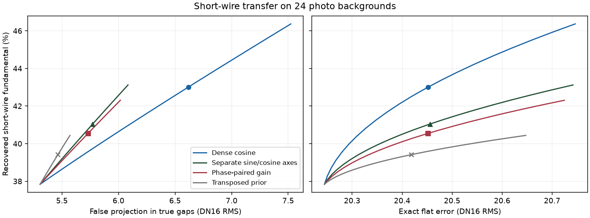
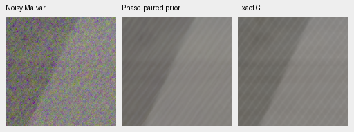
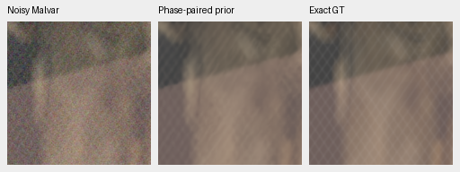

# Phase-paired donor power for weak Bayer detail

Pooling sine and cosine power on the same frequency strengthens the
two measured left-cab mesh peaks. Under nominal conditioning the
phase-paired filter changes the crop by **0.463 DN16 RGB RMS**, versus
**0.287 DN16** for the dense cosine filter at the same calibration
flat-error budget. Its advantage persists at equal added RGB energy.
Native crossings remain incomplete. On planted short wires, the Fourier
filter reduces false projection in true gaps and loses intact response.

[Machine results](results/scene-phase-power-v1/publication.json) ·
[Frozen drivers and receipts](results/scene-phase-power-v1/evidence.tar.xz) ·
[Native provenance](images/scene-phase-power-v1/manifest.json).

## What the donor prior measures

The [dense cosine experiment](scene-dense-atlas.md) shows that nearby
samples can strengthen predictions in the left cab. A translation of a
repeat can still redistribute energy across the prior's real axes.
This study keeps the 32-pixel windows, 0.08–0.16 cycles/pixel band, dense
donor positions and rankings, and frozen Corpus 100k reconstruction.
It measures power on 34 sine/cosine frequency pairs sampled at the
actual sites of the two green grids. Each sampled fit includes an
affine background and unused modes through 0.224 cycles/pixel.
Overlapping query predictions use the same native taper.

The phase-paired prior takes half the dot product of the two green
coefficient vectors for each frequency. The statistic is invariant
under a common rotation of each donor's phase pair. Disjoint donor
halves estimate and check power with the same uncertainty allowance
and minimum effective sample count as the cosine method. The phase in
the delivered correction comes from the query's measured-minus-parent
innovation. Both query greens must support that direction. Neighbor
matching uses noisy descriptors, so the split is an empirical check on
selected observations.

Separate sine/cosine axes use the same Fourier basis and donor bank
and check and deliver each axis independently. A transposed control
swaps spatial frequencies in the donor powers while keeping the query
measurements fixed. A donor-only control omits the query support check.
In an exact on-grid test, rotating all 32 donor phases independently
leaves the paired correction within (10^{-13}) on all four Bayer
layouts. The separate-axis correction norm falls by 7.9% for the tested
phase arrangement. That identity applies to the complete pair at the
tested frequency.

## Exact target transfer

The parent is the [Corpus 100k EMA](full-corpus-long100k.md) at SHA256
`87b96f3c487b9edaf1c477742b6c38f2a82cc6b20a94716d51cc8cf46a17a760`.
The [general recommendation](current-model.md) is V120 EMA
`a9d9b6b4f974e24a6b11e5e740aab32314233a7f53c056cf37c7d2aac1c589fb`.
Each arm adds 0.10 DN16 measured exact-flat RMS on the same 16
calibration backgrounds. The fixed gains transfer to the retained
32 long-wire scenes, 24 short-wire scenes and 32 independent-draw
natural-photo pairs. The long and short cohorts have 16 and 12
true-gap cases respectively. The previous study supplies the same
matching rules and measured cosine predictions. Donor counts and
frozen parent scores reproduce on the applicable inputs, and the
camera cosine boards reproduce at display precision.

| Full atlas, 24 short-wire backgrounds | Recovered fundamental | Intact fundamental RMS, DN16 | False projection in true gaps, DN16 | Exact-flat RMS, DN16 |
| --- | ---: | ---: | ---: | ---: |
| V120 EMA | 36.747% | 61.832 | 5.248 | 20.755 |
| Corpus 100k EMA | 37.840% | 60.687 | 5.307 | 20.245 |
| Dense cosine | 43.008% | 55.726 | 6.618 | 20.452 |
| Separate sine/cosine axes | 41.040% | 57.488 | 5.771 | 20.455 |
| Phase-paired power | 40.547% | 57.998 | 5.731 | 20.452 |
| Transposed paired power | 39.414% | 59.139 | 5.464 | 20.418 |

Paired power lowers false projection by 0.887 DN16 [−1.454, −0.402]
versus dense cosine. Intact response falls 2.461 percentage points
[−3.157, −1.697]. With both methods retrospectively matched at 40.547%
recovered response, false projection is still lower by **0.246 DN16**
[−0.469, −0.043]. Exact-flat error rises by **0.137 DN16**
[+0.106, +0.169]. Separate axes give a similar gap tradeoff. The
paired improvement in the real left crop does not generalize to this
planted-wire response at equal flat error.



The points mark the single locked gain per operator. Lines vary the
gain on the same retained cases. Confidence intervals resample
source photos with fixed gains. On the long-wire panel, paired
power increases continuing short-wire error in true gaps by
2.736 DN16 [1.719, 3.791] versus dense cosine. It still reduces
that error by 2.279 DN16 versus Corpus 100k. The planted long
fundamental lies below the delivered band and changes by less
than 0.01 mean response points. The tight 64-patch cap gives a
similar tradeoff.

On the 32 natural photos, the phase-paired correction adds 0.132
points of target-aligned fine response over Corpus 100k. It raises
fine-increment error by 0.115 DN16 [0.065, 0.173] and exact-flat
fine error by 0.320 DN16 [0.192, 0.463]. The plain EMA remains the
better general operating point on those errors. These scoped
experiments use the existing weights and fixed photo-bank sources.
The paired numerical replay consumed 4.4 s for calibration, 10.1 s
for long wires, 7.6 s for short wires and 3.7 s for natural pairs
on four CPU worker threads, using saved cosine measurements. These
times cover the comparison workload. [Fixed broad panels](performance-history.md).

### Native exact targets

The triplets show noisy Malvar, Corpus 100k plus the phase-paired
correction, and exact simulated GT. Each cell is 160 × 160 native
pixels at `[48,48,160,160]` in the central 256-pixel query. The
simulation uses 16-bit ADC with black level 0.03. Restoration uses
the nominal ISO6400 shot/read prior `0.00128/6.5536e-6`. The shared
display exposure is ×2.

**Bonchamps sculpture** by David d’Angers, photographed by Selbymay.
GBRG extract `[118,44,512,512]`, simulated shot/read
`0.001628503/2.366646e-5`, capture exposure ×0.5162. Paired power
lowers false gap projection by 2.928 DN16 and leaves the weaker
crossings less defined. The binned crop includes constructed wires.
[Photograph](https://commons.wikimedia.org/wiki/File:David_d%27Angers_-_Bonchamps.jpg) ·
[CC BY-SA 3.0](https://creativecommons.org/licenses/by-sa/3.0/) ·
[Comparison](images/scene-phase-power-v1/exact/retained-12-present-comparison.png) ·
[Exact-flat control](images/scene-phase-power-v1/exact/retained-12-flat-triplet.png).



**Château de Malmaison**, photographed by Moonik. BGGR extract
`[60,166,512,512]`, simulated shot/read `0.000122196/2.11738e-7`,
capture exposure ×3.7834. Intact fundamental error rises 4.290 DN16
versus dense cosine. Fine intersections stay soft while the flatter
control stays smooth. The binned crop includes constructed wires.
[Photograph](https://commons.wikimedia.org/wiki/File:Ch%C3%A2teau_de_Malmaison_-_southwest_garden_side_005.JPG) ·
[CC BY-SA 3.0](https://creativecommons.org/licenses/by-sa/3.0/) ·
[Comparison](images/scene-phase-power-v1/exact/retained-20-present-comparison.png) ·
[Exact-flat control](images/scene-phase-power-v1/exact/retained-20-flat-triplet.png).



## Standing GFX100S comparisons

| DSCF3842 cab ROI and conditioning | Dense cosine change, DN16 RGB RMS | Phase-paired change, DN16 RGB RMS | Phase-paired gain at the two observed peaks |
| --- | ---: | ---: | ---: |
| Left nominal | 0.287 | 0.463 | +0.657 / +0.309 pp |
| Left transferred | 0.256 | 0.458 | +0.652 / +0.466 pp |
| Right nominal | 0.060 | 0.138 | +0.096 / +0.003 pp |
| Right transferred | 0.077 | 0.144 | +0.103 / +0.012 pp |

Changes are versus Corpus 100k at the locked gains. The peaks give the
signed projection as a percentage of the same noisy RAW measurement.
On the nominal left, dense cosine adds 0.189 and 0.114 points. At equal
RGB RMS, paired power adds **0.407 and 0.192** points. The transposed
control has smaller responses, especially for the first peak. On the
right, the second direction gains less projection than under dense
cosine. The measured improvement is small in absolute terms and these
same-RAW projections cannot establish fidelity to an unknown clean scene.

Both left views still have unresolved intersections and the nominal
crop remains mottled. The transferred right has the clearest existing
diagonals. Both display exposures and both JPEG references were viewed
alongside the independent ISO100 AHD exposure. The main DSCF3879
sky stays smooth at ×4 with a 0.012 DN16 RGB RMS correction. Coarse
fence crossings stay connected with a 1.798 DN16 correction.
Small building wires and leaf subdivisions stay soft. ISO100 AHD
and camera JPEGs are qualitative references from separate captures.

[Sky](images/scene-phase-power-v1/standing/main-overcast-sky-main-overcast-sky-x4.png) ·
[Building](images/scene-phase-power-v1/standing/main-building-detail-main-building-detail-x4.png) ·
[Foliage](images/scene-phase-power-v1/standing/main-foliage-main-foliage-x4.png) ·
[Coarse fence](images/scene-phase-power-v1/standing/main-chain-link-fence-main-chain-link-fence-x4.png).

| Cab profiles, shot/read | Left | Right |
| --- | --- | --- |
| Nominal `0.00128/6.5536e-6` | [×4](images/scene-phase-power-v1/standing/mesh-nominal-fine-green-mesh-left-x4.png) · [×16](images/scene-phase-power-v1/standing/mesh-nominal-fine-green-mesh-left-x16.png) | [×4](images/scene-phase-power-v1/standing/mesh-nominal-fine-green-mesh-right-x4.png) · [×16](images/scene-phase-power-v1/standing/mesh-nominal-fine-green-mesh-right-x16.png) |
| Transferred `0.0014635775921166604/1.0715704128646712e-6` | [×4](images/scene-phase-power-v1/standing/mesh-profile3879-fine-green-mesh-left-x4.png) · [×16](images/scene-phase-power-v1/standing/mesh-profile3879-fine-green-mesh-left-x16.png) | [×4](images/scene-phase-power-v1/standing/mesh-profile3879-fine-green-mesh-right-x4.png) · [×16](images/scene-phase-power-v1/standing/mesh-profile3879-fine-green-mesh-right-x16.png) |

## Reproduction

The evidence archive binds the phase operator, comparison drivers,
frozen calibration and render receipts. With the [dense atlas inputs](scene-dense-atlas.md)
available, restore the drivers to their experiment directories and run
the numerical and visual stages from the repository root.

```bash
study=.cache/experiments/scene-phase-power-v1
export PYTHONPATH="$PWD/src" OPENBLAS_NUM_THREADS=1 OMP_NUM_THREADS=2
.venv/bin/python "$study/evaluate_phase.py"
.venv/bin/python "$study/diagnostics.py"
.venv/bin/python "$study/probe_camera.py"
.venv/bin/python "$study/render_phase.py" camera
.venv/bin/python "$study/render_phase.py" exact
.venv/bin/python "$study/view_phase.py"
```

The analytical check covers all four Bayer layouts, affine subtraction,
phase rotation, transposition and a zero-innovation case. The repository
patch and scene-inference checks pass all 27 tests.
