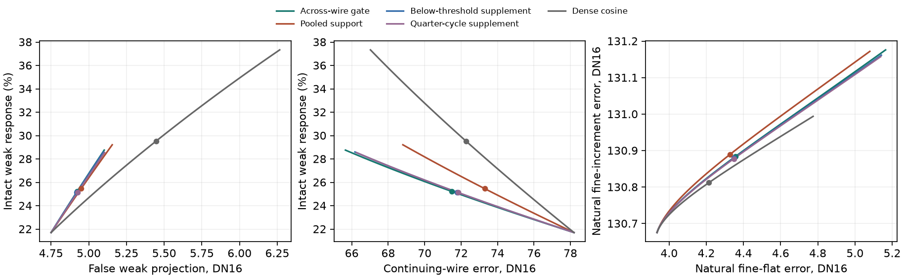
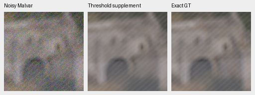
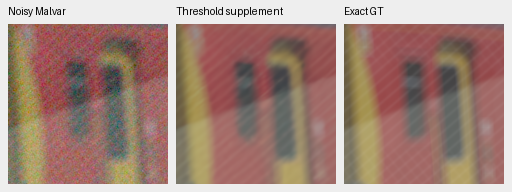

# Pooling center and neighboring Bayer phase

Replacing the center support check with pooled RAW evidence raises
weak response slightly on one off-grid panel and worsens error on
the continuing wire across all three. A supplement limited to weak
center measurements avoids most of that regression, with slightly
lower weak response than the existing across-wire gate. Neither
change visibly restores the missing cab crossings.

[Machine results](results/scene-pooled-phase-v1/publication.json) ·
[Frozen drivers and receipts](results/scene-pooled-phase-v1/evidence.tar.xz) ·
[Native crop provenance](images/scene-pooled-phase-v1/manifest.json).

## Which evidence can open the center gate?

The [across-wire gate](scene-phase-neighbors.md) multiplies each
positive center correction by spatial phase evidence. For each
candidate pair it already checks the center greens individually and
checks pooled support in a group of nearby frequencies. The new
arms keep the group check, the active Fourier grids and the donor
bank fixed. They rebuild the center gate from its two
noise-standardized green projections.

- **Pooled support** combines the weaker center projection with
  the mean of the two neighboring green measurements. The latter
  use the same phase-registered, disjoint across-wire windows as
  the original test and have weight 0.5 in noise units.
- **Per-green pooling** combines each center green only with the
  corresponding neighboring green and uses the weaker result.
- **Threshold supplement** preserves the original across-wire
  gate before calibration and adds any extra support from pooling
  when the weaker center projection is below 0.5 noise standard
  deviations. The addition fades to zero by one standard deviation.
  A second supplement uses per-green pooling.
- **Wrong phase** uses the neighboring quadrature rotated by a
  quarter cycle. The grouped-only control uses the earlier
  exterior and group tests with no individual center test.

The two pooled arms and both supplements require positive signed
measurements from both center greens for any newly admitted lift.
The neighboring phase alters the correction weight. The delivered
phase stays tied to the center, and the center still provides the
amplitude deficit. The sign requirement and zero-neighbor fallback
are checked directly. The parent sees the full query.

The frozen parent is Corpus 100k EMA
`87b96f3c487b9edaf1c477742b6c38f2a82cc6b20a94716d51cc8cf46a17a760`.
The general comparison is V120 EMA
`a9d9b6b4f974e24a6b11e5e740aab32314233a7f53c056cf37c7d2aac1c589fb`.
The new gains come from the previous independent-draw calibration
with 32 ISO6400 natural backgrounds. The primary operating point
bounds both mean fine-increment and fine-flat RMS by the earlier
across-wire gate at its calibrated gain. A second comparison matches
fine-increment RMS alone. The three wire panels and the two 32-photo
natural test panels reuse the saved predictions. Numerical and native
reviews are complete for this inference-only component.
[Broad PSNR history](performance-history.md).

## Recovery and false detail

On the 32-photo off-grid replay, at the two natural error limits:

| Method | Intact weak response | Continuing-wire error, DN16 | False gap projection, DN16 | Exact-flat RMS, DN16 |
| --- | ---: | ---: | ---: | ---: |
| V120 EMA | 20.459% | 83.471 | 4.664 | 24.154 |
| Corpus 100k EMA | 21.706% | 78.197 | 4.751 | 22.965 |
| Dense cosine | 29.519% | 72.277 | 5.445 | 23.139 |
| Across-wire phase | 25.232% | 71.477 | 4.924 | 23.078 |
| Pooled support | 25.460% | 73.299 | 4.950 | 23.117 |
| Per-green pooling | 25.396% | 72.797 | 4.936 | 23.099 |
| Threshold supplement | 25.152% | 71.788 | 4.921 | 23.076 |
| Per-green supplement | 25.177% | 71.710 | 4.922 | 23.077 |
| Wrong-phase supplement | 25.127% | 71.837 | 4.925 | 23.076 |

The pooled arm gains 0.228 response points [−0.008, +0.463]
versus across-wire phase, with **1.822 DN16** more continuing-wire
error [+0.697, +2.935] and +0.026 DN16 false projection
[−0.008, +0.061]. Continuing-wire error rises **1.524** and
**1.112 DN16** on the two earlier off-grid panels. Intact response
there changes by +0.013 and −0.018 points. Per-green pooling
also raises continuing-wire error in all three.

The threshold supplement loses **0.070**, **0.117** and **0.081**
response points on the same panels. Continuing-wire error rises
0.278, 0.188 and 0.310 DN16. All three weak-response and continuing
error intervals exclude zero. False projection changes by +0.013,
−0.003 and −0.003 DN16, with all three intervals spanning zero.
Matching only natural increment error narrows the weak loss on
the 32-photo replay to −0.014 points [−0.047, +0.019], with
+0.193 DN16 continuing-wire error. The unrestricted grouped-only
control raises continuing-wire error 2.923 DN16 at the two natural
limits on that replay.

On natural panels A and B the threshold supplement changes
fine-increment error by −0.004 and −0.001 DN16 versus across-wire
phase. Fine-flat changes are −0.006 and −0.003 DN16. Both
increment intervals span zero. Corpus 100k alone has lower
mean natural increment and flat error. The gain curves show the
threshold supplement and its wrong-phase control close to the
original gate across the tested dose range. Full pooling moves the
continuing-wire tradeoff in the wrong direction.

### Native exact targets

Each triplet shows noisy Malvar, the Corpus 100k EMA with the
threshold supplement, and exact simulated GT. The unresized
160 × 160 cells use `[48,48,160,160]` inside `[128,128,256,256]`.
Both use BGGR, ISO6400 shot/read `0.00128/6.5536e-6`, capture
exposure ×0.33, 16-bit ADC with black 0.03 and display exposure ×2.
The photos were binned fourfold and cropped before composing wires.

**Tsikouri Tower**, C messier, source box `[76,12,512,512]`.
The intact weak response gains 0.065 points, the largest among
the exact-gap cases. Continuing-wire error also rises by 0.450
DN16. The crossing direction is faint over the stone.
[Photograph](https://commons.wikimedia.org/wiki/File:%CE%A0%CF%8D%CF%81%CE%B3%CE%BF%CF%82_%CE%A4%CF%83%CE%B9%CE%BA%CE%BF%CF%85%CF%81%CE%AF%CE%BF%CF%85_DJI_4634.jpg) ·
[CC BY-SA 4.0](https://creativecommons.org/licenses/by-sa/4.0/) ·
[All methods](images/scene-pooled-phase-v1/exact/transfer-05-present-comparison.png) ·
[Exact-flat control](images/scene-pooled-phase-v1/exact/transfer-05-flat-triplet.png).

**Nottingham railway station**, mattbuck, source box
`[220,26,512,512]`. The false weak projection rises by 0.022
DN16, the largest increase among the remaining cases. Weak
crossings stay soft over the red train. Both flat controls look
smooth at the same exposure.
[Photograph](https://commons.wikimedia.org/wiki/File:Nottingham_railway_station_MMB_36_156401.jpg) ·
[CC BY-SA 3.0](https://creativecommons.org/licenses/by-sa/3.0/) ·
[All methods](images/scene-pooled-phase-v1/exact/transfer-01-present-comparison.png) ·
[Exact-flat control](images/scene-pooled-phase-v1/exact/transfer-01-flat-triplet.png).

## Standing GFX100S comparisons

**DSCF3879 ISO6400 / DSCF3880 ISO100.** At display ×4 and shot/read
`0.00128/6.5536e-6`, the threshold supplement changes the sky
by 0.009 DN16 camera-RGB RMS, the coarse fence by 2.194, the
building by 1.753 and the foliage by 3.373 versus Corpus 100k.
Sky stays smooth, coarse links stay connected, and fine cables
and leaf subdivisions stay soft. ISO100 AHD is independently
demosaiced, with different aperture and moving subjects.
[Sky](images/scene-pooled-phase-v1/standing/main-overcast-sky-main-overcast-sky-x4.png) ·
[Building](images/scene-pooled-phase-v1/standing/main-building-detail-main-building-detail-x4.png) ·
[Foliage](images/scene-pooled-phase-v1/standing/main-foliage-main-foliage-x4.png) ·
[Coarse fence](images/scene-pooled-phase-v1/standing/main-chain-link-fence-main-chain-link-fence-x4.png).

**DSCF3842 ISO6400 / DSCF3835 ISO100.** Both ROIs and priors were
viewed at ×4 and ×16 with the independent AHD and both camera JPEGs.
Nominal shot/read is `0.00128/6.5536e-6` and transferred DSCF3879
shot/read is `0.00146358/1.07157e-6`. Exposure, aperture, motion
or rendering differ among the references.

At the across-wire correction's added RMS, the threshold supplement
changes the transferred right projections from +0.830/+0.111 to
+0.836/+0.112 percentage points of the noisy RAW peaks. Full pooling
gives +0.778/+0.227 at the same energy. The transferred right
has the clearest diagonals, with many junctions still missing.
The boards show no clear additional crossings, false-color patches
or splotches. V120 remains the general recommendation.

| Cab ROI | Nominal | Transferred DSCF3879 profile |
| --- | --- | --- |
| Left | [×4](images/scene-pooled-phase-v1/standing/mesh-nominal-fine-green-mesh-left-x4.png) · [×16](images/scene-pooled-phase-v1/standing/mesh-nominal-fine-green-mesh-left-x16.png) | [×4](images/scene-pooled-phase-v1/standing/mesh-profile3879-fine-green-mesh-left-x4.png) · [×16](images/scene-pooled-phase-v1/standing/mesh-profile3879-fine-green-mesh-left-x16.png) |
| Right | [×4](images/scene-pooled-phase-v1/standing/mesh-nominal-fine-green-mesh-right-x4.png) · [×16](images/scene-pooled-phase-v1/standing/mesh-nominal-fine-green-mesh-right-x16.png) | [×4](images/scene-pooled-phase-v1/standing/mesh-profile3879-fine-green-mesh-right-x4.png) · [×16](images/scene-pooled-phase-v1/standing/mesh-profile3879-fine-green-mesh-right-x16.png) |
