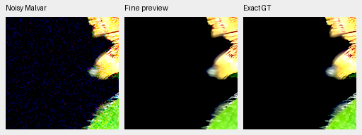
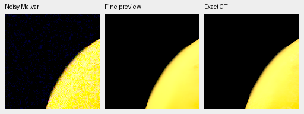

# Whole-image preview resolution and native weak detail

Raising the scene preview from 1,024 to 3,072 pixels changes the
standing coarse fence by up to **4.17 DN16 RMS**. The overcast
sky changes by at most **0.43 DN16**, and the fine green cab
mesh still has incomplete crossings. These are replay
measurements with frozen scene models and identical native
RAW. The 64-photo exact-target test finds a small flat-core
benefit from a denser grid. The finer sensor samples offer
little additional gain over interpolation.
[Paired exact-target measurements](results/scene-preview-scale-v1/preview-paired.json) ·
[Standing output and native viewing](results/scene-preview-scale-v1/standing-viewing.json).

A [regional-context comparison](scene-regional-context.md) tests a later
12k checkpoint with dense cropped context, a mean-preserving whole-frame
blend, and controls for interpolation and spatial placement.

## Fixed native inputs

The [training geometry audit](scene-local-contrast-2400.md#preview-scale-in-training-and-gfx)
found one coarsest feature-grid interval per 64 native pixels
in the median training image and about 364 pixels in the
standing GFX previews. This comparison asks whether the
same trained scene adapter uses more finely sampled context.
It keeps the complete field, native crop and camera settings
fixed.

The two EMAs are plain spatial `0ff44f0d0aa52e9c60f2170072e312a3b3c35287035f24f57da274e17c66fd62`
and localized spatial `9f3a5cc187d0b9c9cd8de5bb22bf93bf29d0e8d0f67a474fbc834c71727eb789`.
Both run in CUDA IEEE FP32 with one shared frozen scene encoder
per preview. The real comparison uses CFA-aware previews at
1,024, 2,048 and 3,072 pixels and a 2,048-pixel bilinear resample
of the rendered 1,024 preview. This last control changes the
feature grid without introducing higher-resolution sensor
measurements. The new 1,024 predictions match the earlier CPU
review to within 0.0017 DN16 RMS on every full query.

## Exact-target ISO6400 comparison

All 64 held-out photos from the [matched scene study](scene-local-contrast-2400.md)
retain their original noisy native queries and full field of view.
Two draws per source produce 128 groups and 384 native queries.
Each group contains an exact present-minus-absent fine increment and
an exact flat core. The scene preview pitches mimic the standing
GFX frame at about **11.39** and **5.69** native pixels per preview
pixel. The grid control bilinearly resamples the coarse preview to
the same shape as the finer preview. The ordinary native-cap
preview and matched local-only predictions are from the same
checkpoint-bound queries.
[Input plan and full source evidence](results/scene-preview-scale-v1/publication.json).

| EMA and preview policy | Coupled increment RMS, DN16 | Coupled flat RMS, DN16 | Independent increment RMS, DN16 | Independent flat RMS, DN16 |
| --- | ---: | ---: | ---: | ---: |
| Corpus 100k EMA | 102.99 | 4.37 | 124.55 | 4.59 |
| Localized local EMA | 102.95 | 4.67 | 124.28 | 4.91 |
| Localized spatial, native-cap matching | 103.04 | 4.77 | 124.28 | 5.00 |
| Localized spatial, coarse | 103.13 | 4.79 | 124.40 | 5.01 |
| Localized spatial, finer | 103.18 | 4.70 | 124.27 | 4.92 |
| Localized spatial, coarse resampled | 103.21 | 4.68 | 124.27 | 4.93 |

Changing from the coarse to the finer preview reduces the
localized spatial arm's flat RMS by 0.083 DN16 in coupled
draws (source-paired interval 0.027–0.147) and by 0.085 in
independent draws (0.036–0.138). The plain spatial arm gives
similar reductions of 0.095 and 0.094 DN16. The finer versus
resampled grid comparison has flat-RMS intervals spanning
zero in both draws and both models. The two finer-grid policies
also give very similar increment errors. Among the 32 lowest
true increments, response and error effects remain small.
Corpus 100k gives the lowest flat RMS among these comparisons.
[Pooled metrics and paired source intervals](results/scene-preview-scale-v1/preview-paired.json).

The native triplets use the localized spatial EMA, ISO6400
shot/read `0.00128 / 6.5536e-6`, ADC16 black fraction 0.03,
and display exposure ×3.0303 with contrast ×2. The displayed
ROI is `[48,48,160,160]` inside each 256-pixel query.
The two textured examples bound the largest positive and
negative coupled fine-increment difference on the fainter
half. The fine insect outline and yellow shell remain soft.
The third view contains a known-flat sky core.
[Bush Hopper by Sandipoutsider, CC BY-SA 4.0](https://commons.wikimedia.org/wiki/File:Close_wing_Basking_of_Ampittia_dioscorides_%28Fabricius,_1793%29_-_Bush_Hopper_%28Male%29_WLB_DSC_9116b.jpg) ·
[Calocochlia by H. Zell, CC BY-SA 3.0](https://commons.wikimedia.org/wiki/File:Calocochlia_festiva_02.JPG) ·
[Native boards, source coordinates and licenses](results/scene-preview-scale-v1/preview-viewing.json).

## Restricting scene corrections by output frequency

A separate replay decomposes the change between matching and
masked previews in aligned camera RGB. The low-pass component
uses a fixed Gaussian with native sigma 3. The complement
contains its removed fine component. The comparison uses
all 64 sources, both noise profiles and both draws without
new neural inference.

On the fainter ISO6400 half, restricting the localized arm to
the low-pass correction lowers coupled increment RMS by 0.058 DN16
and flat RMS by 0.043 versus the full correction. The independent
draw gives +0.033 and −0.023 DN16 respectively. Relative to
masking the guide entirely, the low-pass correction's fine
scores differ by at most 0.004 DN16 on this half. It preserves
mainly a coarse color and luminance shift. The diagnostic
remains a replay of the current adapter.
[Paired band and flat-color estimates](results/scene-preview-scale-v1/band-paired.json).

## Standing GFX100S checks

All 16 boards, eight regions/profiles for each checkpoint,
were viewed at native scale. The overcast field stays smooth.
The coarse fence retains both directions. Building and leaf
details remain soft. In the cab, the transferred prior shows
more visible diagonal repeat than nominal conditioning, and
the finer previews preserve incomplete fine crossings.

| Region | 3,072 vs 1,024 RGB RMS, DN16 | Actual vs resampled 2,048 RGB RMS, DN16 |
| --- | ---: | ---: |
| Overcast sky | 0.40–0.43 | 0.34–0.38 |
| Building | 3.65–3.69 | 1.66 |
| Foliage | 3.36–3.68 | 1.49–1.57 |
| Coarse fence | 3.97–4.17 | 1.98–2.09 |
| Four fine cab views | 1.16–1.94 | 0.58–0.91 |

The changes measure model-to-model disagreement in camera-linear
RGB. The ISO100 AHD and both camera JPEG captures are qualitative
references. The main DSCF3879 boards use exposure ×4 and shot/read
`0.00128 / 6.5536e-6`. The DSCF3842 boards use ×16 and both established
noise priors. The viewing record binds the individual 160×160
regions, query boxes, input fingerprints and checkpoint paths.
[Fixed RAW and all viewed boards](results/scene-preview-scale-v1/standing-viewing.json).

The 3,072 grid can in principle represent both frequencies
of every earlier measured mesh proposal. Their horizontal
components exceed the rectangular sampling limit at 2,048.
The geometry test measures the input grid's capacity. Learned
feature amplitudes and phase fidelity remain unmeasured.
[Frequency calculation](results/scene-preview-scale-v1/frequency-geometry.json).

[Main sky](images/scene-preview-scale-v1/standing/main-overcast-sky-main-overcast-sky-localized-spatial.png) ·
[Coarse fence](images/scene-preview-scale-v1/standing/main-chain-link-fence-main-chain-link-fence-localized-spatial.png) ·
[Nominal right cab](images/scene-preview-scale-v1/standing/mesh-nominal-fine-green-mesh-right-localized-spatial.png) ·
[Transferred right cab](images/scene-preview-scale-v1/standing/mesh-profile3879-fine-green-mesh-right-localized-spatial.png).
