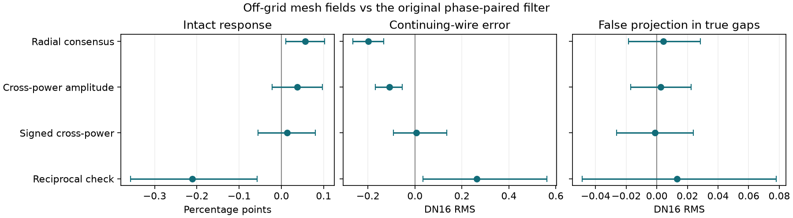
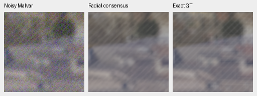
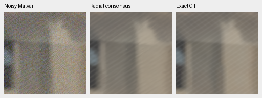

# Shared phase and amplitude in the Bayer query

Restricting the correction to the phase shared by both physical greens
reduces error on wires that continue through true gaps. On **24 new
off-grid fields**, radial consensus lowers that error by **0.198 DN16**
versus the previous phase-paired filter, with similar false projection
and flat error. The dense cosine filter still recovers substantially
more intact wire, with more false projection. The real cab crossings
remain incomplete.

[Follow-up on shifted Fourier grids](scene-staggered-phase.md) measures
best-pair coverage and evaluates the same radial control on 24 additional
off-grid photo backgrounds.

[Machine results](results/scene-query-consensus-v1/publication.json) ·
[Frozen drivers and receipts](results/scene-query-consensus-v1/evidence.tar.xz) ·
[Native provenance](images/scene-query-consensus-v1/manifest.json).

## From phase evidence to an amplitude change

The [previous phase-paired filter](scene-phase-power.md) validates
power in two disjoint sets of exterior RAW patches. Inside the query,
it multiplies the full sine/cosine innovation vector by the confidence
from the two green Bayer grids. The new versions keep that donor
bank, Fourier basis and per-frequency donor gains fixed. The query
calculation changes before the same native taper and luminance
delivery. A separate scalar sets each method's operating point.

- **Radial consensus** uses the direction of the average of the two
  measured green coefficient vectors. It keeps only a positive
  amplitude deficit along that direction, with the same two-green
  confidence ramp evaluated along it.
- **Cross-power amplitude** substitutes the square root of the
  nonnegative dot product of the two green vectors for the observed
  amplitude. Phase or amplitude disagreement makes this estimate
  smaller than the norm of the average.
- **Signed cross-power** also allows a supported amplitude decrease
  when the frozen parent is stronger than the measured estimate.
- **Reciprocal check** proposes the phase from one green and measures
  amplitude along it in the other green, then averages the two orders.

The noise standard deviations use the same propagated local projection
covariance as the original filter. Both CFA grids share a frozen parent
that sees the complete input. The tests measure the behavior of the
full estimator under independent draws. Clean targets enter scoring
after the operational correction. Rotation and Bayer-swap tests verify
the estimator algebra, including rejection when the two observed
phases oppose one another.

The parent is Corpus 100k EMA
`87b96f3c487b9edaf1c477742b6c38f2a82cc6b20a94716d51cc8cf46a17a760`.
The general-use comparison is V120 EMA
`a9d9b6b4f974e24a6b11e5e740aab32314233a7f53c056cf37c7d2aac1c589fb`.
The original phase-paired field reproduces the previous GFX correction
arrays exactly. Its numerical coefficients reproduce on the retained
wire and natural tests. The same 16 earlier calibration scenes set
each strength to +0.10 DN16 exact-flat RMS. The fresh transfer uses the
locked gains from the full donor atlas.

## Fresh off-grid wires

The 24 independent photo backgrounds contain two planted directions
with periods between 7.2 and 9.25 native pixels. Both spatial frequencies
are at least 0.008 cycles/pixel from the nearest 32-pixel Fourier grid
point. There are eight strips, eight ellipses and eight continuous
dips. The first two groups have exact weak-wire gaps with the strong
wire continuing. Each field has independent present, exterior-only,
strong-only and exact-flat draws. The source IDs and cache hashes
are disjoint from the retained panels and all 559,808 photographic
visits in the Corpus 100k training trace. The synthetic captures use
ISO6400 shot/read `0.00128/6.5536e-6`.

| Off-grid method | Intact weak response | Continuing-wire error, DN16 | False gap projection, DN16 | Exact-flat RMS, DN16 |
| --- | ---: | ---: | ---: | ---: |
| V120 EMA | 24.598% | 91.489 | 2.924 | 24.238 |
| Corpus 100k EMA | 25.697% | 84.293 | 3.123 | 23.406 |
| Dense cosine | 34.241% | 79.021 | 4.117 | 23.596 |
| Original phase-paired | 28.266% | 81.807 | 3.333 | 23.640 |
| Radial consensus | 28.322% | 81.609 | 3.337 | 23.639 |
| Cross-power amplitude | 28.304% | 81.698 | 3.335 | 23.646 |
| Signed cross-power | 28.279% | 81.812 | 3.331 | 23.646 |
| Reciprocal check | 28.055% | 82.070 | 3.346 | 23.642 |

Radial consensus changes continuing-wire error by **−0.198 DN16**
[−0.264, −0.133] and intact response by **+0.056 percentage points**
[+0.010, +0.102] versus the original phase-paired filter.
False weak projection changes by +0.004 DN16 [−0.019, +0.029].
For cross-power amplitude, continuing-wire error changes by −0.109 DN16
[−0.169, −0.055] and exact-flat RMS changes by +0.007 DN16
[+0.003, +0.010]. Intervals resample source photos with fixed gains.
Gap metrics use the 16 exact-gap fields. Signed subtraction has
little benefit across this panel, and the reciprocal check loses
response and raises continuing-wire error.



A clean single-carrier projection on the 32-pixel delivery grid gives
the best Fourier pair a median **44.0%** of weak-carrier energy on the
fresh fields, versus **63.4%** on the retained short wires. Across all
delivered Fourier pairs, the median drops from **93.2% to 88.4%**.
The dense cosine basis covers **94.0%** of the fresh carrier energy.
These calculations isolate the native basis on a pure sinusoid.
They measure the spread of signal across modes before noisy selection,
local support or overlap blending.

## Retained targets and operating costs

On the 32 long-wire and 24 short-wire replays, radial consensus
lowers continuing-wire error by 0.149 and 0.102 DN16, respectively,
versus the original phase-paired filter. Cross-power lowers the same
errors by 0.135 and 0.136 DN16. On the retained short wires it gains
0.081 response points [+0.012, +0.146], with negligible mean change in
false projection and flat RMS. Dense cosine continues to favor intact
short-wire response and incurs more false projection.

On the 32 independent-draw natural-photo pairs, radial and cross-power
raise fine-increment error by 0.129 and 0.110 DN16 over Corpus 100k.
Their exact-flat fine errors rise by 0.318 and 0.314 DN16. Signed
cross-power reduces the increment cost to 0.099 DN16 with higher
flat error. The unmodified EMA retains the better general-photo
operating point on these criteria.

The scoped replay uses existing EMAs. Preparing predictions for the
24 fresh fields took 118.4 s for both existing models on CUDA IEEE
FP32. CPU scoring took 18.9 s on four workers. Calibration and the
retained long, short and natural replays took 6.3, 11.5, 8.7 and
4.2 s, respectively. These are study stages. [Fixed broad panels](performance-history.md).

### Native exact targets

Each triplet shows noisy Malvar, the Corpus 100k EMA with radial
consensus, and exact simulated GT. The unresized 160 × 160 cells
use `[48,48,160,160]` in the central `[128,128,256,256]` query.
Both use BGGR, shot/read `0.00128/6.5536e-6`, capture exposure ×0.33,
16-bit ADC with black level 0.03 and common display exposure ×2.
The binned photographs were cropped and used as backgrounds for
the simulated wires.

**View of Toledo**, Bernard Gagnon. Source box `[98,26,512,512]`.
This field gives the largest continuing-wire error reduction,
0.424 DN16. The main diagonal stays coherent while the weak crossing
is much softer than the target.
[Photograph](https://commons.wikimedia.org/wiki/File:View_of_Toledo_02.jpg) ·
[CC BY-SA 3.0](https://creativecommons.org/licenses/by-sa/3.0/) ·
[All methods](images/scene-query-consensus-v1/exact/offgrid-05-present-comparison.png) ·
[Flat control](images/scene-query-consensus-v1/exact/offgrid-05-flat-triplet.png).



**Temple at the top, Galtaji**, © Yann Forget / Wikimedia Commons,
retouched by ApolloWissen. Source box `[42,270,512,512]`.
False weak projection rises 0.091 DN16 in this case. Both phase-paired
variants leave the weaker axis subdued across the facade.
[Photograph](https://commons.wikimedia.org/wiki/File:Temple_at_the_top,_Galtaji,_Jaipur,_India.jpg) ·
[CC BY-SA 4.0](https://creativecommons.org/licenses/by-sa/4.0/) ·
[All methods](images/scene-query-consensus-v1/exact/offgrid-13-present-comparison.png) ·
[Flat control](images/scene-query-consensus-v1/exact/offgrid-13-flat-triplet.png).



## Standing GFX100S comparisons

The DSCF3879 sky stays smooth. At the locked gain radial consensus
changes it by 0.012 DN16 RGB RMS and the coarse fence by 1.781 DN16
versus Corpus 100k. The coarse links stay connected. Fine building
wires and foliage subdivisions stay soft.

On the nominal left DSCF3842 cab, cross-power amplitude adds
0.506 DN16 RGB RMS versus 0.463 for the original phase-paired filter.
At equal added correction energy its two projections on the same
noisy RAW peaks are slightly lower. Radial consensus keeps nearly
the same correction energy as the original. Under the transferred
profile its left-peak projections rise from +0.652/+0.466 to
+0.674/+0.482 percentage points of the observed measurements. The
nominal left remains mottled and mostly unresolved. The transferred
right has the clearest diagonals, with incomplete crossings. Both
profiles and both display exposures were viewed with ISO100 AHD
and the two camera JPEGs. Those are independent qualitative
references from different exposure settings.

[Sky ×4](images/scene-query-consensus-v1/standing/main-overcast-sky-main-overcast-sky-x4.png) ·
[Building ×4](images/scene-query-consensus-v1/standing/main-building-detail-main-building-detail-x4.png) ·
[Foliage ×4](images/scene-query-consensus-v1/standing/main-foliage-main-foliage-x4.png) ·
[Coarse fence ×4](images/scene-query-consensus-v1/standing/main-chain-link-fence-main-chain-link-fence-x4.png).

| Cab profile, shot/read | Left | Right |
| --- | --- | --- |
| Nominal `0.00128/6.5536e-6` | [×4](images/scene-query-consensus-v1/standing/mesh-nominal-fine-green-mesh-left-x4.png) · [×16](images/scene-query-consensus-v1/standing/mesh-nominal-fine-green-mesh-left-x16.png) | [×4](images/scene-query-consensus-v1/standing/mesh-nominal-fine-green-mesh-right-x4.png) · [×16](images/scene-query-consensus-v1/standing/mesh-nominal-fine-green-mesh-right-x16.png) |
| Transferred `0.0014635775921166604/1.0715704128646712e-6` | [×4](images/scene-query-consensus-v1/standing/mesh-profile3879-fine-green-mesh-left-x4.png) · [×16](images/scene-query-consensus-v1/standing/mesh-profile3879-fine-green-mesh-left-x16.png) | [×4](images/scene-query-consensus-v1/standing/mesh-profile3879-fine-green-mesh-right-x4.png) · [×16](images/scene-query-consensus-v1/standing/mesh-profile3879-fine-green-mesh-right-x16.png) |

## Reproduction

Restore the archived drivers with the [phase-paired comparison inputs](scene-phase-power.md).
The off-grid manifest and parent receipt bind each fresh fixture.
The numerical and rendering stages run from the repository root.

```bash
study=.cache/experiments/scene-query-consensus-v1
export PYTHONPATH="$PWD/src" OPENBLAS_NUM_THREADS=1 OMP_NUM_THREADS=2
.venv/bin/python "$study/measure.py"
.venv/bin/python "$study/verify_math.py"
.venv/bin/python "$study/fresh_fields.py"
.venv/bin/python "$study/fresh_score.py"
.venv/bin/python "$study/coverage.py"
.venv/bin/python "$study/camera.py"
.venv/bin/python "$study/fresh_native.py" camera
.venv/bin/python "$study/fresh_native.py" fresh
.venv/bin/python "$study/view.py"
```

The algebra audit covers all four Bayer layouts, smaller and larger
parent amplitudes, opposed phases, phase rotation and swapping greens.
