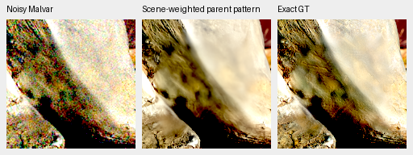
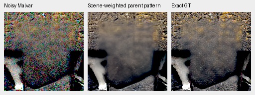

# Exterior Bayer texture covariance on natural detail

A nearby RAW texture covariance can raise fine response on natural
photographs, but the tested correction raises reconstruction error.
At full strength the ISO6400 response increases **0.655 percentage
points**, independent fine-increment RMS increases **1.673 DN16**,
and fine-flat RMS increases **3.097 DN16**. A stricter correction
that follows the neural parent's local texture does less harm and
recovers almost no additional detail. At the calibrated quiet budget,
the correctly oriented covariance gives nearly the same response
as equal directional weights.

[Machine results](results/scene-raw-covariance-v1/publication.json) ·
[Frozen code and receipts](results/scene-raw-covariance-v1/evidence.tar.xz) ·
[Native crop provenance](images/scene-raw-covariance-v1/manifest.json).

## Measuring texture without copying its phase

Each crop keeps the frozen Corpus 100k EMA
`87b96f3c487b9edaf1c477742b6c38f2a82cc6b20a94716d51cc8cf46a17a760`.
The new path measures up to 96 nonoverlapping 32-pixel patches nearest
the 256-pixel query, with the entire query excluded. A separate bank
uses the farthest remaining patches. For each native donor patch it
fits discrete cosine coefficients separately on the two actual green
lattices. The fit includes low-frequency tone terms. The retained modes
run from 0.0625 to 0.1406 cycles per native pixel. Symmetrized green
cross products estimate a second moment. Clipping negative eigenvalues
gives a positive covariance for the correction.

In the query, both green fits must agree in sign and strength. The
covariance contracts the part of the measured coefficient that exceeds
the parent's coefficient in the observed direction. Diagonal and
equal directional weights share the covariance's total power.
Transposing the covariance swaps its spatial axes and preserves its
eigenvalues. The distant bank is scaled to the same power.

The whole-pattern alternative takes a fixed local template from the
parent, optionally weighted by the exterior covariance. Each green
estimates how much that direction can grow. The lift is tapered and
luminance-only. Both greens were available to the parent. The
two-green checks therefore measure an empirical correction and may
reinforce errors already present in the parent's output.
[Coordinate, isolation and composition checks](results/scene-raw-covariance-v1/publication.json).

## Native photo evaluation

The exact input panel has 64 sources at ISO400 and ISO6400 with
independent draws. Each has natural present, attenuated and exact-flat
query roles. A frozen source hash assigns 16 photos to calibration
and 48 to evaluation. The calibration chooses per-arm doses to match
mean added fine-band RMS in the exact-flat crops at ISO6400. The budget
is capped at 0.25 DN16 and at the lowest full-strength correction,
yielding 0.069 DN16. The actual held-out flat changes are also reported.
The evaluation pools error energy across sources and resamples whole
photos for intervals.
[Original captures and model scores](scene-full-epoch-40k.md#checkpoints-and-evaluation).

| Independent ISO6400, 48 photos | Fine response | Fine-increment RMS, DN16 | Fine-flat RMS, DN16 |
| --- | ---: | ---: | ---: |
| Corpus 100k | 65.7289% | 155.7194 | 5.3706 |
| Exterior covariance, full strength | 66.3842% | 157.3921 | 8.4680 |
| Exterior covariance, calibrated | 65.7386% | 155.7299 | 5.3752 |
| Equal directional weights, calibrated | 65.7386% | 155.7260 | 5.3737 |
| Transposed covariance, calibrated | 65.7377% | 155.7313 | 5.3751 |
| Scene-weighted parent pattern, calibrated | 65.7304% | 155.7271 | 5.3894 |
| Equal-weight parent pattern, calibrated | 65.7352% | 155.7381 | 5.4033 |

Relative to equal directional weights, the calibrated coefficient lift
using the scene changes response by −0.00002 points [−0.00275, +0.00223]
and adds 0.00389 DN16 increment error [0.00101, 0.00650]. In the
whole-pattern comparison the scene weighting lowers increment error
0.011 DN16 [0.005, 0.019] versus equal weights and loses 0.005 points.
It still increases increment error versus the parent by 0.008 DN16.
At ISO400 the full-strength exterior covariance raises fine response
0.421 points, increment RMS 0.853 DN16 and fine-flat RMS 1.915 DN16. A coefficient-only comparison at the
larger 0.25 DN16 calibration budget gives +0.035 response points and
+0.040 DN16 increment RMS at ISO6400. The full-strength results and
both calibrated comparisons are archived.

### Separately generated captures

A symmetric swap adds each full-strength correction to the parent
output from the other draw of the same ISO6400 scene. Optical
targets and camera settings match. The two separately generated
capture groups use coupled and independent draws within their
respective present/attenuated pairs. Swapping the two corrections
preserves their total energy and the average target projection. It
changes only their pairing with the parent error.

| Exterior covariance on 48 photos, two captures each | Same capture | Other capture |
| --- | ---: | ---: |
| Twice the parent-error/correction cross term, DN16² | +46.2 | −125.0 |
| Correction energy, DN16² | 190.1 | 190.1 |
| Fine-increment RMS change, DN16 | +0.823 | +0.227 |

The swap removes 0.596 DN16 [0.464, 0.724] of the excess error and
some positive error coupling. The unscaled correction remains noisier
than the parent. The scene-weighted parent-pattern correction falls
from +0.0074 to −0.0009 DN16 when swapped. The other-capture path uses
two captures as a diagnostic. These tests show how reinforcing noisy
parent estimates can raise error even when the signed response rises.

## Native exact-target triplets

Each cell uses unchanged 160 × 160 pixels at `[48,48,160,160]`
inside the listed query. Shot/read is `0.00128/6.5536e-6`, 16-bit ADC
with black 0.03, capture exposure ×0.33, display ×3.0303 and contrast
×2. The middle column shows the scene-weighted parent-pattern arm.
These are its largest observed improvement and regression in fine
increment error on the ISO6400 evaluation sources. The differences
are small and the fine grain remains softer than the target.

**Fischfigur in Jesserndorf**, Stephan van Helden, CC BY-SA 4.0.
BGGR, query `[202,262,256,256]`. Fine-increment RMS changes −0.007 DN16.
[Source](https://commons.wikimedia.org/wiki/File:Fischfigur_im_Dorfbrunnen_Jesserndorf.jpg) ·
[All methods](images/scene-raw-covariance-v1/exact/017-iso6400-covariance-comparison.png).

**Hauroth**, Palauenc05, CC BY-SA 4.0. RGGB, query `[218,192,256,256]`.
Fine-increment RMS changes +0.136 DN16. The mottled rock stays in
roughly the same places and the original stone grain remains soft.
[Source](https://commons.wikimedia.org/wiki/File:Hauroth_Wegekreuz_St-Bartholom%C3%A4us.jpg) ·
[All methods](images/scene-raw-covariance-v1/exact/000-iso6400-covariance-comparison.png).

## Standing GFX100S comparisons

The correction composes directly with the same Corpus 100k checkpoint.
The standing boards also show V120 and the two 40k scene models.
The scene-weighted parent pattern changes the sky by 0.024 DN16
camera-RGB RMS and reproduces the parent in the building, foliage and
coarse-fence crops. Unscaled covariance changes the building and coarse
fence by 11.60 and 15.56 DN16 RMS with no clear new detail at native scale.
In the cab, the scene-weighted correction changes the crops by
0.55–1.65 DN16 RMS. Fine intersections remain incomplete under both
noise priors. All eight boards were viewed at display ×4 for the main
scene and ×16 for the cab. Independent ISO100 AHD and camera JPEGs
are qualitative references at different aperture, exposure time and motion.

[Sky](images/scene-raw-covariance-v1/standing/main-overcast-sky-main-overcast-sky.png) ·
[Building](images/scene-raw-covariance-v1/standing/main-building-detail-main-building-detail.png) ·
[Foliage](images/scene-raw-covariance-v1/standing/main-foliage-main-foliage.png) ·
[Coarse fence](images/scene-raw-covariance-v1/standing/main-chain-link-fence-main-chain-link-fence.png).

| Cab shot/read | Left | Right |
| --- | --- | --- |
| Nominal `0.00128/6.5536e-6` | [Native board](images/scene-raw-covariance-v1/standing/mesh-nominal-fine-green-mesh-left.png) | [Native board](images/scene-raw-covariance-v1/standing/mesh-nominal-fine-green-mesh-right.png) |
| Transferred `0.0014635775921166604/1.0715704128646712e-6` | [Native board](images/scene-raw-covariance-v1/standing/mesh-profile3879-fine-green-mesh-left.png) | [Native board](images/scene-raw-covariance-v1/standing/mesh-profile3879-fine-green-mesh-right.png) |

This component replay adds no fixed 427-photo or measured-camera scores.
