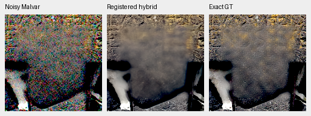
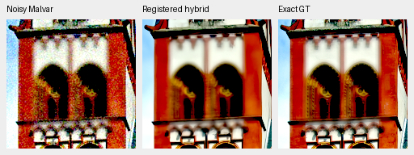

# Combining whole-scene context with a dense regional preview

A dense, correctly registered regional preview gives the spatial 12k model a modest quiet-region benefit. It leaves the native fine increment almost unchanged. The real overcast sky stays smooth, and neither denser full-frame context nor regional context makes the fine cab crossings reliably visible.

[Checkpoint, scores and provenance](results/scene-regional-context-v1/publication.json) · [Frozen drivers and machine results](results/scene-regional-context-v1/evidence.tar.xz) · [Native image manifest](images/scene-regional-context-v1/manifest.json).

## Fixed inputs and preview policies

The spatial full-epoch EMA is `d8279f5dd615b0fe16c8424e4c7b681ea1606ae0ecb376122fa7e5da50ffd1b6`. It receives the same native packed Bayer samples, variance, CFA layout, exposure and camera calibration throughout. The frozen encoder and trained adapter are shared. The independent references and clean targets enter scoring and display only. This is an inference study. [Matched 12k training and review](scene-full-epoch.md#matched-quality-comparison-at-12000-updates).

The ordinary main and cab previews use the whole photo at a 1,024-pixel long side. The dense whole-frame arm increases this to 3,072. These give approximately 11.39 and 3.80 native pixels per preview pixel. The regional arm encodes a window four times the native query's width and height, clipped to the photograph and aligned to the original Bayer phase. The window is 2,048×2,048 native pixels for the four main queries and 3,072×3,072 for the shared cab query, each at a 1,024-pixel cap. Regional pitch is 2 pixels in the main scene and 3 in the cab. Native coordinates convert into the window before adapter sampling.

The hybrid keeps the full-frame adapter offset's spatial mean per channel and interpolates halfway to the regional offset's spatial variation. The resampled control starts with the same low sensor sampling in the regional window as the coarse full view, then bilinearly interpolates to the finer input grid. The flipped control mirrors the already encoded regional feature maps horizontally. All six policies use the same frozen output trunk and noise conditioning. The direct model forward reproduces the refactored full-preview path bit for bit. All six real full-preview queries reproduce the original CPU review within 0.0013 DN16 RMS.

## Exact-target comparison

The fixed development observations contain an attenuated texture, its matched absent counterpart and an exact flat core. Each of 64 photo IDs has independent and coupled ISO6400 draws. Sixteen form the initial comparison and the other 48 replay the same frozen policies. The continuation excludes these photos. Its Corpus 100k parent saw them in earlier training. This is evidence about the model's interventions on fixed development inputs.

The synthetic full-preview arms simulate GFX sampling at about 11.4 and 3.8 native pixels per preview pixel. The regional arm samples at 2 and often spans much of a small development image. The ordinary native-cap control renders the entire development field at up to 1,024 preview pixels. It reproduces the earlier 12k monitor output exactly where inputs overlap.

On the initial 16 independent draws, the registered hybrid reduces fine-band flat RMS by **0.235 DN16 [0.015, 0.637]** versus coarse full context, by **0.231 [0.015, 0.632]** versus the same grid with resampled coarse data, and by **0.202 [0.003, 0.584]** versus flipped features. Fine-increment error changes by −0.009 DN16 [−0.061, +0.039] versus coarse full context. The intervals resample photo IDs. The lower and fine bands cover 1/32–1/8 and 1/8–1/3 cycles per native pixel respectively.

| ISO6400, independent draws on the other 48 photos | Fine-increment RMS, DN16 | Fine flat RMS, DN16 | Lower-band flat RMS, DN16 | Aligned fine response |
| --- | ---: | ---: | ---: | ---: |
| Corpus 100k EMA | 124.593 | 4.363 | 12.360 | 62.854% |
| V120 EMA | 124.850 | 4.883 | 12.957 | 62.480% |
| Spatial 12k, coarse full | 124.060 | 4.486 | 11.589 | 62.314% |
| Spatial 12k, dense full | 124.133 | 4.370 | 11.145 | 62.276% |
| Spatial 12k, regional only | 124.056 | 4.231 | 10.674 | 62.203% |
| Spatial 12k, registered hybrid | 124.070 | 4.368 | 11.199 | 62.290% |
| Spatial 12k, resampled hybrid | 124.054 | 4.428 | 11.368 | 62.306% |
| Spatial 12k, flipped hybrid | 124.060 | 4.478 | 11.526 | 62.302% |
| Spatial 12k, ordinary development preview | 124.060 | 4.232 | 10.674 | 62.204% |

On these 48 independent draws, the registered hybrid lowers fine flat RMS by **0.118 DN16 [0.068, 0.181]** versus coarse full, by **0.060 [0.030, 0.102]** versus resampling, and by **0.110 [0.051, 0.180]** versus flipped context. The lower-band quiet improvement versus coarse full is **0.389 DN16 [0.264, 0.532]**. Fine-increment RMS changes by +0.011 DN16 [−0.037, +0.073] versus coarse full. On coupled draws the quiet improvement is 0.103 DN16 [0.065, 0.148], and fine-increment error rises 0.091 DN16 [0.028, 0.164]. The regional-only arm lowers flat RMS more, with similarly unresolved fine response.

The registered hybrid's lower independent fine-increment error versus Corpus 100k and V120 comes with lower aligned response than Corpus 100k. Its fine-increment RMS on the predetermined fainter 32 of all 64 photos moves by +0.012 DN16 [−0.015, +0.044] versus coarse full on independent draws. This makes the repeatable benefit quiet-region suppression under coarse global sampling. The native-cap control reproduces the previous 12k monitor bit for bit on all 16 overlapping groups.

## Native exact-target views

The 160×160 cells show noisy Malvar, the registered hybrid and exact GT at the same `[48,48,160,160]` ROI in a 256-pixel query. Independent ISO6400 draws use shot/read `0.00128/6.5536e-6`, capture exposure 0.33 and ADC16 black fraction 0.03. The common display uses exposure ×3.0303 and contrast ×2. The complete boards also show the exact flat controls.

**Hauroth**, Palauenc05, CC BY-SA 4.0, source query `[218,192]`, RGGB. The broad stone contours survive in every arm. Fine grain and small flecks remain soft. [Source](https://commons.wikimedia.org/wiki/File:Hauroth_Wegekreuz_St-Bartholom%C3%A4us.jpg) · [All methods](images/scene-regional-context-v1/pilot/000-iso6400-independent-role0-comparison.png) · [Flat control](images/scene-regional-context-v1/pilot/000-iso6400-independent-role2-comparison.png).

**Limburg Cathedral**, Berthold Werner, public domain, source query `[22,250]`, BGGR. The broad arch and frame persist. Small brick variation and fine trim remain softer than the exact target. [Source](https://commons.wikimedia.org/wiki/File:Limburger_Dom_BW_1.jpg) · [All methods](images/scene-regional-context-v1/pilot/001-iso6400-independent-role0-comparison.png) · [Flat control](images/scene-regional-context-v1/pilot/001-iso6400-independent-role2-comparison.png).

The confirmation panel also preserves the fine colored transitions in the bee crop and gradients in the long-tailed tit crop, with softer small markings than in the exact targets. The first uses `[640,276,256,256]`, GRBG, and the second `[0,378,256,256]`, GBRG. Their quiet-center boards and source licenses are bound in the manifest.
[Bee source](https://commons.wikimedia.org/wiki/File:Apis_mellifera_in_Sydney_2.jpg) · [Bee native board](images/scene-regional-context-v1/confirmation/002-iso6400-independent-role0-comparison.png) · [Tit source](https://commons.wikimedia.org/wiki/File:Long-tailed_tit_Gennevilliers_05.jpg) · [Tit native board](images/scene-regional-context-v1/confirmation/003-iso6400-independent-role0-comparison.png).

## Standing GFX100S comparisons

All eight native camera boards were viewed. Either denser full-frame or hybrid context preserves the smooth overcast sky and the two coarse fence directions. Fine building brackets and leaf tips remain soft. The transferred noise prior retains more diagonal texture in the fine cab. The denser previews leave incomplete crossings and mottling on both sides. These outputs use the DSCF3879 and DSCF3842 RAWs, the independent ISO100 AHD references, and the two camera JPEGs on the cab boards.

| Region | Dense full preview change, DN16 RMS | Registered hybrid change, DN16 RMS |
| --- | ---: | ---: |
| Overcast sky | 0.95 | 0.24 |
| Building | 6.00 | 2.60 |
| Foliage | 3.80 | 1.72 |
| Coarse fence | 8.28 | 2.81 |
| Four fine cab views | 2.31–2.98 | 0.91–1.11 |

Changes are camera-linear RGB differences from the coarse global-preview result. The fine-scale hybrid change after removing a native sigma-3 Gaussian component is 0.05 DN16 in sky, 2.52 on the coarse fence and 0.49–0.89 in the cab. The main scene uses display ×4 and shot/read `0.00128/6.5536e-6`. The cab uses display ×16 and the same nominal or transferred `0.0014635775921166604/1.0715704128646712e-6` profile. The manifest retains fixed native coordinates and calibration. The ISO100 and JPEG captures differ in exposure, aperture and motion and serve as qualitative references.

Both the 3,072 full preview and the dense regional input grid can sample all ten previously measured wire carriers across the five fence crops. At stride four, the finest encoder feature grid is too sparse to represent any of those carriers as a literal spatial oscillation between sites. Channels can still carry subcell cues. The sampling calculation explains the distinction between increasing regional evidence and directly representing native phase. [Frozen sampling calculation](results/scene-regional-context-v1/publication.json).

[Overcast sky](images/scene-regional-context-v1/standing/main-overcast-sky-main-overcast-sky.png) · [Building](images/scene-regional-context-v1/standing/main-building-detail-main-building-detail.png) · [Foliage](images/scene-regional-context-v1/standing/main-foliage-main-foliage.png) · [Coarse fence](images/scene-regional-context-v1/standing/main-chain-link-fence-main-chain-link-fence.png).

| Cab profile | Native comparisons |
| --- | --- |
| Nominal | [Left](images/scene-regional-context-v1/standing/mesh-nominal-fine-green-mesh-left.png) · [Right](images/scene-regional-context-v1/standing/mesh-nominal-fine-green-mesh-right.png) |
| Transferred | [Left](images/scene-regional-context-v1/standing/mesh-profile3879-fine-green-mesh-left.png) · [Right](images/scene-regional-context-v1/standing/mesh-profile3879-fine-green-mesh-right.png) |

The scoped input study has no comparable full427 or measured-camera score. [Comparable performance history](performance-history.md).
