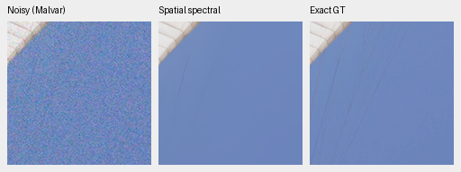
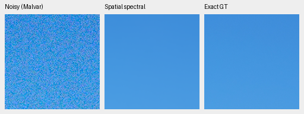

# Scene-conditioned gain for weak RAW detail

This pilot gives scene context control over the strength of a local RAW detail
estimate. It uses the same frozen V120 EMA parent and the same trainable detail
head in both arms. One arm pools scene features over the image. The other uses
features aligned to the native tile and to its overlapping spectral frames.
The comparison tests whether spatial context helps restore faint structure
without increasing unexpected texture.
Both heads train successfully. They slightly reduce longer-band error and
raise finer and quiet-region errors. Aligning scene features gives a negligible
change. V120 remains the general choice.
[Earlier fixed-RAW context intervention](scene-context-extent.md).

## Detail path and training recipe

The local estimator analyzes the actual four Bayer phases and their residual
from V120's predicted mosaic. Its tapered, affine-detrended frames are
32 packed pixels, or 64 native pixels, with half overlap. The estimator
determines the signed gain and uses the measured phase and independent color
samples. The scene adapter supplies two positive multipliers in [0.25, 1.75].
They crossfade across the native frequency interval from 1/16 to 1/8 cycles
per pixel. The gains start at one, and the complete head starts with the
exact V120 output. This path confines the scene contribution to scaling
the local proposal. The RGB result still includes the existing spatial
support and final handoff to Malvar, so delivered coarse and quiet behavior
is assessed from the composed prediction.
[Head implementation](../src/demosaic/scene_spectral_detail.py).

Both arms share 800 fixed scene draws with four native 256-pixel crops per
draw, fresh simulated camera/exposure/noise, global D4 and the same physical
crops for every update. They use the 24,660-source native bin4 pool from the
earlier context study. The 64 validation sources are disjoint from this
training manifest. The standing GFX captures and related photographs remain
excluded from training. Parent V120 EMA SHA256
`a9d9b6b4f974e24a6b11e5e740aab32314233a7f53c056cf37c7d2aac1c589fb`
and DINO SHA256
`691963f0f796aac860d818d59d9d14287a4675612829fbe9467c7f5df8ce5b14`
are shared. One parent forward and one scene encoding serve both arms per
update. Each head has a separate AdamW optimizer and EMA. The parent forward
and scene encoding use BF16, and the physical spectral head uses FP32.

The canonical sensor-valid reconstruction loss includes auxiliary mosaic
supervision. Two added training terms use a shared clean target. The first
measures signed color-band error on low-contrast 32-pixel blocks across
both frequency ranges from 1/32 to 1/3 cycles per native pixel. The second
penalizes increases in regional RGB mean error relative to V120. Both
weights are 0.0002. The band target uses valid sensor values, a local
band-to-mean ratio at most 0.03 and a 16 DN16 normalization floor.
Both arms use the same objective and no target enters the inference inputs.
[Trainer and exact loss](../scripts/train_scene_spectral_detail.py).

Both arms completed 800 updates and 3,200 native crop examples per arm from
791 distinct source photos. The shared training process took 381.43 seconds
and peaked at 0.952 GiB of allocated CUDA tensors. Each arm has 53,540 trainable
parameters. Checkpoints contain both raw and EMA head weights and optimizer
state. The quality collector uses EMA heads on the matched cached V120 inputs.

| Arm | Checkpoint SHA256 |
| --- | --- |
| Pooled | `9d7872e5345e7478ff782477fe438ba6d021684fb6d06f0fea96be5e62797608` |
| Spatial | `7182fff29b6e0634b10879af56b368140bce3ba65c18efbe95e8095228a46e9b` |

## Evaluation scope

The training preflight completed three discarded updates in both arms. It
checked exact initialization, nonzero scene-gate gradients, finite losses,
unchanged parent weights and checkpoint reload. The evaluation preflight used
one exact-target scene and the transferred-profile cab capture. It verified
that the retained V120 outputs and the full-scene CFA tensors use the same
native observations. Its inputs and outputs are separate from the production run.

The scoped review is bound to 64 reserved sources at the two established
positive-noise conditions, plus the standing native GFX ROIs. The
shifted-spatial comparison rolls the complete feature columns while preserving
pooled scene means and padded cells. Numerical results, both real fence
comparisons and actual native viewing close separately from training.
This component study has its own quality panel. The standard 427-photo and
camera-history measurements remain separate.
[Collector](../scripts/evaluate_scene_spectral_detail.py) ·
[Scoring and native rendering](../scripts/report_scene_spectral_detail.py).

## Held-out results

| Condition and EMA | Mean sRGB PSNR (dB) | Longer weak-band RMS (DN16) | Fine weak-band RMS (DN16) | Quiet fine-band RMS (DN16) |
| --- | ---: | ---: | ---: | ---: |
| Shadows, V120 | 42.67652 | 24.13913 | 30.50552 | 3.68578 |
| Shadows, pooled | 42.67802 | 24.13683 | 30.51596 | 4.10919 |
| Shadows, spatial | 42.67802 | 24.13683 | 30.51589 | 4.10160 |
| Shadows, shifted spatial | 42.67801 | 24.13684 | 30.51573 | 4.10176 |
| ISO12800, V120 | 36.22783 | 160.09873 | 215.17915 | 18.20756 |
| ISO12800, pooled | 36.22931 | 160.02249 | 215.21323 | 19.25883 |
| ISO12800, spatial | 36.22931 | 160.02241 | 215.21265 | 19.26010 |
| ISO12800, shifted spatial | 36.22931 | 160.02255 | 215.21212 | 19.26076 |

The weak bands use target-relative contrast below 0.02 on valid linear
luma blocks. The longer band covers 1/32–1/8 cycles per native pixel with
32-pixel DCT blocks. The fine band uses 1/8–1/3 with 16-pixel blocks.
Metrics pool each source's eligible blocks before balancing sources.
The fine-band weak subsets contain 57 and 58 sources, respectively.
The numerical quiet subsets contain only two shadow sources and one ISO12800
source. Response is undefined in those near-zero target bands, so the
report retains their RMS errors. The first summary reported a ratio against
roundoff in these quiet sets. The archived correction removes that ratio,
with the original predictions and error reductions preserved.

The readout improves mean PSNR by about 0.0015 dB and slightly lowers
longer-band error. It raises weak-band error at finer scales and raises
error in both measured quiet subsets. Correct scene alignment makes
almost no difference to these tradeoffs. Shifting the spatial context
changes mean RGB predictions by 0.011 DN16 in shadows and 0.060 DN16
at ISO12800. The two head variants stay experimental.
[Per-source metrics and noise conditions](results/scene-spectral-detail-v1/summary.json) ·
[Alignment intervention](results/scene-spectral-detail-v1/alignment.json).

A [follow-up gain test](scene-spectral-gain-headroom.md) keeps the learned
proposal and its support fixed. Even unbounded nonnegative gains with exact
local targets reduce ISO12800 weak fine-band error by only about 1.1%.
Source-disjoint calibration slightly improves aggregate PSNR while raising
fine and quiet error.

## Native crops

The two triplets show noisy Malvar, V120 EMA plus the spatial spectral EMA
head and exact synthetic GT. Both use RGGB and the fixed
`[48,48,160,160]` ROI. Development source 0 at ISO12800 uses display
exposure 1 and shot/read `0.00256/2.62144e-5`. Development source 1 uses
shadow display exposure 8 and shot/read `0.00064/1.6384e-6`.
Matrices, white balance and display transforms match across all cells.
The sky stays smooth and the thin, closely spaced canopy cords remain
incomplete.
[Crop provenance and both checkpoints](images/scene-spectral-detail-v1/manifest.json) ·
[Original source attributions and crop coordinates](results/whole-scene-context-native-review-v1/native-crop-provenance.json).

The spatial head changes the standing overcast sky by 0.745 DN16 RMS from
V120 and the coarse fence by 0.751. The rendered sky stays smooth.
Building and foliage remain soft. Cab changes from V120 range from
0.392 to 0.473 DN16 RMS, with no convincing new fine crossings. Both
cab noise profiles, both ROIs and the two camera JPEGs were viewed.
All comparisons use native 160-pixel crops and the same exposures
as the standing tests. The DSCF3880/DSCF3835 ISO100 images are
independent qualitative references with different aperture, exposure and
motion.
[Overcast sky](images/scene-spectral-detail-v1/main-overcast-sky-main-overcast-sky.png) ·
[Building](images/scene-spectral-detail-v1/main-building-detail-main-building-detail.png) ·
[Foliage](images/scene-spectral-detail-v1/main-foliage-main-foliage.png) ·
[Coarse fence](images/scene-spectral-detail-v1/main-chain-link-fence-main-chain-link-fence.png) ·
[Cab left](images/scene-spectral-detail-v1/mesh-nominal-fine-green-mesh-left.png) ·
[Cab right](images/scene-spectral-detail-v1/mesh-nominal-fine-green-mesh-right.png) ·
[Transferred left](images/scene-spectral-detail-v1/mesh-profile3879-fine-green-mesh-left.png) ·
[Transferred right](images/scene-spectral-detail-v1/mesh-profile3879-fine-green-mesh-right.png).

The collection uses archived CPU IEEE FP32 V120 and fresh CUDA IEEE FP32
head and scene inference. All 134 observations and 2,048 crop/method
metric rows are complete. The collection stage took 120.82 seconds
including setup, and scoring/rendering took 53.67 seconds. The audit
reproduces 48 native change measurements and verifies 56 retained display
cells. All 16 boards were viewed. Standard photo and camera evaluations of
the separate full-model runs are tracked in the experiment index.
[Training audit](results/scene-spectral-detail-v1/training-audit.json) ·
[Native audit](results/scene-spectral-detail-v1/review-audit.json) ·
[Complete executed evidence](results/scene-spectral-detail-v1/publication.json).
