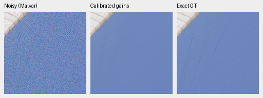
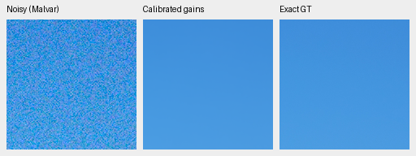

# Gain headroom in the trained scene spectral correction

The previous pilot changed RGB only slightly when its scene features were
shifted. This follow-up tests how much gain selection can improve the existing
RAW-derived proposal. It also tests a gain fit that excludes the source being
scored. Both tests keep the original spatial support and checkpoint fixed.
[Original matched training and native review](scene-spectral-detail.md).

## Measured correction and gain choices

Replay the spatial head and split its learned spectral correction with the
same radial crossfade between 1/16 and 1/8 cycles per native pixel. Synthesize
each contribution with the original overlap weights, multiply by the
same learned support, and apply the original Malvar interpolation.
The sum recovers the existing correction apart from floating-point
rounding. Each component carries the learned local proposal's phase, CFA
color samples and scene weighting. The split keeps the original support
field fixed, including where a different gain would normally affect it.
[Target-free replay](../scripts/diagnose_scene_spectral_gains.py).

The comparison retains both noise observations and all four native crops
for each of the original 64 sources. It also retains the existing six real
GFX input rows and eight GFX display crops. Results from the earlier pilot
motivated this ablation on the same panel. The source exclusion applies to
the gain fit. The first stage loads the RAW
measurements, calibration, fixed checkpoints and prior predictions.
It finishes before the scoring stage opens the exact synthetic targets.
The spatial head EMA SHA256 is
`7182fff29b6e0634b10879af56b368140bce3ba65c18efbe95e8095228a46e9b`.
The V120 EMA parent SHA256 is
`a9d9b6b4f974e24a6b11e5e740aab32314233a7f53c056cf37c7d2aac1c589fb`.

The longer-only ablation keeps the longer contribution at its saved gain.
The calibrated variant fits two nonnegative gains in [0, 2] to reduce
linear camera RGB MSE. Each of the 64 calibration folds excludes all
crops and both priors of the scored source. Each remaining source/prior
has equal weight after dividing its squared error by the squared V120
error. The real crops use one calibration fit across all development
sources, and their AHD and JPEG panels are used only for viewing.

Two target-assisted diagnostics fit separate gains per native crop, one
to the full RGB error and one to the established weak fine band of the
exact target. A third diagnostic fits the weak band independently in
each eligible 16×16 block. The block fit is a numerical limit on scaling
these two delivered fields within that local objective. It has no delivered
image and its freedom differs from the original overlapping FFT frames.
These fits clarify which changes are within the measured proposal's span.
[Calibration and scoring](../scripts/report_scene_spectral_gains.py).

## Held-out calibration and target-assisted limits

All 64 held-out fits return `[2,2]`, the upper gain bound for both
bands. Doubling the correction improves overall PSNR by about 0.0016 dB
against V120 and increases fine weak-band and measured quiet error.
The longer-only variant shows a small reduction in longer weak-band error
with little change in fine or quiet error. The RGB-fit diagnostic also
raises fine-band error. Optimizing the exact weak band directly improves
it slightly.

| Noise and method | Mean sRGB PSNR (dB) | Longer weak-band RMS (DN16) | Fine weak-band RMS (DN16) | Quiet fine-band RMS (DN16) |
| --- | ---: | ---: | ---: | ---: |
| Shadows, V120 | 42.67652 | 24.13913 | 30.50552 | 3.68578 |
| Shadows, learned spatial | 42.67802 | 24.13683 | 30.51589 | 4.10160 |
| Shadows, longer-only | 42.67707 | 24.13629 | 30.50620 | 3.70063 |
| Shadows, calibrated | 42.67805 | 24.14209 | 30.54208 | 4.70246 |
| Shadows, exact weak-band crop fit | 42.67808 | 24.12750 | 30.47479 | 3.68842 |
| ISO12800, V120 | 36.22783 | 160.09873 | 215.17915 | 18.20756 |
| ISO12800, learned spatial | 36.22931 | 160.02241 | 215.21265 | 19.26010 |
| ISO12800, longer-only | 36.22842 | 160.05043 | 215.18140 | 18.23829 |
| ISO12800, calibrated | 36.22943 | 159.97472 | 215.30878 | 21.05578 |
| ISO12800, exact weak-band crop fit | 36.22923 | 159.96360 | 215.02904 | 18.34843 |

Each source/condition contributes its four-crop mean PSNR. Weak-band error
first pools eligible blocks per source, then balances sources. The longer
band uses 32-pixel DCT blocks from 1/32 to 1/8 cycles per pixel. The fine
band uses 16-pixel blocks from 1/8 to 1/3. Both use a target contrast cutoff
below 0.02. The fine weak-band subset includes 57 shadow sources and 58
ISO12800 sources. Quiet fine-band results cover two shadow sources and
one ISO12800 source.
[Complete source-balanced scores](results/scene-spectral-gain-headroom-v1/summary.json).

The upper-bound hits motivated a separate sensitivity check on the
target-assisted local fit. It removes the gain limit, then allows signed
gains as a further relaxation. Both use the same exact weak fine-band
target inside every eligible block. The signed fit can also reverse
the phase of either measured contribution.

| Target-assisted local fit | Shadows fine RMS (DN16) | ISO12800 fine RMS (DN16) |
| --- | ---: | ---: |
| V120 reference | 30.50552 | 215.17915 |
| Gains in [0, 2] | 30.43611 | 214.82410 |
| Unbounded nonnegative gains | 30.11291 | 212.89879 |
| Unbounded signed gains | 29.66219 | 210.27561 |

Even unbounded nonnegative gains chosen from exact targets reduce fine
error by about 1.1% at ISO12800. The learned proposal has limited
weak-detail leverage in this two-component span. The diagnostic holds
support and both delivered fields fixed, so it leaves open changes to
measurement aggregation and to the proposal itself.
[Gain-cap sensitivity](results/scene-spectral-gain-headroom-v1/relaxed.json).

## Native observations

The two triplets use gains calibrated on other sources. They show noisy
Malvar, V120 plus the calibrated spatial head correction and exact GT.
All panels are unresized 160×160 RGGB crops at `[48,48,160,160]`.
Source 0 uses the ISO12800 shot/read `0.00256/2.62144e-5` and display
exposure 1. Source 1 uses the shadows shot/read `0.00064/1.6384e-6`
and display exposure 8. White balance, matrix and display transforms
match per board. Blue sky stays smooth and the fine canopy cords remain
incomplete.
[Native coordinates, source and checkpoints](images/scene-spectral-gain-headroom-v1/manifest.json).

Both real gain variants leave the sky smooth and the cab fine crossings
incomplete. The calibrated variant changes the overcast sky by 1.49 DN16
RMS and the coarse fence by 1.50 from V120. The rest of the building and
foliage detail remains soft. Both GFX noise profiles, cab ROIs and SOOC
JPEGs were viewed under the same display transforms as the original
pilot. The DSCF3880/DSCF3835 ISO100 AHD renders and the camera JPEGs
are qualitative references with different aperture, exposure and motion.
[Overcast sky](images/scene-spectral-gain-headroom-v1/main-overcast-sky-main-overcast-sky.png) ·
[Building](images/scene-spectral-gain-headroom-v1/main-building-detail-main-building-detail.png) ·
[Foliage](images/scene-spectral-gain-headroom-v1/main-foliage-main-foliage.png) ·
[Coarse fence](images/scene-spectral-gain-headroom-v1/main-chain-link-fence-main-chain-link-fence.png) ·
[Cab left](images/scene-spectral-gain-headroom-v1/mesh-nominal-fine-green-mesh-left.png) ·
[Cab right](images/scene-spectral-gain-headroom-v1/mesh-nominal-fine-green-mesh-right.png) ·
[Transferred left](images/scene-spectral-gain-headroom-v1/mesh-profile3879-fine-green-mesh-left.png) ·
[Transferred right](images/scene-spectral-gain-headroom-v1/mesh-profile3879-fine-green-mesh-right.png).

All 134 saved learned outputs replay bit-exactly. The target-free
decomposition differs from the saved correction by at most
`3.50e-10` in normalized camera RGB. The audit reproduces 65 calibration
fits, eight real ROI comparisons and 72 retained display cells. All
16 native boards were viewed. V120 remains the recommendation.
[Independent audit](results/scene-spectral-gain-headroom-v1/audit.json) ·
[Executed sources and full receipts](results/scene-spectral-gain-headroom-v1/publication.json).
