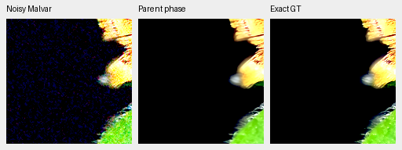
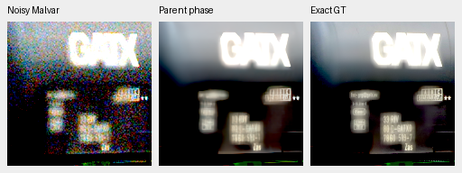

# Using surrounding RAW to choose detail frequencies

Surrounding RAW helps a spectral lift recover more aligned detail on natural
photo targets. The original lift raises independent ISO6400 recovery by
**1.91 percentage points** and increases fine-increment error by **1.83 DN16**.
Requiring agreement along the Corpus 100k phase keeps a smaller **0.43-point**
gain and brings increment error close to the parent. The narrower lift still
adds signal in detail-absent controls. Both standing cab crops stay visually
close to the preceding result, with incomplete crossings.

[Results and checkpoint](results/scene-spectrum-detail-v1/publication.json) ·
[Frozen drivers and receipts](results/scene-spectrum-detail-v1/evidence.tar.xz) ·
[Native crop provenance](images/scene-spectrum-detail-v1/manifest.json).

## Estimating a spectral prior from the surrounding image

The [earlier scene-strength study](context-strength.md) varies the gain of a
fixed detail proposal. Here 32-pixel native windows supply frequency-specific
power. The method registers the two physical green sublattices at their native
sample offsets and forms the real part of their complex cross spectrum. With
independent read and shot noise, its expectation retains the shared signal
power. Query candidates use frequencies from 0.112 to 0.244 cycles per
native pixel. The method avoids the per-plane axis Nyquist limits.

Scene windows exclude the query and its 16-pixel halo. They contribute
according to their distance, camera colour, low-band contrast and orientation.
Their signed power estimates combine before clipping and smoothing. The four
controls use local total power, local plus exterior total power, local plus
exterior spectral shape, and the same exterior shape with its axes transposed.
The external data supply amplitude and direction statistics. Query sites
supply the actual phase.

The lift uses a pooled signed agreement score between the query greens.
The first rule adds excess amplitude from their RAW mean. The second bounds
that amplitude with their cross power after a noise allowance. The third
takes the preceding reconstruction's phase and requires positive support along
it from both green planes before raising the amplitude. Each correction is
achromatic in calibrated linear RGB and uses a tapered overlap-add. Query
appearance, phase and support reuse some samples. The parent-phase variant also
uses a parent that observed the whole query. The thresholds are empirical
and evaluated against noisy flat and masked-detail controls.

The [phase and isolation audit](results/scene-spectrum-detail-v1/evidence.tar.xz)
checks all four Bayer layouts. The relative green phase error for a planted
wave is below 0.005 radians. Replacing the query and halo leaves exterior
features and spectra identical. A noiseless flat preserves all output bytes.

## Natural detail on exact targets

The archived panel provides 64 held-out photo backgrounds, all four
Bayer orders, ISO400 and ISO6400, and coupled and independent noisy observations
of present, attenuated-detail and exact-flat roles. No source observations change.
The first 32 photo IDs set one scalar per policy using the coupled draws.
The main table scores the remaining 32 independent ISO6400 draws. Scaling
matches the added flat spectral energy on the calibration subset. Both the
flat and fine-increment scores use the same 96-pixel core and the native
1/8–1/3 cycles-per-pixel band.

| Independent ISO6400 | Aligned fine response | Fine-increment RMS | Fine flat RMS | Added RMS on detail-attenuated roles |
| --- | ---: | ---: | ---: | ---: |
| Corpus 100k EMA | 64.185% | 122.636 DN16 | 4.365 DN16 | 0 |
| Exterior shape, RAW mean | 66.095% | 124.468 DN16 | 4.784 DN16 | 7.92 DN16 |
| Exterior shape, cross-power bound | 64.591% | 122.764 DN16 | 4.428 DN16 | 2.44 DN16 |
| Exterior shape, matching parent phase | 64.610% | 122.663 DN16 | 4.380 DN16 | 1.73 DN16 |

The parent-phase rule adds **0.425 points [0.278, 0.540]** above Corpus
100k and increases fine-increment RMS by **0.027 DN16 [−0.061, +0.109]**.
The present image's fine-band error rises by 0.080 DN16 [0.021, 0.146].
Replacing exterior spectral shape with mean exterior power gives
122.664 DN16 under the same rule. Transposing the exterior shape gives
122.702 DN16 and slightly higher response. The correct shape gives a
small error advantage over the transposed shape, with little difference
from mean exterior power. Intervals resample photo IDs.

A second calibration matches the three rules' response on the first 32
photos. On the disjoint high-noise independent set, the original RAW mean
lift reaches 64.682% aligned response and 122.867 DN16 increment RMS.
The parent-phase rule reaches 64.742% and 122.694 DN16. Both errors are
above Corpus 100k, and both lifts enter the detail-attenuated controls.
The result identifies phase and amplitude selection as the main constraint
in this test. Higher recovered projection alone overstates the recovery.

## Native exact-target comparisons

Each 160×160 cell retains query ROI `[48,48,160,160]`, ADC16 black
0.03, shot/read `0.00128/6.5536e-6` and capture exposure 0.33, with
display exposure ×3.0303 and reference-centered contrast ×2. The triplets
show noisy Malvar, the fixed parent-phase lift and exact GT. The underlying
EMA checkpoint is
`87b96f3c487b9edaf1c477742b6c38f2a82cc6b20a94716d51cc8cf46a17a760`.

**Bush Hopper**, Sandipoutsider, CC BY-SA 4.0, BGGR, query
`[34,346,256,256]`. The wing edge stays coherent, with soft leaf
detail. The calibrated parent-phase fit lowers this case's increment
error by 0.98 DN16. [Full comparison](images/scene-spectrum-detail-v1/exact/045-iso6400-independent-present-comparison.png) ·
[Exact-flat control](images/scene-spectrum-detail-v1/exact/045-iso6400-independent-flat-comparison.png) ·
[Source](https://commons.wikimedia.org/wiki/File:Close_wing_Basking_of_Ampittia_dioscorides_%28Fabricius,_1793%29_-_Bush_Hopper_%28Male%29_WLB_DSC_9116b.jpg).

**St. Valentin freight train**, GT1976, CC BY-SA 4.0, BGGR, query
`[162,304,256,256]`. The small lettering remains visibly blurred.
The calibrated fit increases this case's increment error by 0.73 DN16.
[Full comparison](images/scene-spectrum-detail-v1/exact/061-iso6400-independent-present-comparison.png) ·
[Exact-flat control](images/scene-spectrum-detail-v1/exact/061-iso6400-independent-flat-comparison.png) ·
[Source](https://commons.wikimedia.org/wiki/File:2018-06-15_%28141%29_33_80_7860_519-7_at_Bahnhof_St._Valentin,_Austria.jpg).

## Standing GFX100S comparisons

All eight boards were viewed. The actual cached 102 MP mosaics
supply surrounding windows. The 256-pixel queries match the archived
Bayer inputs exactly. Each correction adds to the preceding
[measured geometry and colour fit](query-exterior-colour.md). The RAW mean
lift adds visible fine grain to foliage and around the bright building edge.
The parent-phase lift lowers the change from 21.68 to 4.41 DN16 camera
RGB RMS on the building, and from 21.08 to 3.67 on foliage. The sky remains
visually smooth. It changes by 0.006 DN16 RMS with parent phase. The
coarse fence retains both crossing directions. Fine cab changes are below
0.19 DN16 with parent phase and the crossings stay incomplete.

Main DSCF3879 uses shot/read `0.00128/6.5536e-6` and display ×4.
DSCF3842 uses display ×16 with either that nominal prior or transferred
`0.0014635775921166604/1.0715704128646712e-6`. The boards keep the
fixed coordinates, independent ISO100 AHD and both relevant camera JPEGs.
The independent references differ in exposure, aperture and motion.

[Sky](images/scene-spectrum-detail-v1/standing/main-overcast-sky-main-overcast-sky.png) ·
[Building](images/scene-spectrum-detail-v1/standing/main-building-detail-main-building-detail.png) ·
[Foliage](images/scene-spectrum-detail-v1/standing/main-foliage-main-foliage.png) ·
[Coarse fence](images/scene-spectrum-detail-v1/standing/main-chain-link-fence-main-chain-link-fence.png).

| Cab profile | Native comparisons |
| --- | --- |
| Nominal | [Left](images/scene-spectrum-detail-v1/standing/mesh-nominal-fine-green-mesh-left.png) · [Right](images/scene-spectrum-detail-v1/standing/mesh-nominal-fine-green-mesh-right.png) |
| Transferred | [Left](images/scene-spectrum-detail-v1/standing/mesh-profile3879-fine-green-mesh-left.png) · [Right](images/scene-spectrum-detail-v1/standing/mesh-profile3879-fine-green-mesh-right.png) |

### Requiring a measurable phase

In a stress check with exact-flat queries, adding a shared packed-column
component at 5% of the same total noise variance raises the parent-phase
lift's mean addition from 0.0022 to 0.0274 DN16. Some effectively zero
parent coefficients supplied a phase through floating-point roundoff.
Requiring a retained magnitude above 0.18 times the local green noise
scale, with an absolute numerical floor, preserves all 144 exact-flat
replays byte-for-byte. These simulated correlations serve as a stress
case. The actual GFX noise covariance remains unmeasured.

On the archived ISO6400 independent photo panel the stricter rule reaches
64.586% response, adds 1.39 DN16 in attenuated controls and gives
122.636 DN16 increment RMS, equal to the parent at this precision. The
standing sky crop now reproduces the preceding pixels exactly. All four
cab changes are at most 0.052 DN16 RMS with no visible increase in fine
crossings. Both sheets were viewed at native pixel size.
[Phase-floor evidence](results/scene-spectrum-detail-v1/phase-floor.json) ·
[Main scene](images/scene-spectrum-detail-v1/main-phase-floor.png) ·
[Fine green cab](images/scene-spectrum-detail-v1/mesh-phase-floor.png).

The tests leave the trained checkpoint and inference recommendation in place.
The scoped component has no fixed427 or measured-camera scores.
[Comparable score history](performance-history.md).
