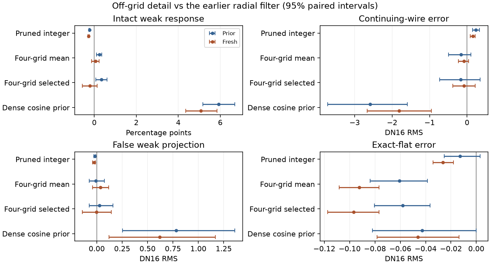
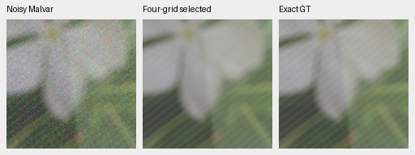
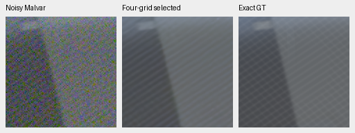

# Shifted Fourier grids for weak Bayer detail

Half-bin shifts give a single Fourier pair much better coverage of
off-grid carriers. In noisy tests, averaging the four grids reduces
the small flat-error penalty of the earlier radial filter in both
24-photo panels. Intact-wire recovery improves on the prior panel
and is close to the earlier filter on the fresh panel. The right cab
fence shows higher projection along both measured RAW peaks, with
fine crossings still incomplete.

[Follow-up on joint Fourier support](scene-coherent-fourier.md)
validates groups of neighboring bins and transfers to 32 unused
photo backgrounds.

[Machine results](results/scene-staggered-phase-v1/publication.json) ·
[Frozen drivers and receipts](results/scene-staggered-phase-v1/evidence.tar.xz) ·
[Native provenance](images/scene-staggered-phase-v1/manifest.json).

## Filter and controls

The [earlier radial filter](scene-query-consensus.md) uses sine/cosine
pairs on a 32-pixel integer Fourier grid. It obtains gain from exterior
RAW patches and delivers a correction only along phase supported by
both query greens. This test keeps the donor windows, descriptor,
ranking, query amplitude rule and overlap taper fixed. It fits the
original grid and three grids shifted by half a bin in x, y or both.
Each fitted grid includes a plane and other nuisance frequencies.
The new fits exclude nonaffine modes under 0.04 cycles/pixel, which
made the unpruned shifted fits ill-conditioned. The pruned integer
grid controls for that change. The four new grids contain 34, 30, 30
and 28 delivered pairs in 0.08–0.16 cycles/pixel. The largest
condition number of the sampled designs is 2.34 across all four CFAs.

- **Four-grid mean** averages the independent spatial corrections.
- **Four-grid selected** assigns candidate pairs to the nearest
  original frequency cell. One half of ranked donor windows selects
  a pair by standardized cross-green power and the other half
  confirms its power. The halves swap roles and the gains are
  averaged. Phase still comes from the native query. This is a
  split of windows from a shared scene and ranking.
- **Dense cosine** is the prior exterior-covariance control.

The clean-carrier check measures the largest phase-averaged fraction
of energy captured by one delivered sine/cosine pair. The median goes
from **44.0% to 88.9%** on the prior weak carriers, **55.6% to 83.3%**
on the fresh weak carriers, and **63.4% to 77.0%** for the two measured
cab peaks. These are best-pair results with known carrier frequencies.
Noisy selection, local support, delivery and overlap blending each
affect the actual recovered response.

The frozen base is Corpus 100k EMA
`87b96f3c487b9edaf1c477742b6c38f2a82cc6b20a94716d51cc8cf46a17a760`.
The general comparison is V120 EMA
`a9d9b6b4f974e24a6b11e5e740aab32314233a7f53c056cf37c7d2aac1c589fb`.
The same 16 retained fields set each gain to +0.10 DN16 exact-flat
RMS. Full-bank gains are 0.22833 for dense, 0.09967 for earlier
radial, 0.09092 for pruned integer, 0.09847 for mean and 0.04347 for
selected. Earlier radial reproduces the retained score coefficients
and standing correction arrays. Direct scoring reproduces the
published off-grid dense and radial controls exactly. The quadratic
gain replay differs by at most 0.00000027 in the reported metric units.

## Two off-grid photo panels

The 24 new backgrounds are disjoint from the prior off-grid panels
and retained targets by image ID and cache hash. The freeze checked
all 559,808 Corpus 100k training photo visits. The new cases use eight
strips, eight elliptical gaps and eight continuous amplitude dips.
The two planted periods are 7.2–9.25 native pixels and both
frequencies are at least 0.008 cycles/pixel from the integer grid.
Each case has independent present, exterior-only, strong-only and
exact-flat draws. The nominal synthetic ISO6400 profile uses
shot/read `0.00128/6.5536e-6` and capture exposure ×0.33.
The prior 24-photo panel was used in the previous phase study. All
operating points were set on the separate retained calibration.

| Method | Prior intact weak response | Prior continuing-wire error | Prior false weak projection | Prior exact-flat RMS | Fresh intact weak response | Fresh continuing-wire error | Fresh false weak projection | Fresh exact-flat RMS |
| --- | ---: | ---: | ---: | ---: | ---: | ---: | ---: | ---: |
| V120 EMA | 24.598% | 91.489 | 2.924 | 24.238 | 19.775% | 76.862 | 3.885 | 19.728 |
| Corpus 100k EMA | 25.697% | 84.293 | 3.123 | 23.406 | 23.389% | 74.716 | 4.148 | 19.294 |
| Dense cosine | 34.241% | 79.021 | 4.117 | 23.596 | 31.532% | 71.132 | 5.024 | 19.507 |
| Earlier radial | 28.322% | 81.609 | 3.337 | 23.639 | 26.450% | 72.948 | 4.405 | 19.553 |
| Pruned integer | 28.093% | 81.842 | 3.319 | 23.626 | 26.180% | 73.099 | 4.379 | 19.527 |
| Four-grid mean | 28.559% | 81.446 | 3.329 | 23.578 | 26.510% | 72.862 | 4.441 | 19.461 |
| Four-grid selected | 28.659% | 81.442 | 3.363 | 23.581 | 26.240% | 72.869 | 4.404 | 19.456 |

Error and false projection are in DN16 RMS. Continuing-wire error
measures the strong direction where the weak direction has a true
gap. Both gap measures use 16 cases per panel. Intervals are 95%
paired bootstrap intervals over photo backgrounds at fixed gains.

- The four-grid mean changes intact response by **+0.237 percentage
  points** [+0.110, +0.360] on the prior panel and **+0.060**
  [−0.128, +0.235] on the fresh panel versus earlier radial.
  Relative to the pruned integer control, response rises **0.467**
  and **0.330** points and continuing-wire error falls **0.396** and
  **0.237 DN16**, respectively. Both continuing-wire intervals exclude
  zero against the pruned control and span zero against earlier radial.
- Mean exact-flat RMS falls **0.061 DN16** [−0.084, −0.039] on the prior
  panel and **0.092** [−0.108, −0.077] on the fresh panel against earlier
  radial. Both four-grid methods still raise flat error versus the
  unmodified Corpus 100k.
- Held-out selection gains **+0.337** response points on the prior
  panel and changes fresh response by **−0.210**. The fresh interval
  spans zero [−0.576, +0.139]. The largest fresh increase in false
  weak projection is 0.572 DN16, even though the mean change is −0.002 DN16
  [−0.143, +0.142].
- Dense cosine raises fresh response **5.081 points** over earlier
  radial and reduces continuing-wire error **1.816 DN16**, with
  **0.619 DN16** more false projection.

## Retained tests and scope

On 24 retained short-wire cases, the selected filter changes intact
response from 40.617% to 40.637% and false projection from 5.738 to
5.702 DN16 versus earlier radial. The four-grid mean gives 40.285%
and 5.637 DN16. On 32 independent-draw natural photos, the selected
filter raises fine-increment error by 0.076 DN16 and fine flat error
by 0.179 DN16 against Corpus 100k. Earlier radial raises them by
0.129 and 0.318 DN16. Target-aligned fine response rises by 0.099
points with selection versus 0.158 with earlier radial. The receipt
also includes the 32 long-wire results and the 64-donor budget.

The numerical and native reviews are complete for this inference-only
component. Calibration and the long, short and natural replays took
5.1, 9.7, 7.6 and 4.1 seconds, respectively. Fresh CPU scoring took
14.9 seconds on four workers. The two frozen EMA predictions use CUDA
IEEE FP32. Their capture receipt includes the GPU suspension in its
wall time. Full-frame speed and the fixed 427-photo and camera panels
were outside this study. [Broad PSNR history](performance-history.md).

### Native exact targets

Each triplet shows noisy Malvar, Corpus 100k EMA with four-grid
selection, and exact simulated GT. The unresized 160 × 160 cells use
`[48,48,160,160]` in query `[128,128,256,256]`. Both crops use RGGB,
the same noise and capture exposure above, 16-bit ADC with black level
0.03, and common display exposure ×2. The source photos were binned
fourfold and cropped as backgrounds for simulated mesh.

**Pervenche de Madagascar en fleur**, Fawaz.tairou, binned source box
`[370,156,512,512]`. The selected grid reduces continuing-wire error
by 1.325 DN16, the largest reduction in this panel. The strong diagonal
extends across the gap and the weaker diagonal remains soft.
[Source photograph](https://commons.wikimedia.org/wiki/File:Pervenche_de_Madagascar_en_fleur.jpg) ·
[CC BY-SA 4.0](https://creativecommons.org/licenses/by-sa/4.0/) ·
[All methods](images/scene-staggered-phase-v1/exact/offgrid-00-present-comparison.png) ·
[Flat control](images/scene-staggered-phase-v1/exact/offgrid-00-flat-triplet.png).

**Fisker Ocean at Motorworld Munich**, Alexander-93, binned source box
`[860,104,512,512]`. False weak projection rises by 0.572 DN16,
the largest fresh increase versus earlier radial. The faint crossing
direction stays much softer than the target. Both flat controls
look smooth at the common display exposure.
[Source photograph](https://commons.wikimedia.org/wiki/File:Fisker_Ocean_Motorworld_Munich_1X7A0079.jpg) ·
[CC BY-SA 4.0](https://creativecommons.org/licenses/by-sa/4.0/) ·
[All methods](images/scene-staggered-phase-v1/exact/offgrid-12-present-comparison.png) ·
[Flat control](images/scene-staggered-phase-v1/exact/offgrid-12-flat-triplet.png).

## Standing GFX100S comparisons

**DSCF3879 ISO6400 / DSCF3880 ISO100.** At common ×4 and shot/read
`0.00128/6.5536e-6`, the four-grid mean changes the overcast sky by
0.006 DN16 RGB RMS versus Corpus 100k and the coarse fence by 1.238,
compared with 0.012 and 1.781 for earlier radial. The sky looks
smooth and the coarse crossings stay connected. The new fits reveal
no obvious additional bracing, cables or leaf subdivisions. The
ISO100 AHD reference is independently demosaiced from the capture at
f/5.6 with different moving subjects and aperture.
[Sky](images/scene-staggered-phase-v1/standing/main-overcast-sky-main-overcast-sky-x4.png) ·
[Building](images/scene-staggered-phase-v1/standing/main-building-detail-main-building-detail-x4.png) ·
[Foliage](images/scene-staggered-phase-v1/standing/main-foliage-main-foliage-x4.png) ·
[Coarse fence](images/scene-staggered-phase-v1/standing/main-chain-link-fence-main-chain-link-fence-x4.png).

**DSCF3842 ISO6400 / DSCF3835 ISO100.** Both cab ROIs and both
conditioning profiles were viewed at ×4 and ×16 with the ISO100
AHD and both straight-out-of-camera JPEGs. The nominal prior is
`0.00128/6.5536e-6`. The transferred DSCF3879 Haar shot/read is
`0.00146358/1.07157e-6`. The native coordinates, color transforms and
JPEG crops are inherited from the standing configurations. The ISO100
f/5.6 AHD and JPEGs serve as qualitative references with different
capture or rendering conditions.

At equal added RGB RMS versus earlier radial, four-grid mean raises
the corresponding two right-ROI projections from **+0.096/+0.004 to
+0.154/+0.028 percentage points** of the noisy RAW peaks under the
nominal profile, and from **+0.105/+0.012 to +0.185/+0.053** under
the transferred profile. On the nominal left, selection shifts support
toward the second peak, from +0.660/+0.314 to +0.531/+0.665 at equal
correction RMS. These projections quantify agreement with the input.
The transferred right still has the clearest diagonals. Fine left
crossings and many right intersections remain incomplete, and neither
shifted filter creates visible new false-color patches or splotches.

| Cab ROI | Nominal | Transferred DSCF3879 profile |
| --- | --- | --- |
| Left | [×4](images/scene-staggered-phase-v1/standing/mesh-nominal-fine-green-mesh-left-x4.png) · [×16](images/scene-staggered-phase-v1/standing/mesh-nominal-fine-green-mesh-left-x16.png) | [×4](images/scene-staggered-phase-v1/standing/mesh-profile3879-fine-green-mesh-left-x4.png) · [×16](images/scene-staggered-phase-v1/standing/mesh-profile3879-fine-green-mesh-left-x16.png) |
| Right | [×4](images/scene-staggered-phase-v1/standing/mesh-nominal-fine-green-mesh-right-x4.png) · [×16](images/scene-staggered-phase-v1/standing/mesh-nominal-fine-green-mesh-right-x16.png) | [×4](images/scene-staggered-phase-v1/standing/mesh-profile3879-fine-green-mesh-right-x4.png) · [×16](images/scene-staggered-phase-v1/standing/mesh-profile3879-fine-green-mesh-right-x16.png) |

V120 remains the general-use recommendation. Four-grid averaging is
a controlled option for reducing off-grid flat cost, with a weaker
intact-detail lift than dense cosine and no clear visual gain on the
standing cab crossings.
