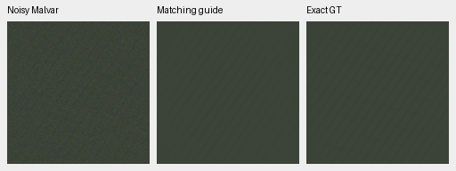
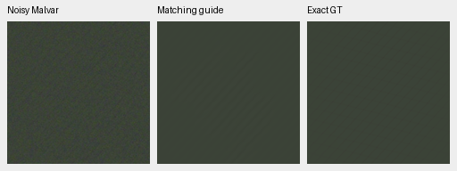

# Direction guides from disjoint RAW regions

A guide estimated from a separate region helped recover weak wires at ISO400
when the wires lay away from a strong edge. Projected weak response rose from
2.75% with query-only discovery to **4.18%** with the matching guide. Weak
increment error fell on all eight tested geometries. Most weak signal still
went unreconstructed, and the ISO6400 weak response barely changed. The
standing cab views show a tradeoff between suppressing query-only stripes in
one region and adding diagonal modulation in another. Fine crossings remain
unresolved. The follow-up estimates a richer wire profile from a different
retained query noise draw and all four Bayer layouts. [Phase-profile comparison](guided-phase-profiles.md).
[Audits, executed sources and native images](results/scene-wave-guides-v1/publication.json).

## What transfers between regions

The donor supplies two frequencies in native cycles per pixel. Each query fold
fits its own nuisance edge and separate RGB sine/cosine coefficients. The other
fold tests the predicted increment against its own measured CFA pixels. Both
folds must support the correction locally. Only afterward does the operator
replace part of the V143 or V120 parent. These are empirical predictive scores.
The final image uses a parent that has seen all of the query's measurements.

The constructed comparison uses eight reused finite-wire geometries, near and
far placements, ISO400 and ISO6400 priors, RGGB draw 0, and three independently
noised query roles per case. Those roles contain no wires, the strong direction
alone, and both directions. The query is the central 256 pixels of each side of
the retained 512-pixel context. The 16 independently simulated donor regions
contain stronger repetitions, changed phase and a separate background.
Only the matching donor shares nominal direction and period with the query.
Each unrelated donor is assigned by a fixed four-source shift.

The initial donor finder recovered both true frequencies within one 256-pixel
Fourier bin in **1 of 16** regions. Most second proposals landed near the
minimum search radius. The donor edge fell beyond the bounded offset grid.
Replaying the same donor RAW with the existing full-frame edge search
raised coverage to **14 of 16**. Every query-only output reproduces bit for bit
between these two runs. Query geometry, threshold 2 and all 96 observations
are identical. This follow-up was prompted by the first result and uses the
same sources. [Initial results](results/scene-wave-guides-v1/probe-v1-result.json) ·
[Full-frame donor replay](results/scene-wave-guides-v1/probe-v2-result.json).

## Paired detail and absent-wire scores

The table shows signed weak response and weak-increment RMS against the exact
constructed target increment. Each cell averages eight geometries. Predictions
outside the 256-pixel query retain the corresponding parent pixels for all
methods, and the scores use the original 512-pixel masks.

| Prior and placement | V143 | Query only | Matching guide | Unrelated guide |
| --- | ---: | ---: | ---: | ---: |
| ISO400 far, weak response | 1.407% | 2.751% | **4.184%** | 1.407% |
| ISO400 far, increment RMS (DN16) | 10.15876 | 10.20903 | **10.15067** | 10.15876 |
| ISO400 near, weak response | 2.621% | 2.621% | 3.238% | 2.633% |
| ISO400 near, increment RMS (DN16) | 12.98076 | 12.98517 | 12.98977 | 12.98075 |
| ISO6400 far, weak response | 0.420% | 0.419% | 0.428% | 0.420% |
| ISO6400 near, weak response | −1.907% | −1.906% | −1.914% | −1.907% |

At ISO400 far, the matching guide gains weak response on six of eight sources
and lowers increment error on eight. The mean improvement over V143 is just
0.0081 DN16 in increment RMS. Quiet RMS stays at 4.0894 DN16 to four decimals.
Mean absolute projection onto the expected weak wire in the weak-absent role
falls from 0.249% to 0.247% versus query-only discovery. At ISO400 near, higher
weak response comes with slightly higher increment error and absent-wire
projection. The stronger direction benefits more, with near ISO400 response
rising from 18.43% to 26.75%. These results motivate using repeated geometry to
help discovery and measuring residual error after the signal has been delivered.
[Independent score and absent-role audit](results/scene-wave-guides-v1/probe-v2-independent-audit.json).

## Native crops and both standing GFX families

Noisy Malvar, V143 plus the matching guide, and exact constructed GT. Each
triplet uses unresized 160×160 pixels at `[176,176,160,160]`, RGGB, exposure 2,
shot 0.00008, read 2.56e-8, ADC16 and black fraction 0.03. V143 EMA SHA256 is
`96d146d017c54196288c585f8b7eddcf030e8a235061049c31e985b9380b7ce4`.
The first two geometries show slightly clearer strong diagonals and incomplete
weak crossings. [All boards, source identities and display metadata](images/scene-wave-guides-v1/manifest.json).

For DSCF3879, the coarse fence guides the fixed sky, building and foliage ROIs
as mismatch stresses. A disjoint strip guides the coarse fence itself. The
sky crop is exactly unchanged by the guide. Building and foliage corrections
are below 0.70 DN16 RMS in camera RGB. The coarse lattice remains visible,
with a small change in modulation. The cab test swaps disjoint left and right
donor boxes on DSCF3842 at both established noise profiles. The guide suppresses
some query-only right-side stripes and adds diagonal modulation on the left.
Neither profile shows convincing new crossing locations.

The real parent is V120 EMA SHA256
`a9d9b6b4f974e24a6b11e5e740aab32314233a7f53c056cf37c7d2aac1c589fb`.
All eight real boards were viewed at the original exposures and coordinates.
ISO100 AHD and camera JPEGs are independent qualitative references with
different exposure, aperture and motion. The pilot does not score them
pixelwise. All 32 adopted noisy, parent and reference display panels match the
previous native review exactly. [Main sky](images/scene-wave-guides-v1/real-v1-main-overcast-sky.png) ·
[Cab left](images/scene-wave-guides-v1/real-v1-mesh-nominal-left.png) ·
[Cab right](images/scene-wave-guides-v1/real-v1-mesh-nominal-right.png).

The study used cached parent outputs and made zero learned forwards or training
updates. Sixteen donor observations were simulated for the initial experiment
and reused byte for byte. Both versions have 128 audited metric rows, four
actually viewed synthetic boards, and four native triplet subsets. The 69
local-wave tests include donor-phase refitting and withheld-sample invariance.
V120 remains recommended for general restoration.
