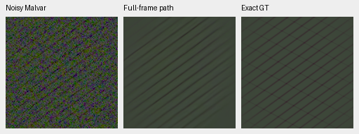
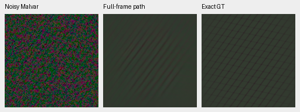

# Whole-frame ranking of localized RAW donor windows

The [fixed-bracket study](localized-donor-validation.md) measured how
a two-boundary fit rejects rails that otherwise look like repeated
detail. This follow-up lets the search choose both donor windows
before running that same check. It compares spectra alone, near and
whole-frame appearance, and whole-frame appearance along the route
from the query to each donor.

The [query-fit follow-up](query-rail-background.md) holds these
guides fixed and isolates the effect of the local background
and validation score on false texture.

## A shared catalog and independent checks

The synthetic replay reuses the 16 source 88–95 observations and exact
targets. Each intended 256×256 donor retains the same 128×128 square
of matching material. The rest shows an independently corrupted
rotated wire field. Two complete rotated-wire donors supply
alternatives. The known matching square is used only for scoring.
A uniform grid enumerates 128- and 192-pixel windows inside all four
donor frames. The real camera comparison uses 64-, 96- and 128-pixel
windows in the established 512- or 768-pixel native neighborhoods.
Donors are disjoint from the query and must bracket it on opposite
sides.

All four rankings share the same candidate catalog and refined
single-edge spectra on absolute Bayer screening sites. A compatible
direction needs a spectral score of at least 20 on one side and 8
on the other. The spectral arm ranks by total matched spectral
score. The context arms rank by the weaker donor affinity, using
spectral score to break ties. Full and near encoders use the same
A-only preview pixels inside the retained frame, with the near
intervention replacing the rest with a constant. Both use frozen
DINOv3 ConvNeXt-Small revision
`421020015aa4266363db803b6049a529999afb1e`.

The path arm uses the full preview and samples four smaller boxes
at 30%, 48%, 66%, and 84% of the straight line from query to donor
center. Each side combines the lower quartile of those affinities
with endpoint affinity by geometric mean. That favors a consistent
route through the scene even when the two endpoints look alike.
The straight route can cross an occluder and penalize a genuinely
matching donor.

Each arm fixes one pair using screening samples. Each proposed
direction then has to predict both reserved RAW folds in both
donors with the shared two-edge background model. The query's
independent phase and support checks use the same V143 or V120
parent, settings and Bayer partition as in the fixed-bracket replay.
A failed donor check returns the exact parent.

## Exact-target results

At ISO400, both near and full-frame ranking choose the two intended
donor frames in **6/8** two-family queries, including **3/4**
same-paint queries. Spectral ranking chooses the two rotated-wire
frames in all eight. Both context rankers choose two windows whose
areas contain at least half of the intended material in **5/8** cases.
The path ranker reaches **5/8** intended brackets and **2/8** with at
least half the intended material in both windows. The route prior
adds no recovery benefit on these composites.

The table reports the original delivery scale and gate. All arms at
this scale remain within the predeclared quiet-RMS allowance of
0.02 DN16 above V143, with ceilings of 2.45489 DN16 and 7.61153 DN16.
Weak response is the projection onto the known faint wire increment.
Increment RMS compares the paired weak-plus-strong and strong-only
difference with the exact increment.

| Arm | ISO400 weak response | ISO400 increment RMS (DN16) | ISO6400 weak response | ISO6400 increment RMS (DN16) |
| --- | ---: | ---: | ---: | ---: |
| V143 EMA | 0.89% | 11.2020 | 0.67% | 25.4279 |
| Fixed bracket, two-edge check | 9.02% | 11.1532 | 0.92% | 25.4302 |
| Window spectra | 0.89% | 11.2020 | 0.67% | 25.4280 |
| Near ranking | 4.69% | 11.1844 | 0.67% | 25.4373 |
| Full-frame ranking | 4.80% | 11.1801 | 0.66% | 25.4380 |
| Full-frame path | 4.65% | 11.2062 | 0.67% | 25.4370 |

The stricter comparison uses the quiet RMS of the cleanest correction
arm. At ISO400 that limit lies at V143's quiet RMS to five decimal
places. Weak response is **0.94%** for full-frame and **0.95%** for near
ranking, versus **0.89%** for V143 and the fixed bracket. The quiet
margin explains the difference from the fixed-scale results.
[Full metrics and selection counts](results/scene-window-donors-v1/summary.json).

All six flat and six single-step controls per ISO reject the proposed
guides for every ranking. The fresh rail-only scenes use 204 candidate
windows per frame and six geometries per ISO. Spectra alone approve
3/12, near ranking 1/12, full-frame ranking 0/12 and full-frame path
1/12. The separate rerun reproduces every decision. These counts
describe donor approval before query delivery. The small panel leaves
the prevalence of false approvals in photos unresolved.
[Frozen recipes, seed and observations](results/scene-window-donors-v1/evidence.tar.gz).

Both native triplets show noisy Malvar, the path result and exact GT
with ROI `[176,176,160,160]`, ISO400 shot/read `8e-5 / 2.56e-8`,
exposure ×2 and contrast ×5. The V143 EMA SHA256 is
`96d146d017c54196288c585f8b7eddcf030e8a235061049c31e985b9380b7ce4`.
The native display scale is 0.82212 at gate threshold 2. The strong
direction is clearer and most of the crossing direction is missing.

[Source 88 with all methods](images/scene-window-donors-v1/iso400-source88-RGGB-comparison.png) ·
[Source 89 with all methods](images/scene-window-donors-v1/iso400-source89-BGGR-comparison.png).

## Native GFX100S review

The full-frame ranks keep the sky, building and foliage bit-exact
V120. Spectra alone add visible purple/green building bands, changing
the crop by **31.27 DN16 RMS** from V120. Near ranking changes the
building by **3.17 DN16 RMS**. Both full-frame ranks change the
coarse chain-link crop by **8.93 DN16 RMS**. The old crossings remain
visible and the gain in actual visible detail is unclear.

On the nominal right cab crop, full-frame ranking changes V120 by
**0.54 DN16 RMS** and path ranking by **0.89 DN16 RMS**. The other
three full-frame or path cab results are exact V120. The clearest
newly chosen mesh donor appears on one side of the left nominal crop.
The other selected windows still include foliage, rail or train body.
Neither rank reliably selects two clear mesh patches. Native comparisons
show no convincing recovery of the fine crosses visible in the
independent ISO100 and camera JPEG views.

Both captures use native 160×160 fixed ROIs and V120 EMA SHA256
`a9d9b6b4f974e24a6b11e5e740aab32314233a7f53c056cf37c7d2aac1c589fb`.
The nominal profile uses shot/read `0.00128 / 6.5536e-6`; exposure
is ×4 for the main scene and ×16 for the cab. Transferred cab
conditioning uses `0.0014635775921166604 / 1.0715704128646712e-6`
at the same exposure. DSCF3880 and DSCF3835 ISO100 AHD and both cab
JPEGs are independent qualitative references.

| RAW and profile | Native comparisons |
| --- | --- |
| DSCF3879 nominal | [Sky](images/scene-window-donors-v1/main-overcast-sky.png) · [Building](images/scene-window-donors-v1/main-building-detail.png) · [Foliage](images/scene-window-donors-v1/main-foliage.png) · [Coarse fence](images/scene-window-donors-v1/main-chain-link-fence.png) |
| DSCF3842 nominal | [Left](images/scene-window-donors-v1/mesh-nominal-left.png) · [Right](images/scene-window-donors-v1/mesh-nominal-right.png) · [Left donors](images/scene-window-donors-v1/mesh-nominal-left-donors.png) · [Right donors](images/scene-window-donors-v1/mesh-nominal-right-donors.png) |
| DSCF3842 transferred | [Left](images/scene-window-donors-v1/mesh-profile3879-left.png) · [Right](images/scene-window-donors-v1/mesh-profile3879-right.png) · [Left donors](images/scene-window-donors-v1/mesh-profile3879-left-donors.png) · [Right donors](images/scene-window-donors-v1/mesh-profile3879-right-donors.png) |

The CPU collection took **343.06 seconds** across all 24 inputs and
reused both restoration checkpoints. The review checks 168 prior
prediction arrays bit for bit. Ten comparison boards, both triplets
and four cab donor montages were inspected at native crop resolution.
This is a component replay with no new training or full427 and
known/unseen camera evaluation.

[Native crop manifest](images/scene-window-donors-v1/manifest.json) ·
[Measured results](results/scene-window-donors-v1/summary.json) ·
[Publication hashes](results/scene-window-donors-v1/publication.json) ·
[Frozen evidence](results/scene-window-donors-v1/evidence.tar.gz).
