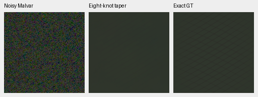
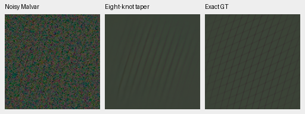

# Footprint transfer with whole-image frequency guides

The faint-wire gain from [reserved RAW footprints](reserved-wire-footprint.md)
does not transfer to the ordinary finite-wire panels with whole-image
frequency proposals. Keeping the eight-knot waveform fit recovers more
than the fundamental, but adding the taper still raises increment
error on both ISO400 panels. Requiring the second direction to confirm
the taper brings the result back near the untapered fit.
[Metrics, executed sources and native crops](results/scene-wire-footprint-v1/publication.json).

## Comparison

The replay uses the two archived ordinary-wire panels above V143 EMA.
Each panel has eight geometries at ISO400 and eight at ISO6400, each
with independent no-wire, strong-only and two-direction observations.
It keeps the original whole-image donor rankings and frequency
proposals, with exact nominal center frequencies as a diagnostic on
the main panel. The exact centers do not supply phase, amplitude or
a footprint. The synthetic recipe uses finite narrow wires and includes
phase drift. The earlier sinusoidal fixtures are a separate control.

All arms use the same nested screened background, held-out RAW sites
and two crossed per-color tests. The quarter of sites reserved for
screening locates a taper using a fundamental-frequency fit, even when
the final waveform uses all eight knots. The confirmed location can
taper only the other direction. The direction that located the
footprint stays uniform.

A stricter variant also asks whether the companion's tapered prediction
beats both its uniform prediction and its no-carrier null. All four
gains must be positive at the selected center across the two reserve
folds. Otherwise the result is the previous uniform fit. The later
per-color gate still uses the complementary three-quarters of RAW,
and the final delivery refit follows the original policy.

## Ordinary-wire response

Cells give weak-increment projection and weak-increment RMS in DN16.
Each arm can reduce its scale to stay within the uniform eight-knot
quiet RMS. The nominal gates are 2 at ISO400 and 1 at ISO6400. The
cutoff is a diagnostic using the evaluation targets' quiet mask.

| Panel and guide | Uniform eight knots | Uniform fundamental | Fundamental taper | Eight-knot taper | Eight-knot taper with companion check |
| --- | ---: | ---: | ---: | ---: | ---: |
| Main ISO400, whole image | 4.801% / 11.1802 | 2.454% / 11.1906 | 2.261% / 11.1973 | 4.839% / 11.1969 | 4.807% / 11.1838 |
| Separate ISO400, whole image | 6.436% / 11.2023 | 3.076% / 11.2224 | 2.457% / 11.2282 | 5.366% / 11.2138 | 6.450% / 11.2021 |
| Main ISO400, exact center | 9.005% / 11.1573 | 4.288% / 11.1810 | 2.689% / 11.1932 | 8.980% / 11.1623 | 9.660% / 11.1550 |
| Main ISO6400, whole image | 0.661% / 25.4379 | 0.664% / 25.4318 | 0.664% / 25.4318 | 0.661% / 25.4379 | 0.661% / 25.4379 |
| Separate ISO6400, whole image | 2.464% / 22.9455 | 2.166% / 22.9442 | 2.165% / 22.9484 | 2.464% / 22.9518 | 2.464% / 22.9455 |
| Main ISO6400, exact center | 0.942% / 25.4388 | 0.955% / 25.4329 | 1.182% / 25.4317 | 1.535% / 25.4363 | 1.569% / 25.4363 |

On the two-direction ISO400 observations, the whole-image proposals
contain a weak guide within one native DFT bin in **3/8** main and
**5/8** separate cases. Both distinct guide directions are within
one bin in **3/8** cases on each panel. The confirmed tapered arm is
eligible on three and two two-direction observations. The extra
companion check admits only one per panel. At ISO6400 it accepts no
whole-image proposals. It accepts two exact-center two-direction
observations, where the small gain still leaves nearly all of the
weak amplitude missing.
[Fixed and quiet-matched tables](results/scene-wire-footprint-v1/summary.json).

### Controls

On the prior fresh ISO400 sinusoids at fixed scale, eight-knot tapering
raises response from **0.86% to 4.51%** and lowers increment RMS from
**6.724 to 6.372 DN16**. Fundamental tapering remains stronger there,
reaching **9.04% / 6.004 DN16**. Requiring the companion to prefer the
footprint keeps only two of eight two-direction cases. It yields
**6.81% / 6.188 DN16** with the fundamental, and admits no prior fresh
ISO6400 observations. These single-panel controls use supplied
nominal frequencies.

On 48 forced-guide flat and rail-only crops, tapering the full eight-knot
companion reduces complex-rail correction RMS from **1.313 to 1.253 DN16**
at the fixed gate, with the same 20.18 DN16 peak. Straight null RMS
changes from 0.447 to 0.445 DN16, and flats are identical. The stricter
companion check rejects tapering on all 48 controls. The fallback can
still produce the uniform fit's previously measured false correction.

## Native synthetic comparisons

Both triplets use noisy Malvar, the whole-image eight-knot taper and
exact constructed GT. The cells are 160×160 native pixels at
`[176,176,160,160]`, exposure ×2, contrast 5, matched WB/matrix,
ISO400-prior shot/read `8e-5/2.56e-8`, ADC16 and black 0.03.
Sources 90 GRBG and 91 GBRG use V143 EMA
`96d146d017c54196288c585f8b7eddcf030e8a235061049c31e985b9380b7ce4`.
The first crop still loses most of both wire families. The second keeps
the dominant family, with the crossing family faint and incomplete.
[Crop and noise manifest](images/scene-wire-footprint-v1/manifest.json).

[Source 90 full comparison](images/scene-wire-footprint-v1/iso400-source90-GRBG-comparison.png) ·
[Source 91 full comparison](images/scene-wire-footprint-v1/iso400-source91-GBRG-comparison.png).

## Native GFX100S review

Both guide families use gate 2 and V120 EMA
`a9d9b6b4f974e24a6b11e5e740aab32314233a7f53c056cf37c7d2aac1c589fb`.
DSCF3879 uses nominal shot/read `.00128/6.5536e-6`, exposure ×4 and
DSCF3880 ISO100 AHD as an independent qualitative reference.

The eight-knot taper keeps the sky at V120 and the whole-image coarse
fence at the uniform fit. The spectral building crop also keeps the
uniform result, while the fundamental variant makes a smaller
correction. Spectral foliage correction increases from 2.21 to 2.54
DN16 RMS relative to V120, without clear new fine leaves. It is the
only guide and crop combination that passes the extra companion check.
[Sky](images/scene-wire-footprint-v1/main-overcast-sky.png) ·
[Building](images/scene-wire-footprint-v1/main-building-detail.png) ·
[Foliage](images/scene-wire-footprint-v1/main-foliage.png) ·
[Coarse fence](images/scene-wire-footprint-v1/main-chain-link-fence.png).

All displayed profiles reproduce V120 in both native DSCF3842 cab
crops. The DSCF3835 ISO100 AHD and both camera JPEGs show much more
fine lattice structure. They remain qualitative references, with
different aperture, exposure time and motion. Display exposure is ×16.

| Cab profile | Shot/read | Boards |
| --- | --- | --- |
| Nominal | `.00128/6.5536e-6` | [Left](images/scene-wire-footprint-v1/mesh-nominal-left.png) · [Right](images/scene-wire-footprint-v1/mesh-nominal-right.png) |
| DSCF3879 profile | `.0014635775921166604/1.0715704128646712e-6` | [Left](images/scene-wire-footprint-v1/mesh-profile3879-left.png) · [Right](images/scene-wire-footprint-v1/mesh-profile3879-right.png) |

This CPU replay uses existing weights. The uniform eight-knot fit
remains the comparison baseline and V120 remains the general
recommendation. The result adds no full427 or held-out camera scores.
