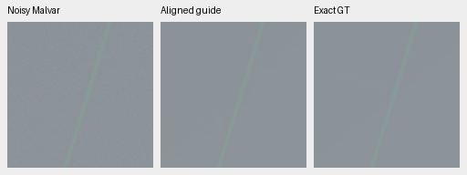
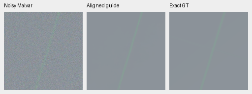

# Can distant context distinguish a weak wire from a gap?

An aligned distant guide barely changes the weak-wire response of the
trained spatial 2k EMA. At ISO400, response is 13.02% of the exact
increment with quiet context, 13.06% with the aligned guide and 13.08%
with an orthogonal guide. At ISO6400, all three are near 5.2%. The
aligned guide produces no visible false continuation in the retained
gap crops.
[Complete metrics and exact native comparisons](results/scene-wire-gap-v1/publication.json).

The [explicit RAW line fit](isolated-raw-line.md) tests the same
idea on fresh geometries. Local fitting recovers much more of the
ISO400 wire. Shorter support reduces false extension into true gaps.

## Paired construction

Each 768×768 constructed scene has a narrow, green-tinted strong
wire on a shallow gradient. Adding a second wire at lower amplitude
creates an exact weak increment on that same background. Present and
absent roles share coupled shot and read noise with valid physical
marginals. Two independent repeats, eight geometries, all four Bayer
layouts and the two priors give 32 pairs.

The spatial model sees each noisy scene with a neutral exterior, a
brighter guide aligned to the weak wire, or an orthogonal guide. Both
guides start outside the native 256×256 query plus a 38-pixel margin.
The guide observations are resimulated only at their changed sensor
sites. For each role, the local packed RAW, variance and camera
tensors are byte-identical across all three contexts. The fourth
comparison runs the same trained trunk with its scene adapter
disabled. The spatial EMA is
`97fd551bd0ae0b7aa97c67e1f6e8b513b722f70d5ad8b8814a96586b934eafac`.
All inference uses CUDA IEEE FP32 and actual Bayer observations.
This is an intervention on the model's complete noisy input.
[Previous whole-image context probe](scene-context-extent.md).

Within the native 160×160 ROI, the projected response is the
output difference between the two roles projected onto the signed
camera RGB increment. Mean absolute false projection measures the
same direction in the absent overlap relative to its exact target.
The quiet mask excludes the strong wire and its immediate vicinity.
The wire-support increment RMS measures the complete signed RGB
increment error on the injected trace.

| Noise | Input | Response | Absolute false projection | Quiet RMS DN16 | Wire increment RMS DN16 |
| --- | --- | ---: | ---: | ---: | ---: |
| ISO400 | Local trunk | 13.12% | 1.14% | 13.84 | 99.44 |
| ISO400 | Neutral scene | 13.02% | 1.15% | 13.82 | 99.50 |
| ISO400 | Aligned guide | 13.06% | 1.16% | 13.80 | 99.48 |
| ISO400 | Orthogonal guide | 13.08% | 1.15% | 13.79 | 99.45 |
| ISO6400 | Local trunk | 5.14% | 4.48% | 35.83 | 107.10 |
| ISO6400 | Neutral scene | 5.18% | 4.44% | 35.88 | 107.05 |
| ISO6400 | Aligned guide | 5.19% | 4.46% | 35.89 | 107.04 |
| ISO6400 | Orthogonal guide | 5.21% | 4.48% | 35.88 | 107.02 |

Aligned context shifts the inspected native RGB by 0.42–1.62 DN16
RMS relative to neutral context. The orthogonal guide produces
comparable changes in weak response. The same checkpoint's standing GFX
review remains the earlier full-preview comparison. The larger
matched scene training uses this constructed test as a follow-up.
[Expanded scene training](expanded-scene-corpus.md#matched-12000-update-continuation) ·
[Standing GFX comparison](scene-context-extent.md#native-observations).

## Native comparisons

The two triplets show noisy Malvar, aligned-guide spatial EMA and
exact constructed GT for geometry 0, repeat 0, RGGB. The query begins
at `[256,256]`, the ROI is `[48,48,160,160]` within that query, and the
display uses exposure ×1. Shot/read are `8e-5/2.56e-8` at ISO400 and
`.00128/6.5536e-6` at ISO6400, with ADC16 and black fraction 0.03.
All 12 boards were viewed. The optional ×8 comparisons make the
strong wire and the faint cross-wire easier to compare with their targets.
[Native provenance](images/scene-wire-gap-v1/manifest.json).

[ISO400 weak wire with contrast ×8](images/scene-wire-gap-v1/iso400-g0-r0-wire-contrast8-comparison.png) ·
[ISO6400 weak wire with contrast ×8](images/scene-wire-gap-v1/iso6400-g0-r0-wire-contrast8-comparison.png) ·
[ISO6400 gap](images/scene-wire-gap-v1/iso6400-g0-r0-gap-comparison.png).
