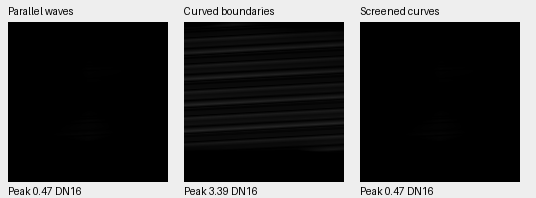
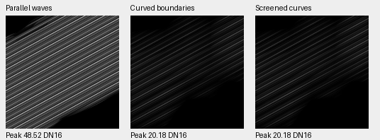
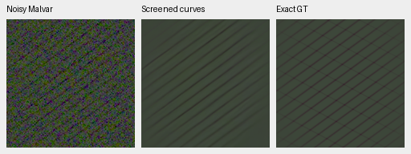
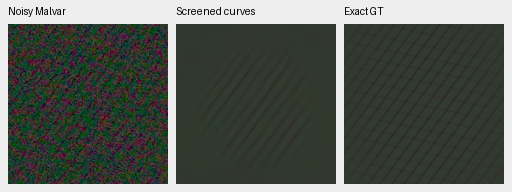

# Screening curved RAW backgrounds on nested reserved samples

The [curved-boundary refit](flexible-query-edges.md) rejected more
false structure on complex rails and increased error on straight
steps and rails. This comparison preserves the original RAW wave
gate and changes how each fold chooses its background. Up to four
curved boundaries are available when they predict more of the
measured scene than straight edges.

## Independent background and wave tests

Each outer discovery fold is split again at predetermined Bayer
sites. The first part fits three background-only candidates on
green measurements. They are the original hard parallel steps,
subpixel-smoothed parallel steps with a shared fitted angle, and
the flexible model with independent tilts and quadratic bends.
All candidates use the same linear affine nuisance.

The nested reserved green samples compare the flexible candidate
with each parallel model. Each score takes the whitened reduction
in squared residuals and divides it by twice the whitened norm
of the difference between the predictions. Both scores must
exceed three. The variance proxy comes from the fixed smooth
parallel prediction. This empirical rule checks geometry beyond
any advantage of softening a straight edge.

The selected family is refit on all of the outer discovery fold,
and only then enters the established held-out wave test. Its
opposite fold supplies the wave validation pixels. No nested
shape score sees that wave validation fold. The two outer fits
choose independently and retain their usual crossed wave decision.
Insufficient nested support or a rejected curve returns the
parallel background.

Both archived null panels are replayed with the same misleading
guides and exact analytic delivery parents. The study also draws
48 structure controls with a new geometry and sensor seed, all
four Bayer layouts, six structure families and two noise profiles.
The ordinary-wire replays retain the 32 observations from two
disjoint source sets and use the fixed V143 EMA parent. The real
replay holds the full-frame and spectral guides fixed over V120.

## Replication on new structure controls

Each cell gives aggregate correction RMS and the largest
absolute pixel correction, in DN16, on native 160×160 crops.
The nominal gate and deliberately misleading frequencies are
the same for all arms. Straight and complex summaries pool
their listed rail families across both noise profiles.

| Exact structure | Parallel refit | Unscreened curves | Screened curves |
| --- | ---: | ---: | ---: |
| Flat, 8 cases | 0.416 / 15.35 | 0.416 / 15.35 | 0.416 / 15.35 |
| Straight step, 8 cases | 0.038 / 2.42 | 0.247 / 3.39 | 0.038 / 2.42 |
| Straight rail, 8 cases | 0.530 / 6.34 | 1.259 / 11.93 | 0.631 / 6.34 |
| Wedge, 8 cases | 5.213 / 36.73 | 0.988 / 14.96 | 0.988 / 14.96 |
| Bent rail, 8 cases | 3.970 / 54.20 | 0.310 / 7.55 | 0.310 / 7.55 |
| Two rails, 8 cases | 7.182 / 48.52 | 2.024 / 20.18 | 2.024 / 20.18 |
| All straight steps and rails, 16 cases | 0.376 / 6.34 | 0.907 / 11.93 | 0.447 / 6.34 |
| All complex rails, 24 cases | 5.613 / 54.20 | 1.313 / 20.18 | 1.313 / 20.18 |

The screen uses curved fits in **2/32** outer folds on the
straight steps and rails and **48/48** on the complex rails.
The hard baseline alone would have admitted another 15 straight
folds. Requiring predictive improvement over smoothed parallel
edges avoids choosing curvature merely for the benefit of
anti-aliasing a straight edge. Straight rail RMS remains above
the parallel baseline.

At the nominal gate, 19/24 complex controls still receive a
correction, versus 24/24 with parallel steps. The stricter
gate leaves 15/24 with an added RMS of 0.566 DN16 and peak
10.99 DN16. The screen limits false responses on this set
while the fully fitted rail background still leaves room for
spurious waves. Flats keep the same 3/8 nonzero corrections
at the nominal gate.

The residual boards show a straight-step case selected for the
largest reduction from unscreened to screened peak error and the
double-rail case selected for the highest parallel peak. Each
board uses one native 160×160 ROI and a common grayscale scale
for the largest absolute camera-RGB correction at each pixel.

## Retained controls and wire response

On the archived complex rails, the screen uses curved boundaries
in every fold and reproduces the unscreened fit's 0.971 DN16
RMS and 14.33 DN16 peak. On the 12 retained straight rails it uses
parallel steps in both folds, recovering the parallel refit's
0.789 DN16 RMS versus 1.110 with unscreened curves. On the retained
straight steps its 0.512 DN16 RMS improves on 0.897 with
unscreened curves, with a remaining cost of 0.052 DN16 over
the parallel refit.

On the two archived positive panels, the screened arm preserves
the original parallel wire predictions. The main full-frame
response at ISO400 is **4.801%**, compared with **4.738%** for
unscreened curves at the same 2.45083 DN16 quiet RMS. The disjoint
full-frame response stays at **6.436%**. Weak response remains
0.661% on the main ISO6400 full-frame panel. These numbers
measure projection onto the exact faint increment.

On the separate **wire beside a rail** diagnostic, both curves
arms retain the same result. With independent noise on paired
strong-only and weak-plus-strong targets, exact guide centers
and the clean rail-only delivery parent, the screened arm
recovers 0.016% at ISO400 and 0.131% at ISO6400. The parallel
arm recovers 0.387% and 0.037%. The screen removes avoidable
background flexibility and leaves the weak-response limit next
to a strong boundary unresolved.
[Full measurements, including separate gate settings](results/screened-query-edges-v1/summary.json).

## Native exact-target crops

Both triplets show noisy Malvar, screened curved backgrounds
with full-frame guides and exact GT. The native 160×160 ROI
is `[176,176,160,160]`; ISO400 shot/read is `8e-5 / 2.56e-8`.
The shared display uses exposure ×2 and contrast ×5 with a
16-bit ADC. V143 EMA checkpoint SHA256 is
`96d146d017c54196288c585f8b7eddcf030e8a235061049c31e985b9380b7ce4`.
Delivery uses scale 0.82212 and threshold 2. Both crops retain
the strong diagonals and miss most of the faint crossings.

[Source 88 comparison](images/screened-query-edges-v1/iso400-source88-RGGB-comparison.png) ·
[Source 89 comparison](images/screened-query-edges-v1/iso400-source89-BGGR-comparison.png).

## Native GFX100S review

The screened and unscreened curved fits reproduce all 16 native
camera crops at the nominal gate. The transferred-right spectral
query differs outside its fixed crop, by 0.058 DN16 RMS over the
whole query. With full-frame guides, the
sky, building and foliage are exact V120. The coarse-fence
correction is 9.00 DN16 RMS from V120 versus 8.99 for the parallel
fit. The visible crossings persist. With the fixed spectral
building guide, the correction is 2.94 DN16 versus 3.92 for
parallel steps. The fine building and foliage detail remains soft.
All four cab crops return to V120, with incomplete faint crossings.

All cells use fixed native 160×160 coordinates and V120 EMA
SHA256 `a9d9b6b4f974e24a6b11e5e740aab32314233a7f53c056cf37c7d2aac1c589fb`.
Nominal shot/read is `0.00128 / 6.5536e-6`, with exposure ×4
for the main scene and ×16 for the cab. The transferred cab
profile uses `0.0014635775921166604 / 1.0715704128646712e-6` at
the same exposure. The DSCF3880 and DSCF3835 ISO100 AHD and
both cab JPEGs are independent qualitative references.

| RAW and profile | Native comparisons |
| --- | --- |
| DSCF3879 nominal | [Sky](images/screened-query-edges-v1/main-overcast-sky.png) · [Building](images/screened-query-edges-v1/main-building-detail.png) · [Foliage](images/screened-query-edges-v1/main-foliage.png) · [Coarse fence](images/screened-query-edges-v1/main-chain-link-fence.png) |
| DSCF3842 nominal | [Left](images/screened-query-edges-v1/mesh-nominal-left.png) · [Right](images/screened-query-edges-v1/mesh-nominal-right.png) |
| DSCF3842 transferred | [Left](images/screened-query-edges-v1/mesh-profile3879-left.png) · [Right](images/screened-query-edges-v1/mesh-profile3879-right.png) |

The CPU replays took 142.10 seconds for the primary set, 69.84
for the disjoint set, 14.12 for the cameras and 195.74 for the
new structure controls. The review verifies 728 archived arrays
including every recomputed unscreened curve prediction. Ten
comparison boards, two triplets and two residual boards were
inspected. The study adds no neural training or standard full427
and known/unseen camera panel scores.

[Native provenance](images/screened-query-edges-v1/manifest.json) ·
[Measurements](results/screened-query-edges-v1/summary.json) ·
[Publication hashes](results/screened-query-edges-v1/publication.json) ·
[Frozen scripts and receipts](results/screened-query-edges-v1/evidence.tar.gz).
