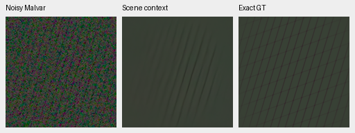
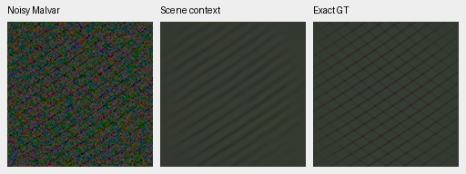

# Whole-frame context for choosing RAW detail donors

The full-frame context changes both left-cab donor pairs. In each case,
one selected patch has more visible mesh and the opposite patch still
contains mostly train body. The chosen guides remain coarse, with
23.5–26.5 pixel periods and nearly horizontal frequency normals.
On the synthetic comparison, near and full-frame context produce
identical restorations. Both make small improvements over spectral
ranking while retaining weak-response limits.
[Published evidence](results/screened-scene-donors-v3/publication.json).

## Matched comparison

Three arms use the same native candidates, spectral peaks, planar fits,
query delivery and fallback. The spectral arm ranks by agreement in
the candidates' RAW spectra. The near-context arm weights that score
with features from the existing 512- or 768-pixel neighborhood. The
full-frame arm takes features from the whole photo at the same scale and
coordinates. The near preview replaces the rest of the image with the
mean color of the retained preview rectangle. Its visible pixels,
coordinates, normalization and encoder are shared with the full arm.

For context, the 8744×11660 RAW field is reduced to a
1536×1152 preview. One native sample per Bayer parity in each absolute
4×4 cell supplies the preview before area reduction, white balance,
matrix rendering and exposure ×4. The cached DSCF3879 and DSCF3842
originals exactly reproduce the retained packed input crops. Both arms
use the same frozen DINOv3 ConvNeXt-Small revision
`421020015aa4266363db803b6049a529999afb1e`. From its stride 4, 8 and 16
maps, a 5×5 sampling grid measures each donor's similarity to the
center of the query. The lower quartile of spatial similarities
penalizes donors with inconsistent appearance. A pair's weaker
affinity weights its spectral score, and the top pair is fixed before
testing the remaining donor samples.

All three arms reserve the same screening samples from query fitting
and validation. The remaining query samples control phase, amplitude,
color and validation of the proposed frequencies. Final coefficient
refitting can use all measurements after weights are fixed. A missing
or unsupported pair returns the saved guarded guide for synthetic
inputs and the cross-checked guide for camera inputs. The split
protects the new guide validation from reusing preview samples.

## Matched synthetic stress test

The reused 32 queries include background, one-family and two-family
roles. Each preview contains only that role's measurements. Candidate
donors are two patches with the designated query geometry, and an
independent, higher-contrast pair with wire families turned by 40
degrees on a differently colored background. All four candidates use
the query's Bayer layout. The 1280-pixel composite measures
selection when two disjoint, internally compatible pairs are available.

Spectral ranking selects the stronger competing pair in all 96
role-specific observations. Each context arm selects the intended
pair in nine observations, including three of the 32 two-family
queries. Both context arms produce identical outputs across all 40
saved synthetic prediction arrays.

Rows give weak-response percentage and weak-increment RMS in linear
DN16 at the common observed quiet limit, capped by the tighter
predeclared delivery setting. The near and full-frame arms share a
column because their outputs are exact matches.

| Setting | Guarded guide | Spectral rank | Near or full-frame rank | Quiet limit, DN16 |
| --- | ---: | ---: | ---: | ---: |
| ISO400 far | 1.69% / 11.2318 | 1.15% / 11.2363 | 1.48% / 11.2325 | 2.33655 |
| ISO400 near | 2.69% / 14.1247 | 2.17% / 14.1276 | 2.88% / 14.1231 | 6.31621 |
| ISO6400 far | 1.31% / 22.9391 | 1.31% / 22.9392 | 1.35% / 22.9389 | 6.40634 |
| ISO6400 near | 2.97% / 30.2402 | 2.89% / 30.2378 | 2.89% / 30.2378 | 14.96980 |

With the same fixed ISO400 far delivery scale, weak response is
1.15% for spectral rank, 4.91% for either context arm and 8.81% for the
guarded guide. Quiet RMS is 2.33655, 2.33840 and 2.34372 DN16,
respectively. This shows the cost of choosing a strong yet incompatible
carrier and explains the smaller margin at matched quiet error.

An after-the-run check reproduced the selected pairs directly from the
screening spectra and measured affinity. Doubling the full-frame
affinity weight raises the number of intended choices from nine to ten.
Ordering the spectrally viable pairs by affinity alone chooses the
intended pair in **75 of 96** observations, including **25 of 32**
two-family queries. This controlled panel gives the two bracket types
distinct appearances. The ranking result exposes a weighting problem
in this panel and does not measure the restored images of those choices.
[Independent audit](results/screened-scene-donors-v3/independent-audit.json) ·
[Ranking sensitivity](results/screened-scene-donors-v3/weight-sensitivity.json).

### Native synthetic crops

The two triplets use sources 81 and 85, native BGGR ROI
`[176,176,160,160]`, shot/read `8e-5 / 2.56e-8`, exposure ×2, and
contrast ×5 around the target mean. The middle columns use threshold
2 and scale 0.82212 above V143 EMA
`96d146d017c54196288c585f8b7eddcf030e8a235061049c31e985b9380b7ce4`.
Both visible reconstructions retain the stronger wires with incomplete
weak crossings.

[Source 81 comparison](images/screened-scene-donors-v3/iso400-source81-far-BGGR-comparison.png) ·
[Source 85 comparison](images/screened-scene-donors-v3/iso400-source85-far-BGGR-comparison.png).

## Native camera review

Full-frame ranking produces identical linear RGB to spectral ranking
on six of eight crops. The two left-cab crops change by **1.42** and
**1.21 DN16 RMS** under the nominal and transferred profiles. Near
context makes the same choice under the nominal profile. Full-frame
ranking differs from near ranking by **0.89 DN16** on the coarse fence
and **1.10 DN16** on the transferred left cab. The overcast sky is
identical to V120 across all three arms.
Native viewing shows existing coarse crossings, soft building hardware
and foliage, and incomplete fine crossings in all four cab views.
The cab previews show no obvious new colored grid.

The shared real parent is V120 EMA
`a9d9b6b4f974e24a6b11e5e740aab32314233a7f53c056cf37c7d2aac1c589fb`.
The main crops use exposure ×4 and the cab crops exposure ×16. Main
and nominal profiles use shot/read `0.00128 / 6.5536e-6`.
The transferred profile uses
`0.0014635775921166604 / 1.0715704128646712e-6`. Every cell preserves
its native 160×160 crop. DSCF3880 and DSCF3835 are separate ISO100
exposures rendered with independent AHD and, for the cab, both
camera JPEGs are shown. The differences in aperture, timing and moving
subjects make these qualitative comparisons.
[Native coordinates, checkpoints, conditioning and viewing](images/screened-scene-donors-v3/manifest.json).

[Sky](images/screened-scene-donors-v3/main-overcast-sky.png) ·
[Building](images/screened-scene-donors-v3/main-building-detail.png) ·
[Foliage](images/screened-scene-donors-v3/main-foliage.png) ·
[Coarse fence](images/screened-scene-donors-v3/main-chain-link-fence.png) ·
[Cab left](images/screened-scene-donors-v3/mesh-nominal-left.png) ·
[Cab right](images/screened-scene-donors-v3/mesh-nominal-right.png) ·
[Transferred left](images/screened-scene-donors-v3/mesh-profile3879-left.png) ·
[Transferred right](images/screened-scene-donors-v3/mesh-profile3879-right.png) ·
[Selected donor neighborhoods](images/screened-scene-donors-v3/selected-neighborhoods.png).

Numerical and native review are complete for this component comparison.
The CPU collection took 536.97 seconds. It reused existing base
restorations and encoded screening previews with the frozen scene
backbone. Coverage is limited to the constructed composites and the two
standing GFX families. The full427 and known/unseen panels are outside
this component review.
