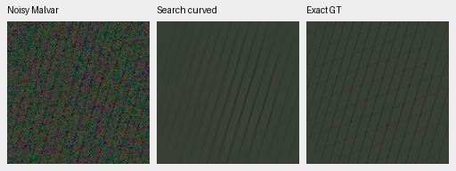
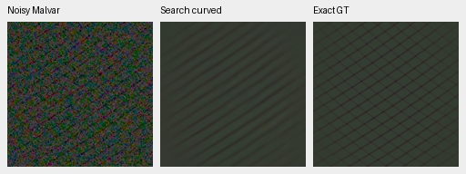

# Searching surrounding RAW for matching detail

Searching the surrounding RAW reduces guide-added diagonal banding in the
left GFX cab crop and leaves the overcast sky bit for bit unchanged. The
selected cab patches include foliage, the fence edge and the train body.
They supply a repeatable 27–28 pixel carrier while the fine mesh crossings
remain missing. In controlled ISO400 far queries, the search improves
straight-wire recovery from **26.42% to 32.48%** over fixed opposing donors.
It loses most of the fixed-donor gain on curved wires.
[Published evidence](results/search-donor-geometry-v1/publication.json).

## Selection and validation

The camera search covers the retained 512-pixel DSCF3879 and 768-pixel
DSCF3842 native RAW windows around each query. It screens 128-pixel
candidate regions at 64-pixel stride, with additional placements abutting
each side of the query. Donors must be disjoint from each other and the
query, with the query center near the line segment between them.
Green RAW samples in a fixed 25% screening subset supply up to six
spectral peaks per donor. The search favors pairs with strong peaks of
similar orientation and frequency. Its search band is 0.035–0.23
cycles per native pixel. Overlapping candidates always use the same
screening samples at the same absolute coordinates.

The chosen pair remains fixed for two complementary validation fits
on the other donor samples. A plane must lower whitened squared error
by more than eight units on each donor in each held-out fold. The
optional shared-curvature fit uses the existing opposing-donor check
against a separate planar model for each donor. The query receives
the interpolated frequency, an optional Hessian, and a list of supported
directions. Query CFA folds estimate phase, amplitude, color and local
support before delivery. Unaccepted brackets return the saved guarded
fit. The two search arms use the same center frequencies and support
flags, with curvature applied only in the curved arm. These checks
measure empirical prediction error over the indicated samples.

The synthetic test reuses 32 original query groups, the two designated
shared-structure donors, and exact archived outputs for the guarded
guide, fixed planar guide and fixed two-donor fit. Two additional
candidate patches contain wires turned by 40 degrees and an edge-only
field, with their own sensor draws. The search ranks the intended pair
first for 14 of the 16 source/noise combinations. The other two are
the same curved source at both noise levels and use the fallback.
In all six curved source/noise combinations, the search misses the
second family by more than one native frequency bin or falls back.
This accounts for part of the curved-wire loss even when the
intended donors are found.
[Synthetic guide alignment](results/search-donor-geometry-v1/diagnostic.json).

## Matched quiet error

Each entry gives weak-increment response as a fraction of the exact
target increment, expressed as a percentage, followed by weak-increment
RMS in linear DN16. All arms are compared at the same observed quiet
RMS within each row, capped at the tighter frozen delivery setting.

| Query subset | Guarded guide | Fixed planar | Fixed two donors | Search planar | Search curved | Quiet RMS |
| --- | ---: | ---: | ---: | ---: | ---: | ---: |
| ISO400 far, all | 8.63% / 11.1993 | 9.19% / 11.1898 | 11.88% / 11.1725 | 9.62% / 11.1927 | 9.14% / 11.1942 | 2.34339 |
| ISO400 far, curved | 3.49% / 11.0616 | 4.47% / 11.0402 | 10.70% / 10.9956 | 1.46% / 11.0762 | 1.46% / 11.0779 | 2.20828 |
| ISO400 far, straight | 26.52% / 9.9299 | 26.42% / 9.9302 | 26.42% / 9.9302 | 32.48% / 9.8897 | 32.48% / 9.8897 | 2.22755 |
| ISO400 near, all | 3.73% / 14.1221 | 3.56% / 14.1226 | 3.68% / 14.1219 | 4.79% / 14.1155 | 4.12% / 14.1184 | 6.31789 |
| ISO6400 far, all | 1.95% / 22.9503 | 1.92% / 22.9451 | 1.98% / 22.9544 | 2.15% / 22.9472 | 2.13% / 22.9495 | 6.41741 |
| ISO6400 near, all | 3.00% / 30.2435 | 2.87% / 30.2441 | 2.93% / 30.2440 | 3.62% / 30.2429 | 3.45% / 30.2417 | 14.97491 |

ISO6400 recovery remains low. The independent audit recomputes 1,920
summary measurements and verifies 120 archived prediction arrays,
10 exact search fallbacks, and native panel pixels. The scoped CPU
collection took 176.31 seconds and used saved neural predictions.
Coverage is the fixed synthetic panel and the two GFX families.
The standard full427 and known/unseen camera panels are outside this review.
[Independent numerical and pixel audit](results/search-donor-geometry-v1/independent-audit.json).

## Native evidence

Sources 81 and 85 are BGGR at ISO400 with 160×160 native pixels per
cell, ROI `[176,176,160,160]`, shot/read `8e-5 / 2.56e-8`,
exposure 2, and contrast 5 around the target mean. Delivery uses threshold
2 and scale 0.82212 above V143 EMA
`96d146d017c54196288c585f8b7eddcf030e8a235061049c31e985b9380b7ce4`.
The restored panels show the stronger family with many weak intersections
missing. The full boards include all fixed and searched arms.

[Source 81 comparison](images/search-donor-geometry-v1/iso400-source81-far-BGGR-comparison.png) ·
[Source 85 comparison](images/search-donor-geometry-v1/iso400-source85-far-BGGR-comparison.png).

The camera replays compose the query-local fit with saved V120 EMA
`a9d9b6b4f974e24a6b11e5e740aab32314233a7f53c056cf37c7d2aac1c589fb`.
All 24 sky candidates fail screening and the restored sky matches V120.
The coarse fence retains existing crossings. Its correction relative to
V120 falls from 26.30 to 0.66 DN16 RMS. The building and foliage remain
soft, with larger changes from V120 of 15.31 and 3.01 DN16 respectively.
The left cab changes by 7.37 and 7.29 DN16 from its cross-checked guide
under the nominal and transferred profiles. In both cases the search
moves the result back toward V120, with less of the added diagonal
modulation. The nominal right crop falls back exactly and the transferred
right crop changes slightly. Cab crossings remain incomplete in all four
views. The native comparisons show no obvious new colored grid.

The main region exposure is ×4 and the cab exposure is ×16. The main and
nominal cab noise coefficients are shot/read `0.00128 / 6.5536e-6`.
The transferred DSCF3879 profile uses
`0.0014635775921166604 / 1.0715704128646712e-6`.
The two camera pairs use separate ISO100 AHD references, with both original
camera JPEGs on the cab boards. These are qualitative comparisons with
different aperture, exposure timing and moving subjects.
[Native coordinates, conditioning, transformations and viewing](images/search-donor-geometry-v1/manifest.json).

[Sky](images/search-donor-geometry-v1/main-overcast-sky.png) ·
[Building](images/search-donor-geometry-v1/main-building-detail.png) ·
[Foliage](images/search-donor-geometry-v1/main-foliage.png) ·
[Coarse fence](images/search-donor-geometry-v1/main-chain-link-fence.png) ·
[Cab left](images/search-donor-geometry-v1/mesh-nominal-left.png) ·
[Cab right](images/search-donor-geometry-v1/mesh-nominal-right.png) ·
[Transferred left](images/search-donor-geometry-v1/mesh-profile3879-left.png) ·
[Transferred right](images/search-donor-geometry-v1/mesh-profile3879-right.png) ·
[Selected neighborhoods](images/search-donor-geometry-v1/selected-neighborhoods.png).

The cab neighborhoods show the distinction that matters for whole-image
context. A region can support a strong periodic signal and still belong
to a different surface from the query. Aligned scene features could
help choose regions on the same surface or follow a visible structure
around an interruption. The local RAW fit would still establish whether
the native frequency, phase and amplitude are supported in the query.
An independent donor-selection test would build the scene preview from
screening samples only.
