# Multiscale measured-CFA loss: first 1,000 updates

Current architecture and recommendations: [current model guide](current-model.md).
The versioned study below retains its measured results and original protocol.

**Stop V61 at this boundary and Use V43 as the comparator for this experiment.** The loss
improves bright saturated fields but lowers photographic and paired-real accuracy
and suppresses weak detail more. A separate trial will test a ten-times smaller
coefficient. This intermediate result does not establish convergence.

[Scores, checkpoint, all 35 native crop receipts and independent audits](results/sensor-mean-v61-first1k-review.json).
[Recipe and engineering checks](sensor-mean-v61.md).

V61 and completed V60 start from the same mature V58 EMA with fresh AdamW/EMA,
seed 48, batch 16/native 256, BF16 training, LR 2e-5, warmup 100 and original 4,000-update
schedule. All 32,904,704 restoration parameters train; DINOv3 stays frozen. Only
`multiscale_sensor_weight: 0 → .01` changes. Wide palette, Commons 40,170/native 128/
paired 32, source fractions, geometry before final downsampling, noise and validation
remain fixed. All 41 logged step/domain/LR/input hashes match. Unlogged batches were
not separately hashed; CUDA optimization is not claimed bitwise repeatable.

| Model | Checkpoint SHA256 |
| --- | --- |
| V60 +1k | `dde398a05fc5df33167d73967d6b5f62ccf3b165f27f8c745b1fdeb45a87f19a` |
| V61 +1k | `f4b503c7b511c2d935ffd5dfb2f8f138c75945dfd29a83bc4fd5b2bb8a9ccf72` |

## Accuracy and uncertainty

427 photographs and16 procedural sources use exact simulated clean targets.
Known development has 4 scenes/8 pairs/72 crops; our unseen-camera development has
5 scenes/10 pairs/90 crops. Real primary scores compare measured CFA; auxiliary AHD
RGB references are independently demosaiced, not exact RGB GT. Means balance
sources. Inference uses FP16/physicalFP32, photo batch 2 and paired batch 4. V43
has different training history and paired batch 2.

| Model | Photo PSNR / SSIM | Procedural PSNR / SSIM | Known CFA PSNR | Unseen CFA PSNR |
| --- | --- | --- | ---: | ---: |
| V43 study comparator | 34.89934 / .957126 | See original report | 54.23332 | 53.80606 |
| V60 +1k | 35.54917 / .961343 | 33.96064 / .969193 | 54.21420 | 53.79297 |
| V61 +1k | 35.33505 / .958582 | 34.40590 / .967661 | 54.05613 | 53.52672 |

| V61 − matched V60 | Difference | 95% paired source interval |
| --- | ---: | --- |
| Photo sRGB PSNR, dB | −.214121 | [−.280267, −.139875] |
| Photo SSIM | −.002761 | [−.002964, −.002583] |
| Procedural sRGB PSNR, dB | +.445269 | [−.146911, +1.248094] |
| Known measured-CFA PSNR, dB | −.158063 | [−.322897, −.005040] |
| Unseen measured-CFA PSNR, dB | −.266250 | [−.341179, −.191322] |

Intervals use 1,000 paired source resamples, seed 42. They describe this development
set, not training-seed or selection uncertainty. All 36 comparisons against V60/
parent/V43 are retained. Observation keys/transforms and classical controls verify
cross-run correspondence; the inherited four-F32-ULP bound is unchanged and all
differences are retained.

## Native photographic triplets

Noisy WB-aware Malvar → denoised → exact simulated GT. Native 160×160 panels at
original 8×-binned evaluation resolution; no crop resizing. Shared ROI [48,48,160,160],
RGGB, WB [2,1,1.5], original protocol matrix, shot .00256/read variance .0000262144,
16-bit ADC/black .03, display exposure×1. Full source/cache/checkpoint/noise/display
metadata accompanies every image. PNGs are 8-bit sRGB previews; metrics use floats.

Parachute fabric and fine cords — V61:

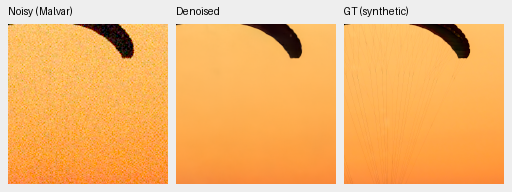

Same observation and coordinates — V60:

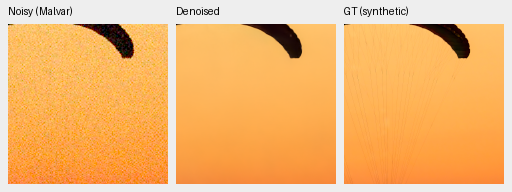

Building and sky — V61:

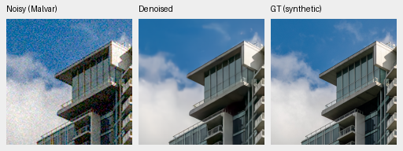

Same observation and coordinates — V60:

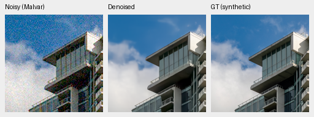

Both erase fine cords and soften cloud/building detail. No useful native detail
gain. Sources: Roy Egloff,
[parachute](https://commons.wikimedia.org/wiki/File:CH.VD.Villeneuve_2007-08-25_Vertigo-Swiss-Riviera_2392_3x2-R_4K.jpg),
and Dietmar Rabich,
[building](https://commons.wikimedia.org/wiki/File:Vancouver_(BC,_Canada),_Coal_Harbour_Seaside_Park,_Blick_in_den_Himmel_--_2022_--_2158.jpg),
CC BY-SA 4.0. Binning/crop/noise/restoration modifications retain that license.
Paired RAW credits and individual licenses remain in the receipts.

## Color improves, with remaining failures

Fixed 147 linear-RGB HSV colors/grays × 2 noise conditions × 4 CFAs = 1,176 observations.
This diagnostic was frozen before earlier palette outputs, following parent
failures, so it is not a blind photo benchmark. Same WB/matrix, native 256/B1,
ROI [48,48,160,160], display×1. Clean targets stay below white; noisy ADC can clip.
The loss excludes ADC-only and clipped/invalid reference blocks.

High-noise/peak .90 results give mean/p95/maximum of the largest absolute
camera-RGB channel-mean error over 96 hue/CFA cases. These are descriptive
statistics, not confidence intervals.

| Saturation | Parent V58 | V60 +1k | V61 +1k |
| ---: | --- | --- | --- |
| .50 | .028115 / .086721 / .088023 | .029993 / .096123 / .100497 | .019586 / .062077 / .064378 |
| .98 | .023667 / .098846 / .120953 | .032886 / .114641 / .121354 | .006903 / .019186 / .028888 |

The saturated-field improvement warrants a smaller-weight trial. Moderate
saturation still reaches .06438 error. The genuine nonlocal RAW reference is
better on moderate bright fields (mean .001260), worse on saturated fields
(mean .016283), and has separate photographic/detail/runtime limitations.

Fixed gray, warm 30° and magenta 315° V61 previews:

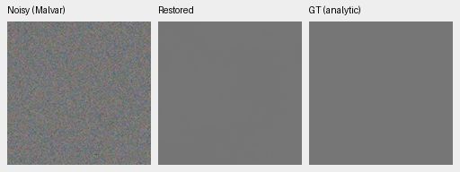

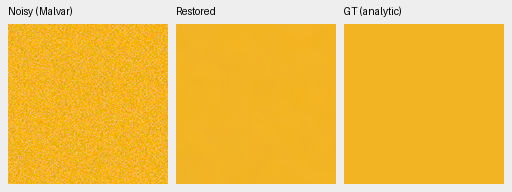

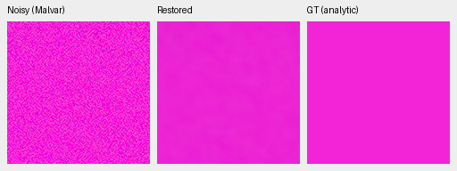

Gray is smooth and warm is close; magenta remains shifted/mottled. Separate
32-case CPU FP32 results retain variation in warm and cyclic magenta.

Weak carriers worsen: at level .18/contrast .02/period 16/high noise, saved mean
in-phase gain falls from .52060 to .32090 (ideal 1). The dark level .01/contrast .1/
period 8 signal remains nearly absent. These are finite analytic diagnostics.

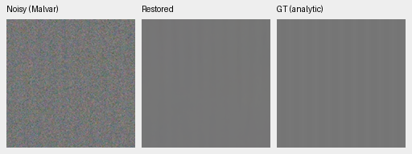

## Standing GFX and other cameras

Cached DSCF3879 ISO6400 → restored → DSCF3880 ISO100 f/5.6, **not GT**. Shared
WB[1.513245033,1,2.215231788], original matrix, input-only shot .0014635775921166604/
read variance 1.0715704128646712e-6, display×4 (+2EV). Captures differ in aperture,
exposure and motion, 3m38s apart. No reference warp, fitted color correction or
pixelwise score. Both and siblings stay excluded from training; originals read-only.

Sky [5800,1400,160,160]:

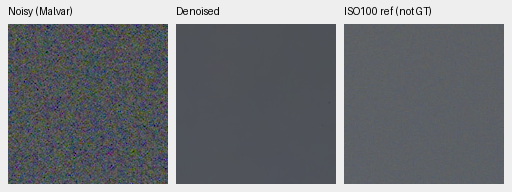

Building [5790,2690,160,160], reference x5791:

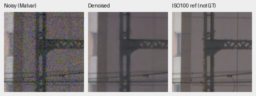

Foliage [8890,5570,160,160]:

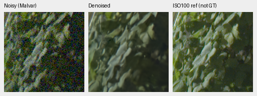

Fence [2240,6000,160,160], reference x2241:

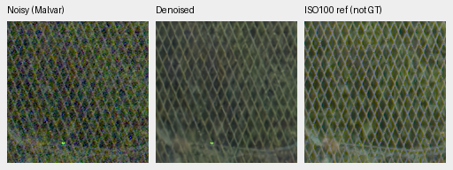

Quiet sky accompanies soft truss, foliage and fence crossings; no clear gain
over V60. Q2 rocks and Sony fuselage stay soft. GFX50R retains more wall texture
than RawNIND but also grain. Those comparisons use RawNIND as a comparator,
never GT, and do not establish broad real superiority.

The 101.996 MP pass took **35.321 s**: 520 native 512 tiles/overlap 64/batch 4,
FP16/physicalFP32, peak allocation 2.032 GB. One pass on a shared machine is not a
throughput sweep. Both 8746×11662 RGB16 TIFFs pass fullSHA/dimensions/dtype and
greater-than-256-code checks; sRGB has ICC. Full 16-bit output works; 10 seconds is unmet.

## Verification and decision

Independent primary arithmetic covers 50,264 case rows/72 reported comparisons,
maximum difference 7.11e-15. State/data/source checks verify 91 model/91 EMA tensors,
89 AdamW states, RNG, step 1000/original 4000 and 41 matched logged observations.
19 primary native PNGs/23 F32 contexts/2 RGB16 files pass integrity checks. Every
common noisy/reference pixel and coordinate/transform matches saved V60.

Hue inference computes only 1,176 new V61 predictions and reuses 3,528 audited exact
parent/V60/reference arrays. CPU replay first matched 4,704 old rows/72 groups/12 whole
PNG hashes with zero inference. Independent Torch64 rebuilt 28,224 hue metric
fields (maximum difference 4.44e-16); separate arithmetic rebuilt 864 group scalars.
The CPU audit verifies 192 fields/four native triplets. Of 35 published native PNGs,
26 were actually opened here and 9 reuse previous whole-file-identical views.
Integrity checks alone are not quality evidence.

The first wrapper failed after successful analytic evaluation: its assertion
expected 672 rows, while 448 observations × (candidate + Malvar) = 896. Original failed
status/source remains preserved. Separate recovery verified finished outputs and
ran only unstarted GFX/other-camera/CPU-audit stages. No training or completed
model panel was repeated.

Do not continue/promote the .01 recipe. Test .001 separately from the same V58
initializer against completed V60, with schedule/data fixed. Larger corpus stays
separate. Protected-final remains closed; general color repair, convergence,
SOTA and the requested real-photo quality remain unresolved.
