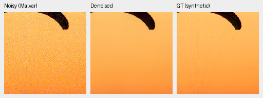
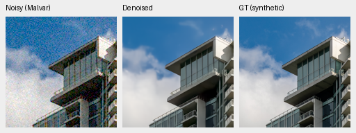
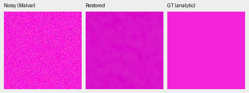
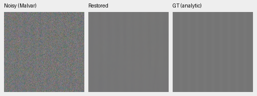
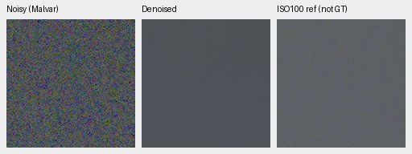
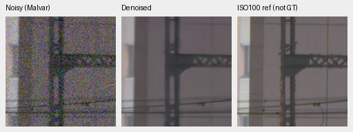
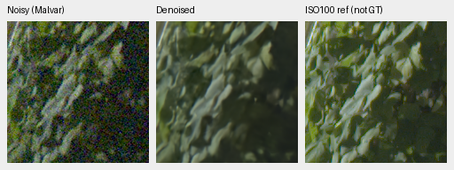
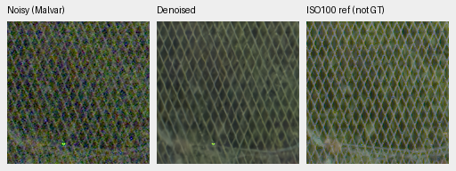

# Smaller measured-CFA loss: first 1,000 updates

Current architecture and recommendations: [current model guide](current-model.md).
The versioned study below retains its measured results and original protocol.

**Stop V62 here and Use V43 as the comparator for this experiment.** Reducing the loss
weight from .01 to .001 recovers much of V61's accuracy, but does not give a
useful overall improvement over the matched loss-off V60 control. Photo PSNR
is tied, photo SSIM and unseen-camera RAW accuracy fall, and weak detail remains
more attenuated. Color bias improves but is not fixed. The next experiment
will isolate a larger reviewed corpus and a longer training stage.

[Complete scores, source witnesses, audits and 38 native crop receipts](results/sensor-mean-v62-first1k-review.json).
[Recipe and executed engineering checks](sensor-mean-v62.md).

## Matched first boundary

V60, V61 and V62 start from the same mature V58 step10000 EMA with fresh
AdamW/EMA, seed 48, native 256/batch 16, BF16 training, LR 2e-5, warmup 100 and
an original 4,000-update schedule. Only multiscale measured-CFA loss weight
changes: 0 / .01 / .001. The 8-stop palette, Commons 40,170/native 128/paired 32,
fractions, geometry/PSF before final area2, noise/ADC and validation stay fixed.
All 41 logged domain/LR/input hashes match V60. This does not establish bitwise
repeatability of CUDA optimization or separately hash every unlogged batch.

V62 whole-state checkpoint SHA256:
`714aeb4abe26e03da8fc6e92c068be7b2070da74ece540e0612c2bd2e0215999`.
V60 control SHA256:
`dde398a05fc5df33167d73967d6b5f62ccf3b165f27f8c745b1fdeb45a87f19a`.

427 photographs and 16 procedural sources use exact simulated targets.
Known RAW development contains 4 scenes/8 pairs/72 crops; our unseen-camera
panel has 5 scenes/10 pairs/90 crops. Real primary scores compare measured CFA;
auxiliary AHD RGB is independently demosaiced, not exact RGB GT. Means balance
sources. Inference is FP16/physical FP32, photo batch 2 and paired batch 4.

| Model | Photo PSNR / SSIM | Procedural PSNR / SSIM | Known CFA PSNR | Unseen CFA PSNR |
| --- | --- | --- | ---: | ---: |
| V60, loss 0 | 35.54917 / .961343 | 33.96064 / .969193 | 54.21420 | 53.79297 |
| V61, loss .01 | 35.33505 / .958582 | 34.40590 / .967661 | 54.05613 | 53.52672 |
| V62, loss .001 | 35.56006 / .960947 | 34.33979 / .969919 | 54.18715 | 53.66490 |

| V62 − V60 | Difference | 95% paired source interval |
| --- | ---: | --- |
| Photo sRGB PSNR, dB | +.010886 | [−.013262, +.037282] |
| Photo SSIM | −.000396 | [−.000453, −.000343] |
| Procedural sRGB PSNR, dB | +.379150 | [+.179886, +.595145] |
| Procedural SSIM | +.000727 | [−.000057, +.001662] |
| Known measured-CFA PSNR, dB | −.027050 | [−.095673, +.021483] |
| Unseen measured-CFA PSNR, dB | −.128072 | [−.178507, −.094034] |

Intervals use 1,000 paired source resamples, seed 42; they do not quantify
training-seed or selection uncertainty. All 48 saved comparisons against
V60/V61/parent/V43 are retained. V43 has different training history and paired
batch 2. Classical controls, nullable metrics, observation keys and transforms
verify the comparisons under the inherited fixed four-F32-ULP bound; no tolerance
was widened. Neither field-bias gains nor procedural PSNR establish real quality.

## Native exact-GT photographs

Noisy WB-aware Malvar → denoised → exact simulated GT. Native 160×160 panels
at the original 8×-binned evaluation resolution; no crop pixels are resized.
Shared ROI [48,48,160,160], RGGB, WB [2,1,1.5], original protocol matrix,
shot .00256/read variance .0000262144, 16-bit ADC/black .03, display exposure×1.
The receipt records every source/cache, checkpoint hash, noise and display
transform. PNGs are 8-bit sRGB previews; evaluation uses float predictions.

Parachute fabric and cords, V62:

Matched V60:

Building and sky, V62:

Matched V60:

Fine cords remain absent and cloud/building detail is soft; no clear native
advantage over V60. Sources: Roy Egloff,
[parachute](https://commons.wikimedia.org/wiki/File:CH.VD.Villeneuve_2007-08-25_Vertigo-Swiss-Riviera_2392_3x2-R_4K.jpg),
and Dietmar Rabich,
[building](https://commons.wikimedia.org/wiki/File:Vancouver_(BC,_Canada),_Coal_Harbour_Seaside_Park,_Blick_in_den_Himmel_--_2022_--_2158.jpg),
CC BY-SA 4.0. Binning/crop/noise/restoration modifications retain that license.
Paired credits and individual licenses remain in the crop receipts.

## Color and weak detail

The same prospectively frozen 1,176-observation hue grid covers 147 linear-RGB
colors/grays, two noise conditions and four CFAs. This diagnostic follows earlier
parent failures and is not a blind natural-image benchmark. Same WB/matrix,
native256/B1, ROI [48,48,160,160], display×1. Clean targets are below white;
noisy ADC may clip. Loss excludes ADC-only and invalid/clipped reference blocks.

At high noise/peak .90, the table gives mean / p95 / maximum of the largest
absolute camera-RGB channel-mean error over 96 hue/CFA cases. These are fixed-grid
descriptive statistics, not uncertainty intervals.

| Saturation | V60 loss 0 | V61 loss .01 | V62 loss .001 |
| ---: | --- | --- | --- |
| .50 | .029993 / .096123 / .100497 | .019586 / .062077 / .064378 | .025922 / .094160 / .096704 |
| .98 | .032886 / .114641 / .121354 | .006903 / .019186 / .028888 | .018197 / .090378 / .103037 |

V62 reduces the high-saturation group mean, but leaves a .103 worst-case error.
The fixed gray/warm previews are close; magenta remains biased and mottled.
The separate CPU FP32 cyclic-magenta preview is also substantially mottled.
All 90 group rows and the nonlocal reference remain in the full receipt.

For the analytic level .18/contrast .02/period16 high-noise carrier, mean
in-phase gain is .44277 versus V60 .52060 and V61 .32090 (ideal 1). The dark
level .01/contrast .1/period8 signal is nearly absent. These finite carrier
checks do not measure real scene resolution.

## Standing GFX and other cameras

Cached DSCF3879 ISO6400 → restored → DSCF3880 ISO100 f/5.6, **not GT**.
Shared WB [1.513245033,1,2.215231788], original camera matrix, input-only shot
.0014635775921166604/read variance 1.0715704128646712e-6, display×4 (+2EV).
Captures differ in aperture/exposure and motion, 3m38s apart. There is no
reference warp, fitted color correction or pixelwise score. Both and siblings
remain excluded from training; originals remain read-only.

Sky [5800,1400,160,160]:

Building [5790,2690,160,160], reference x5791:

Foliage [8890,5570,160,160]:

Fence [2240,6000,160,160], reference x2241:

Sky is quiet; truss, leaves and mesh crossings remain soft. No clear gain over
V60. Aperture/focus/motion differences prevent attributing every difference
from the ISO100 reference to denoising. Q2 rocks and Sony fuselage detail remain
soft; GFX50R retains more wall texture than RawNIND with visible grain. RawNIND
is a same-capture comparator, never GT. Broad real-camera superiority is unproven.

Full 101.996 MP inference took 34.770 seconds: 520 native512 tiles, overlap64,
batch4, FP16/physical FP32, peak CUDA allocation2.032GB. This is one pass on a
shared machine, not a speed gain or throughput benchmark. Both full RGB16 TIFFs
pass full SHA/header/dimensions/dtype/code-diversity checks; sRGB has an ICC tag.
Full-resolution 16-bit output works, but the 10-second target remains unmet.

## Verification and next experiment

Independent arithmetic covers 50,264 primary case rows and 72 original
comparisons, plus 48 saved cross-run comparisons. State checks verify finite
91 model/91 EMA tensors, 89 AdamW states, RNG, step1000/original4000, data/source
hashes and all 41 matched logged observations. Nineteen primary native PNGs,
23 F32 contexts and two RGB16 files pass integrity checks. Every common noisy/
reference pixel and coordinate/transform matches saved V60 exactly.

The hue job computes only 1,176 new V62 predictions, reusing 4,704 audited
parent/V60/V61/nonlocal arrays. Independent Torch64 rebuilds 35,280 metric fields;
separate arithmetic rebuilds 1,080 group scalars. The selected CPU audit checks
192 fields/four native triplets. Of 38 published native PNGs, 26 were actually
opened here and 12 reuse previously viewed whole-file-identical PNGs.

The first final-audit wrapper failed before writing outputs because it used
the frozen model checkout as the working directory for newer relative report
registries. Original status/source are preserved. A separate recovery changes
only those two CPU working directories; completed model outputs are reused.
Both final audit owners have exited. The model worktree and operators stay frozen.

Stop .001 here; no promotion or further coefficient sweep. A longer matched
training stage will compare the complete reviewed 66,934-source corpus with
original 40,170 sources, starting both from completed V60 full4k. This isolates
data scaling without adding the sensor loss. V62's checkpoint and original
schedule remain unchanged. The new 75,806-source corpus still needs matching
4× completion. Protected-final stays closed; convergence, SOTA and the requested
real-photo quality remain unresolved.
