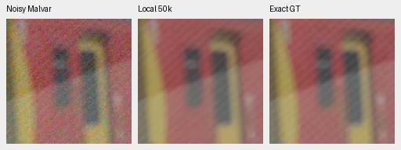
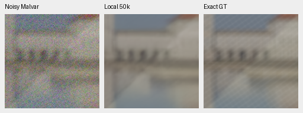

# Weak-wire recovery under pre-Bayer optical blur

Five existing checkpoints were replayed on the same 32 off-grid wire
backgrounds. Each fixture was observed with the original clean input and
with two added Gaussian blur widths. The comparison measures sensitivity
to optics in the synthetic capture pipeline.

## Capture and scoring

The [frozen off-grid transfer](scene-coherent-fourier.md) uses 32
independent binned photographic backgrounds, eight per footprint
(strip, ellipse, smooth dip and contrast step). Each fixture contains four
512 × 512 clean scenes derived from a common smoothed photo background and
camera recipe. The roles are long wire present, long wire only in the
exterior, short wire only, and a flat center.
The weak carrier period is 7.2–9.25 native pixels. The restored query is the
central 256 × 256; the metrics use its central 128 × 128. The original
transfer identifies the same locked source exclusions, captures and noise
seeds. Both standing Fujifilm test families remain outside this replay.

The perturbation is an isotropic unit-sum Gaussian at σ 0.55 and 0.85 native
pixel, with reflected boundaries and support truncated at 4σ. It acts on
the full 512 × 512 scene-linear RGB fixture before exposure, camera
conversion, CFA sampling, Poisson and signed read noise, and ADC
quantization. It also acts on the clean target seen by the simulated camera.
These two blur widths are uncalibrated stress doses. The photographic
backgrounds already have source optics and binning. Each source and role
uses its archived camera, CFA and seed. Changed Poisson means can change
the realized noise even with the same seed. All arrays of all 32 zero-blur
fixtures regenerated exactly, and one zero-blur inference replay per
checkpoint reproduced its four archived predictions exactly.

A second Local 50k replay checks sensitivity to noise realization. It
reproduces the original sharp ADC values by recovering the archived
draws. It then conditionally thins the original photon count to the
minimum rate across the three doses, shares that count and the signed
read noise, and adds independent Poisson excess at each blurred dose.
Each dose retains its own Poisson marginal. The coupling makes the
scored flat regions' input Bayer values, variance and target exactly
equal at all three doses. Any change in the flat output on this replay
comes from pixels outside that scored region.

All checkpoints use their EMA weights in CUDA IEEE FP32. Whole core and
Regional are local-inference checkpoints with different supervision masks
from the [matched training study](local-regional-wire-1024.md). The primary
metric is the signed weak fundamental, after projecting out the smooth
background, local edge and strong carrier harmonics and subtracting the
matched weak-absent output. Its **post-optical** version reports the
percentage of the available blurred target signal recovered. Its
**sharp-normalized** version projects the same output against the
zero-blur clean coefficient. Pre-blur support defines the intact mask
at all doses. The exact-gap mask is eroded by three native pixels for all
doses so convolution across the edge cannot count as a false wire. The
remaining gap samples have identical long-present and weak-absent clean
values. The central flat ground truth is also pixel-identical across
doses. Reduced gap or intact error can reflect a softer target. Paired
checkpoint comparisons at each dose and dose-by-checkpoint interactions
use 12,000 bootstrap resamples at source level within each footprint
family. The faintest half is fixed by the original clean weak amplitude.

## Results

Local 50k recovered less of the weak wire even after accounting for the
contrast lost in the clean optical image. The shared-noise replay isolates
this effect more precisely than reuse of the seed alone.

| Response | σ 0 | σ 0.55 | σ 0.85 |
| --- | ---: | ---: | ---: |
| Clean target, percentage of sharp clean | 100.00 | 92.03 | 80.89 |
| Local 50k, percentage of sharp clean | 22.44 | 18.99 | 14.59 |
| Local 50k, percentage of available clean | 22.44 | 20.60 | 17.94 |
| Local 50k, available response change, points | — | −1.84 [−2.16, −1.51] | −4.49 [−5.19, −3.77] |
| Faintest half, available response change, points | — | −1.45 [−1.85, −1.01] | −4.23 [−5.24, −3.15] |

With the archived seed and an ordinary sensor draw at each dose, the
corresponding Local 50k available-response changes are
−0.42 [−2.58, +1.69] and −4.92 [−7.06, −2.81] points.
On the shared-noise replay, the stronger blur also changes false weak
projection in the true gaps by −0.75 [−1.03, −0.50] DN16.
Flat output RMS changes +0.050 [+0.006, +0.097] DN16
at mild blur and +0.086 [−0.002, +0.170] DN16 at stronger
blur. The flat-core observations are identical, so these small differences
come from altered observations outside the scored core.

Regional training still lowers the continuing-strand error compared with
whole-core training at both blur widths. It also recovers less of the
weak crossing strand. Gap metrics use the 16 strip and ellipse cases.
Intact and flat metrics use all 32 photos. Brackets give paired source-level
95% bootstrap intervals.

| Regional minus Whole core | σ 0 | σ 0.55 | σ 0.85 |
| --- | ---: | ---: | ---: |
| Weak response, sharp-normalized points | −0.73 [−0.98, −0.50] | −0.65 [−0.87, −0.44] | −0.39 [−0.53, −0.26] |
| Continuing-strand RMS in true gaps, DN16 | −3.27 [−4.58, −1.90] | −2.65 [−3.69, −1.63] | −1.97 [−3.62, −0.49] |
| False weak projection in true gaps, DN16 | −0.10 [−0.17, −0.03] | −0.02 [−0.09, +0.05] | +0.01 [−0.06, +0.10] |
| Exact-flat luma RMS, DN16 | −0.26 [−0.53, −0.04] | −0.32 [−0.52, −0.14] | −0.30 [−0.61, −0.05] |

A matched training comparison can mix physically softened and original
captures and reserve a blur dose for evaluation alongside the gap and flat
controls. The available-target and sharp-normalized responses distinguish
how much detail the model recovers from how much the blur removes.

## Native crops

Each panel is 160 × 160 at native 100%. The triplets show noisy Malvar,
Local 50k EMA and exact post-optical ground truth for the long-present
role at σ 0.55. The query ROI is `(48, 48, 160, 160)` in both cases.
Exposure during capture is 0.33. The synthetic ISO6400 profile uses shot
`0.00128`, read `6.5536e-6` and black `0.03`. All panels use the same ×2
scene-linear display exposure and sRGB transfer. The hash-bound receipt
records the input, white balance, camera matrix and CFA for each case,
plus every checkpoint SHA256.

Strip fixture, `long-01`. The source crop starts at `(220, 26)` in the
bin4 photo, so the displayed rectangle starts at `(396, 202)`. Based on
mattbuck's photo of Nottingham railway station. Modified by binning,
rendering synthetic wire and sensor data, and cropping. Derived crops
are CC BY-SA 3.0. [Original photo](https://commons.wikimedia.org/wiki/File:Nottingham_railway_station_MMB_36_156401.jpg) ·
[License](https://creativecommons.org/licenses/by-sa/3.0/).

Ellipse fixture, `long-10`. The source crop starts at `(352, 2)` in the bin4
photo, so the displayed rectangle starts at `(528, 178)`. Modified by
binning, rendering synthetic wire and sensor data, and cropping. Diego
Delso, delso.photo, License CC BY-SA 3.0. [Original photo](https://commons.wikimedia.org/wiki/File:Exterior_del_Palacio_de_Nymphenburg,_M%C3%BAnich,_Alemania61.JPG) ·
[delso.photo](https://delso.photo/) · [License](https://creativecommons.org/licenses/by-sa/3.0/).

All six native triplets were viewed. On the strip, Local 50k keeps the
strong diagonal across the red window area, but the much fainter
opposite slope seldom joins it into a crossing. On the ellipse, the
ground truth still shows crossings away from the hole at σ 0.85.
The local output shows more of one slope near the blue roof than of the
weak intersecting slope. The mild-blur strip and stronger-blur ellipse
boards show the same directional imbalance across all five models.

Full five-model boards are available for the strip at [σ 0](assets/sensor-optical-transfer/long-01-sigma-0-comparison.png),
[σ 0.55](assets/sensor-optical-transfer/long-01-sigma-0.55-comparison.png)
and [σ 0.85](assets/sensor-optical-transfer/long-01-sigma-0.85-comparison.png),
and the ellipse at [σ 0](assets/sensor-optical-transfer/long-10-sigma-0-comparison.png),
[σ 0.55](assets/sensor-optical-transfer/long-10-sigma-0.55-comparison.png)
and [σ 0.85](assets/sensor-optical-transfer/long-10-sigma-0.85-comparison.png).

The [main GFX](gfx-qualitative.md) and [fine cab mesh](gfx-green-mesh.md)
maps link the standing real-photo comparisons for these checkpoints.
The [PSNR history](performance-history.md) tracks fixed photo and camera
panel measurements. This replay measures simulated blur at ISO6400 on
the held-out wire panel.

[Machine summary](results/sensor-optical-transfer-v1/publication.json) ·
[Source, per-photo measurements and replay bindings](results/sensor-optical-transfer-v1/evidence.tar.xz).
