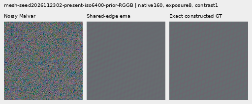
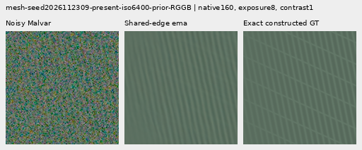
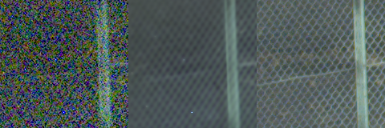
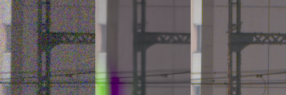

# Shared-edge training: small quiet gains, weaker mesh response

The matched shared-edge trial is complete: **900 noisy updates, 100 ADC skips,
both endpoints on all 822 cached inputs, and all 60 native comparison images
inspected**. The intervention produces real but small reductions in quiet/flat
error. Mesh amplitude and present-mesh reconstruction error worsen. Building
color fringes, false texture and incomplete fine crossings persist. It does
not establish the weak-detail improvement sought by the
[literature plan](weak-detail-literature-2026-11.md).

V120 remains the general recommendation. V200 retains slightly stronger mesh
response than this head, while V195 avoids the newer building color failure in
these views. The shared-edge head is retained as a measured quiet/detail
tradeoff, rather than discarded because it does not win every metric.

## Matched experiment

The existing audited cache replaces 156 mixed-scene rows with two paired
present/background targets sharing the same strong scene and differing by a
faint mesh increment. The other 844 rows are exact adoptions. Head architecture,
V195 initializer, seed, objectives, domain weights, LR schedule and 900-update
budget match V200. Scene content, pairing and their noise draws change together;
this is not an isolated causal test of pair coupling or brightness.

All 1,000 committed checkpoints passed identity/LR/frozen-state/finite-head/EMA/
Adam-clock checks. Training makes no new parent/DINO forward or noise draw.
Review reuses the identical 822 cached observations, including present/absent
meshes, quiet edge/bar regions, previously cached fresh-flat controls, natural
photos, ADC controls and both standing real-photo families. Numerical review
also makes no new parent inference or noise draw. Protected media and siblings
remain excluded from training; originals were not accessed or modified.

## Measured gains and losses

All error entries below are camera-RGB DN16 RMS; lower is better. Mesh projection
is signed amplitude relative to constructed GT; it is not a complete quality
score. Compare matching raw/EMA states.

| Metric | V200 raw | Shared-edge raw | V200 EMA | Shared-edge EMA |
| --- | ---: | ---: | ---: | ---: |
| Present-mesh template amplitude | 11.00297% | 10.68557% | 11.10184% | 10.87386% |
| Present-mesh full error | 8.24445 | 8.26012 | 8.24012 | 8.25130 |
| Present-mesh blank-region error | 5.66489 | 5.65988 | 5.66747 | 5.66402 |
| Absent-mesh full error | 5.36923 | 5.36363 | 5.37199 | 5.36827 |
| Quiet regions, ISO6400 prior | 4.10535 | 4.10211 | 4.10703 | 4.10495 |
| Quiet regions, ISO12800 prior | 6.43845 | 6.43115 | 6.44237 | 6.43744 |
| Cached fresh-flat cohort, ISO6400 prior | 18.72472 | 18.71444 | 18.72981 | 18.72303 |
| Cached fresh-flat cohort, ISO12800 prior | 24.36499 | 24.34823 | 24.37343 | 24.36254 |

Quiet error falls **0.079–0.113% raw / 0.051–0.076% EMA**. Cached fresh-flat
error falls **0.055–0.069% raw / 0.036–0.045% EMA**. Mesh projection loses
**0.3174 percentage points raw / 0.2280 points EMA**, while present-mesh full
error rises. These are descriptive means; they do not establish convergence,
statistical population improvement or safe false-detail risk.

Natural-photo relative band errors decline very slightly. Raw band gains also
decline slightly; EMA gains are nearly unchanged, with mixed signs. The native
duck, butterfly and bird/branch views remain soft, with periodic ribbing in
faint backgrounds. Better average error alone does not demonstrate recovery
of the weaker direction.

The same two fixed directional examples support that limitation. For mesh2302,
the weaker Fourier-sector gain changes **28.41%→27.15%** at EMA; its other sector
falls 57.87%→55.16%. For mesh2309, the weak sector falls 17.27%→16.88%, while the
strong sector remains 92.01%. These are orientation sectors of the full template,
with envelope/intersection leakage, not isolated wire-family amplitudes or
independent population replications. [Full directional bindings](results/shared-edge-v1/directional.json).

## Native exact-GT evidence

Noisy Malvar → **shared-edge EMA** → exact constructed GT. Each cell contains
160×160 unchanged pixels from 512 context, ROI `[176,176,160,160]`, RGGB,
shot 0.00128/read 6.5536e−6, exposure 8/contrast 1 with identical WB/matrix/sRGB display.

The first scene retains rounded/merged segments and incomplete crossings. The
second predominantly recovers one direction. Both states remain visibly distant
from exact GT. Matched ordinary/amplified boards:
[mesh2302](images/shared-edge-v1/comparison-00.png) /
[contrast40](images/shared-edge-v1/comparison-03.png),
[mesh2309](images/shared-edge-v1/comparison-04.png) /
[contrast40](images/shared-edge-v1/comparison-07.png).

The small quiet improvements do not eliminate amplified counterexamples:
[absent mesh](images/shared-edge-v1/comparison-08.png),
[gray flat](images/shared-edge-v1/comparison-23.png),
[ISO12800 flat](images/shared-edge-v1/comparison-26.png),
[blue flat](images/shared-edge-v1/comparison-29.png),
[quiet step](images/shared-edge-v1/comparison-34.png).
Ordinary steps/bars and coarse fence retain their geometry; ADC bark/fur/plane
views remain inherited controls.

EMA export SHA256:
`ad5fd84ea9b07cc2fc9bf671384c98fe8de5ff3f8257e6a29e8fb11ea59e4a9d`.
Raw export SHA256:
`9d389439aa48f4fc45ff192b0d9d0cfb76e9f660b6b557e3472102a2dd92b73b`.
These are cached-component exports above the existing V143 restoration and
frozen V195 anchor, not standalone replacements for the general model.
[Every source/ROI/display/checkpoint binding](images/shared-edge-v1/manifest.json).

## Standing real-photo checks

Noisy → **shared-edge EMA** → independent ISO100/AHD reference:

The building retains conspicuous green/magenta fringes in both endpoints. The
cab has visible modulation with incomplete crossings; no decisive visual gain
over V200 appears in either retained noise profile. Sky is smooth at ordinary
exposure, foliage remains soft, and coarse fence geometry remains aligned.

Main DSCF3879 ISO6400 f/1.7, 1/240 s and DSCF3880 ISO100 f/5.6, 3 s use display
exposure 4/contrast 1 and the central native160 ROI:
[sky](images/shared-edge-v1/comparison-09.png),
[building](images/shared-edge-v1/comparison-10.png),
[foliage](images/shared-edge-v1/comparison-11.png),
[chain-link fence](images/shared-edge-v1/comparison-12.png).

Cab DSCF3842 ISO6400 f/1.7, 1/300 s and DSCF3835 ISO100 f/5.6, 2.5 s retain both
left `[206,229,160,160]` and right `[426,189,160,160]` ROIs in 768 context,
exposure 16/contrast 1, with both straight-out-of-camera JPEGs:
[nominal left](images/shared-edge-v1/comparison-13.png) /
[right](images/shared-edge-v1/comparison-14.png),
[fixed nearby-capture profile left](images/shared-edge-v1/comparison-15.png) /
[right](images/shared-edge-v1/comparison-16.png).
Nominal shot/read are 0.00128/6.5536e−6; the retained nearby DSCF3879 profile is
0.0014635775921166604/1.0715704128646712e−6. Neither is a dedicated mesh-scene
dark/flat calibration. No qualitative parameter sweep was performed.

All real AHD/JPEG references are **independent qualitative references, not exact
GT or scoring targets**: aperture, exposure, motion and processing differ.
[Small real-triplet provenance](results/shared-edge-v1/representative-real.json).

## What this establishes and what remains

The shared-edge intervention yields a slightly quieter operating point, with
lower mesh response and persistent color/texture failures. It does not supply
the plan's decisive result of more weak second-direction response at the same
actual quiet error. This fixed cached suite did not measure fresh independent
noise repetitions of shared-edge increments. The new
[finite-wire near-edge panel](near-edge-response.md) now supplies that check:
no clear weaker-direction gain at the nominal noisy condition. Its
[completed three-noise extension](edge-snr-ladder.md) retains that limitation:
strong response improves substantially at lower noise, but weak response stays
low. Known-template evidence remains different from unknown-structure detection
power or a guaranteed recovery bound.

Meanwhile, the [A-only edge-refinement diagnostic](withheld-cfa-edge-refinement.md)
shows a concrete improvement in separating the tested weak signal from a
competing edge. That supports further edge/background modeling and local
support experiments; it does not by itself repair the neural head.

The publication checks all 8,294,400 newly displayed RGB channels against saved
native predictions and all 20,889,600 copied noisy/baseline/reference channels
against their source panels. The packaged metrics also replay 510 saved V200
scalars across 36 native cases with zero difference. All 15 original-pixel sheets,
60 boards and 12 triplets were actually inspected. Full fit/checkpoint evidence
is preserved, with compressed copies of machine receipts retaining their exact
decompressed bytes. [Publication receipt](results/shared-edge-v1/publication.json).
