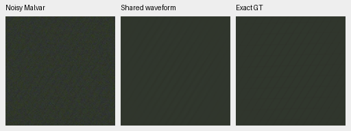
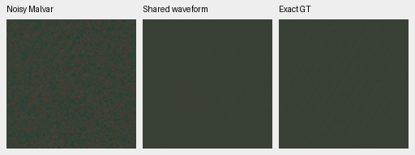

# Try a shared RAW waveform with signed Bayer amplitudes

Sharing the waveform slightly reduces far-edge chroma error. It attenuates
the weak increment at both noise levels and fails on the difficult near-edge
cases even at matched quiet RMS. The standing sky matches V120 and the
fine real fence remains incomplete. The independent fit remains the baseline.
[Executed sources, measurements, and native boards](results/shared-phase-shape-v2/publication.json).

## Discovery and validation

The [joint Bayer gate](joint-phase-profile-support.md) pools withheld
evidence across colors while retaining three separate waveforms. Here the
gate stays per color. Each discovery fold first estimates its own
independent eight-knot profiles from measured CFA sites. For each direction
it removes the knot mean and takes the leading right singular vector of
the three color profiles, weighted by the square root of the summed inverse
noise variance for each color. The fold then fits one signed amplitude
per color and direction along that common knot vector, together with the
original nuisance columns.

The shared profiles are frozen before the opposite folds score them.
Validation stays per color, comparing the fixed fit with an A-only null
that removes the corresponding direction. The shrinkage still subtracts
seven units of fitted energy because the waveform itself was estimated
from discovery samples. The delivery refits signed amplitudes on all
measured sites at the original pooled support. In a constructed
opposite-sign fixture this recovers the exact RGB amplitudes across all
four Bayer orders. Withheld NaNs leave the discovery design unchanged.
[Implementation](../src/demosaic/local_validated_waves.py) ·
[Focused invariance and sign tests](../tests/test_local_validated_waves.py).

The experiment reuses the [edge-guard panel](phase-guide-edge-guard.md):
96 independent observations on eight constructed geometries, each with
near and far placements and ISO400 and ISO6400 priors. Parent images,
measured donor frequencies, 8-pixel edge exclusion, both discovered
frequencies per fold, and all development thresholds and scales match the
independent reference. The settings labeled 0.02 and 0.10 DN16 use the
earlier calibration. Quiet RMS is measured on this panel. The real cases
use fixed threshold 2.
[Frozen runner](../scripts/probe_shared_phase_shape.py) ·
[Per-source summaries](results/shared-phase-shape-v2/summary.json).

## Response and error

Weighted refit at the frozen 0.02 DN16 development setting. Each pair is
independent / shared. Quiet delta is measured relative to V143.

| Noise and edge | Weak response | Quiet delta (DN16) | Weak increment RMS (DN16) | Weak chroma increment RMS (DN16) |
| --- | ---: | ---: | ---: | ---: |
| ISO400 far | 22.36% / 22.10% | 0.03902 / 0.03821 | 11.64371 / 11.64378 | 3.68524 / 3.63150 |
| ISO400 near | 12.16% / 7.65% | 0.01229 / 0.01184 | 15.72125 / 15.74481 | 10.28208 / 10.31539 |
| ISO6400 far | 1.81% / 1.38% | 0.02551 / 0.02092 | 26.60935 / 26.60910 | 6.84075 / 6.82853 |
| ISO6400 near | 1.57% / 0.14% | 0.02529 / 0.01286 | 36.82079 / 36.81818 | 21.77816 / 21.75975 |

At ISO400 near, all eight sources lose weak response and gain increment
error at both frozen settings. At the tight setting, green response
within the 256-pixel query falls from 13.55% to 7.61%, with losses in
red and blue too. At ISO400 far, blue response rises from 4.25% to
5.35% while green falls from 27.44% to 26.73%. The chroma metric
measures the RGB-mean-removed weak-increment error in that same query.
The eight measured geometries remain green dominant. Exact signed
amplitude representation in the fixture does not establish good
recovery of noisy signed-color wires.

The no-wire correction RMS falls from 0.276 to 0.046 DN16 at ISO6400
near. This measures change from the parent. It accompanies a loss
of true response. A descriptive check scales the independent
correction down to the shared arm's measured quiet RMS, using a single
multiplier per condition. The independent fit still recovers 12.00%
versus 7.65% at ISO400 near and 1.13% versus 0.14% at ISO6400 near,
with lower increment error in both. At ISO400 far, matched-quiet
response is nearly tied at 22.13% versus 22.10%, with a
0.00079 DN16 lower increment RMS for the shared fit. Those
multipliers use evaluation targets to describe the tradeoff.
[Measured quiet match](results/shared-phase-shape-v2/matched-quiet.json).

## Native images

The two triplets below use noisy Malvar, the shared-weighted fit at the
frozen 0.02 DN16 setting, and exact constructed GT. Native 160×160 cells
come from ROI `[176,176,160,160]`, source 40 RGGB and source 41 BGGR,
far two-wire placement and repeat 7311. ADC16 black fraction is 0.03;
shot/read are `8e-5/2.56e-8` at ISO400 and `0.00128/6.5536e-6` at
ISO6400. Exposure 2, white balance, color matrix and clipped-sRGB
transform match across methods. The synthetic parent is V143 EMA SHA256
`96d146d017c54196288c585f8b7eddcf030e8a235061049c31e985b9380b7ce4`.

Both ISO400 fits show faint diagonals, with clearer crossings in the
exact targets. At ISO6400, restored panels remain nearly flat where
the targets retain wire structure.
[ISO400 RGGB](images/shared-phase-shape-v2/iso400-source40-far-RGGB-comparison.png) ·
[ISO400 BGGR](images/shared-phase-shape-v2/iso400-source41-far-BGGR-comparison.png) ·
[ISO6400 RGGB](images/shared-phase-shape-v2/iso6400-source40-far-RGGB-comparison.png) ·
[ISO6400 BGGR](images/shared-phase-shape-v2/iso6400-source41-far-BGGR-comparison.png).

V120 EMA supplies the real-camera parent, SHA256
`a9d9b6b4f974e24a6b11e5e740aab32314233a7f53c056cf37c7d2aac1c589fb`.
DSCF3879/3880 uses display exposure 4 with the nominal shot/read
`0.00128/6.5536e-6`. The DSCF3842/3835 cab comparison uses display
exposure 16, that nominal profile and the transferred DSCF3879 estimate
`0.0014635776/1.0715704e-6`. It shows both sides and both camera JPEGs.
ISO100 AHD and low-ISO JPEGs are independent qualitative references
with different aperture, exposure and subject motion.
[Exact crop and conditioning provenance](images/shared-phase-shape-v2/manifest.json).

The overcast sky matches V120 bit for bit in camera RGB and displayed
pixels. Fine hardware and foliage remain soft. The coarse fence's
visible diamonds persist with a change of 26.15 DN16 RMS from the
independent fit. Changes in the cab are more subtle, 1.44–1.93 DN16 RMS
across both profiles and sides, with no convincing new intersections.
[Sky](images/shared-phase-shape-v2/main-overcast-sky.png) ·
[Building](images/shared-phase-shape-v2/main-building-detail.png) ·
[Foliage](images/shared-phase-shape-v2/main-foliage.png) ·
[Coarse fence](images/shared-phase-shape-v2/main-chain-link-fence.png) ·
[Cab left](images/shared-phase-shape-v2/mesh-nominal-left.png) ·
[Cab right](images/shared-phase-shape-v2/mesh-nominal-right.png) ·
[Transferred profile left](images/shared-phase-shape-v2/mesh-profile3879-left.png) ·
[Transferred profile right](images/shared-phase-shape-v2/mesh-profile3879-right.png).

The 104 fits run in 72.62 seconds on two CPU cores. The first collector
halted on comparison of JSON lists with runtime tuples. The successful
run uses array equality for those records. The independent audit checks
2,816 metric reductions, 576 fold fields, 120 retained camera cells and
four exact triplet subsets. All twelve native boards were viewed.
[First collector log](results/shared-phase-shape-v2/first-collector-attempt.log) ·
[Independent audit](results/shared-phase-shape-v2/independent-audit.json) ·
[Native viewing receipt](results/shared-phase-shape-v2/actual-native-viewing.json).
