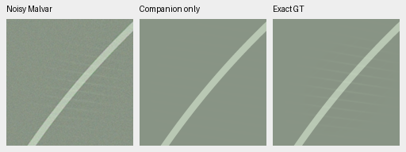
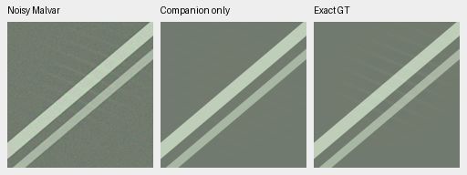

# Sharing perspective between the two wire directions

The stronger wire can estimate how the spacing of a faint wire changes
across a crop. On six constructed ISO400 cases with both directions on
one plane, applying that estimate only to the faint companion raises
measured recovery from **0.38% to 1.15%** and slightly lowers increment
error. The native crops still miss most of the faint lines. The gain
does not repeat on the ordinary whole-image wire panels or at ISO6400.
[Executed evidence](results/shared-projective-phase-v1/publication.json).

## Geometry and RAW validation

The [wider donor-bank replay](donor-frequency-bank.md) shows that having
the right center frequency is insufficient. A single frequency assumes
constant spacing. Under perspective, two directions on a plane can share
the denominator of their projected phase. For centered native coordinates
`x`, the phase `(f · x) / (1 + g · x)` has center frequency `f` and local
quadratic Hessian `−(f gᵀ + g fᵀ)`. The two directions have different
Hessians and can share `g`. This test keeps the guide's center frequencies
fixed and evaluates up to 25 gradients on a two-dimensional grid. It
rejects gradients that leave the supported frequency annulus.

The geometry search uses the original quarter of query RAW reserved for
screening, split into two crossed folds. Each trial compares its first
two phase harmonics with the planar prediction and the carrier-absent
prediction. It fits the screened rail background and separate CFA color
coefficients, and keeps the other active carrier planar during each
comparison. Both held-out halves must exceed a standardized gain of one
against both controls. Among passing trials, pooled reduction in whitened
squared error selects the geometry. The later fit still uses the
complementary RAW, eight phase knots per direction, independent per-color
validation and all-site weighted refit.

The planar control uses the same guides and delivery path. The other arms
apply perspective to the first active carrier alone, to both using its
estimate, to each with its own estimate, or to the companion alone using
the first carrier's estimate. Exact geometry is a synthetic diagnostic.
[Implementation](../src/demosaic/shared_projective_phase.py) ·
[Replay driver](../scripts/probe_shared_projective_phase.py).

## Constructed rails and wires

The 24 cases use an exact analytic rail parent and independent RAW draws
for strong-only and strong-plus-weak captures. Each noise profile has
six common-plane, four different-plane and two planar cases. The inputs
supply the exact center frequencies so this test can measure the effect
of perspective after discovery. The wire profiles are finite, narrow and
area integrated. The table uses the nominal wave gates of 2 at ISO400
and 1 at ISO6400. Each arm can scale down to the original planar fit's
quiet-region RMS. Recovery is the signed projection onto the true weak
increment. Error is the RMS of the reconstructed weak increment in DN16.

| Policy | ISO400 common-plane recovery | Increment RMS DN16 |
| --- | ---: | ---: |
| Planar | 0.377% | 6.068 |
| Estimated, first direction alone | 0.346% | 6.512 |
| Estimated, both directions share | 0.973% | 6.468 |
| Estimated, separate fits | 0.346% | 6.512 |
| Estimated, companion alone | **1.152%** | **6.013** |
| Exact geometry, both directions | 0.986% | 5.946 |
| Exact geometry, companion alone | 1.288% | 6.005 |

The stronger carrier clears the reserve checks in five of six common-plane
ISO400 captures. The companion clears none on its own. Transferring the
accepted geometry reduces the mean companion phase error on the finite wire
support from **0.076 to 0.048 cycles** after removal of constant phase.
Applying estimated geometry to both directions raises increment error even
though it also reduces the stronger direction's phase error. The initial
ranking by minimum standardized gain gives 6.804 DN16 for the shared fit.
Ranking the same admitted set by held-out loss brings it to 6.468 DN16.

Companion-only transfer leaves the four different-plane cases at 0.319%
with a 0.001 DN16 increment error increase. Both directions remain planar in
the two planar cases. None of the 12 ISO6400 two-direction captures accepts
estimated geometry. The common-plane ISO6400 planar result is 0.296% at
6.158 DN16. Supplying exact companion geometry yields −0.107% at 6.180 DN16.
[Fixed-scale and quiet-capped results](results/shared-projective-phase-v1/summary.json).

## Ordinary wire panels and false correction

The main and separate archived panels contribute 32 geometry and profile
combinations with V143 EMA
`96d146d017c54196288c585f8b7eddcf030e8a235061049c31e985b9380b7ce4`.
The whole-image guide produces the same main-panel recovery, 4.801% at ISO400
and 0.661% at ISO6400. The separate ISO400 panel changes from 6.436% to
6.430% for companion transfer with the same 11.202 DN16 increment RMS.
Sharing both slightly improves total query RMS from 7.958 to 7.908 DN16
on that panel while increasing increment RMS from 11.202 to 11.208 DN16.
With exact center guides on the main ISO400 replay, transferring to the
companion reduces recovery from 9.005% to 8.504% and increases increment
RMS from 11.157 to 11.160 DN16. ISO6400 results stay the same on both
archived scenes and with exact centers.

On 48 forced-guide no-wire controls, no flat capture accepts curvature.
The flat correction remains 0.416 DN16 RMS and 15.35 DN16 peak. Companion
transfer raises straight-rail false correction from 0.447 to 0.453 DN16
RMS, with the peak holding at 6.34 DN16. Complex-rail correction stays at
1.313 DN16 RMS and 20.18 DN16 peak.

## Native synthetic crops

Each cell is 160×160 original pixels at ROI `[48,48,160,160]`, with exposure
×4, contrast 1, identity WB and matrix, and clipped sRGB. Both use the
ISO400 prior shot/read `8e-5/2.56e-8`, ADC16, black 0.03 and the analytic
rail parent without checkpoint weights. Case 2 is a shared-plane GRBG
capture and case 7 is a different-plane GBRG capture. The triplets show
noisy Malvar, companion-only transfer and exact GT. The rails remain
sharp. The faint lines visible in both exact references are mostly
absent after restoration, including in the full comparisons with exact
perspective.
[Crop provenance](images/shared-projective-phase-v1/manifest.json).

[Case 2 method comparison](images/shared-projective-phase-v1/iso400-case2-comparison.png) ·
[Case 7 method comparison](images/shared-projective-phase-v1/iso400-case7-comparison.png).

## Native GFX100S review

The standing crops use V120 EMA
`a9d9b6b4f974e24a6b11e5e740aab32314233a7f53c056cf37c7d2aac1c589fb`,
same-side validation, gate 2 and both scene and spectral guides.
The DSCF3879 ISO6400 corrections use `.00128/6.5536e-6` shot/read at
exposure ×4. The independent DSCF3880 ISO100 AHD is a qualitative reference.

The smooth overcast sky is pixel-identical to V120 and the existing
building correction stays the same. With scene guides, the coarse-fence
correction grows from 9.00 to 15.17 DN16 RMS relative to V120 when both
directions share the estimate. The visible lattice gains contrast and
slight mottling, with no clear new crossings. The companion-only fit
matches the planar coarse-fence result. With spectral guides, foliage
correction grows from 2.21 to 3.10 DN16 RMS when both directions share and
falls to 1.78 DN16 for companion-only transfer. Fine leaves remain soft.
[Sky](images/shared-projective-phase-v1/main-overcast-sky.png) ·
[Building](images/shared-projective-phase-v1/main-building-detail.png) ·
[Foliage](images/shared-projective-phase-v1/main-foliage.png) ·
[Coarse fence](images/shared-projective-phase-v1/main-chain-link-fence.png).

Both DSCF3842 fine cab ROIs reproduce the conditioned V120 crop under
both guides and profiles. Fine crossings visible in the DSCF3835 ISO100
AHD and the straight-out-of-camera JPEGs remain unresolved. Exposure is
×16. The independent references differ in aperture, exposure and motion.

| Cab profile | Shot/read | Boards |
| --- | --- | --- |
| Nominal | `.00128/6.5536e-6` | [Left](images/shared-projective-phase-v1/mesh-nominal-left.png) · [Right](images/shared-projective-phase-v1/mesh-nominal-right.png) |
| DSCF3879 profile | `.0014635775921166604/1.0715704128646712e-6` | [Left](images/shared-projective-phase-v1/mesh-profile3879-left.png) · [Right](images/shared-projective-phase-v1/mesh-profile3879-right.png) |

This scoped CPU replay uses existing checkpoints and adds no broad photo
or held-out camera scores. The reserve-only implementation reproduced the
full-grid selector's Hessians and selection traces exactly on 40 saved
inputs. V120 remains the general recommendation.
