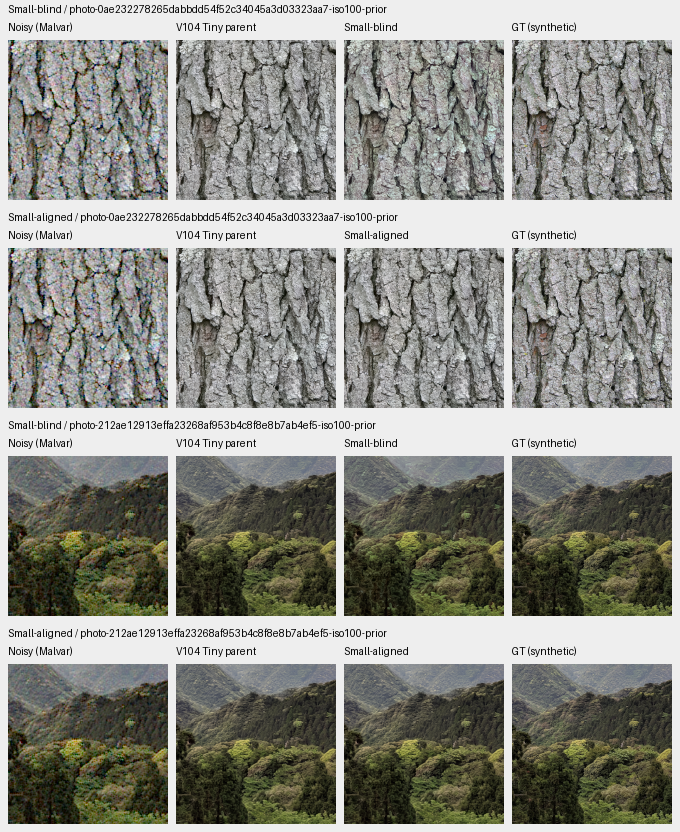
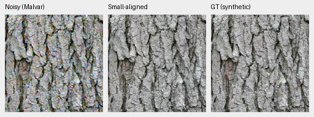
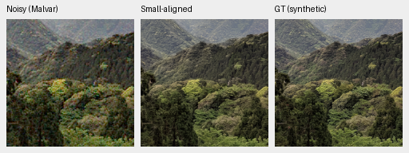

# Small encoder transfer with learned fusion gates

**A training-only feature fit recovers most of the quality lost by swapping
V104's frozen Tiny encoder for Small.** It changes four lateral projections
while retaining the learned fusion gates and restoration trunk. Selected
photo-condition means are within .013dB of Tiny; two adverse-camera scores
remain .25–.26dB lower. This is a candidate initializer for further training.
Joint training, full quality evaluation and a trained capacity benefit remain
unmeasured.

[Source, data, fitted checkpoint, independent audit and native metadata](results/small-lateral-alignment-CPU-v1.json).
The fitted file is
`/mnt/external/demosaic/Small-lateral-alignment-CPU-20261024-v1/Small-aligned-from-V104.pt`,
SHA256 `6a055cb6f5e03676c69a9523350e9236b7e19f162b6ca9f535858d14d42e8baa`.
Its step20000 describes inherited V104 history. The transfer adds a 64-source
linear feature fit and **zero new joint optimizer updates**.

## What is fitted

The original V104 EMA and official pinned frozen Tiny encoder are the teacher.
Small uses its pinned official weights/revision. Both receive the same noisy
Malvar/WB/matrix preview used by the actual model. A real restoration forward
verifies the normalized feature input bit-exactly.

The real cleaned-corpus reader supplies 80 unique training sources, with the
existing geometry, final downsampling, contrast augmentation and zero optical
blur. Randomized broad-camera/exposure/noise observations use fixed recorded
seeds. Exactly one cache read per source is verified. The first 64 sources fit
the maps; 16 different training sources check transfer. Validation, test and
the GFX captures do not enter fitting. Restoration GT is not the fit target.

For each stage, Small's features predict Tiny's original 64-channel lateral
output. A fixed standardized ridge coefficient .001 fits the affine map in
float64; installed coefficients use float32. At most 256 fixed spatial samples
per source/stage enter the solve. Eight lateral weight/bias tensors change;
the other 83 EMA tensors, including all three gates, remain exact. Both frozen
encoders retain their official identities.

On the 16 separate training sources, lateral feature error RMS changes:

| Stage | Blind Small | Aligned Small |
| --- | ---: | ---: |
| 0 | .16262 | .03965 |
| 1 | .12052 | .03114 |
| 2 | 2.92784 | .36250 |
| 3 | .36001 | .36748 |

The deepest-stage error does not improve. Matching feature statistics is also
not a restoration-quality objective; the following measurements assess the
fixed fitted result without tuning it on held-out outputs.

## Fixed material and camera observations

The original four held-out photos, three noise conditions and RGGB observations
are unchanged. Mean sRGB PSNR over the four sources:

| Condition | V104 Tiny | Small blind swap | Small aligned |
| --- | ---: | ---: | ---: |
| ADC-only | 39.49290 | 30.59353 | 39.48010 |
| ISO100 prior | 40.80493 | 35.94253 | 40.80864 |
| ISO12800 prior | 33.49300 | 30.62018 | 33.49125 |

Six of twelve aligned photo cases improve over Tiny. Individual changes range
from −.09738 to +.06243dB; the near-equal means do not mean identical outputs.
These are selected four-source results, not full427 or training-repeat evidence.



[ISO12800 board](images/small-lateral-alignment/iso12800-prior.png).
Blind transfer adds color shifts and smearing. Alignment largely restores
Tiny's appearance; high-noise fine structure remains soft.

Noisy → **Small aligned** → exact synthetic GT, ISO100 prior. Both are native
160×160 crops at [48,48,160,160] within their native256 contexts; no resizing.
Shared WB=[2,1,1.5], recorded common matrix, display exposure ×1,
shot .00002/read variance .0000000016:





[Bark source/ROI/weights/encoder/noise/display metadata](images/small-lateral-alignment/crop-26fb0a9c4f2cf61d.json) ·
[Canopy metadata](images/small-lateral-alignment/crop-03ecf40096db1cd0.json).

| Selected camera crop | Tiny | Small blind | Small aligned |
| --- | ---: | ---: | ---: |
| Coulicoco | 56.98928 | 44.27604 | 56.72694 |
| top_of_Expedit | 60.67192 | 36.72767 | 60.41804 |

These measured-CFA PSNRs use the original 448-pixel interiors.
[Native camera board](images/small-lateral-alignment/camera.png) uses the same
selected native160 ROIs and +2EV across methods. AHD is auxiliary, not exact GT.
Alignment removes the blind swap's large colored blobs; residual camera errors
remain and both scores trail Tiny.

## Color and standing GFX scene

On selected gray case787, maximum absolute camera-channel mean bias is
17.35 DN16 for Tiny, 14,915.49 for blind Small and 17.44 after alignment.
On selected yellow case1008 it is 1,218.06 /12,138.26 /1,170.43 DN16.
The [native fields](images/small-lateral-alignment/color.png) show the removed
transfer artifacts and remaining inherited bias. Only eight preselected colors
were assessed; this does not repair or measure the full color tail.

The [blind](images/small-lateral-alignment/gfx-Small-blind.png) and
[aligned](images/small-lateral-alignment/gfx-Small-aligned.png) GFX boards include
all six sky/building/foliage/fence/sign/platform regions. Alignment removes the
blind variant's building color/edge artifacts and fence distortion, and returns
close to Tiny. Fine foliage/sign detail remains soft. Native160 sensor-pixel
crops use 512-pixel contexts and shared +2EV. DSCF3880 ISO100 f/5.6 is a separate
qualitative reference to DSCF3879 ISO6400, **not GT**.

## Verification and next step

Independent Torch64 arithmetic rebuilds all four ridge systems/solutions,
feature-check errors and 318 pilot score fields. All 112 native cells were
actually viewed and saved pixels read back exactly. The actual fitted
checkpoint reloads through the public loader and reproduces both selected
ISO100 photo predictions bit-exactly.

Actual operation totals are 59 restoration forwards and 219 frozen-encoder
forwards, including feature collection and two serialized-checkpoint replays.
No CUDA or RAW decoding occurs. The parent is restored exactly, originals remain
read-only. The V104 selector was unchanged during that fit; V112 is now selected.

The public [projection fitter](../scripts/fit_dino_laterals.py) reproduces the
eight coefficient tensors bit-exactly from the retained training feature pairs,
without rerunning either encoder. It excludes feature-check records, verifies
archive hashes and refuses existing output files. Six focused tests pass.
[Public-fitter replay and test evidence](results/small-lateral-alignment-public-fitter-v1.json).

```bash
PYTHONPATH=src .venv/bin/python scripts/fit_dino_laterals.py \
  --feature-fit /mnt/external/demosaic/Small-lateral-alignment-CPU-20261024-v1/feature-fit.json \
  --output /mnt/external/demosaic/Small-lateral-alignment-CPU-20261024-v1/refit-example.npz
```

This writes projection arrays; the fitted full initializer is the separately
hashed checkpoint above.

The [next training experiment](small-aligned-training.md) is moving to the
stronger V112 baseline. This V104-derived initializer passed eight actual CPU
optimizer updates with exact initial EMA/gates, matching inputs and finite
model/EMA/Adam. Its idle V113 queue was intentionally superseded before any
CUDA or production work. Preserve this result and reuse retained Small features
and cached previews for a new V112-teacher fit, followed by fresh checks and an
explicit budget. No trained Small quality benefit is claimed.
The earlier [common-function Tiny/Small preparations](convnext-small-capacity.md)
remain preserved and unlaunched; they answer a different initialization question.

Photo attribution: [Derek Ramsey, bark](https://commons.wikimedia.org/wiki/File:Kentucky_Coffee-tree_Gymnocladus_dioicus_3264px.jpg),
[CC BY-SA 2.5](https://creativecommons.org/licenses/by-sa/2.5/), and
[Grendelkhan, canopy](https://commons.wikimedia.org/wiki/File:Forest_covered_hills_on_Yakushima.jpg),
[CC BY-SA 4.0](https://creativecommons.org/licenses/by-sa/4.0/).
Modifications: 8× binning/cropping, synthetic noise, restoration and shared display.
