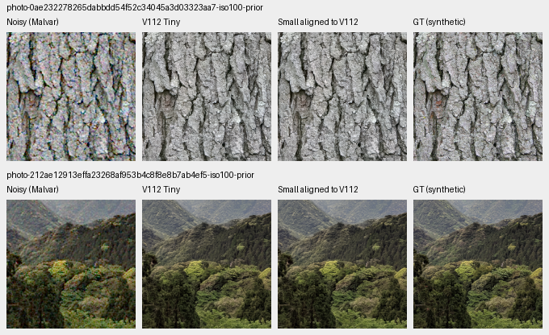
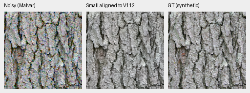
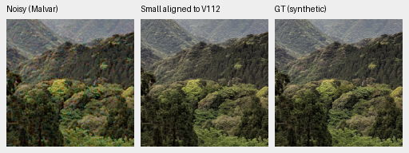

# Small encoder transfer from V112

**The larger frozen DINOv3 Small encoder now has a V112-derived initializer.**
A training-only lateral fit keeps selected photo-condition means within .014dB
of V112 Tiny and keeps the selected ADC biases low. Two adverse-camera
crops remain .20–.32dB worse. This initializer has **zero new joint optimizer
updates**. The subsequent [trained V115 comparison](v114-v115-quality.md)
now improves over V112, with higher known-camera quality and color tradeoffs
against Tiny. V114 is the current general baseline; the initializer results
below retain their original zero-update scope.

[Sources, checkpoint, independent arithmetic audit and native metadata](results/small-v112-lateral-alignment-CPU-v1.json).
The fitted checkpoint is
`/mnt/external/demosaic/Small-V112-alignment-CPU-20261024-v1-v2/Small-aligned-from-V112.pt`,
SHA256 `6b9a863e43ce17594a629440a86388bff93b92b1df33d05c409bd2678cc323e6`.
Its step20000 records inherited V112 history. Its official Small encoder uses
revision `421020015aa4266363db803b6049a529999afb1e`.

## Training-only feature alignment

The fit reuses all 80 cached noisy Malvar previews, Small feature arrays and
spatial sampling positions from the earlier transfer study. It reads no new
source images, repeats no augmentation and decodes no RAWs. All normalized
preview hashes match the original model input. Recomputing Tiny once per source
replays all 320 old V104 lateral targets bit-exactly before producing V112 targets.
One separate source replays the four cached Small feature arrays bit-exactly;
the other 79 Small encoder calls are unnecessary.

Exactly 64 unique training sources fit four affine maps, using fixed standardized
ridge .001 in float64 and float32 installed coefficients. Sixteen different
training sources check transfer. All sources remain in the cleaned 90,864-photo
training manifest. Validation, test and standing GFX captures never enter fitting.
The input is the actual noisy preview; the target is Tiny's lateral output.

Eight weight/bias tensors change. All 83 other V112 EMA tensors, including its
three learned fusion gates, remain exact. Both encoders retain official frozen
weights. On the 16 feature-check sources, error RMS is:

| Stage | Blind Small features with V112 maps | Fitted Small maps |
| --- | ---: | ---: |
| 0 | .16393 | .03978 |
| 1 | .12047 | .03121 |
| 2 | 2.89122 | .36134 |
| 3 | .35823 | .36555 |

The deepest stage does not improve. No ridge sweep or fitting on the following
restoration observations was performed.

## Fixed material and camera observations

The same four held-out photos, three noise conditions and RGGB inputs give
these four-source mean sRGB PSNRs:

| Condition | V112 Tiny | Small aligned to V112 | Difference |
| --- | ---: | ---: | ---: |
| ADC-only | 39.74086 | 39.72745 | −.01341 |
| ISO100 prior | 40.90266 | 40.90232 | −.00034 |
| ISO12800 prior | 33.51165 | 33.51078 | −.00087 |

Five of 12 individual cases improve; changes range from −.09146 to +.06374dB.
These are selected-source results, not the full 427 panel or a training-repeat
estimate. Original Tiny photo scores and native PNGs are reused; those twelve
observations have no retained Tiny float arrays.



[ISO12800 comparison](images/small-v112-alignment/iso12800-prior-0.png).
Both models preserve bark structure and soften high-noise fine canopy detail.

Noisy → **Small aligned to V112** → exact synthetic GT. Both 160×160 crops use
ROI [48,48,160,160] within native 256 contexts, without resizing. Shared WB
[2,1,1.5], the recorded common matrix, display exposure ×1, shot .00002 and read
variance .0000000016 apply to every panel.





[Bark source/ROI/checkpoint/display metadata](images/small-v112-alignment/crop-628448e8846878b4.json) ·
[Canopy metadata](images/small-v112-alignment/crop-35279342f776f1e7.json).

| Selected camera crop | V112 Tiny | Fitted Small | Difference |
| --- | ---: | ---: | ---: |
| Coulicoco | 57.11509 | 56.91245 | −.20265 |
| top_of_Expedit | 60.97539 | 60.65846 | −.31692 |

These measured-CFA PSNRs use the original 448-pixel scoring interiors.
The [native camera comparison](images/small-v112-alignment/camera-0.png) uses
the same selected 160 ROIs and shared +2EV. Two missing Tiny CPU float controls
were generated for this review; their scores match retained GPU scores within
.000004dB. The independently demosaiced AHD reference is auxiliary, **not exact
GT**. Both methods retain blotchy residuals in these dark crops.

## Color and standing GFX scene

Nine fixed palette/condition/CFA observations were checked, including V112's
known worst ADC case 1035. Maximum absolute camera-channel mean bias in selected
ADC fields, DN16:

| Case | V112 Tiny | Fitted Small |
| --- | ---: | ---: |
| gray 787 | 20.79 | 22.01 |
| yellow 1008 | 32.73 | 38.34 |
| green 1035 | 50.89 | 53.39 |

The [native fields](images/small-v112-alignment/color-0.png) show no large transfer
color artifacts. The small bias increase is measured; the full 1,176-case color
tail has not been evaluated for Small.

The GFX boards include [sky, building and foliage](images/small-v112-alignment/gfx-0.png),
then [fence, sign and platform](images/small-v112-alignment/gfx-1.png). Tiny and
fitted Small look close; fine foliage and sign structure remain soft. All are
native 160 sensor-pixel crops from 512 contexts with common +2EV. DSCF3879 ISO6400
is the input; DSCF3880 ISO100 f/5.6 is a separately exposed qualitative reference,
**not GT**. These contexts do not establish complete-frame Small behavior.

## Verification and training

Independent Torch64 arithmetic rebuilds four ridge solutions and fit/check
errors. All80 cached Small feature arrays and their positions remain bit-exact.
The public fitter reproduces all eight coefficients bit-exactly without an
encoder. An independent score audit checks 46 float predictions and 176 metric
fields, and corroborates 12 reused Tiny photo scores against their original
report. SSIM and masked photo metrics retain the public Torch implementation.

All 60 board cells were actually viewed, with exact PNG readback. Two native
triplets match their viewed board cells exactly. The serialized checkpoint
reloads through the public loader and reproduces two recorded ISO100 predictions
bit-exactly. Actual new forward counts are 82 Tiny encodes, 32 Small encodes and 33
restoration forwards. No CUDA occurs; V112 is restored exactly after the pilot.

Two pre-execution mistakes are preserved: an interpreter launch failed at
import, and the first worker rejected a manifest-index assumption. Both had
zero neural forwards or optimizer updates. The corrected worker checks source
IDs and preserves all successful observations without repetition.

The [matched V114/V115 runs](small-aligned-training.md) have continued V112 Tiny and
this fitted Small initializer for 20,000 additional updates each at seed 63.
Both passed eight actual discarded CPU and native 256/B16/BF16 CUDA updates.
Both original runs and all quality stages are complete. The
[trained comparison](v114-v115-quality.md) improves over V112 for both methods,
with Small known-camera/eight-pixel gains and Tiny photo/color strengths.

The [public projection fitter](../scripts/fit_dino_laterals.py) reproduces the
maps from retained training feature pairs:

```bash
PYTHONPATH=src .venv/bin/python scripts/fit_dino_laterals.py \
  --feature-fit /mnt/external/demosaic/Small-V112-alignment-CPU-20261024-v1-v2/feature-fit.json \
  --output /mnt/external/demosaic/Small-V112-alignment-CPU-20261024-v1-v2/refit-example.npz
```

The [earlier V104-derived fit](results/small-lateral-alignment-CPU-v1.json),
[public-fitter verification](results/small-lateral-alignment-public-fitter-v1.json)
and intentionally superseded idle V113 plan remain preserved. The original
blind swap's large artifacts were already measured; that swap was not rerun.

Photo attribution: [Derek Ramsey, bark](https://commons.wikimedia.org/wiki/File:Kentucky_Coffee-tree_Gymnocladus_dioicus_3264px.jpg),
[CC BY-SA 2.5](https://creativecommons.org/licenses/by-sa/2.5/), and
[Grendelkhan, canopy](https://commons.wikimedia.org/wiki/File:Forest_covered_hills_on_Yakushima.jpg),
[CC BY-SA 4.0](https://creativecommons.org/licenses/by-sa/4.0/).
Modifications: 8× binning/cropping, synthetic noise, restoration and common display.
