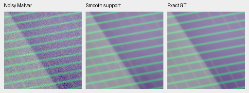
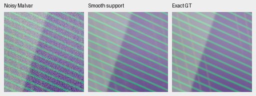

# Localizing a weak mesh correction with RAW support

The smooth support fit reduces added texture inside synthetic ISO400
wire gaps, but can also cut a continuous wire beside an intensity step.
At ISO6400, the held-out check misses the largest false continuation.
Restricting the correction to the weaker direction preserves more of the
existing lattice in the standing cab scenes. [Evidence and native viewing](results/mesh-envelope-support-v1/publication.json).

## Fit a spatially varying wire against a flexible background

The test holds the two candidate frequencies and phases fixed. The local
RAW fit gives each Bayer color its own baseline wire amplitude and fits
one smooth relative amplitude field across colors. The nuisance includes
a smooth background and the stronger wire with spatially varying
amplitude. The candidate field uses 64 quadratic spline coefficients
with ridge regularization. It can describe gaps outside the earlier
disk and strip bank. A low relative amplitude nominates an attenuation
mask. The mask uses the field's 80th percentile as its reference.

Each of two sample groups fits its own mask and refits the constant and
masked wire forecasts before predicting the other group. The combined
fit nominates one more mask for the final audit, using a third group.
The comparisons score the attenuation field actually used for inference.
Both allocations keep the phase reserve outside these fits. The column
allocation uses whole packed columns for each group. The distributed
allocation varies the assignment among packed rows. The tests use
empirical predictive margins. [Method and score archive](results/mesh-envelope-support-v1/evidence.tar.xz).

On the earlier transport panel, the rough fit attenuates 11 of 12
continuous wires. With the exact carrier geometry it still attenuates
10. Subtracting the known clean background or using the input-only
spline background each cuts that count to one. A more flexible phase
model alone leaves 11. This identifies unmodeled background signal as
one source of false cuts. The final mask audit with the smooth
background keeps all 12 continuous development cases.
[Development replay](results/mesh-envelope-support-v1/evidence.tar.xz).

## Fresh exact-target comparisons

The 24 new pairs cover six geometries and two noise priors. Each prior
has six continuous wires, three of them beside an intensity step, and
six gaps, split between disks and strips. The 13-placement median uses
the transported rear phase when it passes the existing RAW checks.
Each localization method uses that same delivered correction. The
rear-only variant attenuates the weaker contribution selected from
the median placement for each output sample.

| Gap policy | ISO400 recovery | ISO400 wire RMS | ISO400 added gap RMS | ISO400 total gap RMS | ISO6400 added gap RMS |
| --- | ---: | ---: | ---: | ---: | ---: |
| Wide support | 97.67% | 50.72 | 81.21 | 113.85 | 33.90 |
| Column gap audit | 97.62% | 50.94 | 54.50 | 103.18 | 33.90 |
| Distributed gap audit | 97.62% | 50.94 | 45.58 | 99.30 | 33.90 |
| Short support | 96.49% | 51.18 | 48.81 | 99.11 | 5.01 |
| Smooth support | 88.45% | 55.54 | 43.38 | 95.88 | 33.90 |
| Distributed smooth | 89.05% | 54.80 | 39.40 | 93.85 | 33.14 |
| Rear only | 88.45% | 56.05 | 46.48 | 95.74 | 33.90 |
| Larger of column and smooth cuts | 88.43% | 55.61 | 31.19 | 92.78 | 33.90 |
| Distributed smooth with step, retrospective | 97.12% | 50.80 | 32.66 | 93.44 | 33.90 |

RMS uses camera-linear DN16. Weak recovery and wire error measure the
present-minus-absent increment across supported wire pixels. Gap error
measures the actual restoration. Added gap RMS measures the change
from the local trunk, including any stronger-wire correction. The
plain spline reduces the gap error while weakening some of the real
wire. The ISO400 step g161 remains continuous in the target. Smooth
support lowers its response from 116.36% to 95.39% and raises wire
error from 50.61 to 54.75 DN16. The distributed step replay restores
all six continuous ISO400 wide-support outputs bit for bit and reduces mean added
gap RMS from 81.21 to 32.66 at nearly unchanged wire error. The step
geometry is fitted on the phase reserve, then supplied to both forecasts.
That choice was made after seeing the smooth mask's false cuts.
[Recomputed scores](results/mesh-envelope-support-v1/summary.json) ·
[Step replay](results/mesh-envelope-support-v1/step-followup.json).

The [prospective contrast-step panel](mesh-step-continuity.md) finds
that a continuous wire with changing contrast can still trigger the
background-only step mask. A side-dependent fit preserves more of
those wires. Direct rear attenuation lowers measured error in the
tested ISO400 rescale cases.

Rotated exteriors and flat roles keep the parent. The wide fit adds
some texture to two front-only controls at ISO400, both using geometry
g163. The step replay leaves those inherited corrections in place.
At ISO6400, short support cuts gap spill but lowers continuous response
from 77.05% to 40.82%. The smooth and discrete audits preserve that
continuous response. They miss the 119.39 DN16 added in the g162 disk.
Supplying its exact gap, carrier geometry and clean background still
fails the combined predictive check. A signed rear-wire color measured
from exterior RAW makes the exact-mask test pass on g161 in the column
allocation. It still misses g162. These controls diagnose evidence
available to the checked fit. [Exact-mask tests](results/mesh-envelope-support-v1/oracle.json) ·
[Signed donor-color replay](results/mesh-envelope-support-v1/color-probe.json).

All case metrics were recomputed exactly from the saved arrays. An
independent least-squares calculation agreed on 18 fixed RAW forecasts.
Three recreated wide-support medians matched the earlier outputs bit
for bit. [Arithmetic verification](results/mesh-envelope-support-v1/verification.json).

The two triplets show g163 (GBRG) and g165 (BGGR), the two largest total
gap-error reductions among the six ISO400 gaps for smooth support.
They share the 160×160 native ROI `[80,80,160,160]` in 320-pixel fields,
noisy Malvar, identity white balance and matrix, ADC16 black fraction
0.03, shot/read `8e-5/2.56e-8`, exposure ×1 and shared reference-centered
display contrast ×8. The synthetic parent is spatial 2k EMA with scene
context bypassed, SHA256
`97fd551bd0ae0b7aa97c67e1f6e8b513b722f70d5ad8b8814a96586b934eafac`.

[g163 comparison](images/mesh-envelope-support-v1/iso400-band-g163-comparison.png) ·
[g165 comparison](images/mesh-envelope-support-v1/iso400-band-g165-comparison.png) ·
[Continuous step false cut](images/mesh-envelope-support-v1/iso400-step-g161-comparison.png) ·
[ISO6400 missed disk](images/mesh-envelope-support-v1/iso6400-disk-g162-comparison.png) ·
[ISO6400 strip](images/mesh-envelope-support-v1/iso6400-band-g161-comparison.png).

## Standing GFX100S review

All eight native crops were viewed. The plain sky, foliage and building
outputs match their prior pixels. Spline attenuation lowers coarse
fence contrast slightly while the crossings remain legible. The right
cab keeps both recovered directions. The rear-only version changes its
contrast less than scaling both directions. On the left, some of the
already faint lattice is softer. The independent ISO100 AHD and JPEGs
show stronger, less uniform detail. Both cab views keep the visible
horizontal wire and background unevenness.

| Crop | Smooth support change | Rear-only change | Distributed smooth change |
| --- | ---: | ---: | ---: |
| Coarse fence | 5.43 | 3.55 | 5.44 |
| Cab left, nominal | 3.33 | 2.15 | 4.07 |
| Cab right, nominal | 4.41 | 2.39 | 4.11 |
| Cab left, transferred | 3.37 | 2.19 | 4.02 |
| Cab right, transferred | 3.64 | 1.81 | 3.36 |
| Sky, foliage and building | 0 | 0 | 0 |

Values are RMS changes in camera-linear DN16 relative to the crop helper
with adjacent donors. The weaker contribution comes from the same
placement that supplied the median combined correction for each output
sample. The direction ordering agrees across all 13 placements of each
active camera fit. The prior discrete gap audit leaves these eight crops
unchanged. [Pixel and view provenance](results/mesh-envelope-support-v1/viewing.json).

The step replay was also viewed across both scenes. The column-based
step fit keeps both left cab crops pixel-identical to the earlier
output, preserving their faint lattice. Its right-cab contrast changes
are smaller than with the plain smooth masks. The distributed step fit
keeps the nominal left crop and still lowers contrast in the transferred
left crop. Sky, foliage and building match the earlier outputs under
both step policies. Some coarse crossings soften slightly.

The parent is local-only 2k EMA SHA256
`ceb5ddaf23fce47806a01045bd86d34bb48d1f64031e382b0d5cfbabf0716880`.
Main DSCF3879 uses exposure ×4 and shot/read `0.00128/6.5536e-6`.
Cab DSCF3842 uses ×16 with that nominal profile and transferred
`0.0014635775921166604/1.0715704128646712e-6`. The DSCF3880 and DSCF3835
ISO100 AHD images and both cab JPEGs are qualitative references. Cells
retain their 160×160 native pixels and matched camera rendering.

[Sky](images/mesh-envelope-support-v1/main-overcast-sky-main-overcast-sky.png) ·
[Building](images/mesh-envelope-support-v1/main-building-detail-main-building-detail.png) ·
[Foliage](images/mesh-envelope-support-v1/main-foliage-main-foliage.png) ·
[Coarse fence](images/mesh-envelope-support-v1/main-chain-link-fence-main-chain-link-fence.png).

| Cab profile | Native comparisons |
| --- | --- |
| Nominal | [Left](images/mesh-envelope-support-v1/mesh-nominal-fine-green-mesh-left.png) · [Right](images/mesh-envelope-support-v1/mesh-nominal-fine-green-mesh-right.png) |
| Transferred | [Left](images/mesh-envelope-support-v1/mesh-profile3879-fine-green-mesh-left.png) · [Right](images/mesh-envelope-support-v1/mesh-profile3879-fine-green-mesh-right.png) |

Step replay with the same ROIs and profiles.
[Nominal left](images/mesh-envelope-support-v1/step-mesh-nominal-fine-green-mesh-left.png) ·
[Nominal right](images/mesh-envelope-support-v1/step-mesh-nominal-fine-green-mesh-right.png) ·
[Transferred left](images/mesh-envelope-support-v1/step-mesh-profile3879-fine-green-mesh-left.png) ·
[Transferred right](images/mesh-envelope-support-v1/step-mesh-profile3879-fine-green-mesh-right.png).

These masks remain experimental. The evaluation covers fixed crops
over a frozen checkpoint. [Full-checkpoint PSNR history](performance-history.md).
