# Selecting connected wave support strengthens the mesh

**Refitting waves inside estimated support raises fresh dark-mesh response 12.8%
and lowers mean added blank-region RMS 34.0% versus refined TV.** The real lattice
has stronger contrast under both priors, while recovery remains soft and uneven.
The worst fresh blank RMS is 39.2% higher. This is an additional `sparse` option;
fixed-bin `edge` remains the optional stage's default. Flat-region safety and
broad superiority are unproven.

[Implementation](../src/demosaic/phase_sparse.py) ·
[CUDA implementation](../src/demosaic/phase_sparse_cuda.py) ·
[Execution and validation](results/sparse-phase-support-publication-v1.json) ·
[Source/ROI/checkpoint/noise/display metadata](images/sparse-phase-support-v1/manifest.json).

## What changes

The [refined-frequency TV method](offgrid-phase.md) smooths local sine/cosine
coefficients before adding a wave to the parent. Its coefficients can stay weakly
nonzero beside real texture. Adding a group penalty encourages exact zeros, but
also dims real detail. The new method selects support with that penalty, then
refits coefficients inside the retained regions without the group penalty.

For local sigma 16 coefficients `z` and their noise-standard-deviation proxy `s`:

1. Approximately minimize
   `0.5*sum((u-z)^2) + sum(16*s*norm(gradient(u))) + sum(0.5*s*norm(u))`.
   Each norm shares both sine/cosine components; the gradient norm also shares
   both spatial axes.
2. Keep locations whose power exceeds 9 under the original Gaussian32 covariance.
   Retain four-connected components of at least 805 packed coefficient cells,
   `ceil(4*pi*(16/2)^2)`, a Gaussian correlation-area heuristic.
3. Refit by minimizing `0.5*sum((v-z)^2) + sum(4*s*norm(gradient(v)))`, with
   `v=0` outside the retained support.

Synthesis keeps the original RGB phasor transport, post-refit power shrink 9,
magnitude cap 3, global gate 9, 32-pixel aprons and native 256/stride 128 blending.
Continuous frequency search and its original inactive gates are unchanged.
Observed clipping retains the exact earlier grid-TV path. No references, GT,
RNG or learned-weight updates enter correction.

The estimated mask, correlation-area rule and Gaussian32 covariance **are not
calibrated confidence**. Reusing noisy input for selection and fitting can still
produce boundary leakage. The numerical optimization gap concerns a fixed
objective; it is not a false-positive probability.

## Running the option

```bash
source scripts/env.sh
uv run demosaic infer /mnt/external/demosaic/models/v143-final5000.pt photo.raf \
  /mnt/external/demosaic/output/photo-sparse-linear.tiff \
  --preview /mnt/external/demosaic/output/photo-sparse-srgb.tiff \
  --shot 0.00128 --read 0.0000065536 --precision float32 \
  --tile 512 --overlap 64 --batch-size 4 \
  --phase-harmonic --phase-harmonic-envelope sparse
```

`sparse` automatically includes guarded frequency refinement. `edge` retains
fixed-bin TV; add `--phase-harmonic-refine-frequency` for its earlier continuous
variant. `complex` and `scalar` retain previous envelopes. Ordinary inference
still leaves the entire stage disabled. The TV device follows the neural device;
`--phase-harmonic-device cpu` selects the NumPy reference. Example noise values
are tested priors, not universal camera calibration. Sidecars record method v5,
support/refit settings, component size and both solvers' achieved gaps/caps.

## Development, a failed trial, and a new holdout

Six group-sparse settings were compared on 128 reused recipes/1024 observations,
then four support/refit settings. Direct sparsity reduced spill but dimmed the
mesh. Support TV16/group multiplier 0.5 followed by refit TV4 raised mean response
13.4% and lowered added blank RMS 39.1% on that development sample. A stronger
refit based on weaker support increased spill; those results remain preserved.

The first setting was locked before 96 new recipes/768 actual V143 root/DINO
calls. It improved mean response and spill but created a small isolated stripe
patch in exact-blank support. Its worst added blank RMS rose 1.52→2.58 DN16.
The amplified native control exposed this failure. That 96-recipe set then became
development data; it is **not held-out validation for the final component rule**.

The false island contained 229 packed cells. Minimum areas 202 and 805 were tested
across all 224 development recipes/1792 observations. 805 removed the island while
retaining essentially all mean response; stronger real lattice contrast remained.
The threshold follows the fitting-kernel scale and is a heuristic, not a proof
that larger components contain real texture.

Noisy → V143 → refined TV → failed unfiltered refit → final connected support →
**exact procedural GT**. Fixed first-failure ROI `[0,96,160,160]`, seed 0782/GRBG:

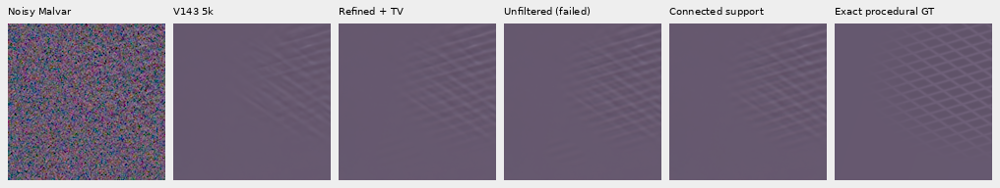

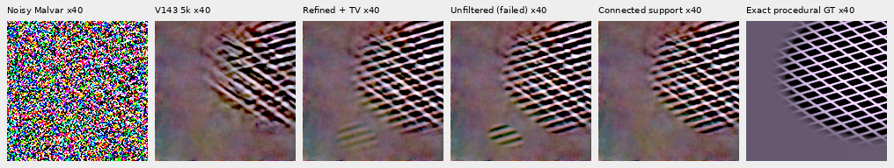

The amplified row applies `empty +40*(value-empty)` in camera-linear space before
the same WB/matrix/+3EV. `empty` is the shared exact-empty synthetic field used
only for display. Pixel coordinates and sizes are unchanged. Existing parent
noise and boundary spill remain visible; removal of this island is a bounded
result, not a general hallucination guarantee.

## Independent final validation

The connected-805 policy was frozen before 64 further recipes,
seeds 2026110900–2026110963: **512 new V143 root/DINO calls**, present/absent×four
CFAs, zero new V120 controls or training. The first failed trial and final trial
therefore total 1280 actual root/DINO calls and 1280 sensor-noise observations.
All model/backbone/input/RNG integrity checks pass. Every method shares the same
actual parent predictions, rather than counting correction calls as neural calls.

Native 256 uses continuous 512→geometry→area2 generation, zero optical PSF,
level 0.02, shot 0.00128/read variance 6.5536×10⁻⁶, ADC16/black 0.03. GT enters scoring
only. Checkpoint SHA256:
`96d146d017c54196288c585f8b7eddcf030e8a235061049c31e985b9380b7ce4`.
[Final lock](results/sparse-phase-support-locked-policy-v2.json) ·
[All final scores](results/sparse-phase-support-prospective-v2.json).

Final sparse correction changes 41 present cases from 14 recipes; 50 recipes retain
every parent value. **All 256 fresh absent inputs retain every parent value.**
These are means across all 256 present cases. Mean per-case RMS is not pooled
pixel RMS or evidence from independent training runs.

| Final dark present cases | V143 parent | Grid TV | Refined TV | Connected support/refit |
| --- | ---: | ---: | ---: | ---: |
| Known-template gain, ideal 1 | .02382 | .06403 | .06553 | .07390 |
| Native 160 spatial error, RMS DN16 | 14.48927 | 13.23985 | 13.19708 | 13.07934 |
| Complete 256 error, RMS DN16 | 11.91387 | 11.08727 | 11.05770 | 10.98928 |
| Added field in exact-blank pixels, RMS DN16 | 0 | .05581 | .06207 | .04099 |
| Error in those blank pixels, RMS DN16 | 6.42698 | 6.43059 | 6.43116 | 6.43021 |
| Worst per-case added blank RMS, DN16 | 0 | 1.32597 | 1.43444 | 1.99739 |

Versus refined TV, response rises 12.77%, spatial error falls 0.89%, complete error
falls 0.62% and mean added blank RMS falls 33.96%. **The improvement is nonuniform:**
10 cases increase blank GT error, eight add more blank RMS and one loses template
response. Worst per-case added blank RMS rises 39.25%. Maximum blank-GT-error
increase is 0.13462 DN16, seed 0957/RGGB. Both corrected methods still exceed parent
mean blank error. Most very weak recipes remain undetected.

The unfiltered control on this same holdout has essentially identical response
but mean added blank RMS .04285 versus final .04099. Component filtering removes
small islands; it does not remove all leakage around the larger retained regions.

## Native exact-GT examples and the remaining tail

Noisy Malvar → final sparse correction → **exact procedural GT**. Native 160 cells
at `[48,48,160,160]` share WB/matrix/+3EV. Examples are the first two active seeds
(preferring RGGB when active), the largest blank-error regression and the first
fully inactive recipe. Selection follows the completed evaluation. Full six-way
comparisons and all source metadata are in the manifest.

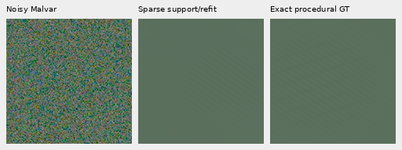

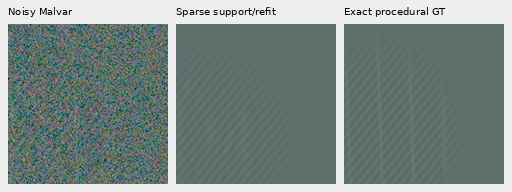

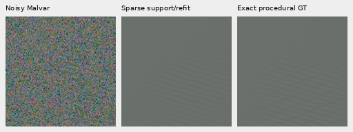

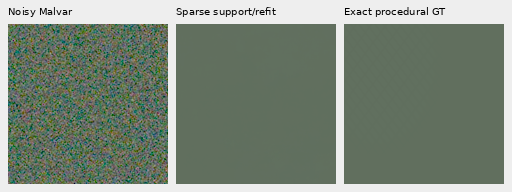

The final worst-regression control fixes ROI `[96,30,160,160]` around the maximum
added-field pixel in exact-blank support. It shows stronger continuation beyond
the true mesh boundary. This remaining failure is why `sparse` stays opt-in.

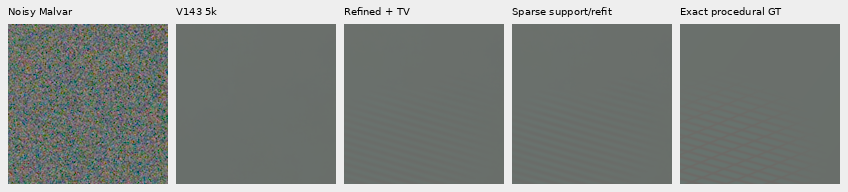

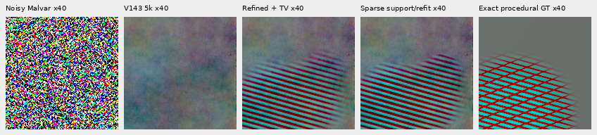

## Complete GFX frames

All three complete 101.996MP V143 parents and normalized RAW arrays are reused
exactly: main DSCF3879 fixed historical Haar; DSCF3842 fine mesh under nominal and
nearby-Haar priors. Neither the unfiltered nor final full run adds neural calls,
RAW decoder opens or noise draws. Existing local ISO100/AHD arrays and both camera
JPEGs are reused. Source drives remain untouched, originals read-only, and test
siblings excluded from training. All independent ISO100/JPEG comparators are
**not exact GT** because aperture, exposure, motion and processing differ.

Main rows: noisy → V120 → V143 → grid TV → refined TV → sparse support/refit →
DSCF3880 ISO100. Original ROIs, native 160 pixels, WB/matrix and common +2EV remain.
Foliage stays painterly; changes in building and larger fence detail remain small.

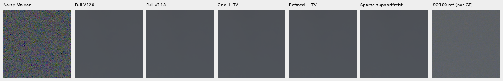

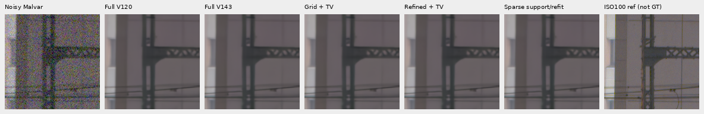

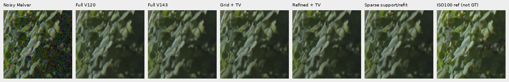

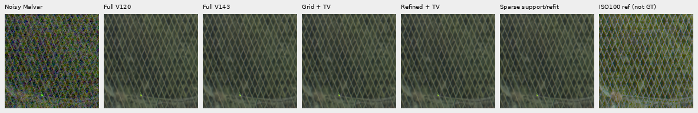

Fine-mesh rows: noisy → V143 → grid TV → refined TV → final sparse → DSCF3835
ISO100. Left/right ROIs begin `[806,6489]`/`[1026,6449]`, with the original integer
reference translation and common +4EV. Nominal shot/read is 0.00128/6.5536×10⁻⁶;
nearby is 0.0014635775921166604/1.0715704128646712×10⁻⁶, fixed from DSCF3879,
not calibrated to this capture. The lattice has more contrast, especially right,
but stays soft, uneven and substantially weaker than ISO100. Window placement
still matters; centred development differences are stronger than some full-grid
locations.

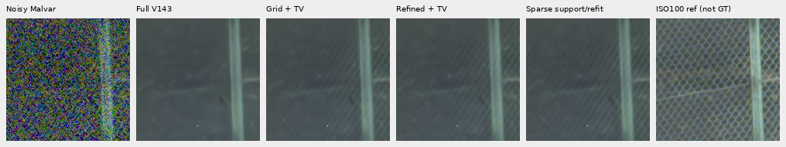


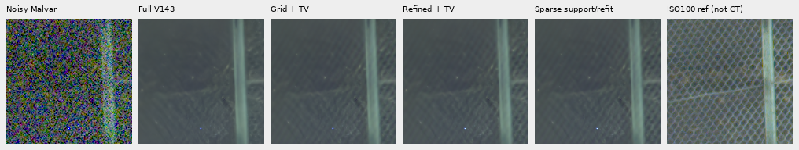

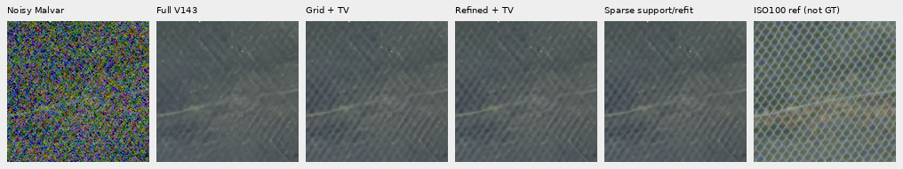

JPEG rows: noisy → V143 → final sparse → ISO6400 JPEG → independent ISO100 AHD →
ISO100 JPEG. All native cells keep common +4EV; JPEG processing differs.

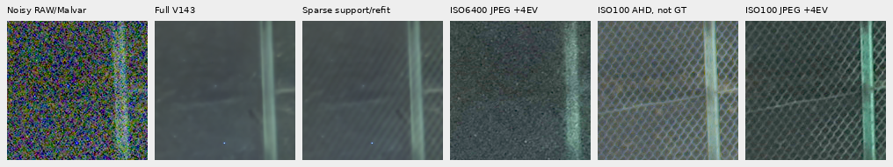

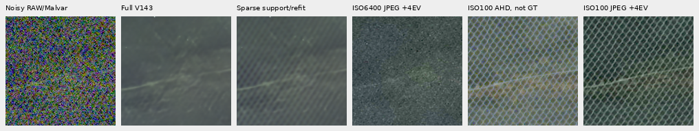

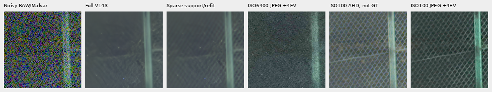

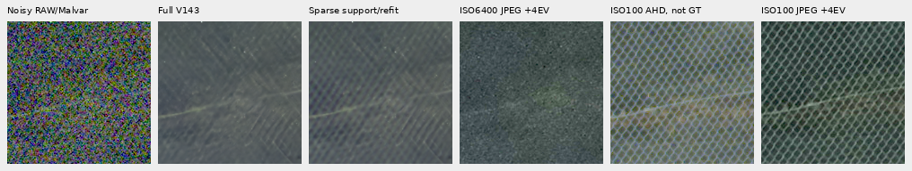

## Flat support, highlights and solver cost

All 96 fixed photographic and 48 uniform inputs per V120/V143 parent retain every
value. The same 2.88MP sky box `[5200,200,2400,1200]` retains every parent channel.
Earlier 4096 independent flat-noise observations and 924 large-uniform windows
selected zero peaks; unchanged selection gives the same bypass. These are
derived checks from preserved receipts, not newly drawn or reexecuted inputs.

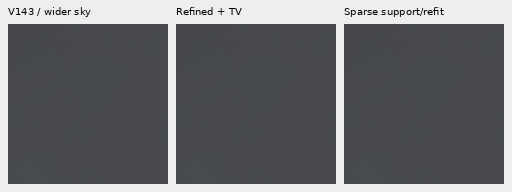

Observed-clipping fallback retains the earlier grid-TV path. Complete-frame
maximum changes remain 8,288/11,638/12,083 DN16 for main/nominal/nearby. The
common−2EV strongest-change views retain independent ISO100/AHD controls:

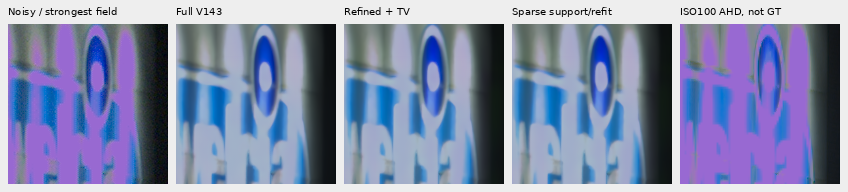

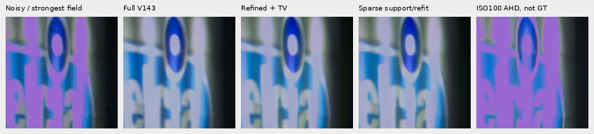


The earlier highlight color/brightness disagreement remains. Matching a prior
result or limiting its maximum added field does not establish correct color.

Both convex subproblems use ADMM gradient penalty 16, second-split penalty 1,
maximum 1024 iterations and target relative primal/feasible-dual gap 1e−5, checked
every 8 steps. Returned fields satisfy their support/soft-threshold constraints.
The FFT extension concerns coefficient fields, never Bayer samples. In final
fresh validation 49/57 support solves cap, maximum gap 7.01×10⁻⁵; all 57 masked
refits reach the target. Complete real frames are less converged:

| Complete final refinement | Seconds | Support solves/capped | Output TV solves/capped | Maximum support gap |
| --- | ---: | ---: | ---: | ---: |
| Main fixed Haar | 538.55 | 704/487 | 1080/56 | 3.63×10⁻⁴ |
| Mesh nominal | 214.29 | 43/31 | 329/24 | 1.33×10⁻⁴ |
| Mesh nearby Haar | 534.32 | 702/401 | 1150/77 | 1.09×10⁻³ |

Output-TV counts include masked refits and clipped-window grid-TV fallbacks.
Three contended CPU threads share CUDA solvers, with one BLAS/Torch CPU thread
each; a separate CPU audit also ran. These are refinement observations, not a
controlled speed ranking or fresh end-to-end neural benchmark. 100MP/10s remains
unmet. All 76 current package modules match the frozen final execution; the earlier
unfiltered 76-module source/output snapshot and original 74-module helper tree
remain preserved.

## Verification and remaining work

Independent joint 10-column affine/template fits check all 2560 final metric rows,
maximum gain difference 3.04×10⁻¹⁴. Public CPU versus locked private GPU checks
cover 100,663,296 final values, maximum difference 3.47×10⁻¹⁸. Public CUDA matches
201,326,592 private final/legacy values exactly, including 512 earlier refined-TV
cases. Original selection/WLS/envelope helpers are unchanged. The private final
evaluation uses the archived helper tree matching its locked hashes; learned
parent inference has its separately verified source snapshot.

**108 relevant tests pass**, including independent analytic sparse-TV/masked-TV
solutions and gap bounds, rotation, exact support, connectivity, all four CFAs,
clipped-window equality, CUDA state/RNG checks and actual CLI/export dispatch.
The CLI test declares its neural stub separately from 1280 actual neural calls.

All 917,962,668 final linear RGB16 channels verify exactly against FP32
clip/round/orientation; complete sRGB16 matches independent float64 within 1 DN16,
with 16-bit/ICC tags verified. Independent rendering/native-copy checks cover
12,134,400 PNG channels across 30 actually viewed boards, including both amplified
controls. No crop pixels resize.
[Final audit](results/sparse-phase-support-native-audit-v3.json) ·
[Independent metrics](results/sparse-phase-support-independent-audit-v2.json) ·
[Port compatibility](results/sparse-phase-support-port-audit-v2.json).

V120 remains the validated general model recommendation; V143 full427/camera
quality is unmeasured. Gaussian coefficient smoothing already blurs support
boundaries; connectivity alone does not undo that limitation. Incomplete weak
detail, connected boundary spill, uncalibrated uncertainty, original highlight
color, placement sensitivity and speed remain open. The improvement goal stays
active.
