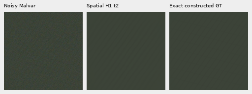
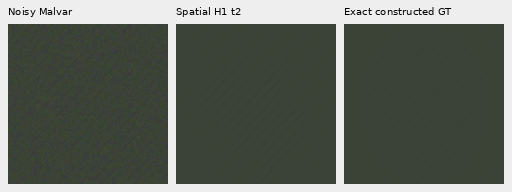
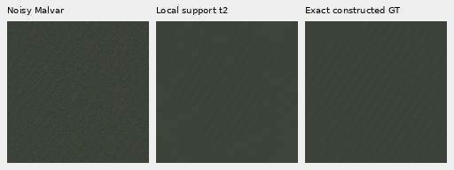
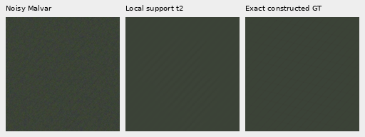
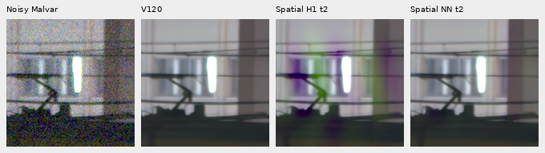

# Local amplitudes recover more synthetic detail but restore building bands

**Local129 amplitude fits raise400/far weak response2.702%→6.241% over the
global-amplitude Hann analytic arm, but add severe green/magenta building
bands.** Weak-increment error improves versus parent, with quiet error+0.168%.
The matched neural-nuisance arm reaches6.043% response and reduces those bands,
but its building correction still rises1.95→41.87 DN16 versus global Hann.
Keep both global-amplitude alternatives available; this explicit local-fit
ablation does not improve the general real-photo recommendation. Fine cab
crossings remain missing.

All48 predictions, independent audits and actual inspection of36 figures are
complete. [Native viewer](images/neural-nuisance-spatial129-v1/native-viewer.html) ·
[Exact receipts/executed sources](results/neural-nuisance-spatial129-v1/publication.json).
This reuses two development sources/RGGB/repeat0 across three priors and two
placements, not independent camera-generalization evidence.

|400 / far, local threshold2|Weak response|Strong response|Quiet RMS DN16|Weak-increment RMS DN16|Full RGB RMS DN16|
|---|---:|---:|---:|---:|---:|
|V143 parent|0.958%|33.783%|4.00857|11.78863|21.77841|
|Global Hann analytic|2.702%|37.587%|4.00872|11.77761|21.73732|
|Global Hann neural|2.304%|37.565%|4.01108|11.78409|21.73904|
|Local129 analytic|6.241%|52.053%|4.01531|11.75966|21.66047|
|Local129 neural|6.043%|46.992%|4.02525|11.76328|21.67411|

Against parent, analytic weak-increment/full RGB error fall0.246%/0.542%;
neural weak-increment error falls0.215% with quiet+0.416%. Source0 analytic
weak response rises1.014%→4.066% while increment error barely changes
8.82672→8.82670 DN16. Source1 rises0.902%→8.416% with error14.75054→14.69262,
driving nearly all mean increment-error improvement. Neural source0 error
worsens8.82672→8.83908. More projected amplitude alone is insufficient.

|Prior / placement|Analytic weak response|Strong response|Quiet error vs parent|Weak-increment error vs parent|
|---|---:|---:|---:|---:|
|400 / near|3.585%|27.538%|+0.0050%|+0.1365%|
|400 / far|6.241%|52.053%|+0.1680%|−0.2457%|
|1600 / near|4.281%|3.834%|+0.0004%|+0.2616%|
|1600 / far|0.927%|25.950%|+0.1562%|+0.3459%|
|6400 / near|0.407%|0.550%|0|0|
|6400 / far|0.257%|1.081%|approximately0|+0.0201%|

All six matched global/local raw-wave/conditional/neural controls and fixed
thresholds0/2/4 are retained. The
[quiet](images/neural-nuisance-spatial129-v1/plots/quiet-tradeoff.png) and
[increment](images/neural-nuisance-spatial129-v1/plots/increment-tradeoff.png)
curves show larger response/error tradeoffs at threshold0. No threshold or
window was selected after these outcomes. Higher-noise weak detail remains
mostly absent, with1600/far response decreasing despite stronger strong-family
response.

A post-closure diagnostic motivated the change. It freezes the actual Hann
geometry, variance, nuisance, operators and scores from each noisy role2 input,
then passes the known exact weak increment through that fixed linear map.
Global ungated signal transfer is only3.35%/4.94%; threshold2 leaves1.14%/1.77%
for the analytic arm. All four actual analytic/neural outputs reproduce exactly.
This is an **oracle mechanism diagnostic**, not an inference quality result:
GT enters only the diagnostic linear input, never discovery or delivered
restoration. Narrow wire shape, finite support, frequency error and support
weights can all limit transfer; the diagnostic does not assign a unique cause.

The [new operator](../src/demosaic/spatial_carrier_amplitudes.py) keeps the
native512 Hann/complete-edge geometry and A-only variance fixed, while fitting
per-color amplitudes on native129 boxes at stride32. Every query fits the full
model and each direction's conditional null from A only. Column-normalized
Gram inversion uses a fixed1e-8 eigenvalue cutoff, equivalent to1e-4 SVD cutoff;
rank-deficient nuisance columns are handled by the same pseudoinverse rule.
Native coefficient interpolation supplies predictions for genuinely withheld
B samples. Only after validation does the same linear operator project the
parent. This changes local nuisance coefficients as well as carrier amplitudes;
it does not prove that the new bands have one identified cause.

Use `LocalWaveConfig(window=512, stride=256, edge_search="full-frame",
frequency_weighting="hann-inverse-variance", amplitude_window=129)` with
`demosaic.local_validated_waves.restore_conditional_waves` for the analytic
variant. It requires no neural nuisance fields. `amplitude_window=0` retains
global amplitudes and remains the default. The six-control producer adds
`--amplitude-window 129` to the [Hann recipe](neural-nuisance-hann512.md).
[Standalone API source/equivalence evidence](results/neural-nuisance-spatial129-v1/public-api-addendum.json).
Both trials reuse88 exact nuisance fields, **zero new neural/DINO forwards**,
and close all48 corrections before target/reference analysis. Native256
materials retain the input-dimension-only fallback.

Noisy Malvar → local129 analytic → exact constructed GT, sources0/1:

Matched neural-nuisance outputs:

All four crops are native160 from512-native400/far two-direction frames,
ROI`[176,176,160,160]`, exposure2/contrast1, shot/read`8e-5/2.56e-8`, recipe
seed202611160500 with saved per-source WB/matrix. Crop pixels are never resized.
Model/configuration SHA256:
`7ddc9c727de96f35c825de85c757c38a97208740e379553c29dce602ff8346f2`.
Procedural V143 parent:
`96d146d017c54196288c585f8b7eddcf030e8a235061049c31e985b9380b7ce4`.
Photographic parent/frozen teacher V120:
`a9d9b6b4f974e24a6b11e5e740aab32314233a7f53c056cf37c7d2aac1c589fb`.
DINO backbone:
`691963f0f796aac860d818d59d9d14287a4675612829fbe9467c7f5df8ce5b14`.

The analytic building maximum is306.78 DN16 at`[72,270,160,160]`; the retained
historical failure ROI`[76,260,160,160]` gives306.63. The actual native view
shows severe green/magenta bands and altered rail contrast. The neural maximum
is41.87 DN16; it reduces the artifact without supplying a real-photo gain.
These are changes from V120, not errors against real GT.

Both standing GFX families are fully retained: DSCF3879/3880 sky/building/
foliage/coarse fence and DSCF3842/3835 fine cab mesh, both profiles/ROIs/JPEGs.
Sky remains quiet, foliage soft, and fine cab crossings absent. Independent
ISO100/AHD references differ in aperture, exposure time and moving subjects;
they are qualitative, **not exact GT**, and never receive pixelwise scores.
Only local caches are accessed; protected captures/JPEGs/siblings remain
outside training and original media read-only.

Independent audits check3,819 fields,228 finite/114 material rows and14,131,200
encoded channels, maximum discrepancy`2.78e-15`. The pre-correction input audit
checks88 fields/70,778,880 finite FP32 values and exact imputation fingerprints.
All36 published figures were actually inspected in eleven unresized contact
sheets. The157-test suite includes independent query SVDs, CFA withholding,
constant preservation for a fixed operator, compact-signal reconstruction and
both standalone analytic controls. The public conditional API reproduces36
closed outputs per global/local study exactly, including building/both cab
profiles/zero noise, with no neural fields or GT RGB loaded. CPU correction
takes314.01s under concurrent work, not a100MP speed measurement. Initial test,
API-check and publication failures remain preserved; all207 partial-publication
file contents also occur byte-for-byte in the completed publication.

This separates a useful synthetic response/error gain from a serious real-photo
failure. Fixing local background/parent transfer without discarding supported
finite detail remains necessary.
The [global-background follow-up](global-background-local-carriers.md) freezes
the broad nuisance coefficients and localizes only residual carriers. It
reduces neural building correction41.87→15.55 DN16 with lower weak response;
analytic bands persist. The local nuisance-coefficient explanation is therefore
incomplete. Its full source/CFA/noise comparison is separately running.
