# Spatial-support wave readout: completed quality

V185 is a useful incremental update to the direct wave readout: **more weak-mesh response and less quiet-field error than V184 at the same new-head training budget.** It still leaves false fine striping, broad colored mottle and incomplete real cab-fence crossings. It becomes the current experimental wave-readout option; V120 Small remains the general recommendation. No new full-photo speed result or broad benchmark establishes a replacement for that model.

## Matched measurements

These are relative changes of paired-suite means, raw versus V184 raw and EMA versus V184 EMA. Each endpoint uses the same 822 fixed development inputs; the suite has been reused during development.

| Measure | V185 raw | V185 EMA |
| --- | ---: | ---: |
| Present mesh signed response versus matched V184 | +2.10975% | +0.45256% |
| Absolute response as percent of exact constructed GT | 4.96761% | 5.17091% |
| Present mesh whole RMS | −0.07975% | −0.00352% |
| Present mesh blank RMS | +0.00424% | −0.00150% |
| Absent mesh whole RMS | +0.00322% | +0.00133% |
| Absent mesh crop spatial RMS | +0.01630% | +0.00507% |
| Quiet total RMS, ISO6400 / ISO12800 | −0.42278% / −0.33588% | −1.03108% / −0.66256% |
| Quiet spatial RMS, ISO6400 / ISO12800 | −0.54732% / −0.41930% | −1.37533% / −0.83327% |
| Standalone flat whole RMS, ISO6400 / ISO12800 | +0.00192% / +0.00289% | +0.00096% / +0.00133% |

Mesh response increases in 170/256 raw and 138/256 EMA inputs. Whole-mesh RMS improves in only 91/256 raw and 71/256 EMA inputs despite the lower means; the mean improvement is uneven. Quiet spatial RMS improves in 25/32 raw and **all32 EMA** inputs; quiet total RMS improves in27/32 raw andall32 EMA. Quiet DC also falls slightly. Standalone flat whole RMS worsens in47/48 raw and43/48 EMA inputs. Absent-mesh whole RMS worsens in254/256 raw and225/256 EMA inputs. Signed absent gains are1.1998e-5 raw and1.1006e-5 EMA; no relative percentage is assigned to these near-zero signed quantities.

Natural fine-band response rises in all four cohort/contrast means: +0.01261–0.06975% raw and +0.00378–0.02318% EMA. Relative band-error means worsen in three of four raw groups and one of four EMA groups; 68/128 raw and62/128 EMA individual band errors worsen. This is a small response change, not universal detail recovery.

Against frozen V183 EMA, mesh response is +11.9081% raw / +16.4881% EMA, but quiet spatial RMS remains **+0.3425–0.3836% raw / +0.9386–0.9585% EMA**. Smaller support recovers part of V184's quiet cost rather than removing it. Versus V180 EMA, response is +9.2160% raw / +13.6858% EMA, while quiet spatial RMS changes −0.1099%/+0.2528% raw and +0.4424%/+0.8682% EMA at ISO6400/12800. V161 harmonic EMA retains more mean mesh response: V185 is −5.1957% raw / −1.3157% EMA, while quiet spatial RMS is lower by5.05–7.86% onall32 inputs. All23 methods, including V173's quieter alternative, remain in the complete tables and native boards.

## What was actually visible

All60 native figures were viewed in15 original-detail sheets, then journaled. On mesh2302, the normal display remains almost uniform; contrast40 reveals stronger fine periodic modulation on a broad colored field, far from the exact target lattice. Mesh2309 still loses the weak crossing orientation. V185 versus V184 changes are small. In absent mesh and dark standalone flats, broad green/purple blotches persist. Normal gray and bright flats look much smoother than their amplified views.

The protected main scene retains a smooth-looking sky at exposure4, coarse chain-link strands, and soft building/foliage detail. For the difficult green cab mesh, both fixed ROIs and both nominal/main3879 noise profiles remain soft and incomplete. Small changes in strand contrast do not establish clearly completed new crossings. Bird feathers, butterfly markings and bark also remain softer than constructed references.

Quiet steps, narrow bars, slanted edges and stripe patches retain false fine vertical/diagonal modulation atcontrast40, with some faint banding atnormalcontrast. Some modulation is reduced relative to V184, especially EMA; broad casts remain. Exact ADC bark, fur, gray and sloped-plane controls stay inherited. This does not establish clean noisy skies or absence of hallucinated detail.

## Architecture and execution

The [implementation and preparation](spatial-context-wave-readout.md) retain the65-packed-pixel wave basis and the same selected bins. Two additional33/17-packed-pixel windows atstride8 provide12 context channels. The head grows316→508 parameters (18→16→12); old six hidden input weights/bias are copied exactly, extra inputs and final mixing start zero. All189 V183 EMA tensors remain frozen/eval. Overlapping RAW measurements reuse noise; they are not calibrated confidence or independent evidence tests.

A fresh900-update run uses V184's same1,000 cached rows,3,600 noisy images,100 ADC skips, allnine losses, clean masks, domain weights, learning-rate schedule and head EMA clock. The extra192 parameters and additional spatial context change together. Genuine row8restore resumes9 without replay. Five factored checkpoints retain raw head/Adam/EMA/RNG and bind the immutable V183 initializer; all reconstruct193 strict tensors. Training peak allocation6.22351GiB; review2.78617GiB. The 100MP/10-second objective remains open.

Original training and review are terminal. The training audit checks all900 FP32 nine-term totals/masks/clocks and1,890 inherited-tensor comparisons across five checkpoints. The quality audit checks6,576 input fingerprints,1,644 V183 EMA and1,644 V169 exact replays,144 ADC outputs,750 equal raw/EMA input-evidence pairs and750 equal support-fingerprint pairs. It independently decodes72 RGB and72 wave arrays, checks53,772,288 ordered baseline+wave channels,510 ordinary native metric scalars plus72 wave RMS scalars (582 total),278 Decimal summary means and378 inherited-tensor comparisons. Reduction retains23 methods/18,906 rows/42 contrasts/1,554 table cells,3,147 Decimal means and15,540 paired mean/difference checks. Rendering independently checks8,294,400 new and72,883,200 unchanged displayed RGB channels. No old scientific inference was rerun.

Native arrays are lossless: checked FP32 addition recipes reference immutable V183 RGB and compressed waves, with XOR fallback when necessary. No bits are quantized, including signed zero. Native storage is130.434MiB for144 arrays, versus410.25MiB of uncompressed array bytes. Journals and full paired tables use losslessgzip. Completed duplicate arrays, source snapshots and receipts share storage while retaining every original path and content hash; original captures, caches, checkpoints and machine receipts retain their bytes.

## Crop, checkpoint and reference metadata

The representative triplets are fixed mesh seeds2026112302/2309,512×512 RGGB contexts, native ROI`[176,176,160,160]`, shot`.00128`, read variance`6.5536e-6`, exposure8, contrast1. Contrast40 boards use the same pixels and transforms across methods. Quiet ROI`[80,176,160,160]` uses exposure8 and contrast40 about camera RGB`[.001500000013,.006000000052,.002666666871]`; ISO12800 uses shot`.00256`, read variance`2.62144e-5`. Every160×160 crop is unresized. The manifest carries each complete input/source/ROI/noise/display binding.

Training checkpoint SHA256: `4bce120381d4c5208e17f10e43a450b0e00884dcbb8f6a7b632312a714787d9f`. Raw module-state SHA256:`485b7b36d61586f3a10c588f88945037cc180b3e8e30633f08ba14a0081deaa9`; EMA:`6a7e4fa774520ad2e3437d7ec4330c4b2d5e4b006bf6e1bca4054c66e47b668b`. The factored checkpoint binds the immutable V183 EMA initializer export`b713608498158b24b09da72c8079d6eae58bc2458f7d4ac63d493b7b679f63b3`. Both full strict exports and all14 viewer states have separate checkpoint/state metadata.

Main GFX inputs are cached DSCF3879 ISO6400 and DSCF3880 ISO100; sky/building/foliage/coarse-fence crops remain in the report. Cab inputs are cached DSCF3842 ISO6400 and DSCF3835 ISO100, with both SOOC JPEGs, context`[600,6260,768,768]`, ROIs`[206,229,160,160]`/`[426,189,160,160]`, exposure16. ISO100/AHD/JPEG panels are independently processed qualitative references, **not exact GT**: aperture, exposure time, motion and processing differ. Captures/JPEGs/siblings remain excluded from training. No originals or unavailable dataz were accessed.

[Exact evidence](results/v185-spatial-context-final-v1.json) · [Native-pixel viewer](images/v185-spatial-context-v1/native-viewer.html).

# Spatial-support wave readout and retained flat/local/global/control comparison tables

RMS values are camera-RGB DN16. Signed gain 1 is exact constructed amplitude. Real ISO100 references are unscored. This reused development suite is not blind validation.

## New readout and retained local/global/control

### Mesh response and blank error

| Metric | V178-control-raw | V178-control-EMA | V178-evidence-raw | V178-evidence-EMA | V180-local-phase-raw | V180-local-phase-EMA | V181-flat-spatial-raw | V181-flat-spatial-EMA | V183-coherent-pair-raw | V183-coherent-pair-EMA | V184-wave-readout-raw | V184-wave-readout-EMA | V185-spatial-context-raw | V185-spatial-context-EMA |
| --- | ---: | ---: | ---: | ---: | ---: | ---: | ---: | ---: | ---: | ---: | ---: | ---: | ---: | ---: |
| Present full RMS | 8.954916 | 8.957374 | 8.950154 | 8.953061 | 8.876450 | 8.877083 | 8.906324 | 8.907939 | 8.876014 | 8.876582 | 8.818888 | 8.793299 | 8.811855 | 8.792990 |
| Present signed template gain | 0.03888490 | 0.03887981 | 0.03924275 | 0.03923549 | 0.04521940 | 0.04548425 | 0.04143345 | 0.04150431 | 0.04422806 | 0.04439006 | 0.04864969 | 0.05147617 | 0.04967608 | 0.05170912 |
| Present blank RMS | 5.610388 | 5.613564 | 5.610671 | 5.614318 | 5.616159 | 5.620176 | 5.604892 | 5.607879 | 5.609462 | 5.612432 | 5.610517 | 5.611432 | 5.610755 | 5.611348 |
| Present blank spatial RMS | 5.428461 | 5.428190 | 5.429207 | 5.429165 | 5.435846 | 5.437361 | 5.421840 | 5.421916 | 5.426760 | 5.427226 | 5.425229 | 5.426176 | 5.425480 | 5.426093 |
| Present blank DC RMS | 1.302865 | 1.315066 | 1.301321 | 1.314366 | 1.297771 | 1.306773 | 1.305530 | 1.315772 | 1.304924 | 1.313785 | 1.313856 | 1.313838 | 1.313840 | 1.313830 |
| Absent full RMS | 5.308835 | 5.311586 | 5.308666 | 5.311814 | 5.310667 | 5.314059 | 5.303987 | 5.306787 | 5.306048 | 5.308645 | 5.307907 | 5.308263 | 5.308078 | 5.308333 |
| Absent signed template gain | 0.00001722 | 0.00001355 | 0.00001755 | 0.00001511 | 0.00008047 | 0.00009106 | -0.00002453 | -0.00002356 | 0.00001412 | 0.00001744 | 0.00000132 | 0.00000449 | 0.00001200 | 0.00001101 |
| Absent blank RMS | 5.308835 | 5.311586 | 5.308666 | 5.311814 | 5.310667 | 5.314059 | 5.303987 | 5.306787 | 5.306048 | 5.308645 | 5.307907 | 5.308263 | 5.308078 | 5.308333 |
| Absent blank spatial RMS | 5.166172 | 5.165967 | 5.166425 | 5.166424 | 5.169570 | 5.170659 | 5.160459 | 5.160529 | 5.162771 | 5.163024 | 5.162245 | 5.162616 | 5.162426 | 5.162691 |
| Absent blank DC RMS | 1.128316 | 1.139692 | 1.126611 | 1.138905 | 1.121278 | 1.130202 | 1.131491 | 1.142331 | 1.130450 | 1.139720 | 1.139799 | 1.139778 | 1.139777 | 1.139766 |

### Quiet fields beside detail

| Metric | V178-control-raw | V178-control-EMA | V178-evidence-raw | V178-evidence-EMA | V180-local-phase-raw | V180-local-phase-EMA | V181-flat-spatial-raw | V181-flat-spatial-EMA | V183-coherent-pair-raw | V183-coherent-pair-EMA | V184-wave-readout-raw | V184-wave-readout-EMA | V185-spatial-context-raw | V185-spatial-context-EMA |
| --- | ---: | ---: | ---: | ---: | ---: | ---: | ---: | ---: | ---: | ---: | ---: | ---: | ---: | ---: |
| iso6400-prior whole RMS | 26.807064 | 26.802756 | 26.805698 | 26.801574 | 26.783953 | 26.770305 | 26.746588 | 26.742613 | 26.732431 | 26.727564 | 27.183310 | 26.954659 | 26.794504 | 26.767163 |
| iso6400-prior quiet RMS | 4.036107 | 4.031506 | 4.034977 | 4.029954 | 4.067919 | 4.063950 | 4.031306 | 4.024922 | 4.051807 | 4.046584 | 4.080410 | 4.121629 | 4.063159 | 4.079132 |
| iso6400-prior quiet spatial RMS | 3.442433 | 3.441227 | 3.443856 | 3.443032 | 3.478830 | 3.479326 | 3.440358 | 3.439251 | 3.461858 | 3.462220 | 3.494628 | 3.543452 | 3.475501 | 3.494718 |
| iso6400-prior quiet DC RMS | 1.992752 | 1.988387 | 1.988485 | 1.983280 | 1.994619 | 1.988680 | 1.989691 | 1.982039 | 1.992888 | 1.984961 | 1.988934 | 1.988311 | 1.988393 | 1.988065 |
| iso12800-prior whole RMS | 35.438505 | 35.433998 | 35.432874 | 35.427920 | 35.277377 | 35.253643 | 35.325202 | 35.317787 | 35.247833 | 35.237946 | 35.319896 | 35.151283 | 35.079847 | 35.018561 |
| iso12800-prior quiet RMS | 6.297270 | 6.292864 | 6.297440 | 6.292439 | 6.328901 | 6.324568 | 6.309551 | 6.302588 | 6.331010 | 6.325115 | 6.361515 | 6.412757 | 6.340148 | 6.370269 |
| iso12800-prior quiet spatial RMS | 5.556405 | 5.555426 | 5.557017 | 5.556344 | 5.599142 | 5.600006 | 5.575015 | 5.573477 | 5.595272 | 5.594999 | 5.637800 | 5.696091 | 5.614161 | 5.648627 |
| iso12800-prior quiet DC RMS | 2.777805 | 2.774289 | 2.778281 | 2.773895 | 2.772617 | 2.766157 | 2.773563 | 2.768331 | 2.779599 | 2.773697 | 2.770699 | 2.769863 | 2.769444 | 2.768868 |

### Standalone 512-pixel flats

| Metric | V178-control-raw | V178-control-EMA | V178-evidence-raw | V178-evidence-EMA | V180-local-phase-raw | V180-local-phase-EMA | V181-flat-spatial-raw | V181-flat-spatial-EMA | V183-coherent-pair-raw | V183-coherent-pair-EMA | V184-wave-readout-raw | V184-wave-readout-EMA | V185-spatial-context-raw | V185-spatial-context-EMA |
| --- | ---: | ---: | ---: | ---: | ---: | ---: | ---: | ---: | ---: | ---: | ---: | ---: | ---: | ---: |
| iso6400-prior full RMS | 18.631764 | 18.629767 | 18.632121 | 18.629596 | 18.624531 | 18.624026 | 18.607935 | 18.609537 | 18.611860 | 18.611952 | 18.610199 | 18.610832 | 18.610556 | 18.611011 |
| iso6400-prior spatial RMS | 18.303915 | 18.303283 | 18.302926 | 18.302710 | 18.306471 | 18.306564 | 18.272367 | 18.271228 | 18.281757 | 18.280332 | 18.278512 | 18.279165 | 18.278884 | 18.279350 |
| iso6400-prior coarse32 RMS | 13.431766 | 13.432282 | 13.432070 | 13.432578 | 13.433240 | 13.433568 | 13.433259 | 13.433500 | 13.433497 | 13.433758 | 13.433774 | 13.433775 | 13.433771 | 13.433773 |
| iso12800-prior full RMS | 24.202722 | 24.199457 | 24.205429 | 24.202115 | 24.206583 | 24.202340 | 24.174201 | 24.175828 | 24.183025 | 24.181174 | 24.179083 | 24.180272 | 24.179782 | 24.180595 |
| iso12800-prior spatial RMS | 23.741963 | 23.740972 | 23.740806 | 23.740427 | 23.749890 | 23.750376 | 23.706304 | 23.704605 | 23.718775 | 23.716694 | 23.714528 | 23.715747 | 23.715247 | 23.716078 |
| iso12800-prior coarse32 RMS | 17.915130 | 17.915920 | 17.915587 | 17.916187 | 17.915837 | 17.914310 | 17.922998 | 17.922111 | 17.923288 | 17.921780 | 17.921870 | 17.921858 | 17.921869 | 17.921869 |

### Natural photographic detail

| Metric | V178-control-raw | V178-control-EMA | V178-evidence-raw | V178-evidence-EMA | V180-local-phase-raw | V180-local-phase-EMA | V181-flat-spatial-raw | V181-flat-spatial-EMA | V183-coherent-pair-raw | V183-coherent-pair-EMA | V184-wave-readout-raw | V184-wave-readout-EMA | V185-spatial-context-raw | V185-spatial-context-EMA |
| --- | ---: | ---: | ---: | ---: | ---: | ---: | ---: | ---: | ---: | ---: | ---: | ---: | ---: | ---: |
| retained512/photo-faint full RMS | 33.964565 | 33.965091 | 33.964381 | 33.964993 | 33.965056 | 33.965822 | 33.967023 | 33.967698 | 33.966346 | 33.967004 | 33.972690 | 33.979277 | 33.972829 | 33.977373 |
| retained512/photo-faint band response | 0.298162 | 0.298158 | 0.298217 | 0.298218 | 0.298853 | 0.298969 | 0.296127 | 0.296243 | 0.296890 | 0.297015 | 0.297615 | 0.298131 | 0.297779 | 0.298142 |
| retained512/photo-faint band error | 0.824616 | 0.824613 | 0.824628 | 0.824625 | 0.824678 | 0.824669 | 0.824773 | 0.824771 | 0.824731 | 0.824729 | 0.824852 | 0.824948 | 0.824870 | 0.824941 |
| retained512/photo-dark full RMS | 29.094201 | 29.094373 | 29.094067 | 29.094435 | 29.097274 | 29.097995 | 29.095585 | 29.096066 | 29.096498 | 29.097180 | 29.102365 | 29.111425 | 29.103421 | 29.110154 |
| retained512/photo-dark band response | 0.530784 | 0.530763 | 0.530842 | 0.530826 | 0.531147 | 0.531274 | 0.527270 | 0.527464 | 0.528097 | 0.528282 | 0.528698 | 0.529417 | 0.529066 | 0.529539 |
| retained512/photo-dark band error | 0.661241 | 0.661240 | 0.661242 | 0.661241 | 0.661293 | 0.661292 | 0.661350 | 0.661347 | 0.661335 | 0.661334 | 0.661439 | 0.661531 | 0.661466 | 0.661545 |
| organic384/photo-faint full RMS | 37.480380 | 37.481906 | 37.480903 | 37.482130 | 37.481665 | 37.482521 | 37.494874 | 37.496490 | 37.491161 | 37.492516 | 37.492637 | 37.492709 | 37.492629 | 37.492681 |
| organic384/photo-faint band response | 0.149424 | 0.149428 | 0.149414 | 0.149424 | 0.149544 | 0.149626 | 0.147867 | 0.147920 | 0.148326 | 0.148382 | 0.148373 | 0.148416 | 0.148416 | 0.148446 |
| organic384/photo-faint band error | 0.924915 | 0.924907 | 0.924921 | 0.924914 | 0.924930 | 0.924906 | 0.925232 | 0.925227 | 0.925151 | 0.925143 | 0.925152 | 0.925154 | 0.925138 | 0.925140 |
| organic384/photo-dark full RMS | 33.685298 | 33.685606 | 33.685377 | 33.685832 | 33.687261 | 33.687290 | 33.691034 | 33.691601 | 33.690263 | 33.690724 | 33.691298 | 33.691748 | 33.691211 | 33.691548 |
| organic384/photo-dark band response | 0.397869 | 0.397863 | 0.397874 | 0.397876 | 0.397806 | 0.397910 | 0.394844 | 0.394988 | 0.395447 | 0.395580 | 0.395640 | 0.395715 | 0.395690 | 0.395741 |
| organic384/photo-dark band error | 0.781673 | 0.781672 | 0.781676 | 0.781676 | 0.781730 | 0.781733 | 0.781703 | 0.781707 | 0.781723 | 0.781728 | 0.781764 | 0.781782 | 0.781765 | 0.781778 |

### ADC controls

| Metric | V178-control-raw | V178-control-EMA | V178-evidence-raw | V178-evidence-EMA | V180-local-phase-raw | V180-local-phase-EMA | V181-flat-spatial-raw | V181-flat-spatial-EMA | V183-coherent-pair-raw | V183-coherent-pair-EMA | V184-wave-readout-raw | V184-wave-readout-EMA | V185-spatial-context-raw | V185-spatial-context-EMA |
| --- | ---: | ---: | ---: | ---: | ---: | ---: | ---: | ---: | ---: | ---: | ---: | ---: | ---: | ---: |
| Photo full RMS | 18.142182 | 18.142182 | 18.142182 | 18.142182 | 18.142182 | 18.142182 | 18.142182 | 18.142182 | 18.142182 | 18.142182 | 18.142182 | 18.142182 | 18.142182 | 18.142182 |
| Photo band error | 0.101800 | 0.101800 | 0.101800 | 0.101800 | 0.101800 | 0.101800 | 0.101800 | 0.101800 | 0.101800 | 0.101800 | 0.101800 | 0.101800 | 0.101800 | 0.101800 |
| fresh-flat512 full RMS | 3.322910 | 3.322910 | 3.322910 | 3.322910 | 3.322910 | 3.322910 | 3.322910 | 3.322910 | 3.322910 | 3.322910 | 3.322910 | 3.322910 | 3.322910 | 3.322910 |
| fresh-flat512 coarse32 RMS | 0.538587 | 0.538587 | 0.538587 | 0.538587 | 0.538587 | 0.538587 | 0.538587 | 0.538587 | 0.538587 | 0.538587 | 0.538587 | 0.538587 | 0.538587 | 0.538587 |
| adc-sloped512 full RMS | 3.776943 | 3.776943 | 3.776943 | 3.776943 | 3.776943 | 3.776943 | 3.776943 | 3.776943 | 3.776943 | 3.776943 | 3.776943 | 3.776943 | 3.776943 | 3.776943 |
| adc-sloped512 coarse32 RMS | 0.573442 | 0.573442 | 0.573442 | 0.573442 | 0.573442 | 0.573442 | 0.573442 | 0.573442 | 0.573442 | 0.573442 | 0.573442 | 0.573442 | 0.573442 | 0.573442 |

## Earlier strengths and both endpoints

### Mesh response and blank error

| Metric | parent | V161-EMA | V169-EMA | V171-EMA | V172-EMA | V173-EMA | V174-EMA | V175-raw | V175-EMA | V178-control-raw | V178-control-EMA | V178-evidence-raw | V178-evidence-EMA | V180-local-phase-raw | V180-local-phase-EMA | V181-flat-spatial-raw | V181-flat-spatial-EMA | V183-coherent-pair-raw | V183-coherent-pair-EMA | V184-wave-readout-raw | V184-wave-readout-EMA | V185-spatial-context-raw | V185-spatial-context-EMA |
| --- | ---: | ---: | ---: | ---: | ---: | ---: | ---: | ---: | ---: | ---: | ---: | ---: | ---: | ---: | ---: | ---: | ---: | ---: | ---: | ---: | ---: | ---: | ---: |
| Present full RMS | 9.111243 | 8.979201 | 8.956287 | 8.909846 | 8.955686 | 8.948849 | 8.955665 | 8.956087 | 8.949633 | 8.954916 | 8.957374 | 8.950154 | 8.953061 | 8.876450 | 8.877083 | 8.906324 | 8.907939 | 8.876014 | 8.876582 | 8.818888 | 8.793299 | 8.811855 | 8.792990 |
| Present signed template gain | 0.02202090 | 0.05239854 | 0.03836594 | 0.03884819 | 0.03877185 | 0.03723868 | 0.03867667 | 0.03879218 | 0.03878479 | 0.03888490 | 0.03887981 | 0.03924275 | 0.03923549 | 0.04521940 | 0.04548425 | 0.04143345 | 0.04150431 | 0.04422806 | 0.04439006 | 0.04864969 | 0.05147617 | 0.04967608 | 0.05170912 |
| Present blank RMS | 5.523323 | 5.816396 | 5.609300 | 5.544439 | 5.610812 | 5.590872 | 5.609727 | 5.610388 | 5.601944 | 5.610388 | 5.613564 | 5.610671 | 5.614318 | 5.616159 | 5.620176 | 5.604892 | 5.607879 | 5.609462 | 5.612432 | 5.610517 | 5.611432 | 5.610755 | 5.611348 |
| Present blank spatial RMS | 5.343113 | 5.645413 | 5.431940 | 5.361961 | 5.429880 | 5.410955 | 5.428378 | 5.421000 | 5.420632 | 5.428461 | 5.428190 | 5.429207 | 5.429165 | 5.435846 | 5.437361 | 5.421840 | 5.421916 | 5.426760 | 5.427226 | 5.425229 | 5.426176 | 5.425480 | 5.426093 |
| Present blank DC RMS | 1.289621 | 1.287310 | 1.289568 | 1.300170 | 1.299983 | 1.294365 | 1.300955 | 1.326118 | 1.300870 | 1.302865 | 1.315066 | 1.301321 | 1.314366 | 1.297771 | 1.306773 | 1.305530 | 1.315772 | 1.304924 | 1.313785 | 1.313856 | 1.313838 | 1.313840 | 1.313830 |
| Absent full RMS | 5.237910 | 5.501669 | 5.305929 | 5.248144 | 5.309113 | 5.291708 | 5.308678 | 5.311212 | 5.302362 | 5.308835 | 5.311586 | 5.308666 | 5.311814 | 5.310667 | 5.314059 | 5.303987 | 5.306787 | 5.306048 | 5.308645 | 5.307907 | 5.308263 | 5.308078 | 5.308333 |
| Absent signed template gain | 0.00003236 | 0.00039787 | -0.00000719 | 0.00001071 | 0.00000519 | -0.00003993 | -0.00000498 | -0.00000001 | 0.00000192 | 0.00001722 | 0.00001355 | 0.00001755 | 0.00001511 | 0.00008047 | 0.00009106 | -0.00002453 | -0.00002356 | 0.00001412 | 0.00001744 | 0.00000132 | 0.00000449 | 0.00001200 | 0.00001101 |
| Absent blank RMS | 5.237910 | 5.501669 | 5.305929 | 5.248144 | 5.309113 | 5.291708 | 5.308678 | 5.311212 | 5.302362 | 5.308835 | 5.311586 | 5.308666 | 5.311814 | 5.310667 | 5.314059 | 5.303987 | 5.306787 | 5.306048 | 5.308645 | 5.307907 | 5.308263 | 5.308078 | 5.308333 |
| Absent blank spatial RMS | 5.099652 | 5.367749 | 5.169538 | 5.102240 | 5.167332 | 5.151649 | 5.166379 | 5.161086 | 5.160891 | 5.166172 | 5.165967 | 5.166425 | 5.166424 | 5.169570 | 5.170659 | 5.160459 | 5.160529 | 5.162771 | 5.163024 | 5.162245 | 5.162616 | 5.162426 | 5.162691 |
| Absent blank DC RMS | 1.098115 | 1.111598 | 1.098120 | 1.135453 | 1.122982 | 1.113479 | 1.125281 | 1.155025 | 1.121672 | 1.128316 | 1.139692 | 1.126611 | 1.138905 | 1.121278 | 1.130202 | 1.131491 | 1.142331 | 1.130450 | 1.139720 | 1.139799 | 1.139778 | 1.139777 | 1.139766 |

### Quiet fields beside detail

| Metric | parent | V161-EMA | V169-EMA | V171-EMA | V172-EMA | V173-EMA | V174-EMA | V175-raw | V175-EMA | V178-control-raw | V178-control-EMA | V178-evidence-raw | V178-evidence-EMA | V180-local-phase-raw | V180-local-phase-EMA | V181-flat-spatial-raw | V181-flat-spatial-EMA | V183-coherent-pair-raw | V183-coherent-pair-EMA | V184-wave-readout-raw | V184-wave-readout-EMA | V185-spatial-context-raw | V185-spatial-context-EMA |
| --- | ---: | ---: | ---: | ---: | ---: | ---: | ---: | ---: | ---: | ---: | ---: | ---: | ---: | ---: | ---: | ---: | ---: | ---: | ---: | ---: | ---: | ---: | ---: |
| iso6400-prior whole RMS | 27.105631 | 26.972453 | 26.806949 | 27.302897 | 26.801695 | 26.860185 | 26.797020 | 26.795723 | 26.796191 | 26.807064 | 26.802756 | 26.805698 | 26.801574 | 26.783953 | 26.770305 | 26.746588 | 26.742613 | 26.732431 | 26.727564 | 27.183310 | 26.954659 | 26.794504 | 26.767163 |
| iso6400-prior quiet RMS | 3.898845 | 4.615625 | 4.046127 | 5.289473 | 4.033561 | 4.012548 | 4.026601 | 4.028107 | 4.033524 | 4.036107 | 4.031506 | 4.034977 | 4.029954 | 4.067919 | 4.063950 | 4.031306 | 4.024922 | 4.051807 | 4.046584 | 4.080410 | 4.121629 | 4.063159 | 4.079132 |
| iso6400-prior quiet spatial RMS | 3.268502 | 3.772120 | 3.439626 | 3.429768 | 3.441249 | 3.417869 | 3.438372 | 3.436096 | 3.435861 | 3.442433 | 3.441227 | 3.443856 | 3.443032 | 3.478830 | 3.479326 | 3.440358 | 3.439251 | 3.461858 | 3.462220 | 3.494628 | 3.543452 | 3.475501 | 3.494718 |
| iso6400-prior quiet DC RMS | 2.016074 | 2.478187 | 2.018205 | 3.855646 | 1.991393 | 1.991098 | 1.982841 | 1.992262 | 2.001566 | 1.992752 | 1.988387 | 1.988485 | 1.983280 | 1.994619 | 1.988680 | 1.989691 | 1.982039 | 1.992888 | 1.984961 | 1.988934 | 1.988311 | 1.988393 | 1.988065 |
| iso12800-prior whole RMS | 36.747466 | 35.371842 | 35.462223 | 36.176612 | 35.435967 | 35.609092 | 35.430797 | 35.338865 | 35.348725 | 35.438505 | 35.433998 | 35.432874 | 35.427920 | 35.277377 | 35.253643 | 35.325202 | 35.317787 | 35.247833 | 35.237946 | 35.319896 | 35.151283 | 35.079847 | 35.018561 |
| iso12800-prior quiet RMS | 6.152652 | 7.060811 | 6.344343 | 7.979617 | 6.295703 | 6.278894 | 6.288010 | 6.278763 | 6.309106 | 6.297270 | 6.292864 | 6.297440 | 6.292439 | 6.328901 | 6.324568 | 6.309551 | 6.302588 | 6.331010 | 6.325115 | 6.361515 | 6.412757 | 6.340148 | 6.370269 |
| iso12800-prior quiet spatial RMS | 5.341833 | 5.949189 | 5.559786 | 5.525857 | 5.557772 | 5.540053 | 5.555586 | 5.554541 | 5.553504 | 5.556405 | 5.555426 | 5.557017 | 5.556344 | 5.599142 | 5.600006 | 5.575015 | 5.573477 | 5.595272 | 5.594999 | 5.637800 | 5.696091 | 5.614161 | 5.648627 |
| iso12800-prior quiet DC RMS | 2.849060 | 3.597003 | 2.853327 | 5.513166 | 2.780697 | 2.778718 | 2.770721 | 2.739782 | 2.800261 | 2.777805 | 2.774289 | 2.778281 | 2.773895 | 2.772617 | 2.766157 | 2.773563 | 2.768331 | 2.779599 | 2.773697 | 2.770699 | 2.769863 | 2.769444 | 2.768868 |

### Standalone 512-pixel flats

| Metric | parent | V161-EMA | V169-EMA | V171-EMA | V172-EMA | V173-EMA | V174-EMA | V175-raw | V175-EMA | V178-control-raw | V178-control-EMA | V178-evidence-raw | V178-evidence-EMA | V180-local-phase-raw | V180-local-phase-EMA | V181-flat-spatial-raw | V181-flat-spatial-EMA | V183-coherent-pair-raw | V183-coherent-pair-EMA | V184-wave-readout-raw | V184-wave-readout-EMA | V185-spatial-context-raw | V185-spatial-context-EMA |
| --- | ---: | ---: | ---: | ---: | ---: | ---: | ---: | ---: | ---: | ---: | ---: | ---: | ---: | ---: | ---: | ---: | ---: | ---: | ---: | ---: | ---: | ---: | ---: |
| iso6400-prior full RMS | 18.546808 | 19.024279 | 18.618871 | 18.394478 | 18.607969 | 18.561545 | 18.609537 | 18.624985 | 18.626425 | 18.631764 | 18.629767 | 18.632121 | 18.629596 | 18.624531 | 18.624026 | 18.607935 | 18.609537 | 18.611860 | 18.611952 | 18.610199 | 18.610832 | 18.610556 | 18.611011 |
| iso6400-prior spatial RMS | 18.235130 | 18.723699 | 18.308796 | 18.067235 | 18.308685 | 18.249657 | 18.312272 | 18.300711 | 18.296671 | 18.303915 | 18.303283 | 18.302926 | 18.302710 | 18.306471 | 18.306564 | 18.272367 | 18.271228 | 18.281757 | 18.280332 | 18.278512 | 18.279165 | 18.278884 | 18.279350 |
| iso6400-prior coarse32 RMS | 13.440561 | 13.375119 | 13.438463 | 13.205937 | 13.435593 | 13.434259 | 13.438287 | 13.433167 | 13.431800 | 13.431766 | 13.432282 | 13.432070 | 13.432578 | 13.433240 | 13.433568 | 13.433259 | 13.433500 | 13.433497 | 13.433758 | 13.433774 | 13.433775 | 13.433771 | 13.433773 |
| iso12800-prior full RMS | 24.071890 | 24.866512 | 24.219097 | 23.850667 | 24.198471 | 24.125142 | 24.180955 | 24.197306 | 24.177811 | 24.202722 | 24.199457 | 24.205429 | 24.202115 | 24.206583 | 24.202340 | 24.174201 | 24.175828 | 24.183025 | 24.181174 | 24.179083 | 24.180272 | 24.179782 | 24.180595 |
| iso12800-prior spatial RMS | 23.596861 | 24.441501 | 23.747288 | 23.431650 | 23.747758 | 23.675332 | 23.745663 | 23.744923 | 23.737404 | 23.741963 | 23.740972 | 23.740806 | 23.740427 | 23.749890 | 23.750376 | 23.706304 | 23.704605 | 23.718775 | 23.716694 | 23.714528 | 23.715747 | 23.715247 | 23.716078 |
| iso12800-prior coarse32 RMS | 17.932544 | 17.847243 | 17.930574 | 17.619500 | 17.921661 | 17.925292 | 17.922356 | 17.923633 | 17.920121 | 17.915130 | 17.915920 | 17.915587 | 17.916187 | 17.915837 | 17.914310 | 17.922998 | 17.922111 | 17.923288 | 17.921780 | 17.921870 | 17.921858 | 17.921869 | 17.921869 |

### Natural photographic detail

| Metric | parent | V161-EMA | V169-EMA | V171-EMA | V172-EMA | V173-EMA | V174-EMA | V175-raw | V175-EMA | V178-control-raw | V178-control-EMA | V178-evidence-raw | V178-evidence-EMA | V180-local-phase-raw | V180-local-phase-EMA | V181-flat-spatial-raw | V181-flat-spatial-EMA | V183-coherent-pair-raw | V183-coherent-pair-EMA | V184-wave-readout-raw | V184-wave-readout-EMA | V185-spatial-context-raw | V185-spatial-context-EMA |
| --- | ---: | ---: | ---: | ---: | ---: | ---: | ---: | ---: | ---: | ---: | ---: | ---: | ---: | ---: | ---: | ---: | ---: | ---: | ---: | ---: | ---: | ---: | ---: |
| retained512/photo-faint full RMS | 33.963754 | 33.989892 | 33.966492 | 33.965750 | 33.965651 | 33.972592 | 33.965226 | 33.966362 | 33.964199 | 33.964565 | 33.965091 | 33.964381 | 33.964993 | 33.965056 | 33.965822 | 33.967023 | 33.967698 | 33.966346 | 33.967004 | 33.972690 | 33.979277 | 33.972829 | 33.977373 |
| retained512/photo-faint band response | 0.298560 | 0.300629 | 0.298025 | 0.298141 | 0.298194 | 0.290365 | 0.298145 | 0.297719 | 0.297729 | 0.298162 | 0.298158 | 0.298217 | 0.298218 | 0.298853 | 0.298969 | 0.296127 | 0.296243 | 0.296890 | 0.297015 | 0.297615 | 0.298131 | 0.297779 | 0.298142 |
| retained512/photo-faint band error | 0.824639 | 0.824519 | 0.824693 | 0.824595 | 0.824629 | 0.824737 | 0.824629 | 0.824593 | 0.824596 | 0.824616 | 0.824613 | 0.824628 | 0.824625 | 0.824678 | 0.824669 | 0.824773 | 0.824771 | 0.824731 | 0.824729 | 0.824852 | 0.824948 | 0.824870 | 0.824941 |
| retained512/photo-dark full RMS | 29.097715 | 29.108120 | 29.094009 | 29.115518 | 29.095378 | 29.108366 | 29.095377 | 29.092722 | 29.092537 | 29.094201 | 29.094373 | 29.094067 | 29.094435 | 29.097274 | 29.097995 | 29.095585 | 29.096066 | 29.096498 | 29.097180 | 29.102365 | 29.111425 | 29.103421 | 29.110154 |
| retained512/photo-dark band response | 0.531446 | 0.531944 | 0.530900 | 0.531020 | 0.530919 | 0.516410 | 0.530799 | 0.529616 | 0.529657 | 0.530784 | 0.530763 | 0.530842 | 0.530826 | 0.531147 | 0.531274 | 0.527270 | 0.527464 | 0.528097 | 0.528282 | 0.528698 | 0.529417 | 0.529066 | 0.529539 |
| retained512/photo-dark band error | 0.661447 | 0.661212 | 0.661251 | 0.661223 | 0.661241 | 0.661891 | 0.661235 | 0.661219 | 0.661222 | 0.661241 | 0.661240 | 0.661242 | 0.661241 | 0.661293 | 0.661292 | 0.661350 | 0.661347 | 0.661335 | 0.661334 | 0.661439 | 0.661531 | 0.661466 | 0.661545 |
| organic384/photo-faint full RMS | 37.469061 | 37.468656 | 37.483612 | 37.498859 | 37.482240 | 37.489719 | 37.483229 | 37.485465 | 37.482585 | 37.480380 | 37.481906 | 37.480903 | 37.482130 | 37.481665 | 37.482521 | 37.494874 | 37.496490 | 37.491161 | 37.492516 | 37.492637 | 37.492709 | 37.492629 | 37.492681 |
| organic384/photo-faint band response | 0.150701 | 0.151718 | 0.149160 | 0.149403 | 0.149407 | 0.145102 | 0.149378 | 0.149340 | 0.149335 | 0.149424 | 0.149428 | 0.149414 | 0.149424 | 0.149544 | 0.149626 | 0.147867 | 0.147920 | 0.148326 | 0.148382 | 0.148373 | 0.148416 | 0.148416 | 0.148446 |
| organic384/photo-faint band error | 0.924117 | 0.924824 | 0.925058 | 0.924904 | 0.924935 | 0.925212 | 0.924941 | 0.924914 | 0.924916 | 0.924915 | 0.924907 | 0.924921 | 0.924914 | 0.924930 | 0.924906 | 0.925232 | 0.925227 | 0.925151 | 0.925143 | 0.925152 | 0.925154 | 0.925138 | 0.925140 |
| organic384/photo-dark full RMS | 33.685796 | 33.688406 | 33.685928 | 33.717351 | 33.687728 | 33.688935 | 33.687788 | 33.684152 | 33.682841 | 33.685298 | 33.685606 | 33.685377 | 33.685832 | 33.687261 | 33.687290 | 33.691034 | 33.691601 | 33.690263 | 33.690724 | 33.691298 | 33.691748 | 33.691211 | 33.691548 |
| organic384/photo-dark band response | 0.398945 | 0.398821 | 0.397799 | 0.398053 | 0.397914 | 0.386519 | 0.397835 | 0.397145 | 0.397168 | 0.397869 | 0.397863 | 0.397874 | 0.397876 | 0.397806 | 0.397910 | 0.394844 | 0.394988 | 0.395447 | 0.395580 | 0.395640 | 0.395715 | 0.395690 | 0.395741 |
| organic384/photo-dark band error | 0.781612 | 0.781774 | 0.781691 | 0.781667 | 0.781679 | 0.781560 | 0.781680 | 0.781671 | 0.781673 | 0.781673 | 0.781672 | 0.781676 | 0.781676 | 0.781730 | 0.781733 | 0.781703 | 0.781707 | 0.781723 | 0.781728 | 0.781764 | 0.781782 | 0.781765 | 0.781778 |

### ADC controls

| Metric | parent | V161-EMA | V169-EMA | V171-EMA | V172-EMA | V173-EMA | V174-EMA | V175-raw | V175-EMA | V178-control-raw | V178-control-EMA | V178-evidence-raw | V178-evidence-EMA | V180-local-phase-raw | V180-local-phase-EMA | V181-flat-spatial-raw | V181-flat-spatial-EMA | V183-coherent-pair-raw | V183-coherent-pair-EMA | V184-wave-readout-raw | V184-wave-readout-EMA | V185-spatial-context-raw | V185-spatial-context-EMA |
| --- | ---: | ---: | ---: | ---: | ---: | ---: | ---: | ---: | ---: | ---: | ---: | ---: | ---: | ---: | ---: | ---: | ---: | ---: | ---: | ---: | ---: | ---: | ---: |
| Photo full RMS | 18.149871 | 18.146394 | 18.142182 | 18.142182 | 18.142182 | 18.142182 | 18.142182 | 18.142182 | 18.142182 | 18.142182 | 18.142182 | 18.142182 | 18.142182 | 18.142182 | 18.142182 | 18.142182 | 18.142182 | 18.142182 | 18.142182 | 18.142182 | 18.142182 | 18.142182 | 18.142182 |
| Photo band error | 0.101855 | 0.101811 | 0.101800 | 0.101800 | 0.101800 | 0.101800 | 0.101800 | 0.101800 | 0.101800 | 0.101800 | 0.101800 | 0.101800 | 0.101800 | 0.101800 | 0.101800 | 0.101800 | 0.101800 | 0.101800 | 0.101800 | 0.101800 | 0.101800 | 0.101800 | 0.101800 |
| fresh-flat512 full RMS | 3.322910 | 3.322910 | 3.322910 | 3.322910 | 3.322910 | 3.322910 | 3.322910 | 3.322910 | 3.322910 | 3.322910 | 3.322910 | 3.322910 | 3.322910 | 3.322910 | 3.322910 | 3.322910 | 3.322910 | 3.322910 | 3.322910 | 3.322910 | 3.322910 | 3.322910 | 3.322910 |
| fresh-flat512 coarse32 RMS | 0.538587 | 0.538587 | 0.538587 | 0.538587 | 0.538587 | 0.538587 | 0.538587 | 0.538587 | 0.538587 | 0.538587 | 0.538587 | 0.538587 | 0.538587 | 0.538587 | 0.538587 | 0.538587 | 0.538587 | 0.538587 | 0.538587 | 0.538587 | 0.538587 | 0.538587 | 0.538587 |
| adc-sloped512 full RMS | 3.771369 | 3.769995 | 3.776943 | 3.776943 | 3.776943 | 3.776943 | 3.776943 | 3.776943 | 3.776943 | 3.776943 | 3.776943 | 3.776943 | 3.776943 | 3.776943 | 3.776943 | 3.776943 | 3.776943 | 3.776943 | 3.776943 | 3.776943 | 3.776943 | 3.776943 | 3.776943 |
| adc-sloped512 coarse32 RMS | 0.574652 | 0.575804 | 0.573442 | 0.573442 | 0.573442 | 0.573442 | 0.573442 | 0.573442 | 0.573442 | 0.573442 | 0.573442 | 0.573442 | 0.573442 | 0.573442 | 0.573442 | 0.573442 | 0.573442 | 0.573442 | 0.573442 | 0.573442 | 0.573442 | 0.573442 | 0.573442 |

RMS is camera-RGB DN16; template gain1 means exact constructed amplitude. The two primary comparisons match V185 raw to V184 raw and V185 EMA to V184 EMA, each trained for900newheadupdates above frozen V183EMA. Extra192parameters and smallerRAWsupport change together. Reused development inputs establish neither blind generalization nor noisy-sky safety. ISO100/AHD/JPEG references are qualitative, not exact GT.

## Native comparisons

All cells retain160×160 source pixels without resizing. The manifest binds source/ROI, checkpoint/state, noise and display exposure/contrast/anchor. Both protected GFX families/JPEGs/siblings remain excluded from training.

### Comparison boards

mesh-seed2026112302-present-iso6400-prior-RGGB; ROI `[176, 176, 160, 160]`, exposure8, contrast1.

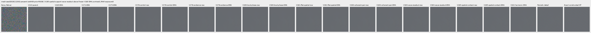

mesh-seed2026112302-present-iso6400-prior-RGGB; ROI `[176, 176, 160, 160]`, exposure8, contrast40.

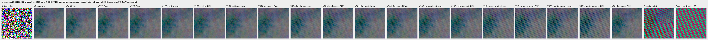

mesh-seed2026112309-present-iso6400-prior-RGGB; ROI `[176, 176, 160, 160]`, exposure8, contrast1.

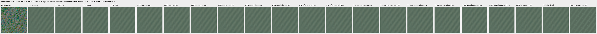

mesh-seed2026112309-present-iso6400-prior-RGGB; ROI `[176, 176, 160, 160]`, exposure8, contrast40.

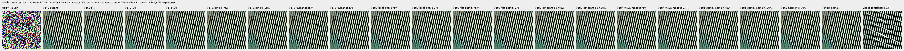

mesh-seed2026112304-absent-iso6400-prior-RGGB; ROI `[165, 0, 160, 160]`, exposure8, contrast40.

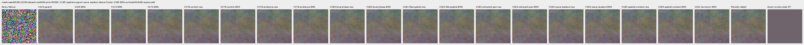

main-overcast-sky; ROI `[176, 176, 160, 160]`, exposure4, contrast1.

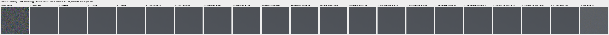

main-building-detail; ROI `[176, 176, 160, 160]`, exposure4, contrast1.

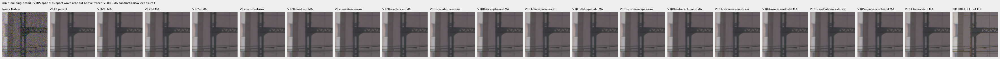

main-foliage; ROI `[176, 176, 160, 160]`, exposure4, contrast1.

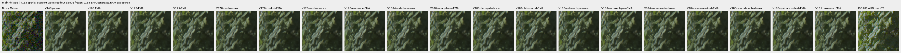

main-chain-link-fence; ROI `[176, 176, 160, 160]`, exposure4, contrast1.

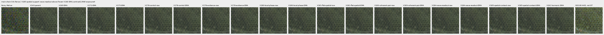

mesh-nominal; ROI `[206, 229, 160, 160]`, exposure16, contrast1.

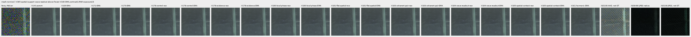

mesh-nominal; ROI `[426, 189, 160, 160]`, exposure16, contrast1.

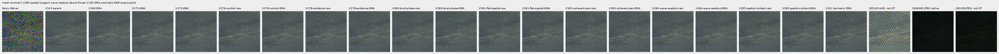

mesh-profile3879; ROI `[206, 229, 160, 160]`, exposure16, contrast1.

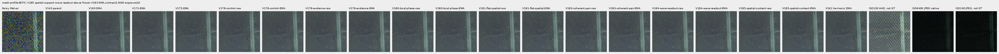

mesh-profile3879; ROI `[426, 189, 160, 160]`, exposure16, contrast1.

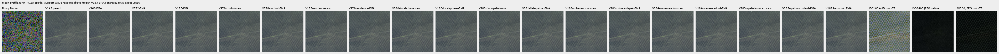

organic-02a76fd33b5e1414a0504f0b3f0aeb03a569b6f4-photo-faint-RGGB; ROI `[112, 112, 160, 160]`, exposure14.3883, contrast8.

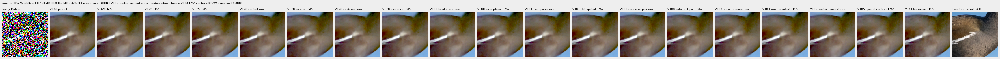

organic-dabacecd4780a1c230f8e9fce6ca1a604bdeab4c-photo-dark-RGGB; ROI `[112, 112, 160, 160]`, exposure102.758, contrast1.

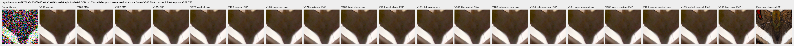

organic-6b3920bceba82d95ecf9351d47f6f94267694bd0-photo-dark-RGGB; ROI `[112, 112, 160, 160]`, exposure64.0491, contrast1.

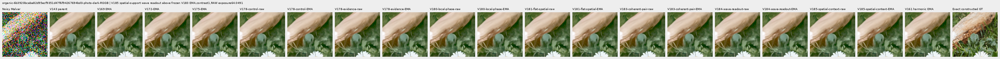

gray-l0.02-adc-only-RGGB; ROI `[48, 48, 160, 160]`, exposure4, contrast40.

gray-l0.02-iso12800-prior-RGGB; ROI `[48, 48, 160, 160]`, exposure4, contrast40.

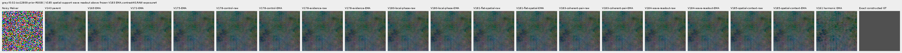

flat512-gray-l0.02-adc-only-RGGB; ROI `[176, 176, 160, 160]`, exposure4, contrast40.

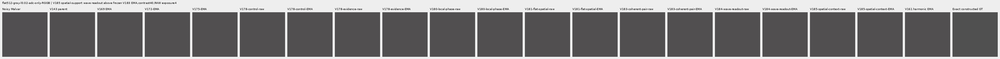

flat512-gray-l0.02-iso6400-prior-RGGB; ROI `[176, 176, 160, 160]`, exposure4, contrast40.

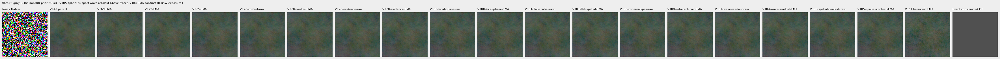

flat512-gray-l0.02-iso12800-prior-RGGB; ROI `[176, 176, 160, 160]`, exposure4, contrast40.

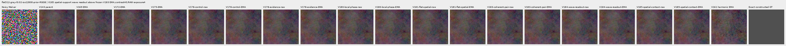

flat512-h210-s0.50-l0.02-iso6400-prior-RGGB; ROI `[176, 176, 160, 160]`, exposure4, contrast40.

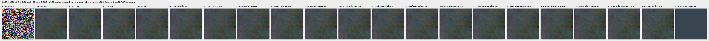

flat512-gray-l0.18-iso12800-prior-RGGB; ROI `[176, 176, 160, 160]`, exposure1, contrast8.

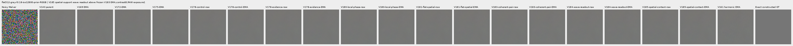

flat512-gray-l0.90-iso12800-prior-RGGB; ROI `[176, 176, 160, 160]`, exposure1, contrast4.

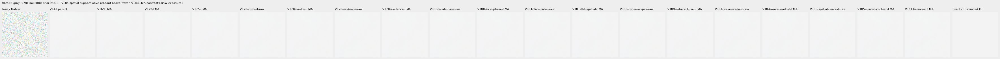

photo-3e638bbb56ed80abc88939468783e3bf9b92ee77-photo-faint-RGGB; ROI `[176, 176, 160, 160]`, exposure12.1494, contrast8.

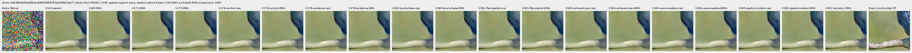

photo-3e638bbb56ed80abc88939468783e3bf9b92ee77-photo-dark-RGGB; ROI `[176, 176, 160, 160]`, exposure80.9959, contrast1.

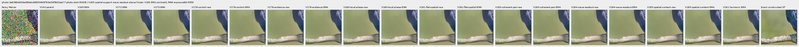

mixed-vertical-step-iso6400-prior-RGGB; ROI `[80, 176, 160, 160]`, exposure8, contrast40.

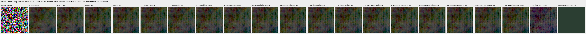

mixed-vertical-step-iso6400-prior-RGGB; ROI `[240, 176, 160, 160]`, exposure8, contrast1.

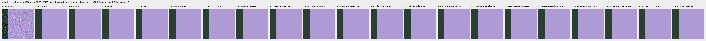

mixed-vertical-step-iso12800-prior-RGGB; ROI `[80, 176, 160, 160]`, exposure8, contrast40.

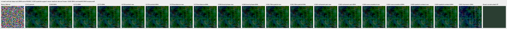

mixed-vertical-step-iso12800-prior-RGGB; ROI `[240, 176, 160, 160]`, exposure8, contrast1.

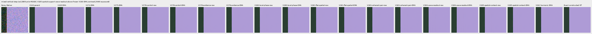

mixed-narrow-bar-iso6400-prior-RGGB; ROI `[80, 176, 160, 160]`, exposure8, contrast40.

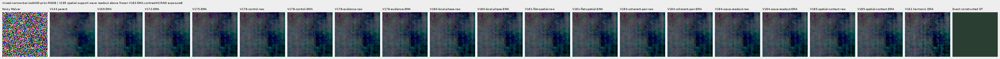

mixed-narrow-bar-iso6400-prior-RGGB; ROI `[240, 176, 160, 160]`, exposure8, contrast1.

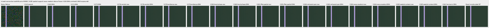

mixed-narrow-bar-iso12800-prior-RGGB; ROI `[80, 176, 160, 160]`, exposure8, contrast40.

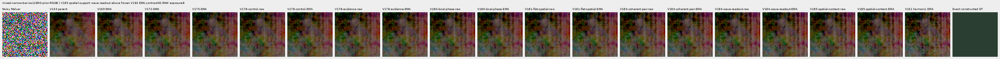

mixed-narrow-bar-iso12800-prior-RGGB; ROI `[240, 176, 160, 160]`, exposure8, contrast1.

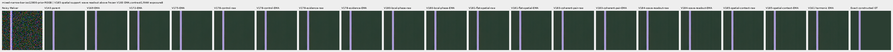

mixed-slanted-step-iso6400-prior-RGGB; ROI `[80, 176, 160, 160]`, exposure8, contrast40.

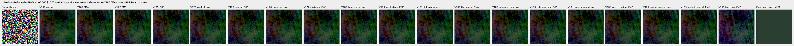

mixed-slanted-step-iso6400-prior-RGGB; ROI `[240, 176, 160, 160]`, exposure8, contrast1.

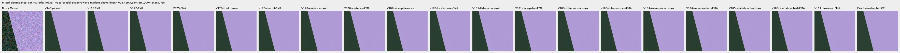

mixed-slanted-step-iso12800-prior-RGGB; ROI `[80, 176, 160, 160]`, exposure8, contrast40.

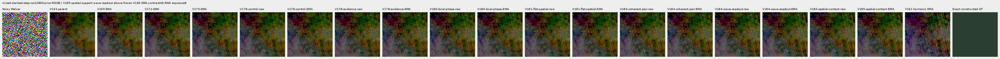

mixed-slanted-step-iso12800-prior-RGGB; ROI `[240, 176, 160, 160]`, exposure8, contrast1.

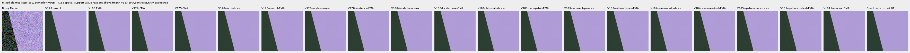

mixed-striped-patch-iso6400-prior-RGGB; ROI `[80, 176, 160, 160]`, exposure8, contrast40.

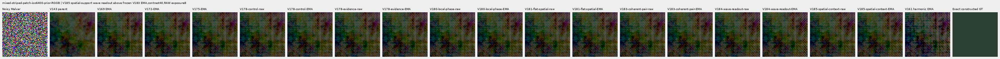

mixed-striped-patch-iso6400-prior-RGGB; ROI `[240, 176, 160, 160]`, exposure8, contrast1.

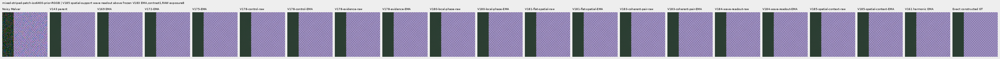

mixed-striped-patch-iso12800-prior-RGGB; ROI `[80, 176, 160, 160]`, exposure8, contrast40.

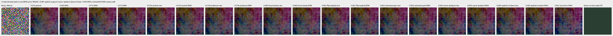

mixed-striped-patch-iso12800-prior-RGGB; ROI `[240, 176, 160, 160]`, exposure8, contrast1.

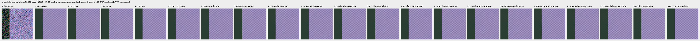

V150-control-bark-contrast0p025-adc-RGGB; ROI `[48, 48, 160, 160]`, exposure1, contrast40.

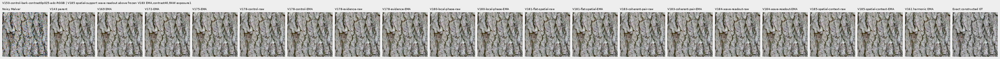

V150-control-raccoon-fur-contrast0p025-adc-RGGB; ROI `[48, 48, 160, 160]`, exposure1, contrast40.

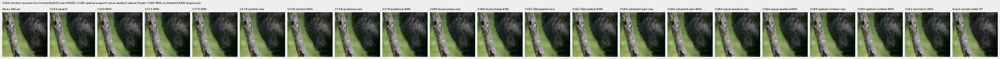

V150-control-ADC-plane0-RGGB; ROI `[176, 176, 160, 160]`, exposure45, contrast8.

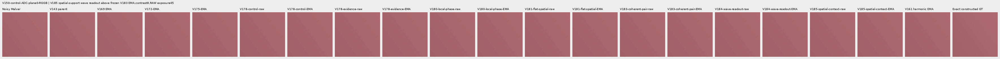

V150-control-ADC-plane1-RGGB; ROI `[176, 176, 160, 160]`, exposure9, contrast8.

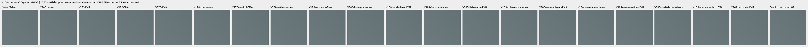

V150-control-ADC-plane2-RGGB; ROI `[176, 176, 160, 160]`, exposure1, contrast8.

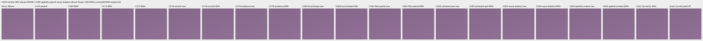

V150-control-ADC-plane3-RGGB; ROI `[176, 176, 160, 160]`, exposure0.24, contrast8.

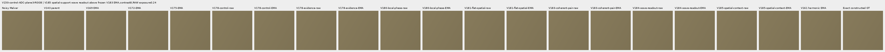

### Noisy, restored and exact constructed GT

mesh-seed2026112302-present-iso6400-prior-RGGB; ROI `[176, 176, 160, 160]`, exposure8, contrast1.

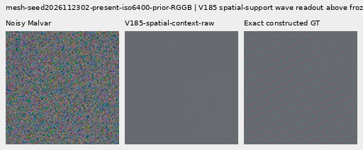

mesh-seed2026112302-present-iso6400-prior-RGGB; ROI `[176, 176, 160, 160]`, exposure8, contrast1.

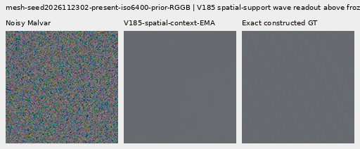

mesh-seed2026112309-present-iso6400-prior-RGGB; ROI `[176, 176, 160, 160]`, exposure8, contrast1.

mesh-seed2026112309-present-iso6400-prior-RGGB; ROI `[176, 176, 160, 160]`, exposure8, contrast1.

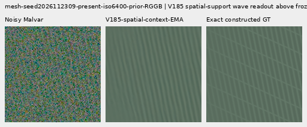

flat512-gray-l0.02-iso6400-prior-RGGB; ROI `[176, 176, 160, 160]`, exposure4, contrast40.

flat512-gray-l0.02-iso6400-prior-RGGB; ROI `[176, 176, 160, 160]`, exposure4, contrast40.

flat512-gray-l0.02-iso12800-prior-RGGB; ROI `[176, 176, 160, 160]`, exposure4, contrast40.

flat512-gray-l0.02-iso12800-prior-RGGB; ROI `[176, 176, 160, 160]`, exposure4, contrast40.

mixed-vertical-step-iso6400-prior-RGGB; ROI `[80, 176, 160, 160]`, exposure8, contrast40.

mixed-vertical-step-iso6400-prior-RGGB; ROI `[80, 176, 160, 160]`, exposure8, contrast40.

mixed-vertical-step-iso12800-prior-RGGB; ROI `[80, 176, 160, 160]`, exposure8, contrast40.

mixed-vertical-step-iso12800-prior-RGGB; ROI `[80, 176, 160, 160]`, exposure8, contrast40.

[Publication verification](results/v185-spatial-context-publication-verification-v1.json).
