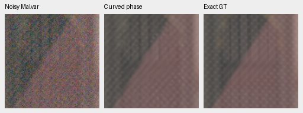
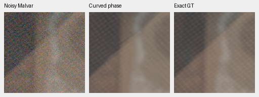

# Checking spatial phase in weak fence crossings

A curved phase fit recovers **0.215 percentage points** more
interaction contrast on 24 new warped photo fixtures and lowers
junction increment error by **0.115 DN16**. Supplying the exact
wire geometry raises the gain to **1.191 points**, indicating room
to improve phase measurement and validation. The fitted curved
term gives no change in either fine cab ROI, and a simpler affine
phase changes the right cab slightly. The method remains experimental.

## Predict the difference phase from the two wires

The [regional junction refit](junction-regional-refit.md) uses one
fixed difference phase and local contrast. This experiment asks
whether a spatial departure from that phase predicts separate
Bayer samples. Exterior RAW nominates the same two fundamental
frequencies. The first complete-cell Bayer fold fits separate
complex amplitude fields for both wires, with a plane in native
coordinates and one quadratic term along each wire. A weak ridge
shrinks the spatial coefficients. The nuisance design includes the
smooth surface, an optional step and the eligible fixed higher
orders. The affine control drops the quadratic. The replicated
control circularly averages independent phase fits from the
first two Bayer folds, using a shared level and nuisance estimate.

The difference between the two predicted phases supplies the
candidate crossing waveform. Before testing it, the fit accounts
for the fixed difference cosine with spatially varying amplitude,
its constant quadrature, both moving fundamentals and the rival
higher orders. The first fold supplies the residual sign. The
third and fourth folds must support both fundamentals and the
signed residual across the 192-pixel interior. The difference
needs a pooled score of 3.25 and at least 0.90 in each held fold.
Delivery subtracts the candidate's fitted projection on the
stationary carrier. The usual station gate requires support for
both wire directions. The last three folds also estimate
amplitude in 16 windows, with a separate experimental control
that estimates one amplitude over the whole evaluated interior.

Replacing every held RAW sample leaves the phase forecasts and
variance inputs bit-identical on four Bayer layouts at an odd
crop origin. On the exact warped phases in the holdout, mean
relative-phase cosine across valid wire regions rises from
**0.634** for the fixed phase to **0.771** for the curved phase and
**0.849** for the replicated fit. The replicated estimate predicts
the geometry more closely and delivers slightly less contrast
than the calibrated curve. A quarter-cycle rotation of the
variable candidate gives much less recovery on the warped photos.

## Paired exact-target results

Calibration uses 24 re-captured sources and selects the full-dose
curved fit under limits for added gap, additive and quiet
texture and stationary-junction error. The independent set has
**32 source-disjoint Commons backgrounds**, checked by source ID
and bin-four cache hash. Twenty-four have a spatially varying
difference phase. Eight have bent wires with a fixed junction
phase to challenge the shape assumption. Two ISO6400 observations
per source use σ 0.85 pre-Bayer blur, exposure ×0.33, black 0.03,
ADC16 and shot/read `0.00128/6.5536e-6`. The interaction and
matched additive roles share counts at the lower site rate and
share read noise. The exact target uses the optical blur.

| 24 new variable-phase photos | Interaction response | Junction increment RMS, DN16 | Added gap luma RMS, DN16 |
| --- | ---: | ---: | ---: |
| Regional RAW refit | 16.445% | 44.386 | 0.000 |
| Affine phase | 16.538% | 44.339 | 0.024 |
| Curved phase, locked dose | 16.660% | 44.271 | 0.049 |
| Replicated curve | 16.638% | 44.280 | 0.050 |
| Curved quarter-cycle control | 16.460% | 44.381 | 0.000 |
| Supplied geometry, local amplitude | 17.636% | 43.768 | 0.128 |
| Replicated curve, pooled amplitude at calibration dose | 17.160% | 44.026 | 0.226 |

The curved phase gives **+0.215 points** `[+0.086,+0.351]`,
**−0.115 DN16** `[−0.197,−0.042]` junction error and
**+0.049 DN16** `[+0.001,+0.112]` gap luma. Intervals resample
entire photos within geometry. The gap result uses the 12 sources
with known gaps in the varying-phase subset. Across 48 varying
draws the curve accepts 14 and changes 11. Giving it the exact
frequencies and phases accepts 20 and changes 19, with
+1.191 points `[+0.593,+1.826]` and more gap residue. The supplied
geometry is a diagnostic available on the constructed scenes.
At the same added gap luma it would provide 0.453 points under
linear dose matching on this panel. The calibrated curve
reproduces the earlier output on stationary, matched additive,
strong-only, flat-core, edge-only and uniform controls. All 24
retained straight sources and the 48 ordinary photos with
authentic and incompatible surroundings also reproduce it.

Pooling amplitudes after the same phase checks increases recovery.
Calibration picks a 60% dose for the pooled replicated curve.
Across the independent panel, mean gap addition rises to
**0.170 DN16**, above the **0.150 DN16** calibration limit.
The corresponding figure on the warped subset is 0.226 DN16.
When pooled recovery is matched to the local fit's gap cost on
that subset, it adds just **0.154 points**. The wider readout
has more usable amplitude and needs better localization.

## Native exact comparisons

Both triplets show noisy Malvar, the calibrated curve above
the regional RAW refit and exact GT. Native 160×160 cells use
`[48,48,160,160]` inside the 256×256 recipient at `[128,128]`,
the ISO6400 physical simulation above and a common ×2 display
exposure followed by sRGB. The model is Local 50k EMA SHA256
`62f4e9ce84075c8df1a254a1889033b5787133e8c98c63e0ec3d174a94734959`.
Both examples have the largest junction-error reduction in
their respective gap and continuous subsets.

Reinhold Möller, *Berndorf Friedenskirche Orgel*, bin-four crop
`[512,352,512,512]`, BGGR, draw zero. The junctions gain a little
modulation across the contrast boundary. The remaining wire is
visible in the gap. These photos are adapted by binning, adding the
carriers and simulating capture. [All methods](assets/spatial-junction-phase-v1/warped-independent-09-comparison.png) ·
[Source](https://commons.wikimedia.org/wiki/File:Berndorf_Friedenskirche_Orgel_041361-HDR.jpg) ·
[CC BY-SA 4.0](https://creativecommons.org/licenses/by-sa/4.0/).

Palauenc05, *Vienne two benchmarks*, bin-four crop
`[366,190,512,512]`, GRBG, draw zero. The exact crossings are
better defined in the light part of the crop. The restored pattern
remains uneven through the dip. [All methods](assets/spatial-junction-phase-v1/warped-independent-22-comparison.png) ·
[Source](https://commons.wikimedia.org/wiki/File:Vienne_two_benchmarks.jpg) ·
[CC BY-SA 4.0](https://creativecommons.org/licenses/by-sa/4.0/).

## Standing GFX100S comparisons

The calibrated curve reproduces the regional RAW refit in the sky,
building, foliage and both fine cab ROIs. It changes the coarse
fence by 0.800 DN16 RGB RMS and keeps the connected intersections.
The separate affine phase obtains pooled and minimum held scores
of **3.47 and 1.48** on the nominal right cab. The curve scores
**2.65 and 1.14**. The affine variant changes the right cab by
0.134 DN16 nominal and 0.172 transferred. The pooled affine
variant changes them by 0.900 and 0.944 DN16. At ×16 there is some
local contrast change, with incomplete crossings, retained mottle
and no clear new color ripple. Both left cab views reproduce the
regional refit.

The separate ISO100 exposure supplies a second diagnostic. The
affine phase fields fitted to DSCF3842 and DSCF3835 on the right
differ by **0.018 cycles RMS** after removing a constant phase
offset at the established approximate registration. The separate
ISO100 phase fits also predict positive residual correlation in
both held folds. On the nominal left cab, the ISO100 reference
has positive correlations and the ISO6400 folds disagree in sign.
Different aperture, exposure and scene motion limit the
comparison. The reference supplies no reconstruction inputs.

The native origins for sky, building, foliage and coarse fence
are `[5800,1400]`, `[5790,2690]`, `[8890,5570]` and `[2240,6000]`.
Cab origins are `[806,6489]` and `[1026,6449]`. Transferred shot/read
is `0.0014635775921166604/1.0715704128646712e-6`. V120 Small EMA
SHA256 `a9d9b6b4f974e24a6b11e5e740aab32314233a7f53c056cf37c7d2aac1c589fb`
is shown alongside Local 50k. The independent ISO100 AHD and
in-camera JPEGs are qualitative references.

| RAW and profile | Native boards |
| --- | --- |
| DSCF3879 nominal ×4 | [Sky](assets/spatial-junction-phase-v1/main-overcast-sky-main-overcast-sky-x4.png) · [Building](assets/spatial-junction-phase-v1/main-building-detail-main-building-detail-x4.png) · [Foliage](assets/spatial-junction-phase-v1/main-foliage-main-foliage-x4.png) · [Coarse fence](assets/spatial-junction-phase-v1/main-chain-link-fence-main-chain-link-fence-x4.png) |
| DSCF3842 nominal | [Left ×4](assets/spatial-junction-phase-v1/mesh-nominal-fine-green-mesh-left-x4.png) · [Right ×4](assets/spatial-junction-phase-v1/mesh-nominal-fine-green-mesh-right-x4.png) · [Left ×16](assets/spatial-junction-phase-v1/mesh-nominal-fine-green-mesh-left-x16.png) · [Right ×16](assets/spatial-junction-phase-v1/mesh-nominal-fine-green-mesh-right-x16.png) |
| DSCF3842 transferred | [Left ×4](assets/spatial-junction-phase-v1/mesh-profile3879-fine-green-mesh-left-x4.png) · [Right ×4](assets/spatial-junction-phase-v1/mesh-profile3879-fine-green-mesh-right-x4.png) · [Left ×16](assets/spatial-junction-phase-v1/mesh-profile3879-fine-green-mesh-left-x16.png) · [Right ×16](assets/spatial-junction-phase-v1/mesh-profile3879-fine-green-mesh-right-x16.png) |

This is a frozen-checkpoint crop study. The exact-photo and native
reviews are complete for this scope. The fixed 427-photo and
measured-camera panels score the underlying full models.
[Scores and phase diagnostics](results/spatial-junction-phase-v1/summary.json) ·
[Native provenance](assets/spatial-junction-phase-v1/manifest.json) ·
[Publication hashes](results/spatial-junction-phase-v1/publication.json) ·
[Executed sources and frozen receipts](results/spatial-junction-phase-v1/evidence.tar.xz).
