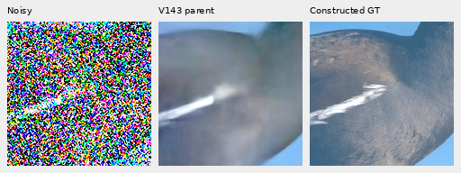
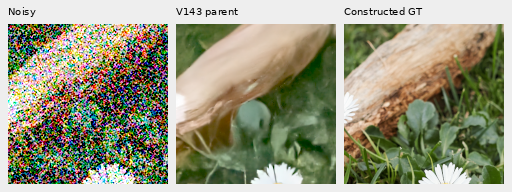

# Organic dark-photo baseline and spatial-attention supplement

**V143 preserves broad forms but loses much of the fine organic texture in
this new diagnostic.** Mean 3–8px-band response is .151 for faint organic photos
and .399 for dark photos, with ideal response1. Feathers, moth scales, grass
and bark remain soft; selected outputs contain blurred islands and false color.
The V144/V145 endpoint comparisons are pending. This is a measured baseline,
not an improvement or a universal photo-quality result.

[Actual baseline results](results/spatial-photo-supplement-parent-baseline-v1.json) ·
[Independent metric/target/PNG audit](results/spatial-photo-supplement-parent-audit-v2.json) ·
[All24 native triplets, source licenses and metadata](images/spatial-photo-parent-v1/manifest.json).

## Fixed observations

The separate supplement has128 observations from16 validation images:
64 retained512-pixel photographic contexts from the
[supported-amplitude study](supported-wave-amplitude.md), plus64 new384-pixel
organic contexts from eight additional sources. All are native bin8 linear
sRGB16 caches; source selection used metadata and native source-only previews
before new noise or model outputs. The organic sources have smaller native
dimensions, so their contexts are384 rather than512. Crop pixels are never
resized. All16 IDs are absent from both photographic training ID sets.
[Frozen source choice](results/spatial-photo-supplement-source-choice-v1.json).

Both cohorts use two transformations and all four CFAs. Faint photos have mean
linear sRGB .02 and one-eighth contrast about channel means. Dark photos have
mean .003 and full contrast. Noise uses shot .00128, read6.5536e−6,16-bit ADC
and black .03. Each model receives identical packed RAW, variance, CFA, WB and
matrix values. The targets are **exact constructed camera-RGB targets from
binned photographs**, not exact physical-scene GT or real-capture references.

Native160 central ROIs are[176,176,160,160] for retained512 and[112,112,160,160]
for organic384. Display exposure is the inverse scene scaling, shared across
all columns. The extra faint views apply8× camera-RGB contrast about the same
target mean to every panel; this is display only and can strongly clip noise.
Noisy columns use Malvar demosaicing for display. V143's periodic stage is off.
Checkpoint SHA256:
`96d146d017c54196288c585f8b7eddcf030e8a235061049c31e985b9380b7ce4`.
Every image's manifest records source coordinates, arrays/checkpoint hashes,
noise conditioning, exact exposure and common display anchor.

## Baseline measurements and native views

Each row averages32 observations from eight source images and four CFAs.
Two cohorts and two conditions give128 cases overall. The CFA cases share source
content;128 observations are not128 independent photos. Camera-RGB error is
measured over the full context. DCT16 luma response and relative error use
native160 crops in linear sRGB, with radial frequencies1/8≤f<1/3 and no
content-dependent block selection. Response alone can reward noise, so it
must be read with reconstruction error and orthogonal residuals in the receipt.
Different cohorts and conditions are not an isolated causal comparison.

| Cohort | Condition | Mean full error, DN16 | Mean band response, ideal1 | Mean relative band error |
| --- | --- | ---: | ---: | ---: |
| Retained512 | Faint | 33.96375 | .29856 | .82464 |
| Retained512 | Dark | 29.09772 | .53145 | .66145 |
| Organic384 | Faint | 37.46906 | .15070 | .92412 |
| Organic384 | Dark | 33.68580 | .39895 | .78161 |

Noisy → V143 → constructed GT, native160. The moorhen's faint feather texture
is mostly erased; common display exposure14.38835×, with8× display contrast.
Source: [Alexis Lours](https://commons.wikimedia.org/wiki/File:Common_moorhen_(Gallinula_chloropus)_France.jpg),
[CC BY4.0](https://creativecommons.org/licenses/by/4.0). Selection for this page follows viewing all24
triplets; the underlying source cohort was fixed before inference.

Dark grass/bark keeps broad leaf and trunk boundaries but loses fine surface
structure. Common display exposure64.04909×, contrast1.
Source: [Jules Verne Times Two](https://commons.wikimedia.org/wiki/File:Daisies_near_Cockspur_coral_tree_(Erythrina_crista-galli)_roots,_Jardim_da_Pra%C3%A7a_de_Londres,_Lisbon,_Portugal_julesvernex2.jpg),
[CC BY-SA4.0](https://creativecommons.org/licenses/by-sa/4.0).

The full manifest also includes wet leaves, moth scales/hairs, apple skin,
butterfly and heron feathers, in both conditions and the enhanced faint view.
All24 PNGs were viewed through four unresized sheets. Their5,529,600 panel RGB
values match an independent FP64 rendering exactly. All128 baseline metric rows
were recomputed; largest absolute metric difference3.10e−11. Reconstructed
source/target linear colors differ by at most1.12e−8. The separate input audit
also checks every input fingerprint and the16-bit ADC lattice.
[Input audit](results/spatial-photo-supplement-input-audit-v1.json).

## Endpoint comparison still running

This supplement leaves the original150-input reviews and training schedules
unchanged. It reuses64 V143 predictions and adds64 actual V143 parent forwards;
each future endpoint gets128 forwards, for320 new model forwards and320 encoder
forwards in total.
Only64 new noisy observations are generated. No training, RAW decodes or
source-drive opens are added. `/mnt/dataz` remains unused. The original main
GFX scene, fine green mesh, both camera JPEGs and48 exact-flat controls remain
in the [primary V144/V145 review](v143-spatial-attention-trial.md).

The64 new V143 forwards are complete with exact weights and unchanged RNG.
The original primary controller stopped after V144's successful numeric stages
because it looked for the flat audit under the wrong filename. The replacement
adopts all150 completed V144 outputs; the replacement supplement adopts its64
parent outputs. Original failures and receipts remain preserved, with no
inference/noise replay, training restart or reset of the conservative deadlines.
The supplement waits for both primary reviews and the replacement owner to
exit before collecting V144/V145. Its report and independent auditor remain
frozen with the input plan. Flat-region quality must
be assessed from the analytic fields and real sky alongside photographic gains.
[Supplement plan](results/spatial-photo-supplement-plan-v1.json) ·
[Active recovery plan](results/spatial-photo-supplement-recovery-plan-v2.json) ·
[Preserved recovery evidence](results/spatial-photo-review-recovery-publication-v2.json) ·
[Driver](../scripts/review_spatial_photo_supplement.py) ·
[Independent auditor](../scripts/audit_spatial_photo_supplement.py).

The first baseline PNG auditor expected exposure duplicated at image level;
the baseline manifest stores it inside the observation. A separately preserved
reader correction uses that declared exposure. All data, predictions, report
and PNG bytes remain unchanged.
[Preserved audit recovery](results/spatial-photo-supplement-parent-audit-recovery-v1.json).

Boards retain their source licenses. Full authors, titles, page/license links,
original source hashes and credit fields are preserved in the image manifest.
