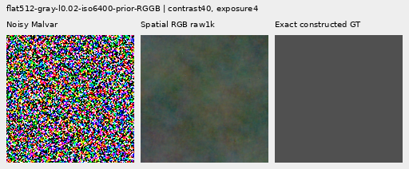
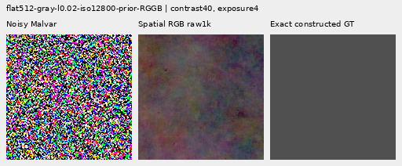
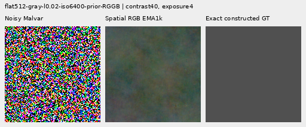
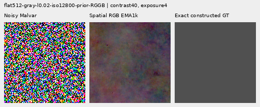
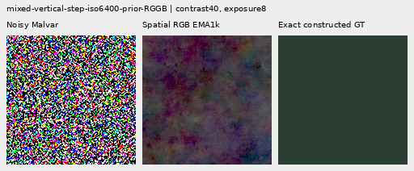
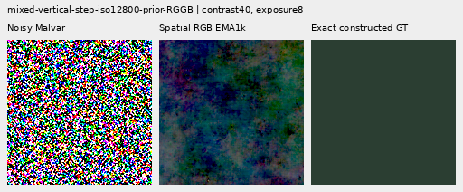

# V157: lower coarse flat-field error, worse quiet-region color bias

The direct multiscale RGB hybrid lowers native512 noisy-flat full RMS
**0.94–1.10% versus V143**, with **0.90–0.98% lower block32 error**. All 48
flat inputs improve in both measures at both raw/EMA endpoints versus V143
and the exact V156 control. This is a useful coarse-error reduction beyond
the previous late spectral heads.

The cost is substantial: mixed quiet-neighbor RMS rises **10.26–14.98% versus
V143**, with visible magenta/blue casts at 40×. Mesh response falls below V143,
and fine real cab crossings remain missing. Broad flat-field mottle remains
visible. **This hybrid does not satisfy the joint weak-detail/clean-quiet goal.**

Both 1k heads, four fixed endpoints, 822 inputs, independent audits and all
72 actual native views are complete. Retain V157 as the direct spatial/coarse
architecture comparator and its measured standalone-flat strength. Keep
[V156](local-excess-risk.md) as the quieter learned-detail training control,
[V153](delivered-spectral-objective.md) for stronger mesh response and
[V150](objective-floor-training.md) for stronger ADC photos.
[V120 Small](current-model.md) remains the general recommendation on broader
evidence. These choices retain measured strengths without freezing the architecture.

## Standalone noisy flats

Each native512 prior has 24 cases; four CFA placements are related observations.
Full spatial RMS removes image DC. Block32 RMS measures variation after native
32×32 averaging, retaining coarse error rather than fitting it away.

|Flat test|V143|V157 raw|V157 EMA|Spatial RGB raw|Spatial RGB EMA|
| --- | ---: | ---: | ---: | ---: | ---: |
|Native512 ISO6400 full RMS|18.546808|18.525205|18.517628|18.372489|18.369973|
|Native512 ISO6400 spatial RMS|18.235130|18.213137|18.205378|18.041301|18.051496|
|Native512 ISO6400 block32 RMS|13.440561|13.440890|13.440523|13.308961|13.319811|
|Native512 ISO12800 full RMS|24.071890|24.041122|24.030574|23.810498|23.805983|
|Native512 ISO12800 spatial RMS|23.596861|23.565391|23.554538|23.336459|23.349752|
|Native512 ISO12800 block32 RMS|17.932544|17.931976|17.931945|17.756811|17.771300|
|Older native256 ISO12800 full RMS|27.233548|27.201136|27.186906|26.995569|26.991236|
|Older native256 ISO12800 spatial RMS|26.017191|25.983274|25.968052|25.752030|25.761072|
|Older native256 ISO12800 block32 RMS|19.539875|19.538875|19.539051|19.366148|19.379026|

Both full and coarse error improve on every native512 case relative to V143
and matched V156. Native512 spatial RMS falls 1.01–1.10% versus V143; crop-block32
falls 0.87–1.01%. Older native256 ISO12800 full RMS improves 0.87–0.89% and
block32 improves 0.82–0.89%. The gain reaches coarse variation, rather than only
reducing high-frequency grain. It exceeds V154's roughly 0.45–0.50% full-RMS
gain on the native512 flats, with a much worse mixed-neighbor cost below.

DC behavior is mixed: ISO6400 worst absolute DC rises 1.42% for EMA, while the
ISO12800 worst value falls 5.04%. Neither an average gain nor constant-field
parent equality establishes local accuracy. Actual contrast40 images still
contain broad colored patches; the numerical gain is not a visibly clean field.

## Quiet neighbors beside strong structure

Sixteen cases per prior put a step, narrow bar or patterned patch beside an
exact quiet dark region. Whole-image, quiet-total and quiet-spatial error
must remain separate. Spatial error removes the quiet region's channel means.

| Prior | Method | Whole RMS | Quiet RMS | Quiet spatial RMS |
| --- | --- | ---: | ---: | ---: |
|ISO6400|V143|27.105631|3.898845|3.268502|
|ISO6400|V157 raw|27.058155|3.907594|3.278527|
|ISO6400|V157 EMA|27.065605|3.899175|3.268512|
|ISO6400|Spatial RGB raw|27.339566|4.482988|3.238095|
|ISO6400|Spatial RGB EMA|27.274996|4.365052|3.232918|
|ISO12800|V143|36.747466|6.152652|5.341833|
|ISO12800|V157 raw|36.610153|6.162404|5.352693|
|ISO12800|V157 EMA|36.643242|6.157827|5.347504|
|ISO12800|Spatial RGB raw|37.131077|6.898679|5.300686|
|ISO12800|Spatial RGB EMA|37.023001|6.783631|5.301677|

Quiet spatial error falls 0.75–1.09% versus V143, yet total quiet RMS rises
10.26–14.98%. Both endpoints worsen 24/32 quiet inputs against V143. Against
matched V156, raw worsens 23/32 and EMA 24/32. Maximum increases over V156 are
2.14626 DN16 raw and 1.88435 EMA. Whole mixed-scene RMS also worsens 0.62–1.04%
versus V143. Strong-region improvement does not compensate for the quiet bias.

An [independent original-pixel decomposition](results/v157-spatial-rgb-quiet-DC-audit-v1.json)
checks 160 outputs, 480 scalar values and 160 per-case energy identities.
Mean quiet DC magnitude exposes the color-error cost:

| Method | ISO6400 mean quiet DC RMS | ISO12800 mean quiet DC RMS |
| --- | ---: | ---: |
|V143|2.016074|2.849060|
|V156 raw|2.016686|2.849498|
|V156 EMA|2.016646|2.849442|
|Spatial RGB raw|2.925343|4.229166|
|Spatial RGB EMA|2.766653|4.037120|

For each individual crop, total squared error equals spatial squared error
plus DC squared error. The means of those RMS quantities do not obey the same
identity. The decomposition agrees with the audited score rows to 2.67e-15.
It substantiates the observed color bias, without isolating its cause.

The native ISO6400 step/slanted-step neighbors acquire a stronger magenta cast;
the ISO12800 views shift toward blue/magenta. Narrow-bar changes are smaller.
Normal-contrast whole-context views conceal much of this bias. The
[paired audit](results/v157-spatial-rgb-v1/paired-regions.json) retains all
2,176 comparisons across quiet, flat and natural groups; counts are not a
statistical-significance claim or a guarantee on unseen captures.

## Mesh response and blank error

There are 256 present and 256 absent inputs. Response projects onto exact
procedural GT; it is not accuracy or a calibrated detection probability.
Actual blank error compares output with target, whereas added blank energy
compares the output with its parent.

| Method | Present full RMS | Response | Actual blank RMS | Blank spatial RMS | Added blank RMS |
| --- | ---: | ---: | ---: | ---: | ---: |
|V143|9.111243|0.02202090|5.523323|5.343113|0.00000000|
|V157 raw|9.080738|0.02433695|5.522763|5.342544|0.31564742|
|V157 EMA|9.088409|0.02325169|5.519909|5.339598|0.28432343|
|Spatial RGB raw|9.074109|0.02135746|5.463479|5.279086|0.33215525|
|Spatial RGB EMA|9.073479|0.02118075|5.462776|5.281840|0.33000107|
|Existing periodic detail|8.586126|0.07089755|5.523328|5.343118|0.00063557|

Absolute mesh response is only 2.12–2.14% of GT: 3.01–3.82% below V143 and
8.91–12.24% below matched V156. Present full RMS improves 0.41% versus V143,
but weak-wire response decreases. The existing periodic comparator retains
much stronger response; it still has distinct support/texture limitations.

Present actual blank RMS improves 1.08–1.10% and blank spatial RMS 1.15–1.20%
versus V143. Absent full RMS is 5.18247/5.18076 DN16 raw/EMA, versus 5.23791
parent. Added blank correction is larger than V156's despite lower actual
error: a beneficial denoising change need not have smaller correction energy.
Absent mean template projection near zero does not establish absence of local
false structure. Broad variation and missing crossings remain in native views.

## Natural detail and ADC behavior

Each natural group contains 32 related CFA/recipe inputs. Retained-faint full
RMS improves 0.018–0.020% versus V143; the other three groups worsen by
0.023–0.059%. Band errors are mixed, and all natural band responses remain
0.34–0.59% below V143. Most also lose response versus V156. Feathers, bark,
branches and organic texture remain soft; there is no convincing new natural
weak-detail recovery.

|Photo test|V143|V157 raw|V157 EMA|Spatial RGB raw|Spatial RGB EMA|
| --- | ---: | ---: | ---: | ---: | ---: |
|Retained512 faint full RMS|33.963754|33.960603|33.962389|33.957648|33.956899|
|Retained512 faint band error|0.824639|0.824569|0.824698|0.824705|0.824717|
|Retained512 faint band response|0.298560|0.297855|0.297562|0.297242|0.297213|
|Retained512 dark full RMS|29.097715|29.094054|29.094977|29.104340|29.105095|
|Retained512 dark band error|0.661447|0.661410|0.661443|0.661467|0.661468|
|Retained512 dark band response|0.531446|0.530368|0.530279|0.529649|0.529646|
|Organic384 faint full RMS|37.469061|37.468319|37.472629|37.480065|37.478330|
|Organic384 faint band error|0.924117|0.924249|0.924407|0.924196|0.924213|
|Organic384 faint band response|0.150701|0.150037|0.149699|0.149852|0.149809|
|Organic384 dark full RMS|33.685796|33.684630|33.685973|33.705722|33.703303|
|Organic384 dark band error|0.781612|0.781617|0.781635|0.781593|0.781594|
|Organic384 dark band response|0.398945|0.397982|0.397824|0.397527|0.397512|

The new direct path is exactly zero at zero physical variance. The shared
spectral parameters nevertheless train jointly, so the complete model's ADC
behavior can change. All 192 constant ADC arrays retain parent pixels exactly;
parent equality is not equality to GT.

|ADC test|V143|V157 raw|V157 EMA|Spatial RGB raw|Spatial RGB EMA|
| --- | ---: | ---: | ---: | ---: | ---: |
|Photo full RMS|18.149871|18.152257|18.150549|17.939292|17.961360|
|Photo band error|0.101855|0.101954|0.101956|0.100609|0.100758|
|Photo band response|0.968329|0.967273|0.967277|0.968694|0.968601|
|Sloped512 full RMS|3.771369|3.766475|3.767035|3.723443|3.732082|
|Sloped512 spatial RMS|3.397249|3.391990|3.392570|3.346101|3.355006|
|Sloped512 block32 RMS|0.574652|0.576587|0.576247|0.606916|0.600736|
|Sloped512 crop block32 RMS|0.088145|0.088142|0.088143|0.088148|0.088147|
|Sloped512 worst absolute DC|11.176981|11.171241|11.172559|11.223246|11.220159|

Eight ADC photo cases improve full RMS 1.04–1.16% and band error 1.08–1.22%
versus V143, recovering V156's small regression. V150's roughly 3.06% photo
gain remains stronger. These gains arise with the direct path inactive and
cannot be credited to its ADC output. Sloped-field full RMS improves
1.04–1.27%, while block32 worsens 4.54–5.61% and worst absolute DC rises
0.39–0.41%. There is no broad coarse-ADC gain.

## Native 100% comparisons

All 72 primary figures were actually viewed at original detail in 18 unscaled
sheets. Every cell is 160×160 original pixels. The
[manifest](images/v157-spatial-rgb-v1/manifest-v1.json) binds source/ROI,
checkpoint SHA256, noise conditioning, exposure, target anchor and contrast.
The 48 method boards plus 24 repeated-cell triplets contain 32,332,800 checked
RGB channels. Repeated cells add no observations.

Four standalone-flat triplets show **noisy Malvar → spatial RGB → exact
constructed GT** for both improved endpoints. Native512 RGGB, gray level .02,
ROI `[176,176,160,160]`, shared exposure 4 and camera-linear contrast 40 about
the exact target means. ISO6400 shot .00128/read variance 6.5536e-6;
ISO12800 shot .00256/read variance 2.62144e-5. Crop pixels are never resized.









The quiet-neighbor failures use the same priors, native512 RGGB,
ROI `[80,176,160,160]`, shared exposure 8 and contrast 40 about the exact
quiet-target means. These casts remain visible beside the exact constant GT:





| Endpoint | Mesh2302 | Mesh2309 | Flat ISO6400 | Flat ISO12800 | Quiet ISO6400 | Quiet ISO12800 |
| --- | --- | --- | --- | --- | --- | --- |
|local-control-raw-step1000|[native](images/v157-spatial-rgb-v1/comparison-00-local-control-raw-step1000-triplet.png)|[native](images/v157-spatial-rgb-v1/comparison-02-local-control-raw-step1000-triplet.png)|[native](images/v157-spatial-rgb-v1/comparison-19-local-control-raw-step1000-triplet.png)|[native](images/v157-spatial-rgb-v1/comparison-20-local-control-raw-step1000-triplet.png)|[native](images/v157-spatial-rgb-v1/comparison-26-local-control-raw-step1000-triplet.png)|[native](images/v157-spatial-rgb-v1/comparison-28-local-control-raw-step1000-triplet.png)|
|local-control-EMA-step1000|[native](images/v157-spatial-rgb-v1/comparison-00-local-control-EMA-step1000-triplet.png)|[native](images/v157-spatial-rgb-v1/comparison-02-local-control-EMA-step1000-triplet.png)|[native](images/v157-spatial-rgb-v1/comparison-19-local-control-EMA-step1000-triplet.png)|[native](images/v157-spatial-rgb-v1/comparison-20-local-control-EMA-step1000-triplet.png)|[native](images/v157-spatial-rgb-v1/comparison-26-local-control-EMA-step1000-triplet.png)|[native](images/v157-spatial-rgb-v1/comparison-28-local-control-EMA-step1000-triplet.png)|
|spatial-rgb-raw-step1000|[native](images/v157-spatial-rgb-v1/comparison-00-spatial-rgb-raw-step1000-triplet.png)|[native](images/v157-spatial-rgb-v1/comparison-02-spatial-rgb-raw-step1000-triplet.png)|[native](images/v157-spatial-rgb-v1/comparison-19-spatial-rgb-raw-step1000-triplet.png)|[native](images/v157-spatial-rgb-v1/comparison-20-spatial-rgb-raw-step1000-triplet.png)|[native](images/v157-spatial-rgb-v1/comparison-26-spatial-rgb-raw-step1000-triplet.png)|[native](images/v157-spatial-rgb-v1/comparison-28-spatial-rgb-raw-step1000-triplet.png)|
|spatial-rgb-EMA-step1000|[native](images/v157-spatial-rgb-v1/comparison-00-spatial-rgb-EMA-step1000-triplet.png)|[native](images/v157-spatial-rgb-v1/comparison-02-spatial-rgb-EMA-step1000-triplet.png)|[native](images/v157-spatial-rgb-v1/comparison-19-spatial-rgb-EMA-step1000-triplet.png)|[native](images/v157-spatial-rgb-v1/comparison-20-spatial-rgb-EMA-step1000-triplet.png)|[native](images/v157-spatial-rgb-v1/comparison-26-spatial-rgb-EMA-step1000-triplet.png)|[native](images/v157-spatial-rgb-v1/comparison-28-spatial-rgb-EMA-step1000-triplet.png)|

Mesh triplets use native512 RGGB, ROI `[176,176,160,160]`, ISO6400 shot
.00128/read variance 6.5536e-6, exposure 8 and contrast 1. Method coordinates
and transforms are identical. Complete boards retain V143, both V156 controls
and the periodic comparator where applicable.

The noisy [feather](images/v157-spatial-rgb-v1/comparison-13.png) view uses
Alexis Lours, CC BY4.0, SHA1 `02a76fd33b5e1414a0504f0b3f0aeb03a569b6f4`,
native 384, ROI `[112,112,160,160]`, exposure 14.388348 and contrast 8.
The [dark bird/branch](images/v157-spatial-rgb-v1/comparison-25.png) uses
Andrew Mercer, CC BY-SA4.0, SHA1 `3e638bbb56ed80abc88939468783e3bf9b92ee77`,
native 512, ROI `[176,176,160,160]`, exposure 80.995917 and contrast 1.
Both use shot .00128/read 6.5536e-6. Fine texture remains missing.

Standing DSCF3879 ISO6400/DSCF3880 ISO100 views retain
[sky](images/v157-spatial-rgb-v1/comparison-05.png),
[building](images/v157-spatial-rgb-v1/comparison-06.png),
[foliage](images/v157-spatial-rgb-v1/comparison-07.png) and
[chain-link fence](images/v157-spatial-rgb-v1/comparison-08.png), exposure 4.
DSCF3842/3835 fine cab mesh retains both windows under
[nominal left](images/v157-spatial-rgb-v1/comparison-09.png),
[nominal right](images/v157-spatial-rgb-v1/comparison-10.png),
[profile3879 left](images/v157-spatial-rgb-v1/comparison-11.png) and
[profile3879 right](images/v157-spatial-rgb-v1/comparison-12.png) priors.
Native 768 contexts, left/right ROIs `[206,229,160,160]` / `[426,189,160,160]`,
exposure 16 and contrast 1. Both SOOC JPEGs stay native unboosted sRGB8.
Independent ISO100/AHD/JPEG references differ in aperture, shutter, processing
and motion: **qualitative references, not exact GT**, never pixelwise scored.
No convincing new fine cab wires appear. Protected captures, JPEGs and siblings
remain excluded from training; originals stay read-only and `/mnt/dataz` untouched.
The [quiet ROI](images/v157-spatial-rgb-v1/comparison-26.png) at 40× and
[whole-edge view](images/v157-spatial-rgb-v1/comparison-27.png) at 1× retain
the same coordinates across methods.

## What the new path predicts


[LateSpatialRgbDetail](../src/demosaic/late_spatial_rgb.py) combines two paths
fed by the same supplied frozen V143 camera RGB and observed RAW:

```text
output = V143 RGB + learned spectral correction + direct spatial RGB correction
```

The spectral estimator is the unchanged relative-phase model. The new path
uses four packed-grid scales at strides 1, 2, 4 and 8, width 24, seven residual
blocks, average downsampling, bilinear upsampling, additive skips and global
context at the coarsest scale. A zero final convolution predicts all twelve
C-major RGB phases, then pixel shuffle restores native RGB coordinates. This
path has no affine removal, spectral band, support gate, Malvar-only color
subspace or learned amplitude bound. It can represent DC and unsampled-color
corrections. Replicated CNN borders use slices with deterministic CUDA backward.

Its 39 input channels contain twelve centered parent-RGB phases, four signed
RAW-minus-parent CFA innovations, four physical variance coordinates, twelve
CFA-placement indicators, three parent means, three white-balance coordinates
and one noise-unit coordinate. Signal coordinates use `asinh`; the inherited
16-DN16 floor sets feature units. Image-wide parent means retain brightness
information after centering. No clean target or reference enters forward.

Image-wide shot/read RMS supplies the output amplitude unit. Exactly zero
physical variance makes the new path exactly zero. The inherited spectral
estimator still runs, including its own ADC behavior. This preserves ADC routing
under the noisy-only training protocol; it does not claim improved ADC quality.
Positive-noise outputs can predict either sign at any RGB phase. Neither the
noise units nor the network output are calibrated confidence or a safety bound.

The zero final layer exactly embeds the unchanged estimator at initialization.
All shared spectral weights initialize identically, then both paths train
jointly. The new path adds 83,964 parameters / 32 tensors: total **117,677 / 45**
versus **33,713 / 13** for the control. This tests the complete hybrid, with
greater capacity and compute; it is not a parameter-matched ablation. Global
gradient clipping also couples the two paths' optimizer pressure.

The supplied V143 parent already uses official frozen DINOv3 ConvNeXt-Small
features. This experiment reuses its cached outputs, without a new parent or
DINO pass. It is an independently implemented packed-grid residual, not a
reproduction of the restoration papers in the [research notes](research.md).

## Fixed matched protocol


The [recipe](../configs/quality-v143-spatial-rgb-v157.yaml) fixes two fresh heads:

| Arm | Architecture | Supervision |
| --- | --- | --- |
| `local-control` | Unchanged relative spectral estimator | Exact V156 local-regret recipe |
| `spatial-rgb` | Same estimator plus direct multiscale RGB path | Same objective and coefficients |

Both use the same 1,000 cached V148 batches / 4,000 old observations. There are
882 supervised batches and 118 ADC batches with zero total gradient. All 1,000
AdamW and EMA clocks advance, including momentum/decay coasting. Pixel and
gradient penalties, delivered-RGB spectral MSE coefficient .25, local-regret
weight 1, domain weights, noise conditions, geometry, initialization of shared
weights, LR schedule and clipping remain fixed. Local regret compares actual
32px/hop16 RGB error against the original V143 parent, using exact training
targets only in the loss. It permits beneficial denoising of an incorrect parent.

The control reproduces V156's complete local-risk trace, raw/EMA/Adam states
and all 1,644 reviewed outputs bitwise. There is one fixed architecture and two
final raw/EMA endpoints per arm, with no quality-selected width, scale or early
checkpoint. The new architecture can alter both spectral and spatial parameters;
any quality change cannot be attributed to the spatial output alone.

All 86 previous neural files remain byte-identical; one new module is added.
There are no new data constructions, noise draws, parent/DINO calls, original
lookups, RAW decodes or `/mnt/dataz` accesses. Protected GFX captures, JPEGs and
siblings remain excluded from training and original media remains read-only.

## Completed validation and preserved execution history

The 45 CPU tests pass in 1.80s: nine new coordinate/capacity/identity/gradient
tests and 36 inherited local/delivered-objective tests. CUDA compatibility uses
84 actual evaluations across 28 archived native256/384/512/768 contexts: current
control, frozen V156 control and zero-spatial extension match. Genuine 8+2
model/EMA/Adam/RNG restoration passes; production starts fresh. All 58 tensors
have finite nonzero prefix gradients. Mandatory final CPU checks load four
raw/EMA states strictly, verify 58 finite Adam states and prove the complete
1,000-row control trace/raw/EMA/Adam exactly reproduces V156. All 1,644 actual
control prediction replays match their archive before old array storage is reused.

[Recorded pre-clip norms](results/v157-spatial-rgb-v1/training-routing.json)
have noisy-batch median/max .103889/30.963337 for the hybrid versus
.002986/.067385 for control. The hybrid clips 67/882 noisy batches; control
clips none. All 118 ADC batches have zero total loss and gradients, while all
1,000 AdamW/EMA clocks advance. The larger architecture and shared clipping
change optimization pressure; these norms do not isolate causal quality.
[Component magnitudes](results/v157-spatial-rgb-v1/component-usage.json)
record the coupled paths without treating support or correction size as confidence.

The [independent audit](results/v157-spatial-rgb-v1/independent-metrics-audit.json)
checks 40,210 scalars over 4,686 rows, maximum discrepancy 6.82e-13 and
476 Decimal reductions. It binds 3,288 selected head evaluations and 1,398
retained parent/periodic rows. All 30 real rows remain unscored.

Training completed on November 3. The initial review stopped at the 88 GiB
local-disk guard after two complete controls and 554 raw hybrid arrays.
The first recovery retained those files, replayed the raw prefix exactly and
completed raw; it had 194 journaled EMA outputs when the user paused. Its
processes were suspended with exact PID/create-time checks. On the explicit
November 7 resume, those handles were absent. A new review revision verified
the durable files, replayed all 194 EMA outputs exactly and completed the
remaining 628 predictions. Model, loss, data and endpoints stayed fixed.

Actual scientific work totals **6,140 head evaluations**: 84 compatibility,
20 discarded smoke, 2,000 production and 4,036 review. Review includes
748 repeated partial evaluations (554 raw + 194 EMA); these add no observations.
All 14 recorded owners are terminal. One resource guard stop and the explicit
pause/resume history remain preserved; there was no training restart.

Unique new predictions use 1.623 GiB local and 2.798 GiB external storage.
New writes after the disk stop are external. Local/external reserves were
88/200 GiB initially, 80/196 for first recovery and 60/196 for post-pause
review, with projected headroom checked each time. Historical policies and
receipts stay unchanged; no evidence is moved or deleted. Training peak
allocated CUDA is 4.148 GiB; the final EMA recovery records 1.445 GiB, under
the 12 GiB quota. RAM guards remain 52 GiB launch / 32 GiB runtime.
Parent/DINO calls, noise draws, original lookups and RAW decodes remain zero;
original media is read-only and `/mnt/dataz` stays unused.

The [final publication](results/v157-spatial-rgb-final-v1.json) preserves
33 final receipts byte-exact alongside the unchanged ten preparation receipts,
30 preparation source texts, 86 previous neural hashes and 16 additional
recovery/reduction/metric sources. The independent quiet-DC supplement retains
its own source and pixel-level reductions. The
[publication verification](results/v157-spatial-rgb-publication-verification-v1.json)
binds prediction bytes, repeated native pixels, rounded tables, paired costs
and documentation. Machine UTC timestamps remain unchanged. See the
[local-time final diary](../diary/2026-11-07-00-58-20-v157-final-spatial-rgb.md).

## Next quality work

The unrestricted spatial path can reduce actual coarse noisy-flat error.
Its present joint training also weakens detail and introduces regional color
bias. Keep both findings. The next controlled change should address regional
DC supervision and path coupling while retaining V156's quieter detail control.
Local noise/DC scaling and global-context effects are hypotheses to test,
not isolated causes established by this trial. The existing loss uses inherited
whole-image noise units; its soft box penalty is not a hard quiet-region constraint.

The [primary-method notes](results/v157-spatial-rgb-v1/recent-research.json)
also keep native-grid DINO fusion open. No external paper code, weights, data
or reported gains were adopted here. No V158 implementation or training is
claimed. Fine dark wire recovery and clean quiet regions must still improve
together; the broader goal remains active.
