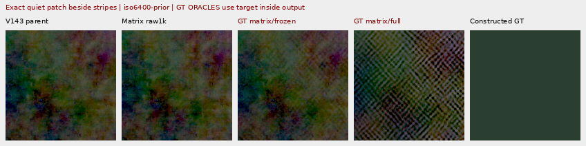
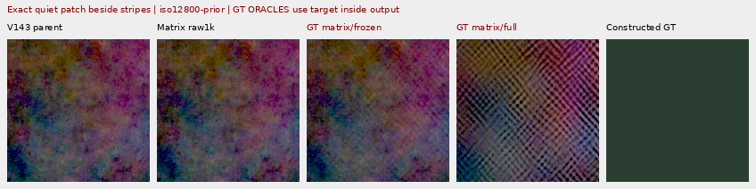
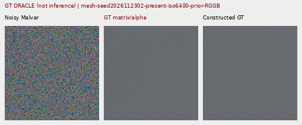
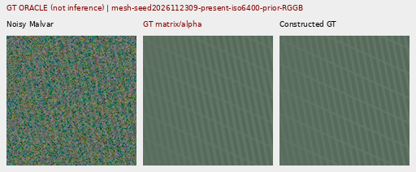
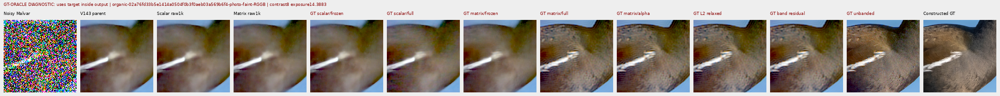
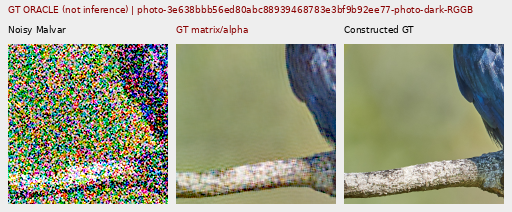

# Spectral capacity and quiet-region limits

The per-bin V148 spectral operator can express much stronger mesh and photo
corrections when supplied the exact target. Its norm bound is not the main
amplitude bottleneck on these cases. The learned estimator remains far below
that capacity, and its frozen support suppresses useful oracle corrections.
A full-support oracle also produces a false lattice in a truly flat patch
beside strong stripes. Both estimation and spatial support need attention.

**Every oracle below uses exact constructed GT inside its output calculation.**
These are diagnostic counterfactuals, unavailable at inference. Independent
per-bin matrices also relax the shared neural network's parameterization. They
do not prove that the trained network can express the witness, that the noisy
input contains enough information to infer it, or that a new model improves
real photos. With GT available, a matrix can rotate noise toward known detail.
The [completed V148 quality comparison](phase-matrix-detail.md) remains negative.

## Fixed diagnostic and results

All 792 retained constructed-target cases participate: 512 present/absent mesh,
128 photo, 120 flat and 32 strong-structure/quiet controls. All 792 original
matrix-raw predictions replay exactly before extracting their support. There
are eight fixed GT-using variants and 6,336 saved diagnostic arrays, with no
training, new noise, parent or DINO calls. Four CFA placements of a recipe are
related observations, not independent scenes. The six real contexts have no
exact GT and receive no oracle intervention.

The errors below are mean per-observation RMS in unclipped camera RGB, scaled
by 65535. Mesh response has ideal 1. The photo column is the retained512 faint
cohort. Every GT label denotes target information in output reconstruction.

| Method | Mesh response;256 | Mesh RMS;256 | Faint photo RMS;32 | ISO6400 quiet RMS;16 |
| --- | ---: | ---: | ---: | ---: |
| V143 parent |0.022021|9.11124|33.96375|3.89885|
| Learned matrix raw1k |0.020022|9.14391|33.97164|3.93960|
| GT scalar, frozen support |0.064803|8.72291|33.47026|3.93960|
| GT scalar, full support |0.289746|7.29889|31.36504|5.51688|
| GT matrix, frozen support |0.133007|8.46712|30.62802|3.78436|
| GT matrix, full support |0.716526|6.10776|19.21751|4.09614|
| GT matrix, global image alpha |0.712837|6.10769|19.21751|4.09040|
| GT relaxed L2, full support |0.766082|5.92414|18.76834|3.96015|
| GT band-only residual |0.835293|5.86881|19.00437|3.48504|
| GT unbanded residual |0.978880|3.65880|9.90891|2.00318|

The learned gate averages about .16 on mesh/photo inputs. Holding that gate
fixed reduces the matrix witness's response from .717 to .133; the proposal
therefore has substantial useful capacity behind the gate. This does not
contradict V147's [harmful full-support intervention](late-spectral-detail.md):
opening support on the actual learned proposal was worse. A better proposal
and better support must be learned together.

The existing input-only periodic `detail` comparator has mesh response .070898
and RMS 8.58613. It remains a useful, incomplete inference option. The stronger
GT-informed rows are not replacements for it.

Photographic band errors also fall under the oracle. For faint retained512,
relative luma-band error .824639 becomes .447391 under GT matrix/full and
.125849 under GT unbanded residual. Faint organic384 goes .924117→.510161→.163771.
Native views expose remaining checker/color/ringing artifacts along boundaries.
Even an unbanded target residual through fixed CFA sampling and signed Malvar
cannot reproduce every RGB detail.

The native512 ISO6400 flat RMS falls 18.54681→15.77383 under GT matrix/full,
but coarse block32 error barely changes, 13.44056→13.36192. Unbanded target
residual reduces these further to 11.65470 and 9.56070. Excluded low frequencies,
affine components and fixed RGB interpolation leave substantial residual error.

## Quiet error and correction energy are different

Inside the exact blank masks of the 256 present mesh cases, the matrix oracle
makes larger corrections while reducing actual error:

| Method | Actual blank RMS | Blank spatial RMS | Added correction RMS |
| --- | ---: | ---: | ---: |
| V143 |5.52332|5.34311|0.00000|
| Learned matrix |5.55579|5.37668|0.63867|
| GT scalar/full |5.60002|5.42139|1.38239|
| GT matrix/frozen |5.36613|5.18054|0.40266|
| GT matrix/full |5.01548|4.81654|2.47963|
| GT unbanded residual |3.36454|3.06442|4.55446|

The same point holds on absent inputs: GT matrix/full changes pixels by RMS
2.32596 but lowers actual error from 5.23791 to 4.70707. Correction energy is a
footprint metric; it can include removal of existing noise. Future reports
should retain actual blank/DC/spatial errors beside added-change measurements.
This does not make arbitrary changes in flat regions acceptable.

The mixed controls show a separate, concrete failure. Their quiet ROI is exactly
constant, next to stronger structure. On the displayed striped RGGB cases:

| Prior | Parent whole-scene /quiet RMS | GT matrix/full whole-scene /quiet RMS |
| --- | ---: | ---: |
| ISO6400 |58.85471 /3.52814|34.77377 /5.21476|
| ISO12800 |87.10782 /6.95183|45.06555 /8.62557|

Whole-image error improves strongly while a false diagonal lattice appears in
an exact quiet region. The GT-derived global MSE line search chooses alpha1 on
both examples and preserves this failure. A per-bin coefficient norm bound or
whole-context RGB improvement does not guarantee local flat safety.





Both extracts are native160×160, ROI `[80,176,160,160]`, exposure8 and diagnostic
contrast40 about the same quiet-target anchor. The source, conditioning and
unaltered pixels are bound in the manifest. Frozen matrix support reduces the
lattice; the full-support witness does not have an oracle spatial mask.

## Native GT-informed witnesses

All 48 figures were actually viewed: 38 original oracle figures, two native
quiet extracts and eight unchanged real V148 boards. Twelve unscaled sheets
plus the two individual extracts cover them. The
[manifest](images/v148-spectral-capacity-v1/manifest-v1.json) records source/ROI,
noise, exposure, common contrast/anchor, checkpoint and exact PNG hashes.
Every cell is 160×160 original pixels; no crop is resized.

These two triplets show noisy → **GT-using matrix/image-alpha diagnostic** → exact
constructed GT. Both use native512, RGGB, ROI `[176,176,160,160]`,
shot .00128/read 6.5536e-6, exposure8 and contrast1. They are the unchanged 2302
and 2309 observation recipes from V148. Crossings return, but the band-limited
shape/contrast is still imperfect.





The faint moorhen board shows much more texture under GT matrix/full, with
boundary artifacts remaining: native384, ROI `[112,112,160,160]`, exposure
14.388348 and contrast8. Source: Alexis Lours, CC BY4.0,
`02a76fd33b5e1414a0504f0b3f0aeb03a569b6f4`.



The dark bird/branch triplet uses a native512 context, ROI `[176,176,160,160]`,
exposure80.995917 and contrast1. Source: Andrew Mercer, CC BY-SA4.0,
`3e638bbb56ed80abc88939468783e3bf9b92ee77`. The photographic target is exact for
the construction from binned free imagery, not physical-scene RAW GT.



The unchanged standing real evidence includes DSCF3879/3880
[sky](images/v148-spectral-capacity-v1/unchanged-V148-real-05.png),
[building](images/v148-spectral-capacity-v1/unchanged-V148-real-06.png),
[foliage](images/v148-spectral-capacity-v1/unchanged-V148-real-07.png) and
[chain-link](images/v148-spectral-capacity-v1/unchanged-V148-real-08.png).
DSCF3842/3835 retains nominal
[left](images/v148-spectral-capacity-v1/unchanged-V148-real-09.png)/
[right](images/v148-spectral-capacity-v1/unchanged-V148-real-10.png) and fixed
profile3879 [left](images/v148-spectral-capacity-v1/unchanged-V148-real-11.png)/
[right](images/v148-spectral-capacity-v1/unchanged-V148-real-12.png), both camera
JPEGs included. These are byte-exact previous V148 boards. ISO100/AHD/JPEG
references differ in aperture, exposure time and moving subjects; they are
qualitative, **not exact GT**. No target-aware real output is constructed.

## Operators and verification

For observed CFA Y, parent camera RGB B and constructed target T, let S sample
CFA phases and A be V148's affine-removal/tapered orthonormal FFT analysis:

```text
x = A(Y) - A(S(B))
d = A(S(T)) - A(S(B))
c = existing radial band × observed-power fraction
scalar delta = x × clip(Re(xᴴd) / ||x||², -c, c)
H0 = d xᴴ / ||x||²
H = H0 / max(c, sqrt(norm1(H0) × normInf(H0)))
matrix delta = c H x
```

The matrix calculation also restricts real/imaginary entries strictly inside
1−1e-6, then applies V148's conjugate pairing and norm projection. It is a
feasible per-bin rank-one witness, not the optimal matrix under that bound.
Zero cases are handled explicitly. The L2 row projects d onto the larger ball
of radius `c||x||`; it minimizes isotropic coefficient error in that relaxation,
not training loss or RGB error. Band/unbanded residual rows remove the
innovation-amplitude restriction to probe the shared synthesis geometry.
Frozen support is held from the actual learned forward, rather than recomputed
from the changed proposal. Full support is the sigmoid-family limit. Image
alpha is a GT-only whole-context RGB MSE line search in[0,1], never fitted to a
selected crop.

The [evidence](results/v148-spectral-capacity-v1.json) preserves the fixed plan,
all outputs and source versions. Six math tests pass, including independent
NumPy formulations, singular values, zero behavior and CPU/CUDA parity.
Independent scoring checks 61,664 scalars and 812 Decimal reductions (maximum
1.59e-12), with all 2,952 retained baseline bindings/metrics matching V148.
A separate NumPy64 affine/STFT/cap/matrix/overlap/Malvar implementation checks
32 reconstructions over eight fixed cases/all four CFAs; maximum difference
1.17e-8 camera RGB. Region/line audits cover all 792 cases and 6,144 mesh rows.
Rendering independently checks 34,867,200 RGB channels; the two extracts repeat
another768,000 source channels exactly. Actual native viewing is recorded.

The source matrix raw1k export SHA256 is
`027994ba7f5bbdea83c15dcb203bfa6632cddf2a88978465e215478d0b715382`.
All 84 frozen neural files and model state remain unchanged. The diagnostic adds
792 component replay calls, no parent/DINO/noise calls or updates, with peak
allocated CUDA811,386,880 bytes. All four recorded primary workers are terminal.
The first preparation aborted on an optional metadata key before any inference;
its source/receipt remain preserved. No original media or `/mnt/dataz` is read.

The next estimator should improve input-derived coherent evidence and spatial
support jointly. Known CFA phase transport and green common/difference channels
are a concrete way to simplify that evidence before another learned gain trial.
The quiet counterexample also requires testing local safety beside strong
structure, rather than relying on coefficient contraction or overall error.
The requested real-detail/clean-sky improvement remains unachieved. See the
[timestamped diary](../diary/2026-11-03-12-57-23-spectral-capacity-oracle.md).
