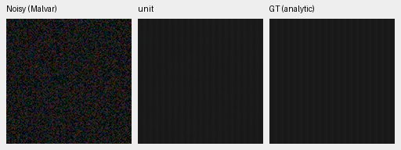
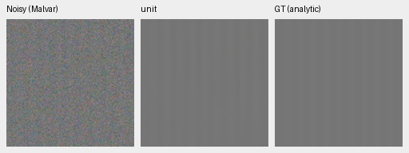

# The trained spectral gate passes little of the available carrier correction

A fixed-weight diagnosis of V89 finds an amplitude bottleneck on the two
analytic carriers: its mean scalar gates are.01282/.01986 even though the
input-only spectral mask weights at their frequencies are.78585/.85688.
The fixed unit-gate intervention restores substantially more carrier contrast.
This is a conditional inference result on known sinusoids, not an improved
trained model or a demonstrated photographic gain.

The [original4k quality review](spectral-original4k-review.md) remains closed
without promotion or extension. This follow-up keeps the genuine V89 EMA,
all46 original training modules and original analytic source/helpers fixed.
No parameter, target, inference noise prior or threshold changes. There is no
gate sweep: only the trained output, its own pre-head base, and a fixed unit
multiplier on the same measured-CFA innovation. Target/frequency enter scoring
and diagnostics only, never the spectral inference.

## Measured component behavior

Both highest-noise cases average the same sixteen CFA/draw slots. Ideal signed
carrier gain is1. Base means V89's adapted trunk immediately before its final
spectral module, not V88 or V63.

|Mean / contrast / period|Mean gate|Mean mask at carrier|Base gain|Full gain|Unit gain|
| --- | ---: | ---: | ---: | ---: | ---: |
|.01 /.10 /8px|.012821|.785848|.004573|.015141|.829319|
|.18 /.02 /16px|.019861|.856878|.287800|.300176|.910897|

The two gate ranges are[.010484,.013831] and[.019127,.020587]. The innovation
itself has mean signed gain.824745/.623097. The actual full-minus-base response
matches the per-case gate times that innovation, up to FP32 rounding. This
isolates the conditional head contribution; it does not assign the whole
matched V89−V88 training effect to that head.

Unit gating also raises noncarrier RMS:.00020285→.00020808 and
.00100799→.00101274 versus the trained output. Quadrature response changes
from−.000751/−.000292 to+.011420/+.008083. Stronger carrier contrast does not
mean every error term improves.

All32 highest-noise flat slots have zero non-DC mask support; base/full/unit
outputs are byte-identical over their complete native256 tensors. That finite
check does not establish a false-positive rate or safety on natural images.

Unconditional unit gating loses more than.05 signed gain versus the trained
output in16 of192 ADC-labelled tests (four distinct signal/layout cases;
deterministic ADC draw labels repeat). The losses are period4/high-contrast
cases and reach−.06449. A signed-gain loss is not a ranking of all error
metrics: the first failed case has gain1.00828→.94431 while RGB RMSE slightly
decreases. These results provide no basis for installing a blanket unit gate.
Every ADC contrast remains in the [independent audit](results/spectral-gate-components-array-audit-v1.json).

## Native analytic views

All variants use checkpoint
`bf6e15b8d6493a9dad491576d9da7a7a710081f234e56870009db38b779a29a3`.
These are noisy Malvar → diagnostic output → exact analytic GT. Each panel
is160×160 unchanged pixels from ROI[48,48,160,160] in the native256 field.
RGGB, original CPU noise seed20261016, shot.00256/read variance.0000262144,
WB[2,1,1.5], display exposure1/0EV and the same camera-to-sRGB transform are
shared across variants. Full matrix/source/checkpoint/PNG bindings are in the
[asset index](results/spectral-gate-components-native-assets-v1.json).

Trained V89:

Same V89 trunk before the spectral head:

Fixed unit intervention, with the same trunk/innovation:

The dark bars become clearly visible under the unit intervention. Bright bars
also strengthen, while the selected flat stays smooth. All nine triplets/fifteen
native cells were actually inspected before interpreting the component
statistics. [Complete board, including the flat](images/spectral-gate-components-native-v1.png),
[actual pre-statistics view record](results/spectral-gate-components-native-review-v1.json).

## Replay and independent arithmetic

The genuine-weight CPU hook preflight passes six small engineering batches.
The CUDA diagnosis covers all112 original carrier/flat batches:448 case slots
per mode,280 unique input samples including metadata/targets, and1792 rows
across the three interventions plus the MHC witness. ADC repetitions are not
additional independent evidence. No inference is performed on photographs,
GFX captures or protected-final data.

The final model output equals the captured spectral-module output. Direct
module replay and the full/base/gate/innovation decomposition are bitwise exact
within the new execution. Model state, genuine DINO hash and CPU/CUDA RNG stay
unchanged. The pinned DINO hash remains
`370a84c2d9e1d216757422c0a25ceb82a0a106083ba8ca545d9b267e704540fd`.
All original MHC scalar witnesses match exactly. Original neural metric replay
is bounded rather than bitwise: largest gain-family difference5.24e−7 and
largest other scalar difference1.23e−8, within the previously fixed1e−4/1e−7
bounds.

Independent NumPy normal equations and FFT/flat reductions recompute9024
metric scalars from all1344 full/base/unit array rows, with maximum1.70e−14
difference. All112 saved input fingerprints and both FP32 output decompositions
match exactly. FP64 head/mask reconstructions differ by at most1.15e−8/5.37e−7
from their FP32 execution. Compressed arrays total about800MiB and remain
outside Git; they contain generated fields, not personal captures.

[Fixed plan](results/spectral-gate-components-plan-v1.json),
[CPU preflight](results/spectral-gate-components-CPU-v1.json),
[complete CUDA diagnosis](results/spectral-gate-components-CUDA-v1.json),
[independent array audit](results/spectral-gate-components-array-audit-v1.json),
[mechanism review](results/spectral-gate-components-review-v1.json).
Executed model/worker sources and arrays remain under
`/mnt/external/demosaic/experiments/spectral-gate-components-v1/`.

The next check is the same fixed head intervention on photographic/cached GFX
inputs. Natural edges, clipping and the separately measured
[window-dependence risk](spectral-operator-context.md) can behave differently
from these stationary carriers. No serving/default/checkpoint change, training
extension or new quality promotion follows from this diagnostic. The complete
project quality and100MP/10s goals remain open.
