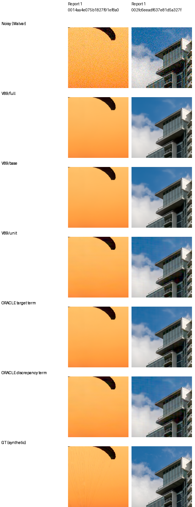
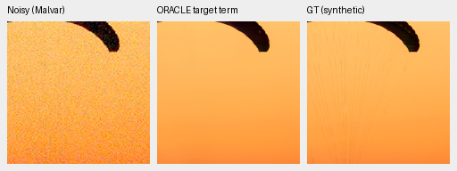
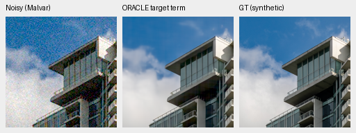
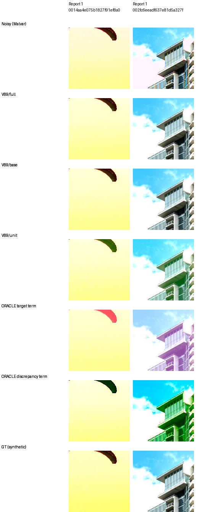

# The fixed spectral correction mixes useful detail with harmful discrepancy

A target-informed decomposition of the
[rejected photographic unit gate](spectral-photo-components.md) narrows the
failure. At high noise, the observation-to-target discrepancy carries the
visible sky grid and canopy-edge banding. Removing that term still does not
recover the canopy cords, and does not guarantee better displayed RGB. In
clipped highlights, both isolated terms produce large opposing color casts.
Their interaction matters; this is not solely a stochastic-noise failure.

This read-only CPU study uses the same saved genuine V89 step4000 arrays,
seven conditions and two source crops. It loads no learned model and performs
no training or GPU inference. Both oracle rows use exact synthetic GT inside
their output calculation. They are diagnostic counterfactuals, unavailable as
inference methods. No checkpoint, serving policy or quality gate changes.

## Conditional decomposition

Let B be V89's own pre-head base, T the target and Y the observed packed CFA.
A samples RGB at the saved CFA phases. L applies the saved observed spectral
mask, inverse orthonormal FFT and signed linear Malvar interpolation with the
same WB. The observed mask and B stay fixed throughout:

```text
s = L(A(T) − A(B))       target-derived term, uses GT
d = L(Y − A(T))          observation-to-target discrepancy, uses GT
unit = B + s + d
oracle target = B + s
oracle discrepancy = B + d
```

The discrepancy includes simulated noise and ADC effects. In highlights it
also includes the difference between physical sensor measurements and the
canonical reference-white target. Neither oracle recomputes the mask or base
on clean data. This algebra does not identify independent noise variance or a
fresh clean-input model response.

For e=B−T, the unclipped camera-RGB squared error is
`||e||² + 2<e,s> + ||s||² + 2<e,d> + ||d||² + 2<s,d>`.
All terms and the cross term are retained in the
[complete scores](results/spectral-innovation-split-scores-v1.json). The
increment from adding d after s includes `2<s,d>`; attribution depends on the
order, so component energies cannot be treated as additive causes.

## Results on the fixed two sources

These are mean **sRGB PSNR differences versus V89's own base**, in dB, over the
original border8/native240 evaluation field. They are not comparisons with
V88/V63, and differ from the previous report's unit-minus-trained baseline.
There are two sources with repeated conditions, not fourteen independent scenes.

| Condition | Unit | GT oracle target term | GT oracle discrepancy term |
| --- | ---: | ---: | ---: |
| ADC only | +0.8183 | +0.8183 | −0.0001 |
| ISO100 prior | −1.4659 | −0.7246 | −1.4200 |
| ISO1600 prior | −2.7877 | −0.3168 | −3.4969 |
| ISO12800 prior | −2.6233 | −0.1536 | −3.4571 |
| Shadows | −1.8665 | +0.4918 | −2.8149 |
| Highlights | −6.3140 | −14.9041 | −12.8167 |
| Legacy noise | −2.7949 | −0.2789 | −3.5844 |

The target-derived term reduces unclipped camera-RGB MSE on all fourteen
evaluation fields, yet loses mean sRGB PSNR in five of seven conditions.
The camera metric retains its original target/channel convention and is not
a physical-camera accuracy claim. Native crops expose the practical color
failures that the scalar camera error reduction misses.

At highest noise, discrepancy energy is 3.84/2.72 times target-term energy on
the canopy/building fields. After the target term, adding the discrepancy
increases camera MSE by .00001752/.00003278, exceeding the target-term decreases
of .00000525/.00001448. Cross terms are negative and materially affect these
numbers. The visible pattern and these conditional error increments support
rejecting the unrestricted correction on these inputs; they do not establish
a general noise-estimation law.

All fourteen complete native256 fields contract measured-CFA error under the
target term. This follows from A×Malvar being identity at measured sites and
the shared Fourier weights lying in[0,1]. It does not guarantee error reduction
at unmeasured RGB channels, inside a cropped ROI or after WB/color/display
rendering. The clipped-highlight oracle is a direct counterexample to treating
that measurement property as a displayed-color guarantee.

## Native views, inspected before scoring

All20 triplets/28 native160px cells below were actually viewed before new
quality scores were computed. Every method uses identical coordinates and the
original CPU FP32 display transform. Crop pixels are never resized. The saved
learned outputs remain FP32; component arithmetic is independent FP64. Open
the original PNGs at100% if the browser scales the page.

The highest-noise board shows trained/base/unit and both **GT-informed oracle**
rows. The discrepancy-only row retains the strong periodic sky pattern and
canopy-edge stripes. Target-only largely removes those patterns but leaves
the radial canopy cords absent:



Two small target-only oracle triplets, noisy → GT-informed diagnostic → exact
synthetic GT:





The clipped-highlight board makes the interaction explicit. Target-only turns
the canopy edge/building pink; discrepancy-only turns them green/cyan. Their
sum partially cancels these casts but remains worse than trained/base:



All crops use V89 source checkpoint SHA256
`bf6e15b8d6493a9dad491576d9da7a7a710081f234e56870009db38b779a29a3`,
RGGB, original CUDA observation seed20261014, WB[2,1,1.5] and display exposure1.
Native ROI[48,48,160,160] maps to cache ROI[237,51,160,160] for the canopy and
[243,137,160,160] for the building. Highest noise uses shot.00256/read
variance.0000262144/exposure1; highlights use.00008/.0000000256/exposure4.
The [asset index](results/spectral-innovation-split-native-assets-v1.json)
contains all source, cache, matrix, checkpoint, noise, exposure and PNG bindings,
including two triplets per intervention per condition.

Sources: [Roy Egloff, Swiss Riviera canopy](https://commons.wikimedia.org/wiki/File:CH.VD.Villeneuve_2007-08-25_Vertigo-Swiss-Riviera_2392_3x2-R_4K.jpg)
and [Dietmar Rabich, Vancouver building](https://commons.wikimedia.org/wiki/File:Vancouver_(BC,_Canada),_Coal_Harbour_Seaside_Park,_Blick_in_den_Himmel_--_2022_--_2158.jpg),
[CC BY-SA4.0](https://creativecommons.org/licenses/by-sa/4.0/), modified by
binning, cropping, noise simulation and diagnostic reconstruction. The targets
are exact for the synthetic recipe, not measured RAW GT. No GFX oracle is
constructed: its independently demosaiced ISO100 reference is not exact GT.
The standing [four-region GFX result](spectral-photo-components.md#standing-gfx-captures)
and README V43 examples remain the real-photo evidence.

## Independent checks and next action

The [fixed plan](results/spectral-innovation-split-plan-v1.json) precedes
preparation and scoring. It binds66 inputs, including all46 original model
modules, helper source and seven original photo-array packages. The later
physics cleanups are excluded. The
[CPU preflight](results/spectral-innovation-split-CPU-v1.json) checks24
signed-stencil fixtures across all four CFAs and two WB settings; maximum
FP64-versus-original-FP32 difference is2.93e−8. Preparation computes no quality
statistics. [Actual native review](results/spectral-innovation-split-native-review-v1.json)
is required before scoring.

The independent reconstruction reproduces every saved innovation and unit
output within4.50e−7/4.59e−7. All84 original PSNR witnesses replay within
.00000751dB. The MSE algebra closes within1.39e−17.

The separate [Torch CPU audit](results/spectral-innovation-split-array-audit-v1.json)
checks all98 original array fields byte-for-byte. Its FP64 FFT/measured-site
replay differs by at most5.00e−16; original FP32 Malvar replay by1.24e−7. It
independently recomputes224 MSE terms and420 metric scalars: MSE differences
stay below2.78e−17 and original FP32-rendered PSNR differences below.00000241dB.
All20 source triplets/28 board cells validate. CPU RNG is unchanged and CUDA
remains uninitialized. Arrays total135.67MiB outside Git under
`/mnt/external/demosaic/experiments/spectral-innovation-split-v1/`.

The [final review](results/spectral-innovation-split-review-v1.json) keeps the
unit-gate rejection. A future quality experiment should learn joint RGB
reconstruction and noise/semantic selectivity, rather than assume a fixed
measured-CFA/Malvar innovation becomes reliable when its amplitude increases.
A matched late-DINO refinement study is a distinct hypothesis requiring its
own fixed plan and genuine engineering/trained-quality checks. No new training
recipe or target-informed inference change is installed here. SOTA, decisive
real-photo superiority and100MP/10s remain unmet/unproven.
