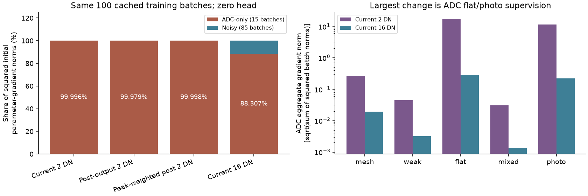

# Spectral supervision allocation: ADC pressure dominates the tested gradients

The next controlled change should test the training-loss scale. At zero
initialization, 15 ADC-only batches contribute **99.9961%** of summed
squared actual parameter-gradient norms in a balanced 100-batch probe. Peak weighting
bounded at 8 raises that share to 99.9985%; supervising the
post-output spectrum alone leaves 99.9790%. Raising the loss floor from 2
to 16 DN16 lowers it to 88.307%, with 84 of 85 noisy-batch gradients
bit-exact and maximum relative vector change 1.62095e-05 in the
remaining noisy batch. This is a diagnosis and candidate objective, **not an
improved denoiser** or a proof about Adam's eventual updates.

The [completed V149 comparison](coherent-phase-estimator.md) found no useful new
fine fence or photographic texture from known CFA alignment/coherence features.
All six endpoints and 66 native figures are complete. The new evidence
changes the next action from another feature/gate expansion to a matched loss
floor experiment, while keeping the protected real-photo and actual quiet-error
checks.

[Standalone vector figure](images/spectral-loss-allocation-v1/initial-parameter-allocation.svg)
and [machine evidence](results/spectral-loss-allocation-v1.json) preserve the data.

## What was measured

The probe takes the first 20 batches of each of five original V148/V149 domains,
in their original order: 100 batches / 400 old observations, 80 per domain. Fifteen
batches are ADC-only (`shot=read=0`), 85 have physical shot/read noise. This
balanced diagnostic is not the full training distribution or independent
validation. All 100 cached batch bytes/target/parent fingerprints are checked.
No source photo, original media, RAW decoding or `/mnt/dataz` access is needed.

At the fresh native matrix head, frequency outputs are zero and the spatial gate
is exactly 0.5. A free complex coefficient field therefore has the exact fixed
linear synthesis/gate/Malvar derivative of the initialized network. Its cotangent
is mapped through Hermitian matrix pairing, the existing observed-power/band
factor, and the actual initialized 48→32 frequency features to the shared output
layer. The resulting 1040-vector contains 16 real biases and 32×32 output weights.
All other parameter gradients are exactly zero at initialization. Ten complete
fresh-head forwards independently check all 12 parameter tensors under both
2/16 DN floors: 20 full autograd comparisons of the projected vector, maximum
relative L2 difference 3.08e-06.

The first frozen diagnostic measures coefficient/matrix-field gradients only.
The second repeats the same fixed cohort and adds the actual parameter
projection plus a 16 DN floor. Every original coefficient scalar is independently
checked against the first run; maximum difference 0. Summed squared
batch-gradient norms describe magnitude allocation, not gradient direction,
parameter displacement, optimizer influence or learned-model quality.

## Matched loss alternatives at initialization

All terms retain the old domain weights, RGB pixel/gradient Charbonnier errors
and spectral weight .25. The current objective supervises the spectrum before
the gate. The post-output variant instead analyzes the sampled final RGB output
against the sampled exact target. Peak weighting multiplies that spectral error
by `1+7*r/(1+r)`, where `r` is clean four-phase FFT power divided by the sum of
floored frame-noise proxies. The weight stays in [1,8] with no normalization that
weakens flat penalties. That proxy is not calibrated SNR, and high power does
not specifically identify faint noisy detail.

The 16 DN candidate preserves the current pre-gate objective and changes only
the common training floor: per-image RGB standard-deviation floor 2→16 DN16 and
per-phase spectral variance floor `(2/65535)^2`→`(16/65535)^2`. Physical noise
inputs, forward processing, architecture and constants remain unchanged. The
larger floor reduces ADC pressure; it does not remove ADC training or guarantee
ADC quality. A constant target need not describe every ADC example: the flat
domain also contains slopes, and photographic ADC inputs retain real texture.

| Objective | ADC gradient norm aggregate | Noisy aggregate | ADC squared-norm share |
| --- | ---: | ---: | ---: |
|Current 2 DN|20.9880289|0.1317564|99.9961%|
|Post-output 2 DN|8.4472915|0.1225111|99.9790%|
|Peak-weighted post 2 DN|46.3428760|0.1819801|99.9985%|
|Current 16 DN|0.3620776|0.1317564|88.3068%|

Aggregates are `sqrt(sum_batch ||gradient||²)`, not the norm of an averaged
gradient. The next table separates the source domains. It uses exactly the
same projected parameter gradients and batch counts.

| Domain | ADC/noisy batches | Current ADC norm | Current noisy norm | 16 DN ADC norm | 16 DN noisy norm |
| --- | ---: | ---: | ---: | ---: | ---: |
|mesh|5/15|0.2626291|0.0710729|0.0192852|0.0710730|
|weak|1/19|0.0451150|0.0988857|0.0032260|0.0988857|
|flat|5/15|17.4935013|0.0219005|0.2853873|0.0219005|
|mixed|1/19|0.0309415|0.0222888|0.0013896|0.0222888|
|photo|3/17|11.5932223|0.0394155|0.2219685|0.0394155|

This supports testing the floor change before peak boosting. It does not show
that ADC supervision is dispensable, that 16 DN is optimal, or that a stronger
noisy gradient will recover the real mesh. The original peak-weighted and
post-output alternatives remain diagnostic, not inference additions.

## Evidence beyond the first update

The [separate full-trace audit](results/spectral-loss-training-trace-v1.json)
matches all 1,000 completed V149 training rows to cached noise metadata, for all
three heads. There are 118 ADC-only and 882 noisy batches. For the native control:

| Condition | Batches | Median logged norm | Mean |90th percentile | Maximum | Norm>1 |
| --- | ---: | ---: | ---: | ---: | ---: | ---: |
|ADC-only|118|0.298018|12.744068|6.261485|591.315063|35|
|Noisy|882|0.017676|0.025973|0.056818|0.355323|0|

ADC rows account for 97.311% of squared norm after a simple cap-at-1 proxy.
The actual clipping uses a small implementation epsilon; this proxy does not
reconstruct updates. These are real logged norms later in training, but they
still do not prove a causal explanation for missing texture. The aligned and
context traces are included in the receipt rather than substituted for a loss
control.

## Reproducibility and next test

Both frozen diagnostic runs and every source receipt remain unchanged. The
public archive has 10 byte-exact copies including the 100×13×1040 gradient array,
85 matching frozen neural hashes and both executable diagnostic versions.
Independent NumPy FP64 reduction checks 36,500 scalar values,
with 78 Decimal norm reductions and linearity checks.
Both diagnostic owners exited successfully. Total work is 20 full fresh-head
forward calls plus 100 extra frequency-hidden convolutions, zero optimizer
updates, zero new parent/DINO calls and zero new noise draws. Peak allocated
CUDA is 5.84/7.36 GiB in the coefficient/parameter runs.

Next compare fresh identical native heads with 2/16 DN floors, matched to the old
4,000 cached observations, 1,000-step horizon, seed, schedule, clipping and EMA.
Review every fixed raw/EMA endpoint against actual blank/quiet errors and the
standing GFX scenes under both mesh priors/windows/JPEGs. Add held-out sloped
ADC and faint-photo ADC controls before treating any noisy-detail gain as a
useful replacement. Constant ADC flat preservation alone cannot establish that
tradeoff. Current [model recommendations](current-model.md) and the [66 native
V149 comparisons](coherent-phase-estimator.md) retain their measured evidence.

See the [local-time diary](../diary/2026-11-03-14-43-40-spectral-loss-allocation.md).
