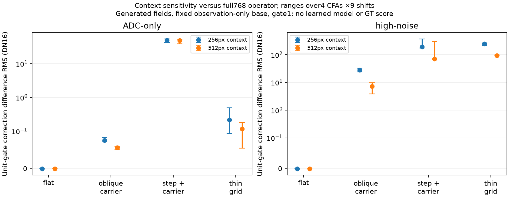

# Spectral correction depends on the surrounding window

A generated CPU check confirms context sensitivity in the spectral operator
with the noisy pixels and coarse base held identical in the compared region.
This is an operator diagnostic at a fixed unit gate, not a learned-checkpoint
evaluation, a GT score, a visibility result or a new acceptance threshold.

Four768px fixtures contain a constant field, an oblique14.5px carrier, a step
plus that carrier, and a thin oblique grid. Each uses four CFAs, ADC-only or the
existing shot.00256/read.0000262144 condition, black.03 and WB`[2,1,1.5]`.
The coarse base is one global17px box mean of observation-only Malvar RGB.
No clean target enters the correction. Each fixture/noise/CFA case uses one
seeded observation, reused across all contexts; different cases have different
draws.

Each256/512px context shifts by−32/0/+32px in each axis. All576 contexts compare
the same native ROI`[304,304,160,160]` with the correction computed from the
full768px field. Every context verifies exact common RAW, variance and base
pixels. Even origins preserve CFA phase; at least16 native pixels separate the
ROI from direct MHC border padding. Center-context repeats match byte-for-byte.
The full-context correction is a reference operator output, **not GT**.

For the high-noise cases, ranges below cover all four CFAs and nine shifts.
DN16 means65535×normalized camera RGB, without display rendering.

| Fixture |256px correction-difference RMS DN16|512px correction-difference RMS DN16|
| --- | ---: | ---: |
| Flat |0|0|
| Oblique carrier |24.18–32.33|3.88–9.78|
| Step + carrier |174.26–366.39|65.36–303.17|
| Thin grid |213.37–268.64|89.85–97.72|

The FFT frequency grid, periodic boundary, size-dependent threshold and
window-averaged variance can all change with context. Larger contexts are
closer to the full-context operator in these cases; this is not evidence of
better reconstruction quality. A common fixed scalar gate would scale these
isolated differences, but the actual learned base and gate can also vary across
contexts, so these numbers are not trained-model bounds.

The plot was actually viewed. Markers are medians and whiskers are observed
min/max ranges, not confidence intervals. All32 cases/576 rows are retained,
including the eight flat cases with zero core correction. These few flat draws
do not establish a false-discovery rate.

## Phase-mean mechanism check

If every non-DC mask coefficient were one, then in the interior the correction
would be `MHC(residual - phase_mean(residual))`. With common base/raw pixels,
the context difference would equal MHC's response to the full-minus-local
phase means. The real mask need not be one, including with the finite ADC
variance floor.

All288 ADC contexts replay exactly. On the thin-grid fixture, this phase-mean
prediction leaves only.00071–.00076DN16 RMS, versus the original.055–.489DN16
context differences. On the step fixture it leaves38.4–52.3DN16 RMS, so it does
not account for most of that fixture's difference. Removing phase-mean
subtraction is therefore not justified as a general repair by this check.
No operator, training or inference change follows.

Independent NumPy64 reductions reproduce all eight saved noisy RGGB/center
correction pairs with maximum arithmetic difference1.42e−14DN16. Four operator
module hashes match the actual frozen training package. Torch CPU RNG stays
exact and CUDA is hidden. No photograph, protected scene, DINO or learned model
is loaded. Both executed scripts and the standalone PDF/arrays remain in
`/mnt/external/demosaic/experiments/spectral-operator-context-CPU-v1/`.

[Complete probe](results/spectral-operator-context-CPU-v1.json),
[all-case summary and phase-mean audit](results/spectral-operator-context-summary-v2.json).
`scripts/probe_spectral_tile_context.py` generates the fields;
`scripts/summarize_spectral_tile_context.py` replays the ADC cases and checks
the saved arrays. The original spectral4k comparison and its fixed criteria
continue unchanged. Any eligible learned endpoint still needs actual native
and full-frame checks; this proxy cannot replace them.
