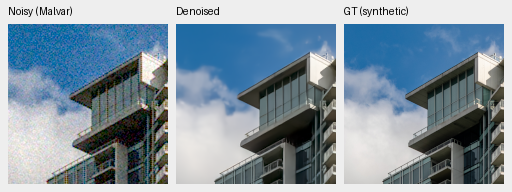
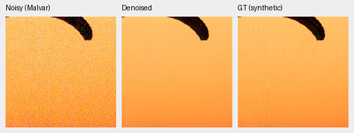
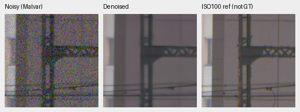
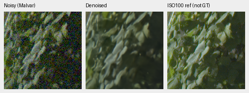
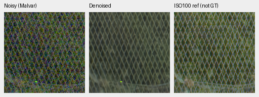
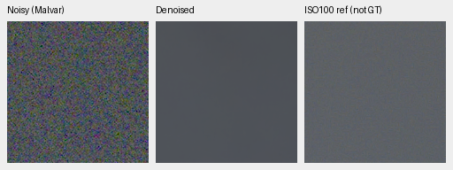
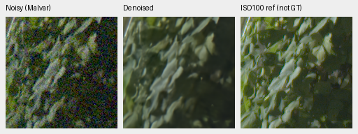

# Spectral4k: small photo gain; camera and weak-detail criteria fail

Both original4,000-update budgets and the complete review are finished. V89's
matched photographic gain over V88 is **+.00776dB**, source-bootstrap95% interval
**[+.00695,+.00851]**, with **−.000148 SSIM**. Both fixed weak-carrier gains fall
short of+.05, and both endpoints lose known-camera performance versus V63.
Neither is promoted or extended. V43 remains the working reference.

All eight fixed native boards were actually inspected before interpreting the
new quality statistics:81 source triplets/125 unchanged160px cells. Final
packaged boards match the viewed PNG bytes, including the earlier completed
camera/photo views. [Actual pre-statistics visual record](results/spectral-original4k-native-review-v1.json),
[final decision](results/spectral-original4k-final-review-v1.json), and
[complete crop/source/ROI/conditioning/exposure index](results/spectral-original4k-published-native-assets-v1.json).

## Training and evaluation boundary

| Endpoint |Checkpoint SHA256|
| --- | --- |
|V88 control4k|`d17891aa95cadfffe02dc497a96a9de3481f6044a3c270762bc014cbca0c16e4`|
|V89 spectral4k|`bf6e15b8d6493a9dad491576d9da7a7a710081f234e56870009db38b779a29a3`|
|V63 original20k parent|`ed70952dd33c5d7da39199bf1306b58b579862920fb0cccd6b222f19871bc9b5`|

Each new arm processes64,000 examples at native256/B16/BF16, seed55, strict
execution and its original4k schedule. Both use the reviewed88,508-source
Commons population, native128 captures/106 groups and paired32 scenes. V89
adds the zero-initialized68-parameter spectral gate at20× head LR; common base
LR is1e−5. This is one matched seed, not a complete corpus pass or a test that
isolates data expansion from additional training.

The [production boundary](results/spectral-original4000-training-boundary-v1.json)
verifies finite original terminal states, retained endpoints, all176 recorded
source/forward/supervision pairs,161 shared scheduled metric logs, source
archives and final Python/CPU/CUDA RNG. The control's real extra first-resume
log is preserved and its known final wrapper failure independently audited;
no additional control update was used. [Completion provenance](spectral-log-completion.md).

FP32 evaluation uses all46 modules from the actual training archive, including
the old physical-feature/VST implementations. The separate implementation
cleanup probes did not enter this comparison. The original
[experiment and criteria](spectral-v88-v89.md) are unchanged.

## Primary results

Values below are source-balanced differences. Camera panels score measured
CFA against registered low-noise RAW, using four known/five unseen scenes;
their auxiliary AHD RGB is not exact RGB GT.

| Metric |V88−V63|V89−V63|V89−V88|
| --- | ---: | ---: | ---: |
|427-photo sRGB PSNR, dB|+.25625|+.26401|+.00776|
|427-photo sRGB SSIM|+.000758|+.000610|−.000148|
|Known-camera CFA PSNR, dB|−.02141|−.02512|−.00372|
|Unseen-camera CFA PSNR, dB|+.04896|+.05082|+.00186|
|Original canonical camera-linear PSNR, dB|−2.06155|−2.05504|+.00651|

The known-camera intervals versus V63 are entirely negative:
V88[−.02635,−.01283] and V89[−.03020,−.02005]dB. V89 narrowly passes the
unseen+.05dB minimum; V88 does not. Both fail the required known-camera gain.
The canonical camera-linear loss is retained under the original target
convention; it is not relabeled as a physical real-RAW score.

The matched intervention passes its photo-PSNR/camera-nonregression numerical
screen, but this does not satisfy weak-detail or endpoint-promotion criteria.
Its photographic gain is+.02869dB in ADC-only and only+.00135dB at the
highest noise prior. The matched SSIM loss is concentrated in the synthetic
overexposure condition:−.001222 there. This is a quality tradeoff, not a
uniform improvement. All fourteen photo/procedural condition means are
[retained with the color grid](results/spectral-original4k-condition-and-color-review-v1.json).

The full427 review checks74,424 scalar rows:427 photos+16 procedurals, seven
conditions, four CFAs and six methods. Known/unseen coverage is432/540 rows,
eight/ten capture pairs and72/90 crops per method. Independent stored-scalar
summary differences are at most7.11e−15. All27 classical metric witnesses
match exactly, despite the explicit older posthoc4-ULP comparison bound.
[All primary contrasts and provenance](results/spectral-original4k-primary-statistics-v1.json).
The RAW-to-sRGB transfer used for retained RawNIND remains a benchmark
convention; its synthetic-photo deficit is not broad real-camera superiority.

The fixed418/416 source exclusions preserve the small matched effect:

|Photographic cohort|V89−V88 PSNR, dB|95% source interval|SSIM difference|
| --- | ---: | --- | ---: |
|427 original|+.007760|[+.006946,+.008511]|−.0001479|
|418 known series excluded|+.007748|[+.006995,+.008464]|−.0001513|
|416 known series/sites excluded|+.007736|[+.006925,+.008435]|−.0001519|

[Complete sensitivities](results/spectral-original4k-source-sensitivity-v1.json)
and [independent Decimal/scalar-bootstrap audit](results/spectral-original4k-source-sensitivity-audit-v1.json)
retain all81 contrasts. These source intervals do not measure training-seed,
selection, unknown capture-family or foundation/ancestor pretraining uncertainty.
This remains development evidence, not a newly independent final test.

## Weak signal, ADC and color

The two fixed highest-noise carriers use16 CFA/draw cases each:

|Mean/contrast/period|V88 signed gain|V89 signed gain|Difference|Flat RMS ratio|
| --- | ---: | ---: | ---: | ---: |
|.01/.10/8px|.004526|.015141|+.010615|.99780|
|.18/.02/16px|.283519|.300176|+.016657|1.00282|

Both gain differences miss+.05; both flat-noise limits pass. The dark carrier
is still nearly absent in the viewed outputs. All192 individual ADC contrasts
pass the−.05 loss limit, with differences[−.023701,+.024668]; all12 group means
are retained, so averaging cannot hide a failure. [Unchanged criteria and every
ADC contrast](results/spectral-original4k-numerical-criteria-v1.json).
The independent1344-row analytic audit covers448 observations per method,
84 groups and2256 stored scalar fields, with maximum2.22e−16 summary difference.
[Analytic audit](results/spectral-original4k-analytic-audit-v1.json).

Flat-color behavior is mixed. At the highest noise prior/peak.9, mean maximum
channel bias for saturation.5 is.001614/.001645 for V88/V89 versus.014350 for
V63; saturation.98 gives.001068/.001079 versus.005739. Bright gray instead
has larger mean bias:.003641/.003158 versus.001342. Selected magenta fields
look smoother in both new endpoints, without a visible spectral advantage.
These finite grid summaries are descriptive, not real-photo confidence bounds.
All54 groups are retained. All3528 saved float predictions/21,168 metric fields
and native renders pass the independent array audit (maximum5.55e−16), followed
by648 summary scalars/quantiles (maximum1.73e−18).
[Array audit](results/spectral-original4k-hue-array-audit-v1.json),
[summary audit](results/spectral-original4k-hue-summary-audit-v1.json).

## Native exact-GT triplets

Each triplet is noisy Malvar → restored → exact synthetic GT. Every panel is
an unchanged160×160 crop; RGB8 PNGs are viewing copies, not the FP32 scoring
arrays. Both sources use RGGB, shot.00256/read variance.0000262144, display
exposure1/0EV and WB[2,1,1.5], with identical camera/display transforms across
methods. The asset index records the full matrix, cache/source/checkpoint/PNG
hashes, protocol noise seed20261014 and validation seed42.

|Source in8× linear cache|Native displayed cache ROI xywh|Native256 context xywh|
| --- | --- | --- |
|Swiss Riviera canopy `0014aa4e…`|[237,51,160,160]|[189,3,256,256]|
|Vancouver building `002fc6ee…`|[243,137,160,160]|[195,89,256,256]|

V88 control:

V89 spectral:

Canopy cords remain missing and fine clouds remain soft in all four inspected
methods, including V63 and working V43. Known/unseen shelf/chart/fabric views
show no clear new spectral detail advantage. Source credits:
[Roy Egloff's Swiss Riviera photo](https://commons.wikimedia.org/wiki/File:CH.VD.Villeneuve_2007-08-25_Vertigo-Swiss-Riviera_2392_3x2-R_4K.jpg),
[Dietmar Rabich's Vancouver photo](https://commons.wikimedia.org/wiki/File:Vancouver_(BC,_Canada),_Coal_Harbour_Seaside_Park,_Blick_in_den_Himmel_--_2022_--_2158.jpg),
[CC BY-SA4.0](https://creativecommons.org/licenses/by-sa/4.0/), modified by
linear binning/crop, camera/noise simulation, restoration and rendering.
Camera development sources are [RawNIND](https://doi.org/10.14428/DVN/DEQCIM),
with retained per-scene credits/CC0 grants and independently demosaiced AHD RGB.

## Standing GFX native comparisons

The cached DSCF3879 ISO6400/DSCF3880 ISO100 pair and siblings remain outside
training. The f/5.6 ISO100 image is independently demosaiced, taken3m38s later,
and **not exact GT or a pixelwise scoring target**. Every triplet is noisy →
restored → that independent reference. Display exposure is4/+2EV, with common
shot.0014635775921166604/read variance.0000010715704128646712 conditioning.
All below are unchanged160px squares; reference alignment uses only integer
input/reference offsets, with no warping/resizing or output-dependent selection.

|Region|ISO6400 xy|ISO100 xy|
| --- | --- | --- |
|Sky|[5800,1400]|[5800,1400]|
|Building|[5790,2690]|[5791,2690]|
|Foliage|[8890,5570]|[8890,5570]|
|Chain-link fence|[2240,6000]|[2241,6000]|

V88 control:

V89 spectral:

The project models retain a more coherent fence grid than RawNIND in the
selected view, but the new endpoints look similar to V63/V43. Foliage stays
overly smooth. Fine blue-sign structure remains suppressed in all three fresh
models, and platform detail is soft. No broad real-photo superiority follows.

All final native boards: [photos](images/spectral-original4k-native-full427.png),
[known](images/spectral-original4k-early-known-five-methods.png),
[unseen](images/spectral-original4k-early-unseen-five-methods.png),
[GFX](images/spectral-original4k-native-gfx.png),
[analytic](images/spectral-original4k-native-analytic.png),
[hue](images/spectral-original4k-native-hue.png),
[extra palettes](images/spectral-original4k-native-hue-extra.png),
[highlights](images/spectral-original4k-native-highlights.png).

No new full102MP export or timing was run for these ineligible endpoints.
The README/default stays on V43. SOTA, decisive real-photo superiority and
100MP/10s remain unmet/unproven; the complete project goal remains active.
